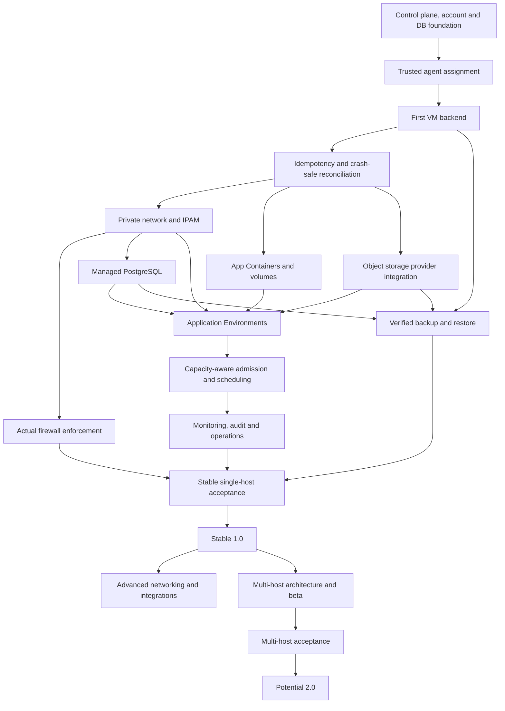

# CoveStack — Product Roadmap, Versioning and Release Scope

**Document type:** Product and engineering roadmap  
**Document version:** 1.0  
**Roadmap status:** Proposed; subject to implementation evidence and maintainer review  
**Product maturity:** Experimental  
**Product direction:** Infrastructure-only; no Labs or learning-management scope  
**License direction:** Apache License 2.0 approved by the maintainer; verify the root `LICENSE` and third-party notices before public distribution  
**Object storage:** RustFS preferred candidate, subject to CoveStack acceptance tests  
**VM backend:** Incus over QEMU/KVM is the preferred candidate to evaluate; no VM driver is currently established.

---

## 1. Executive product definition

**CoveStack is an open-source, local-first infrastructure control plane for small teams that want account-owned environments, intelligent resource scheduling, reliable provisioning, built-in security and recoverable infrastructure across their own machines.**

CoveStack aims to turn a resource request into actual infrastructure, visible lifecycle management and safe recovery without requiring each user to administer the underlying runtimes.

Its intended value is not simply that it can create VMs, containers, databases or networks. Its value is the unified workflow that connects:

1. Account and resource ownership.
2. Environment-level orchestration.
3. VM, container and Kubernetes lifecycle management.
4. Private networking and storage.
5. Capacity-aware scheduling.
6. Durable desired state and safe reconciliation.
7. Security policy and audit.
8. Backup, restoration and recovery.
9. A consistent API, CLI and later web dashboard.
10. Replaceable infrastructure providers and drivers.

CoveStack is not intended to become an AWS emulator, a hypervisor, a Kubernetes distribution, a database engine or a replacement for every existing infrastructure project. It should orchestrate mature backends behind a coherent account-aware control plane.

### 1.1 Target users

The initial target users are hypotheses to validate through pilots and user feedback:

- Small software and engineering teams.
- Developers who self-host infrastructure.
- Homelab and self-hosting users.
- DevOps and platform engineers.
- Organizations that operate their own infrastructure.
- Engineering and training labs that need account-owned environments.

CoveStack must not claim market adoption or product-market fit until real users have installed it and repeatedly used its workflows.

### 1.2 Product promise

A user should eventually be able to:

1. Install CoveStack on supported Linux infrastructure.
2. Create an account, project or workspace.
3. Request a VM, container, database or complete application environment.
4. Let CoveStack select and provision suitable resources.
5. Inspect resource status and operation history.
6. Update or stop resources through the API or CLI.
7. Recover interrupted provisioning without duplicate resources.
8. Restrict access between accounts and environments.
9. Back up and restore supported data.
10. Delete an environment without affecting unrelated or shared resources.

This is the product target, not a claim that all capabilities are already implemented.

---

## 2. Current starting point and honest status

The current project is **Experimental**.

The existing project overview records source-level foundations such as Go configuration, HMAC request signing, a bounded signed client, a cancellable single-account no-execution polling loop, Java authentication/replay components and lifecycle validators.

The same overview explicitly states that actual VM/App Container provisioning, runtime reconciliation, capacity admission, complete account-owned resource APIs, concrete credential provisioning and a foundational runnable migration chain are not yet established as a verified product.

The polling loop deliberately stops if work arrives; it does not execute resources. Existing source files, unit-test sources, builds or previous test reports do not prove infrastructure readiness.

### 2.1 Starting-point table

| Area | Starting point recorded in project overview | Roadmap implication |
|---|---|---|
| Go agent | Signed client and no-execution polling loop exist | Complete trusted assignment, claims, execution and reporting |
| Java control plane | Authentication/replay components and lifecycle validators exist | Complete runnable resource APIs and durable resource workflows |
| PostgreSQL | Intended authoritative resource and operation store | Complete foundational migrations, transaction design and tested recovery |
| VM service | No verified CoveStack VM driver | Implement and validate a real VM backend |
| App Containers | No verified end-to-end provisioning workflow | Implement a separate container driver and lifecycle |
| Networking | IPAM and network work is described in the target design | Prove address allocation and actual network enforcement |
| Object storage | Provider decision under evaluation | Validate RustFS against tenant-isolation and recovery requirements |
| Kubernetes | k3d is a target option with runtime dependencies | Add after the core resource and agent lifecycle is reliable |
| Scheduling | Proposed capacity-aware behavior | Implement measured admission and placement |
| Security | Design and component foundations exist | Prove actual API, runtime, network and credential boundaries |
| Backup/restore | Target capability | Demonstrate usable recovery, not merely backup creation |

### 2.2 Status vocabulary

Every feature in the documentation, CLI, dashboard and release notes must use an honest status:

- **Proposed:** idea or architectural option not yet approved.
- **Planned:** accepted future scope, not implemented.
- **In Progress:** implementation work has started.
- **Partially Implemented:** some behavior exists, but the complete feature is unavailable.
- **Implemented:** implementation exists, but may not have passed runtime acceptance.
- **Runtime Verified:** the feature has been exercised against its real backend.
- **Acceptance Passed:** defined acceptance tests have passed with recorded evidence.
- **Supported:** release criteria, compatibility and operational requirements have been met.
- **Deferred:** intentionally postponed.
- **Blocked:** cannot proceed until a dependency or decision is resolved.

Do not promote a feature's status based only on a class, interface, mock, diagram, configuration example or successful compilation.

---

## 3. Product principles

All releases should follow these principles.

### 3.1 Local-first, not local-only

The first supported deployment should manage infrastructure on machines controlled by the user. The architecture should not prevent future multi-host operation or additional providers.

### 3.2 Real infrastructure

A successful resource operation must correspond to a real backend resource and a verified observation. A simulated public IP, mocked container, or API record without a runtime resource is not a provisioned resource.

### 3.3 Account ownership is authoritative

Every managed resource must have an authoritative owner and a clear lifecycle. A runtime label alone is not sufficient proof of authorization.

### 3.4 Desired state is durable

PostgreSQL is the authoritative record for user intent, ownership, generations, operations and reservations. Runtime inspection is used to establish observed state, not to replace the platform's ownership database.

### 3.5 Reconciliation must be safe

Retries must not create duplicate resources. Stale workers must not overwrite newer state. Runtime actions that may have succeeded before a crash must be inspected and settled before another create/delete attempt.

### 3.6 Capacity must be measured

CoveStack must reject unsafe provisioning requests when host capacity, quotas or backend compatibility do not permit them. A development host specification is not a production capacity guarantee.

### 3.7 Security is built into lifecycle operations

Identity, authorization, network restrictions, credential custody, audit and safe deletion are part of resource provisioning—not optional decoration.

### 3.8 Backends are replaceable

CoveStack should own the control-plane resource model and orchestration. Mature external projects should provide virtualization, storage, database, registry and other execution primitives.

### 3.9 Single-host does not mean highly available

A single-host deployment has a single-host failure domain. Multi-host resilience and high availability require separate design and acceptance.

---

## 4. Service catalogue and product scope

The catalogue below defines the intended product surface. It does not imply that every service belongs in the first release.

### 4.1 Core service families

| Category | Service | Intended functionality | Initial maturity target |
|---|---|---|---|
| Compute | Compute Instances (VMs) | Create, inspect, start, stop, restart, resize and delete real VMs | Core |
| Compute | App Containers | Manage OCI containers as a separate shared-kernel resource | Core |
| Compute | Kubernetes Clusters | Create, inspect and delete local Kubernetes clusters | Core product capability; staged implementation |
| Compute | VM Images/Templates | Approved images, reusable VM configuration and initialization | Core supporting capability |
| Networking | VPC / Private Networks | Account/project-owned isolated networks | Core |
| Networking | Subnets | Address ranges and subnet reservations | Core |
| Networking | IPAM | Collision-free address allocation and reservation lifecycle | Core |
| Networking | Network Interfaces | Attach/detach and track interfaces | Core |
| Networking | Firewalls / Security Groups | Inbound/outbound rules with actual traffic enforcement | Core security capability |
| Storage | Block Volumes | Persistent volumes and attachment lifecycle | Core |
| Storage | Object Storage | Account-owned buckets, scoped credentials and S3-compatible access | Core |
| Data | Managed PostgreSQL | Persistent database, scoped credentials, readiness and backup | Core |
| Environments | Application Environments | Group resources into an owned, dependency-aware environment | Core differentiator |
| Security | IAM/RBAC | Users, accounts, roles, permissions and resource authorization | Core |
| Security | API Keys / Service Accounts | Scoped programmatic identities and revocation | Core |
| Security | Secrets Management | Protected secret storage and workload references | Core |
| Security | Audit / Events | Resource, identity, security and administrative event history | Core |
| Operations | Quotas | Per-account and per-project resource limits | Core |
| Operations | Monitoring / Health | Host, agent, backend and resource observations | Core |
| Operations | Basic Logging | Platform, agent and workload logs with redaction | Core |
| Operations | CLI / API | Consistent user-facing management interface | Core |
| Operations | Snapshot / Backup / Restore foundations | Recovery points and verified restore workflows | Core operational capability |

**Core** describes the intended product foundation. It does not mean all these services must be completed simultaneously or that they are currently implemented.

### 4.2 Future service candidates

| Category | Future service | Why it may be useful | Dependency / caution |
|---|---|---|---|
| Networking | Load Balancers | Route traffic across healthy backends | Stable networking and health checks |
| Networking | Private DNS | Resolve internal resource names | Network and resource inventory |
| Networking | DNS Management | Manage owned zones and records | Domain ownership and provider integration |
| Networking | NAT / Egress Gateway | Controlled outbound network access | Routing and firewall enforcement |
| Networking | VPN Gateway | Secure remote access to private networks | Identity, routing and key lifecycle |
| Networking | Application Gateway / Ingress | Publish selected applications | Routing, TLS and exposure policy |
| Networking | Public IP / Port Exposure | Reach selected services externally | Actual host reachability, NAT and firewall |
| Storage | File Storage | Shared NFS/SMB access | Storage backend and tenant isolation |
| Storage | Advanced Snapshot Policies | Schedule and retain snapshots | Backend snapshot semantics |
| Storage | Advanced Backup Policies | Retention, verification and restore automation | Measured recovery |
| Database | Managed Valkey | Cache and key-value workloads | Persistence, auth and operational testing |
| Database | Managed MySQL | Additional relational workload | Backup and lifecycle support |
| Database | Managed MariaDB | Additional relational workload | Backup and lifecycle support |
| Database | MongoDB-compatible service | Document database option | Demand, licensing and compatibility review |
| DevOps | Private Container Registry | Store and control OCI images | Registry credentials and image policy |
| DevOps | Artifact Registry | Store build and package artifacts | Storage, retention and access model |
| DevOps | Deployment Automation | Coordinate application rollout and rollback | Stable environment APIs |
| DevOps | Infrastructure Templates | Reusable declarative environments | Versioning and validation model |
| DevOps | TLS / Certificate Management | Manage application certificates | Gateway and domain integration |
| Security | Advanced Key Management | Managed encryption keys and rotation | Secure key custody |
| Security | Security Posture / Scanning | Detect configuration and image risks | Scanner integrations and false-positive handling |
| Compute | Kubernetes Node Pools | Manage groups of worker nodes | Kubernetes lifecycle and scheduler |
| Compute | Autoscaling Groups | Maintain desired instance count | Reliable metrics and scheduling |
| Compute | GPU Instances | GPU-backed workloads | Hardware discovery, drivers and isolation |
| Operations | Multi-host Scheduling | Place workloads across machines | Multi-host control and failure model |
| Operations | Resource Migration | Move resources across supported backends/hosts | Storage and network compatibility |
| Operations | Disaster Recovery | Recover on another host | Replication, backup and tested restore |

Future candidates are not commitments. Add them only when user demand, backend maturity and team capacity justify them.

---

## 5. Versioning policy

CoveStack should use Semantic Versioning:

`MAJOR.MINOR.PATCH`

Examples:

- `0.3.0`
- `0.6.2`
- `1.0.0`
- `1.2.0`

### 5.1 Before 1.0.0

While the project is `0.x`:

- Public APIs and configuration may evolve.
- Resource schemas may change.
- CLI commands may change.
- Runtime support may be limited.
- Breaking changes must still be documented.
- Users should be warned that the product is experimental or pre-stable.

Do not use `0.x` as an excuse to make undocumented destructive changes.

### 5.2 Version increments

| Change | Version action | Example |
|---|---|---|
| Backward-compatible feature addition | Increase MINOR | 0.4.0 → 0.5.0 |
| Backward-compatible bug/security fix | Increase PATCH | 0.5.0 → 0.5.1 |
| Breaking API or resource-model change before 1.0 | Increase MINOR and clearly document breaking change | 0.5.0 → 0.6.0 |
| Breaking change after 1.0 | Increase MAJOR | 1.4.0 → 2.0.0 |
| Preview release | Add prerelease suffix | 0.8.0-alpha.1 |
| Release candidate | Add RC suffix | 0.9.0-rc.1 |

Build metadata may be used for CI artifacts, but must not affect version precedence.

### 5.3 Prerelease naming

Use:

- `alpha`: feature incomplete or API unstable.
- `beta`: feature-complete for the intended release, with integration and user testing underway.
- `rc`: release candidate; only critical fixes should remain.
- Stable release: no prerelease suffix.

### 5.4 API versioning

Keep product versioning separate from API versioning.

Hypothetical versioning example only — not a current endpoint, route rename or approved future contract:

- Product version: `0.5.0`
- Illustrative API path: `/api/v1/...`

Current internal wire contract is **1.1.0**, with `/internal/v1/agent/...`; existing public auth registration uses `/v2` and `/kan/v1`. These prefixes do not establish complete runnable APIs. New schemas/paths/versions require coordinated base inputs, fixtures, generated outputs and Go/Java consumers. See [actual API boundaries](../docs/platform/api-and-cli.md).

A product patch release should not silently break API compatibility.

Any future API version or resource contract change must include:
- Migration notes.
- Compatibility rules.
- Client/agent compatibility.
- Database migration behavior.
- Rollback or recovery considerations.
- Deprecation policy.

### 5.5 Release artifacts

A public release should eventually contain:

- Versioned source tag.
- Release notes.
- Supported installation instructions.
- Checksums.
- Signed artifacts where practical.
- SBOM.
- Third-party notices.
- Compatibility matrix.
- Upgrade instructions.
- Known issues.

CoveStack-owned code/documentation already uses maintainer-approved [Apache-2.0](../LICENSE). Packaging must retain the root license and applicable third-party licenses/notices; adoption does not clear every dependency/image or copied-reference right.

---

## 6. Release strategy overview

This is a dependency-driven version plan, not a calendar commitment. Releases should be made when their acceptance gates pass, not on predetermined dates.

### Mandatory safety prerequisites before the first runtime resource

This remains a **Proposed** version plan; no release/version or contract change is approved by this clarification. Later milestones expand coverage, automation, recovery depth and operating profiles; they never defer the minimum controls needed for a safe earlier resource. The [canonical readiness gates](../docs/platform/readiness.md) remain authoritative.

Before the first VM or other backend mutation: persist owned desired state/generation and operation; atomically protect idempotency and capacity reservations; authenticate trusted account/host assignment and current claims; enforce exact generation/owner/epoch for convergence under an explicitly reviewed expiry policy; inspect before create and settle unknown outcomes; serialize resource actions; verify actual readiness and network/disk/access policy; retain audit/freshness/secret-safe diagnostics; and prove interrupted retry creates no duplicate or unrelated cleanup. Security, admission and basic safe recovery are prerequisites, even where richer related features appear in later version rows.

No immature runtime is exposed as a supported account-owned service to meet a version number. Unit/mock/source evidence remains separate from real acceptance. Maturity labels below are targets subject to independent evidence; a server-only foundation cannot pass the VM-dependent Alpha gate.

| Version | Name | Main objective | Maturity target |
|---|---|---|---|
| 0.1.0 | Experimental Foundation | Record current codebase baseline and developer setup | Experimental |
| 0.2.0 | Control Plane Foundation | Complete runnable identity, account and resource authority | Experimental until independent Alpha gates pass |
| 0.3.0 | VM Instances | Owned real VM lifecycle with mandatory safety prerequisites | Alpha target after readiness evidence |
| 0.4.0 | Durable Reconciliation | Broader drift, outage, concurrency and recovery conformance beyond the first-runtime safety baseline | Alpha |
| 0.5.0 | Private Networking and Isolation | Expand networks/IPAM/firewall policy; basic owned traffic isolation already required for runtime | Alpha |
| 0.6.0 | App Containers and Volumes | Separate container lifecycle and persistent block storage | Alpha |
| 0.7.0 | Managed Data Services | PostgreSQL and object storage with scoped access | Beta |
| 0.8.0 | Application Environments | Multi-resource environment orchestration | Beta |
| 0.9.0 | Capacity and Operations | Broader capacity, monitoring/logging and operator coverage; initial admission/quotas/freshness already required | Beta |
| 0.10.0 | Kubernetes and Integrations | Kubernetes lifecycle and provider extensibility | Beta |
| 0.11.0 | Hardening / Release Candidate | Security, recovery, upgrade and compatibility acceptance | RC |
| 1.0.0 | Stable Single-Host CoveStack | Supported single-host infrastructure product | Stable |
| 1.1.x | Advanced Networking | Load balancing, DNS, NAT, VPN and ingress candidates | Stable increments |
| 1.2.x | Extended Storage and Databases | File storage and additional database providers | Stable increments |
| 1.3.x | DevOps Integrations | Registry, artifacts, IaC and deployment integrations | Stable increments |
| 1.4.x | Advanced Security and Governance | SSO, advanced key management and posture integrations | Stable increments |
| 1.5.x | Multi-Host Beta | Multi-node agents, placement and host-aware scheduling | Beta |
| 2.0.0 | Multi-Host Platform | Multi-host operation after independent acceptance | Stable target |

The version numbers are planning identifiers. They may be changed if implementation dependencies or project priorities require it.

---

## 7. Detailed release specifications

## 7.1 Version 0.1.0 — Experimental Foundation

**Goal:** establish a reproducible developer baseline and accurately publish the current experimental state.

### Scope

- Documented repository setup.
- Current Java control-plane and Go-agent boundaries.
- Existing configuration loading.
- Existing HMAC signing behavior.
- Existing bounded signed client.
- Existing cancellable no-execution polling loop.
- Existing authentication/replay components and lifecycle validators where source confirms them.
- Developer setup and diagnostic instructions.
- Clear experimental-status README.
- Explicit list of missing runtime capabilities.

### Excluded

- Claims of actual VM provisioning.
- Claims of container provisioning.
- Claims of production account isolation.
- Claims of capacity admission.
- Claims of runtime reconciliation.
- Claims of verified recovery.

### Acceptance criteria

- A contributor can reproduce the documented build/test steps.
- The documented polling behavior matches source.
- Secrets are not included in examples.
- Current limitations are clear.
- No unverified quick-start claims are made.

**Release message:** CoveStack is an experimental infrastructure-control-plane codebase; it is not yet a usable provisioning platform.

---

## 7.2 Version 0.2.0 — Control Plane Foundation

**Goal:** establish the authoritative account, resource and operation model required before real runtime provisioning.

### Features

- Runnable control-plane application.
- Foundational database migrations.
- Account and membership records.
- User authentication.
- Account authorization.
- Role/permission model.
- Resource ownership model.
- Resource API validation.
- Operation records.
- Idempotency records.
- Agent registration and trusted assignment.
- Credential provisioning and revocation.
- Signed request verification.
- Replay protection.
- Sanitized error model.
- Initial CLI commands for accounts and status.
- Health endpoints for platform dependencies.

### Technical requirements

- PostgreSQL owns resource and operation state.
- Agent cannot directly modify platform database.
- User CLI cannot access privileged runtime interfaces.
- Authorization occurs before resource mutation.
- Operations have durable identifiers.
- Duplicate requests are handled predictably.
- Credential custody and rotation are documented.

### Acceptance criteria

- Fresh database migration chain succeeds.
- User and agent authentication are tested.
- Unauthorized account access is denied.
- Duplicate create requests are tested.
- Invalid, expired or replayed credentials are rejected.
- Agent assignment is verified against server-side ownership.
- Control-plane restart preserves authoritative state.

### Not included

No claim of actual VM provisioning until 0.3.0.

---

## 7.3 Version 0.3.0 — VM Instances

**Goal:** create the first real infrastructure resource managed by CoveStack.

**Prerequisite:** the mandatory safety baseline in section 6 must be implemented and verified with this first VM slice. Durable intent, idempotency, claims/fencing, actual access/capacity controls and inspect-before-create are not postponed to 0.4/0.5/0.9. Future contract and expiry decisions still require B+D+A/C review before execution.

### Features

- Compute Instance resource model.
- VM create request.
- Approved VM image selection.
- CPU and memory configuration.
- Virtual disk configuration.
- VM network attachment using the supported initial network model.
- Secure guest initialization.
- VM start.
- VM stop.
- VM restart.
- VM inspect.
- VM delete.
- Runtime resource identity mapping.
- Readiness observation.
- Basic operation history.
- Basic resource quotas.
- Initial single-host admission checks.

### Backend direction

Evaluate Incus over QEMU/KVM.

The exact Incus version, host requirements, image format, storage pool and network backend must be tested and pinned.

### Security requirements

- Only the trusted Go agent accesses the privileged Incus API.
- Tenant-facing APIs never expose the Incus socket.
- VM ownership is verified by control-plane state and runtime identity.
- Untrusted workload operations are not executed directly by the API process.
- VM resource allocation is bounded.

### Acceptance criteria

- A real VM is created.
- The guest OS boots.
- CPU, memory and disk settings are verified.
- The VM can be stopped and restarted.
- A VM can be inspected after agent restart.
- Delete affects only the owned VM.
- An unauthorized account cannot operate the VM through the CoveStack API.
- Host-capacity rejection works for an intentionally oversized request.
- Concurrent identical idempotent creates yield one owned VM and durable operation result.
- Kill the agent after backend create but before acknowledgement; inspect/resume converges to exactly one owned VM.
- Stale generation/owner/epoch cannot acknowledge the current attempt; progress never acknowledges, and the chosen expiry/renewal policy is tested.
- Unknown provider task outcome blocks conflicting create/delete; unrelated resources remain unchanged.
- Required network/disk/secret access denial and truthful health/audit are verified on the admitted profile.

**Important:** this is VM lifecycle support, not yet a production multi-tenant VM hosting guarantee.

---

## 7.4 Version 0.4.0 — Durable Reconciliation and Recovery

**Goal:** expand and harden the durable reconciliation and recovery already required for the first runtime resource.

The feature list below extends and systematizes the existing safety baseline across failure combinations, restarts, drift and services. It is not the first introduction of desired state, idempotency, claims/fencing, serialization or interrupted-create recovery.

### Features

- Desired state.
- Observed state.
- Resource generation.
- Acknowledged generation.
- Operation state.
- Claims.
- Lease acquisition and renewal.
- Fencing epochs.
- Stale-report rejection.
- Resource-level execution serialization.
- Idempotent runtime operations.
- Inspect-before-create behavior.
- Crash recovery.
- Retry behavior.
- Runtime drift detection.
- Operation timeout handling.
- Uncertain-action settlement.
- Agent shutdown and restart behavior.
- Control-plane restart recovery.

### Critical engineering rules

- A failed poll must not imply that no runtime action occurred.
- An expired claim does not prove the old runtime process stopped.
- Database fencing alone does not prevent an old worker from issuing runtime commands.
- Do not hold database transactions open during long runtime operations.
- Never create a replacement until uncertain existing work is safely inspected and settled.
- Stale worker reports must update nothing.
- Successful convergence must clear lease owner and expiry together while retaining appropriate fencing history.

### Acceptance criteria

- Kill agent before resource creation.
- Kill agent after backend creation but before acknowledgment.
- Restart the control plane during an operation.
- Submit duplicate requests.
- Send a stale generation report.
- Send a stale lease/epoch report.
- Run concurrent reconciliation attempts.
- Confirm there are no duplicate owned runtime resources.
- Confirm the final resource state matches accepted desired state.

This release should demonstrate a real end-to-end reconciliation workflow, not a mocked lifecycle.

---

## 7.5 Version 0.5.0 — Private Networking and Security Boundaries

**Goal:** provide the network foundations needed for isolated account-owned environments.

### Features

- VPC/Private Network resource.
- Subnet model.
- IPAM.
- Address reservations.
- Network interface lifecycle.
- Network attachment to supported VMs.
- Firewall/security-group model.
- Inbound policy.
- Outbound policy.
- Default-deny behavior.
- Network ownership.
- Cross-account network access denial.
- Network observation and cleanup.
- Resource dependency validation.

### Acceptance criteria

- Overlapping address allocation is prevented.
- Concurrent allocation does not produce duplicate IP reservations.
- VM networking is verified through actual interfaces and routes.
- Allowed network communication succeeds.
- Denied network communication fails.
- Unauthorized account cannot attach to or modify another account's private network.
- Cleanup releases addresses only after owned resources are safely detached or removed.
- Agent or server restart does not lose authoritative reservations.

Do not claim that a stored security-group rule is enforced until actual traffic tests prove it.

---

## 7.6 Version 0.6.0 — App Containers and Persistent Volumes

**Goal:** support a separate lightweight application workload resource.

### Features

- App Container resource.
- OCI image selection.
- Image digest tracking.
- CPU and memory limits.
- Environment configuration.
- Secret references.
- Port mapping.
- Network attachment.
- Persistent volume attachment.
- Start/stop/restart.
- Health checks.
- Inspect.
- Log access.
- Update image.
- Delete.
- Ownership and cleanup.
- Container runtime observation.

### Security boundaries

- Containers share the host kernel.
- Do not grant tenant workloads Docker daemon access.
- No arbitrary privileged containers by default.
- No unrestricted host mounts.
- Apply resource and network restrictions.
- Define the trust level for container workloads.
- Prefer VM isolation for workloads outside the documented trusted boundary.

### Acceptance criteria

- Actual OCI container starts and becomes ready.
- Volume data persists across restart.
- Container can be updated using a reviewed lifecycle.
- Failed provisioning can recover without duplicates.
- Unauthorized account cannot inspect, modify or delete another account's container.
- Cleanup removes only owned runtime artifacts.

---

## 7.7 Version 0.7.0 — Managed Data Services

**Goal:** make CoveStack useful for real application environments with persistent data.

### A. Managed PostgreSQL

Features:

- PostgreSQL instance lifecycle.
- Database initialization.
- Database and user creation.
- Scoped credentials.
- Private network access.
- Persistent storage.
- Actual SQL connection readiness.
- Start/stop/restart.
- Health observation.
- Credential rotation.
- Backup.
- Restore.
- Deletion and retention policy.

Acceptance:

- Application connects using its scoped credentials.
- Unauthorized account access is denied.
- Database data persists across restart.
- Backup is created.
- Restore returns expected rows and checksums.
- Cleanup respects data-retention policy.

### B. Object Storage

Preferred candidate: RustFS, pending CoveStack acceptance.

Features:

- Operator-managed object-storage deployment.
- Account-owned buckets.
- Scoped account/workload credentials.
- Bucket policies.
- Java-side bucket and policy reconciliation.
- Persistent object data.
- Bucket lifecycle.
- Usage observation.
- Backup and restore integration.

RustFS-specific limitations to preserve in the design:

- S3 compatibility is a documented subset, not a promise of complete AWS S3 parity.
- Do not depend on unsupported ACL authorization.
- Verify the exact bucket-policy and identity behavior required by CoveStack.
- Bucket logging and ownership-control gaps must remain documented until supported and tested.
- Pin the selected RustFS release and compatibility evidence.

### Object-storage acceptance

- Create an account-owned bucket.
- Issue scoped credentials.
- Upload and download exact object bytes.
- Reject cross-account access.
- Verify bucket policy enforcement.
- Restart the storage service and read existing data.
- Perform a real backup/restore test.
- Verify that deleting one tenant bucket does not affect another tenant or shared operator data.

Keep provider independence so another S3-compatible backend can be added later.

---

## 7.8 Version 0.8.0 — Application Environments

**Goal:** allow users to manage complete application environments as one owned unit.

### Features

- Environment resource.
- Environment definition.
- Environment-to-resource ownership mapping.
- Resource dependency representation.
- Provisioning order.
- Dependency readiness.
- Environment status.
- Environment operation history.
- Partial-failure reporting.
- Environment update.
- Safe retry.
- Environment deletion.
- Shared-resource protection.
- Environment-level audit.

### Example environment

An e-commerce environment may contain:

- Frontend VM or container.
- Backend VM or container.
- PostgreSQL.
- Object-storage bucket.
- Private network.
- Subnets/IP reservations.
- Firewall rules.
- Persistent volumes.

### Acceptance criteria

- One environment request creates the intended owned resources.
- Dependencies are ready before dependent applications start.
- Partial failures are recoverable.
- Retrying does not duplicate resources.
- Environment inspection lists all associated resources.
- Deletion removes only environment-owned resources.
- Shared operator-owned object storage and unrelated resources remain intact.
- Recovery can establish the environment's actual state after agent/control-plane restart.

Do not build an unrestricted general-purpose workflow/DAG engine unless a demonstrated requirement demands one.

---

## 7.9 Version 0.9.0 — Capacity, Monitoring and Operations

**Goal:** make single-host resource management observable and capacity-aware.

### Features

- Host registration and inventory.
- CPU discovery.
- Memory discovery.
- Disk discovery.
- Runtime capability discovery.
- Freshness-aware host observations.
- Platform reserved capacity.
- Resource reservations.
- Account quotas.
- Admission control.
- Placement decisions for supported single-host backends.
- Resource utilization.
- Agent health.
- Backend health.
- Desired versus observed state.
- Basic logs.
- Resource events.
- Audit search.
- Capacity warnings.
- Operation failure visibility.

### Scheduling rules

The scheduler must consider:

- Requested vCPU.
- Requested RAM.
- Disk requirement.
- Existing reservations.
- Platform reserve.
- Account quota.
- Backend compatibility.
- Runtime availability.
- Placement constraints.
- Freshness of host observations.

Stale capacity data must not be treated as guaranteed free capacity.

### Acceptance criteria

- Oversized requests are rejected.
- Reservations are consistent under concurrent requests.
- Account quotas are enforced.
- Stale host capacity is detected.
- Resource health and observation freshness are visible.
- Scheduling decisions are auditable.
- Agent unavailability is visible.
- A host restart does not silently lose authoritative reservations.

This release is a single-host capacity-management foundation, not yet multi-host scheduling.

---

## 7.10 Version 0.10.0 — Kubernetes and Provider Integrations

**Goal:** extend the supported infrastructure types while keeping provider boundaries stable.

### Kubernetes features

- k3d/k3s cluster lifecycle.
- Cluster create/delete/inspect.
- API endpoint reservation.
- Scoped kubeconfig export.
- Cluster readiness.
- Node and resource inventory.
- Basic quota and ownership association.
- Cluster recovery.
- Safe deletion.
- Documented Docker/runtime requirements.

### Provider architecture

- Stable provider/driver interfaces.
- Backend capability declaration.
- Backend version and compatibility reporting.
- Provider health.
- Resource identity mapping.
- Backend-specific error translation.
- Safe retry semantics.
- Provider test harness.

### Optional integrations

- Floci for local AWS API emulation.
- Registry integration.
- Infrastructure-as-Code integration candidates.

### Acceptance criteria

- Actual supported cluster is created.
- Cluster readiness is verified.
- Kubeconfig is exported only to an authorized user.
- Kubeconfig is never exposed in ordinary resource observations.
- API-port reservations prevent collisions.
- Delete removes only the owned cluster.
- Unsupported runtime conditions are rejected clearly.
- Provider-specific failures do not corrupt authoritative resource state.

---

## 7.11 Version 0.11.0 — Hardening and Release Candidate

**Goal:** prove that the supported single-host product profile is ready for stable release consideration.

### Required areas

**Installation**
- Clean installation on supported Linux profiles.
- Dependency checks.
- Runtime checks.
- Secure configuration.
- Upgrade and rollback procedures.

**Security**
- Authentication tests.
- Authorization tests.
- Cross-account denial.
- Runtime socket protection.
- Secret handling.
- Agent communication security.
- Network isolation tests.
- Administrative audit.
- Dependency scanning.
- Static analysis.
- Secret scanning.

**Reliability**
- Agent crash recovery.
- Control-plane restart recovery.
- Database restart recovery.
- Runtime interruption.
- Duplicate request tests.
- Stale worker tests.
- Backup/restore acceptance.
- Storage restart persistence.

**Operations**
- Health endpoints.
- Monitoring.
- Logs.
- Error reporting.
- Capacity benchmarks.
- Supported compatibility matrix.
- Backup instructions.
- Recovery procedures.

**Release engineering**
- Root Apache-2.0 license present.
- Third-party notices.
- Versioned release notes.
- SBOM.
- Checksums.
- Signed artifacts where practical.
- Vulnerability disclosure policy.
- Installation guide.
- Troubleshooting guide.

### Acceptance criteria

All 1.0 mandatory gates must be passed. A Release Candidate is not a stable product.

---

## 7.12 Version 1.0.0 — Stable Single-Host CoveStack

**Goal:** provide a useful, supported local infrastructure control plane for a clearly defined single-host deployment profile.

### User-visible capabilities

A new user with supported hardware should be able to:

1. Install CoveStack using documented instructions.
2. Configure the control plane and trusted agent.
3. Create users/accounts/projects according to the supported model.
4. Create a real VM Instance.
5. Create and manage an App Container.
6. Create supported private networks and firewall rules.
7. Create persistent volumes.
8. Provision managed PostgreSQL.
9. Use the supported object-storage provider.
10. Create and manage an Application Environment.
11. Inspect resources and operations through API/CLI.
12. Observe health and basic logs.
13. Recover documented interrupted operations.
14. Back up and restore supported data.
15. Delete resources safely.
16. Upgrade using supported instructions.

### Stable-release requirements

- All supported services pass their defined acceptance gates.
- Supported host profiles are measured and documented.
- No critical known data-loss or cross-account authorization defect remains.
- Backup and restoration have been tested.
- Upgrade/rollback is documented and tested.
- API and agent compatibility is documented.
- Installation is reproducible.
- Root licensing and third-party obligations are clear.
- Operational limitations are explicit.

### Explicit exclusions from 1.0 unless separately accepted

- High availability.
- Multi-host migration.
- Arbitrary public-cloud provisioning.
- Complete AWS API emulation.
- Unrestricted tenant shell/host access.
- Every database engine.
- Every storage backend.
- Full enterprise IAM/SSO.
- GPU scheduling.
- Universal workload portability.

A stable single-host release is not a claim of high availability or hostile multi-tenant certification.

---

## 8. Post-1.0 feature expansion

These are later feature increments, not prerequisites to publishing the first useful stable product.

### 8.1 Version 1.1.x — Advanced Networking

Potential additions:

- Load balancers.
- Backend pools.
- Health checks.
- Private DNS.
- DNS records and zones.
- NAT/egress gateway.
- VPN gateway.
- Application gateway/ingress.
- TLS/certificate lifecycle.
- Controlled public exposure.

Acceptance must prove real traffic routing and isolation.

### 8.2 Version 1.2.x — Extended Storage and Databases

Potential additions:

- NFS/SMB file storage.
- Advanced snapshot policies.
- Advanced backup retention.
- Managed Valkey.
- Managed MySQL.
- Managed MariaDB.
- Additional object-storage providers.
- Storage migration tools.

Do not add database engines without tested backup, restore, credential and upgrade procedures.

### 8.3 Version 1.3.x — DevOps Integrations

Potential additions:

- Private OCI registry using an evaluated project such as Harbor.
- Artifact registry.
- Terraform/OpenTofu provider.
- Ansible inventory.
- Deployment automation integrations.
- Image digest and provenance tracking.
- Image signing/verification integration.
- Infrastructure template repository.
- Environment configuration import/export.

CoveStack should integrate established CI/CD and supply-chain tools rather than implementing a full build system without demand.

### 8.4 Version 1.4.x — Advanced Security and Governance

Potential additions:

- External identity provider integration.
- SSO.
- Advanced RBAC.
- Advanced key-management provider.
- Secret rotation automation.
- Security posture reporting.
- Image vulnerability scanning.
- Policy packs.
- Advanced audit retention.
- Compliance-oriented evidence export.

### 8.5 Version 1.5.x — Multi-Host Beta

Potential additions:

- Multiple host agents.
- Host registration and trust.
- Multi-host inventory.
- Capacity-aware placement.
- Placement constraints.
- Resource reservations across hosts.
- Host drain/maintenance workflow.
- Failure detection.
- Supported workload relocation where backend and storage permit.
- Centralized audit and monitoring.

Do not imply automatic VM migration between arbitrary hosts. Disk formats, network configuration, CPU compatibility and storage availability must be considered.

This release should remain Beta until host failure, stale agent, partition and recovery tests pass.

### 8.6 Version 2.0.0 — Multi-Host Platform

Version 2.0 should be considered only after the multi-host design has passed independent acceptance.

Potential stable capabilities:

- Multi-host scheduling.
- Node capacity management.
- Host maintenance and drain.
- Supported resource relocation.
- Multi-host failure recovery.
- Centralized policy and audit.
- Documented network and storage topology.
- Multi-host installation and upgrade.
- Tested control-plane and database recovery model.

Do not promise high availability unless the control plane, database and all required dependencies have an explicitly designed and tested HA architecture.

---

## 9. Feature add-on catalogue

These features may be developed independently and should not distract from the stable core.

| Add-on | User value | Required foundation |
|---|---|---|
| Managed Valkey | Caching and key-value service | Database driver, network and backup model |
| Managed MySQL/MariaDB | Additional database choices | Tested lifecycle and restore |
| Private Registry | Store container images | Identity, storage and image controls |
| Artifact Registry | Store build and package outputs | Storage and access control |
| Load Balancer | Publish resilient application endpoints | Network and health checks |
| DNS | Stable resource naming | Network inventory and domain control |
| VPN | Secure private access | Identity, routing and key lifecycle |
| NAT/Egress | Controlled outbound access | Firewall and routing |
| File Storage | Shared filesystems | Storage backend and permissions |
| TLS Management | Application certificate lifecycle | Gateway and domain integration |
| Terraform/OpenTofu | Declarative infrastructure workflows | Stable API and idempotent lifecycle |
| Ansible Integration | Configuration management | Stable resource inventory |
| Image Scanning | Vulnerability visibility | Registry/image integration |
| Advanced KMS | Managed encryption key lifecycle | Secure key custody |
| GPU Instances | AI/ML workloads | Hardware discovery and drivers |
| Autoscaling | Maintain desired capacity | Reliable metrics and scheduler |
| Cross-host DR | Recover on another host | Verified backup and multi-host placement |

An add-on becomes a supported capability only after its own acceptance tests and security requirements pass.

---

## 10. Dependency graph

The following graph captures the important implementation order.

This is a dependency model, not a requirement that every feature be developed in a single strict sequence. Some work can proceed in parallel after its foundations are available.

---

## 11. Release acceptance framework

Every release must have explicit acceptance evidence.

## 11.1 Provisioning

- Resource actually exists in the runtime.
- Resource matches requested configuration.
- Readiness is checked.
- Resource ownership maps to authoritative control-plane state.
- Failed provisioning is observable.

## 11.2 Ownership and security

- Unauthorized requests are rejected.
- Cross-account access is denied.
- Runtime privileged sockets remain inaccessible to tenants.
- Workload credentials are scoped.
- Administrative events are audited.
- Network restrictions are verified through real traffic tests.

## 11.3 Reconciliation

- Duplicate API requests do not duplicate resources.
- Agent interruption is recoverable.
- Control-plane restart is recoverable.
- Stale generations and fencing epochs cannot overwrite current state.
- Uncertain backend actions are inspected before retry.
- Cleanup cannot delete unrelated resources.

## 11.4 Capacity

- Host resources are discovered.
- Reservations are accounted for.
- Quotas are enforced.
- Stale data is not treated as free capacity.
- Oversized requests are rejected.
- Concurrent reservations cannot over-allocate beyond the configured admission policy.

## 11.5 Backup and restore

- Backup output is produced.
- Backup integrity is checked.
- Restore is executed.
- Expected database rows and object bytes are verified.
- Restore procedure is reproducible.
- Recovery failures are reported.

## 11.6 Operational readiness

- Fresh installation works.
- Upgrade works.
- Rollback is documented.
- Supported compatibility matrix exists.
- Logs are useful and sanitized.
- Health state is accurate.
- Security and dependency checks run.
- Release artifacts and licensing notices are complete.

A test that has not been run must not be described as passed.

---

## 12. Supported deployment profiles

Do not publish one generic hardware requirement for all environments.

Define profiles based on measurements.

| Profile | Intended use | Key requirements |
|---|---|---|
| Developer profile | One developer, limited workloads | Small local installation and low concurrency |
| Single-host team profile | Multiple accounts on one server | Measured VM/container capacity, quotas, backups and access controls |
| Dedicated self-hosted profile | More sustained workloads | Tested host sizing, monitoring and recovery |
| Future multi-host profile | Multiple machines | Host trust, network/storage design, scheduler and failure testing |

The previous 8 GB sizing is a lab constraint, not a production capacity guarantee.

Do not invent VM density or concurrent workload figures.

Publish sizing guidance only after benchmarks with named hardware, guest images and workload combinations.

---

## 13. Architecture evolution and technology responsibilities

Preserve the current product-owned technology boundaries unless a reviewed decision changes them.

| Component | Technology direction | Responsibility |
|---|---|---|
| Control plane | Java / Spring Boot | Identity, account policy, API, desired state, operations and orchestration |
| Database | PostgreSQL | Authoritative ownership, resources, operations, reservations and history |
| Agent | Go | Trusted host communication, inspection and runtime operations |
| CLI | Go | User-facing API client and workflow commands |
| VM provider | Incus / QEMU / KVM candidate | Real VM lifecycle |
| Container provider | Docker or approved OCI runtime | App Container lifecycle |
| Kubernetes provider | k3d/k3s initially | Local Kubernetes cluster lifecycle |
| Object storage | RustFS preferred candidate | S3-compatible tenant buckets and object storage |
| Secrets provider | Under evaluation | Protected secret and credential custody |
| Replay protection | Valkey direction | Nonce/replay protection where required |

### 13.1 Java-to-Go evolution

- Keep the current Java control plane until a specific migration is justified.
- Build new CoveStack-owned CLI, agent, driver and scheduler modules in Go where appropriate.
- Define stable contracts before replacing owned modules.
- Migrate selectively and test behavioral equivalence.
- Do not rewrite Floci's Java internals.
- Do not make a whole-system language rewrite a prerequisite for product usefulness.

---

## 14. Licensing and open-source release policy

The maintainer has approved Apache License 2.0 as CoveStack's intended project license.

Before a stable public release:

- Ensure the complete Apache-2.0 license text exists at the repository root.
- Ensure copyright ownership and notices are accurate.
- Review third-party dependency licenses.
- Preserve external project notices.
- Add a third-party notices document where needed.
- Publish contribution and security disclosure guidance.
- Publish reproducible release information.
- Sign releases where practical.
- Publish an SBOM.
- Explain how users can report vulnerabilities.

Apache-2.0 for CoveStack does not change the licenses of RustFS, Incus, PostgreSQL, Valkey or other external components.

Do not claim legal review has occurred unless it has.

---

## 15. Explicit non-goals

CoveStack should not attempt to build all underlying technology itself.

Do not build:

- A hypervisor.
- A kernel.
- A container runtime.
- A Kubernetes distribution.
- A database engine.
- An object-storage engine.
- A full cloud API emulator.
- A complete public-cloud replacement.
- A general-purpose CI/CD service without demonstrated demand.
- An unrestricted host command execution system.

Use existing providers and integrate them behind controlled interfaces.

Do not include Labs, student exercises, instructor workflows or learning-platform features in this product roadmap.

---

## 16. Risks and decision points

| Risk | Impact | Required response |
|---|---|---|
| Incus backend complexity | Delays real VM lifecycle | Build a small VM vertical slice and test host prerequisites |
| Docker dependency for k3d | Kubernetes unavailable on some hosts | Keep Kubernetes optional until runtime prerequisites are met |
| Object-storage gaps | Tenant isolation or recovery may fail | Test RustFS policies, credential scopes, restart and restore |
| Single-host capacity | Unsafe workload placement | Measure, reserve and reject capacity |
| Privileged agent | Host compromise risk | Narrow operations and secure agent identity |
| Cross-account access bugs | Data or infrastructure exposure | Automated API, network and runtime isolation tests |
| Incomplete recovery | Data loss | Verified restore acceptance |
| Too many services | Scope expansion | Prioritize complete vertical workflows over feature count |
| Premature Go migration | Compatibility and coordination cost | Migrate only owned modules with clear contracts |
| Unsupported market differentiation | Low user adoption | Pilot with real teams and compare existing tools |
| Licensing/redistribution gaps | Release risk | Complete license and third-party review before distribution |

### Decisions still requiring evidence or approval

- Exact Incus/QEMU/KVM version and supported host profiles.
- Final object-storage provider and tested compatibility.
- Secrets and key-custody provider.
- Initial network backend and enforcement mechanism.
- Initial supported Linux distributions.
- Measured single-host capacity profiles.
- Multi-host storage and network architecture.
- Stable API and agent compatibility policy.
- Public contribution and release governance.

---

## 17. How to use this roadmap

This document is the product planning source for future infrastructure releases.

For every implementation milestone:

1. Select one bounded release capability.
2. Confirm its dependencies.
3. Create an implementation issue.
4. Define actual acceptance tests before declaring completion.
5. Implement the capability.
6. Test against the real backend.
7. Record evidence.
8. Update the feature status.
9. Update release notes and compatibility documentation.
10. Merge only after review.

Do not expand a release simply because the service catalogue contains more candidates.

The product should grow based on successful end-to-end workflows and demonstrated user needs.

---

## Final product direction

CoveStack should become a dependable local-first infrastructure control plane, not a collection of loosely connected services.

The first major success is not supporting 30 infrastructure products.

It is allowing a user to provision a real VM, give it an owned private network and persistent data, manage it through a consistent control plane, recover safely from interrupted work, and remove it without affecting other users' resources.

Build that workflow exceptionally well. Add the next service only when its lifecycle, ownership, security, capacity and recovery can be managed to the same standard.
