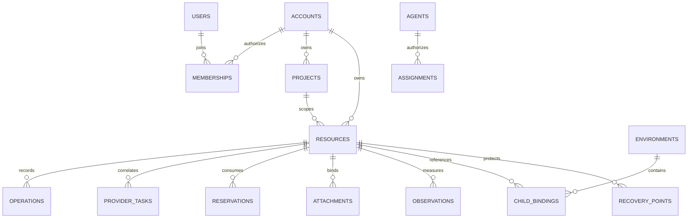

# CoveStack V5 — VM-First Database and Concurrency Design

| Document control | Value |
| --- | --- |
| Updated | 4 November 2026 |
| Authority | Detailed current product specification; aligned to the [canonical catalogue](../docs/product/CoveStack-Product-Architecture-and-Service-Catalogue.md) and [product SRS](../docs/product/CoveStack-Product-SRS.md) |
| Evidence | Target design, not a completion certificate; source and actual test results determine implementation status |
| Compatibility | V5 is a documentation label; current wire contract remains 1.1.0; future fields/kinds/versions require coordinated review |

## 1. Status and actual schema evidence

**Design reference only; not executable, not migration-ready.** B owns schema and all SQL; C reviews tenancy/secrets/tests, A agent-facing/task/network/capacity columns, D DTO/wire/IDs. PostgreSQL 17 is the current platform direction; no newer/native UUIDv7 feature is assumed. Java uses JDBC/JdbcClient, no JPA.

Existing source has Flyway declared and only V5 publication / V6 domain migrations. These reference accounts/resources prerequisites not supplied by foundational migrations in the inspected tree. No entity/repository foundation or applied live DB history was established. Do not claim this is a live schema or run the old reference DDL as a VM migration.

The prior full 32-table/extended DDL, original queries and historical alternatives are preserved in this file's snapshot. They are not silently approved for the VM-first model. This active document updates ownership/domain requirements and concurrency boundaries while final table/column/check details await B+C+A/D review.

## 2. Conventions, IDs and exact state strings

| Convention | Target / decision boundary |
| --- | --- |
| Identity | Internal UUID generated in app or approved PostgreSQL function; unique never-reused public_id; separate numeric provider_id only for bounded external mapping, B+D finalize |
| Ownership | Account-scoped owned records and explicit project policy; accounts/users/operator pools have documented global exceptions; no ownership/business keys hidden in JSON |
| Names/types | snake_case plural tables, singular columns, explicit units (memory_mb/size_gb/size_bytes), inet/cidr where appropriate; final constraints/extension requirements reviewed |
| Time/version | UTC timestamptz; created_at/updated_at/row_version on mutable records; immutable events/audit/definition versions do not get misleading mutable timestamps |
| Foreign keys | Explicit owned composite references, default RESTRICT; no cross-account relation, hidden cascade or unaudited ownership transfer |
| JSON | Versioned validated spec/observed/error shape and spec hash; typed template definitions/inputs are explicit exceptions, never plaintext secrets |
| Secrets | Hash-only API tokens; protected ciphertext/reference/key version for recoverable signing/DB/S3 material; no ordinary spec/observed secret |
| Deletion | Durable intent/tombstone/retention on owned resources; exact type semantics reviewed; physical release only after confirmed cleanup |

### 2.1 Current lifecycle catalogue — unchanged 1.1.0

| Current kind | Owner | Desired strings | Observed strings |
| --- | --- | --- | --- |
| compute.instance | agent | active, off, archive | new, provisioning, starting, active, stopping, off, deleting, archive, error |
| db.instance | agent | online, stopped, deleted | creating, starting, online, stopping, stopped, deleting, deleted, error |
| k8s.cluster | agent | active, deleted | provisioning, running, degraded, deleting, deleted, error |
| compute.group | server | active, deleted | new, active, scaling, degraded, deleting, deleted, error |
| compute.snapshot | agent | available, deleted | creating, available, deleting, deleted, error |
| network.load-balancer | agent | active, deleted | new, provisioning, active, degraded, deleting, deleted, error |
| storage.bucket | server | available, deleted | creating, available, deleting, deleted, error |


| Entity | Current state strings |
| --- | --- |
| operation | queued, running, completed, failed, cancelled |
| notification | queued, delivering, delivered, failed |


These strings are existing wire semantics, not evidence the types run. VM Instance/App Container/VPC/NIC/firewall/provider task/project names are conceptual product/schema requirements, not approved new wire kinds/states. VPC has no current wire kind; storage.bucket is server-owned. Missing states/roles/backup/engine statuses remain **TBD with B/C/D**, not guessed into CHECK constraints. No automatic legacy container archive-to-VM mapping.

## 3. Logical ERD and new product model



Relationships only: logical domains, not approved physical CREATE TABLE statements. Named concepts below may map to several reviewed tables or typed records; do not create a microservice/table per catalogue feature automatically.

## 4. Retained 32 reference-table responsibilities

| Reference name | Purpose in updated model | Columns / constraints / disposition to finalize | Owner |
| --- | --- | --- | --- |
| accounts | Ownership root / account lifecycle | uuid id; unique public_id; timestamps and row_version; tenancy root policy | B+C |
| users | Global login identity | uuid id; normalized unique email; protected password hash/algorithm; auth lifecycle; no invented tenant owner | C+B |
| account_members | Account/user authorization | Explicit account_id/user FK and reviewed role policy; uniqueness and membership revocation; project association decision | C+B |
| agents | Canonical host/agent registry | Host identity/fingerprint, approved credential/assignment relation, capability/version/heartbeat observations; max counts from tested profile | B+A/C |
| api_tokens | Opaque user API credential | Hash-only lookup; unique identifier/hash, account/user/membership binding, expiry/revocation/scopes; plaintext never stored | C+B |
| signing_credentials | Recoverable service signing secret | Unique key ID, service kind, account/agent assignment, ciphertext/key version and lifecycle; no user/agent credential swap | C+B; A |
| resources | Desired-state resource authority | Owned immutable IDs/type/schema version/name/spec_hash; generation/acked/observed revision; task/host/reservation and lease fields; sanitized errors/deletion intent | B; A/C/D |
| operations | User-visible operation/attempt | Composite owner/resource reference; idempotent request correlation/status/attempt/provider-task references and timestamps | B; C/D |
| resource_events | Append-only resource events | Owner/resource/operation/revision/time and sanitized event payload; identity ID; no mutable updated_at; app cannot UPDATE/DELETE | B+C |
| idempotency_keys | Atomic repeat-result authority | Unique account/key plus reviewed route/method fingerprint, response status/body and expiry; same transaction as resource/operation/reservations | B+C |
| resource_tags | Reviewed optional labels/tags | Scoped resource FK and unique key; user tags cannot overwrite reserved ownership labels; defer until a test/API needs it | B/D; A/C |
| volumes | Owned persistent disks | Capacity units/provider/storage ref, account/host/attachment/locality/retention and verified data lifecycle; no arbitrary host path | B+A; C |
| ssh_keys | Authorized guest access key | Account/fingerprint uniqueness, public key metadata and safe guest injection; no private key in ordinary resource rows | C+B; A |
| subnet_pool | Operator-approved allocatable ranges | Reviewed pool CIDRs/reserved routes and backend delegation; values TBD, overlap with host/VPN/runtime prevented | C+B+A |
| vpcs | Owned private network intent | Account/project identity, pool/CIDR/backend mapping/generation and dependent attachments; no product one-network/account ceiling | C+B+A |
| ip_allocations | Live interface address leases | Owner/network/interface/resource references; released_at; unique live address per network; release only after actual detach | C+B+A |
| port_allocations | Reserved endpoint allocation | Agent/host/resource/port binding before backend create; released_at and unique live host/port/resource; exact endpoint type reviewed | B+A; C |
| droplets | Historical container-specific subtype name | Do not copy as VM table: image/container_name are not guest disk/kernel semantics. Decide explicit legacy adapter/migration to VM and App Container models | B+D+A/C |
| k8s_clusters | Cluster desired/backend state | Owned resource, reviewed k3s pair/topology/capacity, reserved endpoint, provider task and kubeconfig secret reference only | B+A; C/D |
| k8s_node_pools | Later richer topology | Owned cluster/group placement/count and constraints; no historical fixed node count imposed; defer richer pool schema until supported subset needs it | B+A; C/D |
| db_instances | Managed PostgreSQL subtype | Owned resource/volume/engine image/private endpoint/credential and backup-policy reference; actual SQL readiness and scoped restore | B+A; C/D |
| buckets | Server-owned object-storage intent | Account/resource/provider/bucket identity, policy/current generation and intended deletion; operator RustFS service is separate | B Java; C |
| bucket_credentials | Scoped tenant object identity | Account/bucket or explicit policy binding, unique access key, encrypted secret/key version/lifecycle and reviewed permissions; not root keys | C+B Java |
| account_quotas | Authoritative account limits | Account/kind/dimension limit with units; usage derived from owned allocations/reservations, not independently stored twice | B+A; C |
| backups | Owned protected recovery artifact | Kind/capability/consistency/source generation, location/digest/size/key refs, retention and real verification evidence; enum absent from contract TBD | B+A; C |
| restore_jobs | Durable recovery attempts | Owned source/target/operation/attempt, consistency/key/version checks and verified outcome; no source data destroyed on failed restore | B+A; C |
| stack_templates | Typed environment definition registry | Operator/account ownership policy and allowed components; do not encode academic template-count ceiling | B+D; A/C |
| stack_template_versions | Immutable definition version | Documented definition JSON/schema hash, validated variable schema/readiness edges; append-only, no updated_at | B+D; A/C |
| stacks | Owned application environment | Account/project, definition version/nonsecret input/secret refs, operation/generation and aggregate observation | B; A/C/D |
| stack_resources | Stable child/dependency bindings | Owned environment/resource role/logical key, dependency/retention/shared-reference policy; unique binding before execution | B; A/C/D |
| audit_log | Security/admin append-only history | Actor/action/outcome/request/correlation, protected network metadata; account nullable or separate unauth event design pending; no mutable updated_at | C+B |
| mail_outbox | Optional transactional notification | Insert authorized notification in business transaction if needed; SMTP failure never rolls back resource intent; defer until actual test requires it | B+C |


### 4.1 Additional VM-first/product requirements — proposals, B finalizes

| Logical area | Required records/shape | Boundary / acceptance |
| --- | --- | --- |
| Projects/membership | Explicit account/project grants and effective authorization | Cross-project sharing must not bypass account ownership |
| Trusted assignments | Credential/account/host/agent lifecycle and enrollment/revocation | Current auth principal does not prove a registered host |
| Provider task | Async accepted operation identity, backend ownership and uncertain outcome | Parent crash/lost reply cannot launch conflicting duplicate task |
| VM subtype | Guest image/version, vCPU/memory, owned disk/NIC/initialization and provider references | Separate guest kernel/readiness; no reuse of container_name as a VM spec |
| App Container subtype | OCI image/digest, resource/trust/env-secret/health and volume/network bindings | Explicit shared-kernel boundary; forbidden sockets/root mounts |
| Images and storage attachments | Approved provenance/version, volume/snapshot and attach/locality references | No arbitrary host path/double attach; real data recovery |
| NIC/subnet/firewall | Owned association/rule revision/default-deny apply observation | Range/IP uniqueness plus actual traffic enforcement |
| Capacity/host observations | Physical budget, platform reserve, durable pending/committed reservations and ordered freshness | Concurrency cannot overspend; stale host or unknown task blocks admission/release |
| Secret/observation/log policy | Mature custody references, scoped redacted health/events/logs | Freshness is separate from acknowledgement; foreign access and key recovery tested |

No final table names/DDL/wire fields are invented for these gaps. B+D+A/C agree authoritative shape, state vocabulary, foreign keys, indexes, lock order and migration plan before code. Refer to [existing-file plan](../EXISTING-CODE-CHANGE-PLAN.md) for actual existing edit targets.

## 5. Reference DDL disposition and integrity rules

The old full CREATE TABLE set is retained **only in the historical snapshot**; it describes earlier container/MinIO/academic assumptions. Do not execute it or treat it as a migration-ready specification. New VM/project/assignment/capacity/attachment tables need coordinated fresh DDL under B ownership; no .sql file is created here.

Required invariants: unique owner/public identity; active-name uniqueness with deleted-row policy; acked_generation cannot exceed desired; live port/IP uniqueness with released_at/reuse; ownership-composite FKs; epoch/owner/expiry consistency; operator-pool containment and network overlap protection. PostgreSQL operator classes/extensions for any overlap exclusion are reviewed/tested, not assumed from a pseudocode operator.

Secret/KMS references never become business keys in JSON. App DB role is DML-only/non-superuser; migrator owns DDL, readonly role scoped; no app UPDATE/DELETE on events/audit. Optional RLS using reviewed connection-session context is defense in depth, not a replacement for account predicates. Configure reviewed per-role timeouts and verified TLS outside loopback; current local platform DB bind remains private.

## 6. Identity and unauthenticated audit

Accounts own resources; users join through memberships, agents identify trusted operator hosts and credential contexts grant specific account assignments. Issued user token lookup is hash-only; service signing material must be recoverable through protected reviewed custody. B+C decide key rotation/backup and privileged RustFS administration/private Java management path. Root/admin S3 keys are never tenant keys.

Unauthenticated failed logins have no trusted account. Choose nullable scoped audit with restricted security access versus separate security events (B+C); document tradeoff before implementation. Do not invent an account or discard failed events. Append-only/hash-linked application logs are verifiable records, not tamper-proof against a privileged administrator.

## 7. Concurrency and reference queries

### 7.1 Trusted account/host scope

One host agent may contain multiple isolated account credential/client contexts, but each authenticated discovery/claim is resolved to its stored assignment. Current key/principal fields do not settle the full host relationship. Do not accept an arbitrary request account_id/agent selector as authority. Server-side trusted context must join actual authorized assignment/host/capability before selecting work; B+C+A/D finalize the protocol and DB mapping.

READ COMMITTED plus row locks can coordinate claim/report; capacity/host quota, port and IP allocation require reviewed shared lock/advisory-lock or serializable discipline. Define lock ordering, bounded serialization/deadlock retry and canonical physical-host authority across all account contexts. No fixed two-cluster count is hardcoded into the product schema.

### 7.2 Claim sketch — non-executable design

```text
BEGIN
  resolve trusted credential -> account/host/assignment/capability from stored policy
  lock an eligible due owned resource FOR UPDATE SKIP LOCKED
  verify current desired generation and authorized nonconflicting provider task
  reserve/retain required capacity and set owner, bump epoch, set DB-time lease
  record attempt; COMMIT
```

Do not claim worker SQL lease acquisition alone fences an already-running backend task. Host/child exclusion and actual provider task settlement are mandatory before takeover; an unknown result retains reservations.

### 7.3 Exact-generation acknowledgement and separate progress

Illustrative field names are proposals, **not executable/not migration-ready**; assignment/expiry predicates must be finalized consistently by B+C+A. Exact generation/owner/epoch are mandatory. Lease-expiry acceptance/rejection details remain an explicit policy decision; do not silently implement contradictory renew/report checks.

```sql
-- Reference predicate only; no actual foundation table/column implementation implied.
UPDATE resources
SET acked_generation = :gen,
    lease_owner = NULL,
    lease_expires_at = NULL
WHERE id = :id
  AND account_id = :trusted_account_id
  AND lease_owner = :owner
  AND lease_epoch = :epoch
  AND generation = :gen;
-- Add the finalized current assignment and claim-validity predicates.
-- Keep lease_epoch unchanged; zero affected rows means not accepted.
```

Progress/health use a separate guarded ordered-observation statement and **never update acked_generation**. Apply monotonic freshness/timestamp/generation checks; stale/future reports cannot replace newer observations. Ack releases owner and expiry together to satisfy lease consistency. No >= generation shortcut; readiness is domain-specific actual evidence.

### 7.4 Atomic idempotency and admission

One transaction reserves account/key+fingerprint, inserts desired resource/operation/event/reservations, stores response and commits. Duplicate same fingerprint returns the same stored result (or follows a reviewed in-flight wait path); mismatch rejects with agreed policy, not a second resource. Resource creation and outbox intent can share a transaction if enabled; SMTP/provider calls are outside it. Capacity accounting derives authoritative reservations/allocations, not duplicate usage counters.

### 7.5 Server-owned network and RustFS reconciliation

Java owns network/IP allocation and object bucket/key/policy intent. A applies reviewed backend network/process capabilities after protocol approval; no invented VPC wire fields. RustFS service/volumes are operator-owned. Java safely inspects/recreates intended bucket/policy/key configuration and never confuses it with restoring byte data. Private administration, root custody/rotation and recovery of policies/keys need B+C/A design. All provider tasks/operations remain owner-bound and retriable without duplicates.

## 8. Data lifecycle and recovery

Deletion is authorized intent; remove owned dependencies in safe order, retain policy-governed data, confirm backend absence before releasing ports/IPs/disks/reservations and retain immutable identities/tombstones. Complete scoped inventory plus reviewed grace is required for GC; partial/time-out known IDs is not deletion authority.

Retentions and recovery objectives are TBD through measured policy, not fixed invented defaults. Back up control-plane DB/schema/assignments/tasks, keys and tenant VM/SQL/object data/config as appropriate; restore into isolated target and reconcile actual backend before enabling mutation. File-write checksum is not known-data restore proof. [Recovery](CoveStack-Operations-and-Recovery.md).

## 9. Migration policy and dependency order — proposal, B finalizes

| Order | Required slice | C acceptance before broadening |
| --- | --- | --- |
| Foundation | Identity/account/membership/agent/credentials, resource/operations/idempotency/events/audit | Real auth, clean/upgrade migration and owner constraints |
| Safe execution | Assignment/tasks/claims, VM/App Container types, images/volumes/NICs/network/IP/ports, reservations/quotas | Fencing, nonoverlap, no overspend, guest/task recovery and actual traffic |
| Data services | PostgreSQL and RustFS bucket/key/policy/backup/restore records | Actual SQL/object persistence and protected verified recovery |
| Environments/observation | Typed definition/child/sharing, useful health/logs/operations | Partial retry, no shared-data deletion and truthful freshness |
| Optional support/future | Tags/mail/pools/advanced service tables only when actual tests/API need them | Domain-specific gates and clear dependency/ownership |

Flyway is declared. Establish actual applied history and resolve V5/V6 prerequisite order before implementation; never rewrite applied migrations. Use forward-only reviewed versions, expand/contract and empty-DB/upgrade/restore notes; final migration filenames/numbers are not selected by docs. CI schema tests require a real authorized PostgreSQL 17 setup, not the old Markdown DDL.

## 10. Schema acceptance — C owns tests

Clean DB migration/upgrade; composite FK blocks foreign owner relation; live-name/port/IP uniqueness and release reuse; overlapping ranges rejected; acked <= desired; stale epoch/exact-generation report affects zero rows; progress does not ack; concurrent claims distinct; ten same-key requests one resource/response; parallel host/account admission no overspend; unauthorized event/audit mutation rejected; secret ciphertext/hash never equals plaintext fixture; unknown provider task survives restart without duplicate. Validate real keys/DB/object/VM recovery and retained deletion. Assertions must actually run, not be inferred from this schema.

## 11. Existing versus proposed / legacy disposition

| Existing source | Current fact | Proposed work |
| --- | --- | --- |
| V5__create_publications.sql | Publication table file referencing accounts/resources; not proof of a foundational chain or running gateway | Preserve applied history, establish prerequisites, review future route ownership |
| V6__create_domains.sql | Domain/proof files and constraints; no verified DNS service | Review prerequisite/claim/proof/reassignment and actual access rules |
| Java auth interfaces/filters | Account/key/kind principal, no concrete persistence/host binding foundation | Reviewed credential/member/assignment repositories and bootable API |
| Generated lifecycle catalogues | Current exact 1.1.0 strings | Versioned VM/type/claim/spec evolution with schemas/fixtures/consumers |
| Prior 32-table DDL / droplets | Historical reference, not executable VM schema | Keep unique requirements in snapshot; re-model guest/container distinction and new product ownership |

## 12. Open decisions and owners

B+C+A/D: full VM/type/protocol and relational model. B: migration history/UUID/reservations/locks/retention. C+B: custody/RLS/unauth audit and exact role policy. A+B/C: host/profile, subnet/port pool and uncertain runtime tasks. D+B: public/internal/provider IDs and DTO/schema compatibility. B+C/A: RustFS admin/client/private route/data+key restore. Missing enums remain TBD with B/D. None of these is finalized by the old full DDL or this active reference.

## Historical traceability

The [previous body of this file](../docs/archive/V5-before-full-product-alignment-2026-11-04.md#v5-covestack-database-schema) is preserved unchanged as historical reference, including earlier requirements/DDL/acceptance text. It is not current VM/RustFS setup guidance. Use this active body, the linked canonical domain specifications and [actual implementation evidence](CoveStack-Implementation-Status.md) for new work. No source, migrations, contracts, tests, configuration or runtime state is changed by this document.
