# CoveStack V5 — Database Schema Reference

| Document control        | Value                                                                   |
| ----------------------- | ----------------------------------------------------------------------- |
| Product / documentation | **CoveStack / V5**                                                      |
| Updated                 | **15 October 2026**                                                     |
| Submission deadline     | **Monday, 25 January 2027**                                             |
| Compatibility names     | Server: `kan-server`; agent: `kan-agent`                                |
| Status                  | Target design and implementation guidance; not a completion certificate |

## 1. Document control

**Reference design, B finalizes. Not executable, not migration-ready.** DDL exists only in this Markdown. No .sql/migration is created and no database is queried. Angle-bracket TBD constraints deliberately prevent treating this as executable SQL.

## 2. Scope and conventions

| Convention      | Rule                                                                                                     |
| --------------- | -------------------------------------------------------------------------------------------------------- |
| Database        | PostgreSQL 17; no newer features claimed                                                                 |
| Names           | snake_case; plural tables; singular columns; explicit unit suffixes                                      |
| Identity        | Internal uuid; application-supplied in reference; final generation strategy B                            |
| External IDs    | Unique prefixed public_id for CLI; numeric provider_id for /v2; B+D finalize prefix/mapping              |
| Dates           | timestamptz, UTC; created_at on every table; updated_at on mutable tables only                           |
| Mutable rows    | bigint row_version; optimistic checks                                                                    |
| Tenancy         | account_id NOT NULL on every tenant table; explicit composite FKs                                        |
| Deletion        | RESTRICT by default; resource soft deletion only through resources.deleted_at                            |
| JSON            | Specs/observations; documented request-result/error payloads; reviewed stack definition/inputs exception |
| Enums           | Contract 1.1.0 values only; anything missing TBD with B                                                  |
| Secret material | api_tokens hashes; signing_credentials service-kind ciphertext and key version                           |

Global records: accounts are tenancy roots; users are global login identities; agents are host registry; subnet_pool and reviewed template registries are operator-global. They are not tenant resource lists. B+C must review access and credential-to-host binding. Every owned/support record remains account-scoped. Proposed exception: audit_log may contain unauthenticated security events with no trusted account; nullable scope versus a separate security-events table remains B+C decision, not a settled schema.

JSON contains no hidden ownership/uniqueness/business keys. Resources spec/observed/last_error shapes remain in coordinated schemas; last_error contains sanitized error details. Idempotency response_body is a documented API result snapshot, not a second resource registry. Template definition contains fixed components/order/validated inputs; stack inputs contain accepted nonsecret inputs/secret references. These exceptions are explicit; no DAG engine.

### 2.1 Contract state matrix

| Kind                    | Desired state CHECK            | Phase from observed-state contract                                                             |
| ----------------------- | ------------------------------ | ---------------------------------------------------------------------------------------------- |
| `compute.instance`      | `active`, `off`, `archive`     | `new`, `provisioning`, `starting`, `active`, `stopping`, `off`, `deleting`, `archive`, `error` |
| `db.instance`           | `online`, `stopped`, `deleted` | `creating`, `starting`, `online`, `stopping`, `stopped`, `deleting`, `deleted`, `error`        |
| `k8s.cluster`           | `active`, `deleted`            | `provisioning`, `running`, `degraded`, `deleting`, `deleted`, `error`                          |
| `compute.group`         | `active`, `deleted`            | `new`, `active`, `scaling`, `degraded`, `deleting`, `deleted`, `error`                         |
| `compute.snapshot`      | `available`, `deleted`         | `creating`, `available`, `deleting`, `deleted`, `error`                                        |
| `network.load-balancer` | `active`, `deleted`            | `new`, `provisioning`, `active`, `degraded`, `deleting`, `deleted`, `error`                    |
| `storage.bucket`        | `available`, `deleted`         | `creating`, `available`, `deleting`, `deleted`, `error`                                        |

Resources phase is the proposed relational name for the existing observed-state vocabulary, not a new wire field. Kind-specific acknowledgment mapping remains authoritative; correct phase plus runtime readiness is required before acknowledgment. db.instance reserved states resizing/migrating/forking are excluded. Shared resources CHECK includes known extended kinds for future design, but CORE-5 APIs admit only the core subset; no extended service is thereby available.

VPC is server-owned in a separate record because no VPC contract kind exists. desired_state/phase are TBD with B; network attachment message changes require B+A coordination. Buckets remain server-owned; the agent's generic driver only runs MinIO.

Operation states: queued, running, completed, failed, cancelled. Mail states: queued, delivering, delivered, failed. Present/absent and in_progress/errored are rejected substitutions. New role/status/engine/backup enums are unresolved rather than guessed. Signing kind service is explicitly approved and matches the inspected filter.

## 3. ERD — Layer 1 reference

The ERD includes every Layer 1 table. **Relationships only; columns are in section 4.** It is reference structure, not deployed schema. Mermaid-aware rendering is needed; existing print helpers are not modified in this batch.

```mermaid
erDiagram
    accounts ||--o{ account_members : "account_id"
    users ||--o{ account_members : "user_id"
    accounts ||--o{ api_tokens : "account_id"
    users ||--o{ api_tokens : "user_id"
    accounts ||--o{ signing_credentials : "account_id"
    agents ||--o{ signing_credentials : "agent_id"
    accounts ||--o{ resources : "account_id"
    agents ||--o{ resources : "agent_id"
    agents ||--o{ resources : "lease_owner"
    accounts ||--o{ operations : "account_id"
    resources ||--o{ operations : "account_id, resource_id"
    operations ||--o{ operations : "account_id, retry_of"
    accounts ||--o{ resource_events : "account_id"
    resources ||--o{ resource_events : "account_id, resource_id"
    operations ||--o{ resource_events : "account_id, operation_id"
    accounts ||--o{ idempotency_keys : "account_id"
    resources ||--o{ idempotency_keys : "account_id, resource_id"
    accounts ||--o{ resource_tags : "account_id"
    resources ||--o{ resource_tags : "account_id, resource_id"
    accounts ||--o{ volumes : "account_id"
    accounts ||--o{ ssh_keys : "account_id"
    accounts ||--o{ vpcs : "account_id"
    agents ||--o{ vpcs : "agent_id / lease_owner"
    subnet_pool ||--o{ vpcs : "pool_id"
    accounts ||--o{ ip_allocations : "account_id"
    vpcs ||--o{ ip_allocations : "account_id, vpc_id"
    resources ||--o{ ip_allocations : "account_id, resource_id"
    accounts ||--o{ port_allocations : "account_id"
    agents ||--o{ port_allocations : "agent_id"
    resources ||--o{ port_allocations : "account_id, resource_id; live reservations only"
    accounts ||--o{ droplets : "account_id"
    resources ||--o{ droplets : "account_id, resource_id"
    vpcs ||--o{ droplets : "account_id, vpc_id"
    accounts ||--o{ k8s_clusters : "account_id"
    resources ||--o{ k8s_clusters : "account_id, resource_id"
    accounts ||--o{ k8s_node_pools : "account_id"
    k8s_clusters ||--o{ k8s_node_pools : "account_id, cluster_id"
    accounts ||--o{ db_instances : "account_id"
    resources ||--o{ db_instances : "account_id, resource_id"
    volumes ||--o{ db_instances : "account_id, volume_id"
    vpcs ||--o{ db_instances : "account_id, vpc_id"
    accounts ||--o{ buckets : "account_id"
    resources ||--o{ buckets : "account_id, resource_id"
    accounts ||--o{ bucket_credentials : "account_id"
    buckets ||--o{ bucket_credentials : "account_id, bucket_id"
    accounts ||--o{ account_quotas : "account_id"
    accounts ||--o{ backups : "account_id"
    resources ||--o{ backups : "account_id, resource_id"
    accounts ||--o{ restore_jobs : "account_id"
    backups ||--o{ restore_jobs : "account_id, backup_id"
    operations ||--o{ restore_jobs : "account_id, operation_id"
    resources ||--o{ restore_jobs : "account_id, target_resource_id"
    stack_templates ||--o{ stack_template_versions : "template_id"
    accounts ||--o{ stacks : "account_id"
    stack_template_versions ||--o{ stacks : "template_version_id"
    accounts ||--o{ stack_resources : "account_id"
    stacks ||--o{ stack_resources : "account_id, stack_id"
    resources ||--o{ stack_resources : "account_id, resource_id"
    accounts |o--o{ audit_log : "optional account_id"
    accounts ||--o{ mail_outbox : "account_id"
    resources ||--o{ mail_outbox : "account_id, resource_id"
    operations ||--o{ mail_outbox : "account_id, operation_id"
```



## 4. Layer 1 table-by-table specifications

All are **Planned**. B owns schema; C reviews tenancy/secrets and owns tests; A reviews agent-facing state/leases/ports/labels; D reviews DTO/ID alignment.

### 4.1 accounts

| Property         | Reference specification                          |
| ---------------- | ------------------------------------------------ |
| Purpose          | Account boundary; public IDs never reused        |
| Owner / layer    | B/C; Layer 1                                     |
| Status           | Planned                                          |
| Tenancy          | Operator/global identity; B+C access review      |
| PK               | `PRIMARY KEY (id)`                               |
| FK               | None specified beyond referenced policy          |
| Unique/exclusion | `UNIQUE (public_id)`                             |
| CHECK            | None specified beyond referenced policy          |
| Indexes          | PK/unique indexes; additional tuning B finalizes |

| Column        | Type / null / default                 | Purpose                                                  |
| ------------- | ------------------------------------- | -------------------------------------------------------- |
| `id`          | `uuid`; NOT NULL                      | Application-supplied identity; UUID strategy B finalizes |
| `public_id`   | `text`; NOT NULL                      | public id                                                |
| `name`        | `text`; NOT NULL                      | name                                                     |
| `created_at`  | `timestamptz`; NOT NULL DEFAULT now() | UTC creation                                             |
| `updated_at`  | `timestamptz`; NOT NULL DEFAULT now() | UTC last write; append-only records unchanged            |
| `row_version` | `bigint`; NOT NULL DEFAULT 0          | Optimistic concurrency                                   |

### 4.2 users

| Property         | Reference specification                            |
| ---------------- | -------------------------------------------------- |
| Purpose          | Global login identity; hash algorithm B+C finalize |
| Owner / layer    | C/B; Layer 1                                       |
| Status           | Planned                                            |
| Tenancy          | Operator/global identity; B+C access review        |
| PK               | `PRIMARY KEY (id)`                                 |
| FK               | None specified beyond referenced policy            |
| Unique/exclusion | `UNIQUE (email)`                                   |
| CHECK            | None specified beyond referenced policy            |
| Indexes          | PK/unique indexes; additional tuning B finalizes   |

| Column          | Type / null / default                 | Purpose                                                  |
| --------------- | ------------------------------------- | -------------------------------------------------------- |
| `id`            | `uuid`; NOT NULL                      | Application-supplied identity; UUID strategy B finalizes |
| `email`         | `citext`; NOT NULL                    | email                                                    |
| `password_hash` | `text`; NOT NULL                      | password hash                                            |
| `created_at`    | `timestamptz`; NOT NULL DEFAULT now() | UTC creation                                             |
| `updated_at`    | `timestamptz`; NOT NULL DEFAULT now() | UTC last write; append-only records unchanged            |
| `row_version`   | `bigint`; NOT NULL DEFAULT 0          | Optimistic concurrency                                   |

### 4.3 account_members

| Property         | Reference specification                                                                                                                |
| ---------------- | -------------------------------------------------------------------------------------------------------------------------------------- |
| Purpose          | Associate global user with account and role                                                                                            |
| Owner / layer    | C/B; Layer 1                                                                                                                           |
| Status           | Planned                                                                                                                                |
| Tenancy          | account_id NOT NULL                                                                                                                    |
| PK               | `PRIMARY KEY (account_id, user_id)`                                                                                                    |
| FK               | `FOREIGN KEY (account_id) REFERENCES accounts(id) ON DELETE RESTRICT`; `FOREIGN KEY (user_id) REFERENCES users(id) ON DELETE RESTRICT` |
| Unique/exclusion | `UNIQUE (account_id, user_id)`                                                                                                         |
| CHECK            | `CHECK (<TBD with B: role — membership enum absent from contract>)`                                                                    |
| Indexes          | PK/unique indexes; additional tuning B finalizes                                                                                       |

| Column        | Type / null / default                 | Purpose                                       |
| ------------- | ------------------------------------- | --------------------------------------------- |
| `account_id`  | `uuid`; NOT NULL                      | Account boundary; explicit FK                 |
| `user_id`     | `uuid`; NOT NULL                      | user id                                       |
| `role`        | `text`; NOT NULL                      | role                                          |
| `created_at`  | `timestamptz`; NOT NULL DEFAULT now() | UTC creation                                  |
| `updated_at`  | `timestamptz`; NOT NULL DEFAULT now() | UTC last write; append-only records unchanged |
| `row_version` | `bigint`; NOT NULL DEFAULT 0          | Optimistic concurrency                        |

### 4.4 agents

| Property         | Reference specification                                                                 |
| ---------------- | --------------------------------------------------------------------------------------- |
| Purpose          | Global execution-host registry; account access via signing credentials                  |
| Owner / layer    | A/B/C; Layer 1                                                                          |
| Status           | Planned                                                                                 |
| Tenancy          | Operator/global identity; B+C access review                                             |
| PK               | `PRIMARY KEY (id)`                                                                      |
| FK               | None specified beyond referenced policy                                                 |
| Unique/exclusion | `UNIQUE (host_fingerprint)`                                                             |
| CHECK            | `CHECK (max_clusters = 2)`; `CHECK (<TBD with B: status — agent presence enum absent>)` |
| Indexes          | PK/unique indexes; additional tuning B finalizes                                        |

| Column              | Type / null / default                      | Purpose                                                  |
| ------------------- | ------------------------------------------ | -------------------------------------------------------- |
| `id`                | `uuid`; NOT NULL                           | Application-supplied identity; UUID strategy B finalizes |
| `host_fingerprint`  | `text`; NOT NULL                           | host fingerprint                                         |
| `version`           | `text`; NOT NULL                           | version                                                  |
| `status`            | `text`; NOT NULL                           | status                                                   |
| `last_heartbeat_at` | `timestamptz`; NULL                        | last heartbeat at                                        |
| `capabilities`      | `text[]`; NOT NULL DEFAULT ARRAY[]::text[] | capabilities                                             |
| `max_clusters`      | `integer`; NOT NULL DEFAULT 2              | max clusters                                             |
| `created_at`        | `timestamptz`; NOT NULL DEFAULT now()      | UTC creation                                             |
| `updated_at`        | `timestamptz`; NOT NULL DEFAULT now()      | UTC last write; append-only records unchanged            |
| `row_version`       | `bigint`; NOT NULL DEFAULT 0               | Optimistic concurrency                                   |

### 4.5 api_tokens

| Property         | Reference specification                                                                                                                |
| ---------------- | -------------------------------------------------------------------------------------------------------------------------------------- |
| Purpose          | Hash-only opaque Bearer verification; no recoverable token                                                                             |
| Owner / layer    | C/B; Layer 1                                                                                                                           |
| Status           | Planned                                                                                                                                |
| Tenancy          | account_id NOT NULL                                                                                                                    |
| PK               | `PRIMARY KEY (id)`                                                                                                                     |
| FK               | `FOREIGN KEY (account_id) REFERENCES accounts(id) ON DELETE RESTRICT`; `FOREIGN KEY (user_id) REFERENCES users(id) ON DELETE RESTRICT` |
| Unique/exclusion | `UNIQUE (account_id, id)`; `UNIQUE (token_hash)`                                                                                       |
| CHECK            | `CHECK (<TBD with B: status — token eligibility enum; hash algorithm/custody B+C>)`                                                    |
| Indexes          | PK/unique indexes; additional tuning B finalizes                                                                                       |

| Column         | Type / null / default                      | Purpose                                                  |
| -------------- | ------------------------------------------ | -------------------------------------------------------- |
| `id`           | `uuid`; NOT NULL                           | Application-supplied identity; UUID strategy B finalizes |
| `account_id`   | `uuid`; NOT NULL                           | Account boundary; explicit FK                            |
| `user_id`      | `uuid`; NULL                               | user id                                                  |
| `token_hash`   | `bytea`; NOT NULL                          | token hash                                               |
| `scopes`       | `text[]`; NOT NULL DEFAULT ARRAY[]::text[] | scopes                                                   |
| `status`       | `text`; NOT NULL                           | status                                                   |
| `expires_at`   | `timestamptz`; NULL                        | expires at                                               |
| `revoked_at`   | `timestamptz`; NULL                        | revoked at                                               |
| `last_used_at` | `timestamptz`; NULL                        | last used at                                             |
| `created_at`   | `timestamptz`; NOT NULL DEFAULT now()      | UTC creation                                             |
| `updated_at`   | `timestamptz`; NOT NULL DEFAULT now()      | UTC last write; append-only records unchanged            |
| `row_version`  | `bigint`; NOT NULL DEFAULT 0               | Optimistic concurrency                                   |

### 4.6 signing_credentials

| Property         | Reference specification                                                                                                                  |
| ---------------- | ---------------------------------------------------------------------------------------------------------------------------------------- |
| Purpose          | Account-scoped encrypted KAN1 service secret                                                                                             |
| Owner / layer    | C/B; Layer 1                                                                                                                             |
| Status           | Planned                                                                                                                                  |
| Tenancy          | account_id NOT NULL                                                                                                                      |
| PK               | `PRIMARY KEY (id)`                                                                                                                       |
| FK               | `FOREIGN KEY (account_id) REFERENCES accounts(id) ON DELETE RESTRICT`; `FOREIGN KEY (agent_id) REFERENCES agents(id) ON DELETE RESTRICT` |
| Unique/exclusion | `UNIQUE (account_id, id)`; `UNIQUE (key_id)`                                                                                             |
| CHECK            | `CHECK (kind = 'service')`; `CHECK (secret_key_version > 0)`; `CHECK (<TBD with B: status — credential eligibility enum absent>)`        |
| Indexes          | PK/unique indexes; additional tuning B finalizes                                                                                         |

| Column               | Type / null / default                      | Purpose                                                  |
| -------------------- | ------------------------------------------ | -------------------------------------------------------- |
| `id`                 | `uuid`; NOT NULL                           | Application-supplied identity; UUID strategy B finalizes |
| `account_id`         | `uuid`; NOT NULL                           | Account boundary; explicit FK                            |
| `agent_id`           | `uuid`; NOT NULL                           | agent id                                                 |
| `kind`               | `text`; NOT NULL                           | kind                                                     |
| `key_id`             | `text`; NOT NULL                           | key id                                                   |
| `secret_ciphertext`  | `bytea`; NOT NULL                          | secret ciphertext                                        |
| `secret_key_version` | `integer`; NOT NULL                        | secret key version                                       |
| `scopes`             | `text[]`; NOT NULL DEFAULT ARRAY[]::text[] | scopes                                                   |
| `status`             | `text`; NOT NULL                           | status                                                   |
| `expires_at`         | `timestamptz`; NULL                        | expires at                                               |
| `revoked_at`         | `timestamptz`; NULL                        | revoked at                                               |
| `last_used_at`       | `timestamptz`; NULL                        | last used at                                             |
| `created_at`         | `timestamptz`; NOT NULL DEFAULT now()      | UTC creation                                             |
| `updated_at`         | `timestamptz`; NOT NULL DEFAULT now()      | UTC last write; append-only records unchanged            |
| `row_version`        | `bigint`; NOT NULL DEFAULT 0               | Optimistic concurrency                                   |

### 4.7 resources

| Property         | Reference specification                                                                                                                                                                                                                                                                                                                                                                                                                                                                                                                                                                                                                                                                                                                                                                                                                                                                                                                                                                                                                                                                                                                                                                                                                                                                                                                                                                                                                                                                                                                                                                                                                                                                                                                                                                                                                                                          |
| ---------------- | -------------------------------------------------------------------------------------------------------------------------------------------------------------------------------------------------------------------------------------------------------------------------------------------------------------------------------------------------------------------------------------------------------------------------------------------------------------------------------------------------------------------------------------------------------------------------------------------------------------------------------------------------------------------------------------------------------------------------------------------------------------------------------------------------------------------------------------------------------------------------------------------------------------------------------------------------------------------------------------------------------------------------------------------------------------------------------------------------------------------------------------------------------------------------------------------------------------------------------------------------------------------------------------------------------------------------------------------------------------------------------------------------------------------------------------------------------------------------------------------------------------------------------------------------------------------------------------------------------------------------------------------------------------------------------------------------------------------------------------------------------------------------------------------------------------------------------------------------------------------------------- |
| Purpose          | Authoritative kind-specific desired intent; no presence enum                                                                                                                                                                                                                                                                                                                                                                                                                                                                                                                                                                                                                                                                                                                                                                                                                                                                                                                                                                                                                                                                                                                                                                                                                                                                                                                                                                                                                                                                                                                                                                                                                                                                                                                                                                                                                     |
| Owner / layer    | B/A/C; Layer 1                                                                                                                                                                                                                                                                                                                                                                                                                                                                                                                                                                                                                                                                                                                                                                                                                                                                                                                                                                                                                                                                                                                                                                                                                                                                                                                                                                                                                                                                                                                                                                                                                                                                                                                                                                                                                                                                   |
| Status           | Planned                                                                                                                                                                                                                                                                                                                                                                                                                                                                                                                                                                                                                                                                                                                                                                                                                                                                                                                                                                                                                                                                                                                                                                                                                                                                                                                                                                                                                                                                                                                                                                                                                                                                                                                                                                                                                                                                          |
| Tenancy          | account_id NOT NULL                                                                                                                                                                                                                                                                                                                                                                                                                                                                                                                                                                                                                                                                                                                                                                                                                                                                                                                                                                                                                                                                                                                                                                                                                                                                                                                                                                                                                                                                                                                                                                                                                                                                                                                                                                                                                                                              |
| PK               | `PRIMARY KEY (id)`                                                                                                                                                                                                                                                                                                                                                                                                                                                                                                                                                                                                                                                                                                                                                                                                                                                                                                                                                                                                                                                                                                                                                                                                                                                                                                                                                                                                                                                                                                                                                                                                                                                                                                                                                                                                                                                               |
| FK               | `FOREIGN KEY (account_id) REFERENCES accounts(id) ON DELETE RESTRICT`; `FOREIGN KEY (agent_id) REFERENCES agents(id) ON DELETE RESTRICT`; `FOREIGN KEY (lease_owner) REFERENCES agents(id) ON DELETE RESTRICT`                                                                                                                                                                                                                                                                                                                                                                                                                                                                                                                                                                                                                                                                                                                                                                                                                                                                                                                                                                                                                                                                                                                                                                                                                                                                                                                                                                                                                                                                                                                                                                                                                                                                   |
| Unique/exclusion | `UNIQUE (account_id, id)`; `UNIQUE (public_id)`; `UNIQUE (provider_id)`                                                                                                                                                                                                                                                                                                                                                                                                                                                                                                                                                                                                                                                                                                                                                                                                                                                                                                                                                                                                                                                                                                                                                                                                                                                                                                                                                                                                                                                                                                                                                                                                                                                                                                                                                                                                          |
| CHECK            | `CHECK (kind IN ('compute.instance', 'db.instance', 'k8s.cluster', 'compute.group', 'compute.snapshot', 'network.load-balancer', 'storage.bucket'))`; `CHECK ((kind = 'compute.instance' AND desired_state IN ('active', 'off', 'archive')) OR (kind = 'db.instance' AND desired_state IN ('online', 'stopped', 'deleted')) OR (kind = 'k8s.cluster' AND desired_state IN ('active', 'deleted')) OR (kind = 'compute.group' AND desired_state IN ('active', 'deleted')) OR (kind = 'compute.snapshot' AND desired_state IN ('available', 'deleted')) OR (kind = 'network.load-balancer' AND desired_state IN ('active', 'deleted')) OR (kind = 'storage.bucket' AND desired_state IN ('available', 'deleted')))`; `CHECK ((kind = 'compute.instance' AND phase IN ('new', 'provisioning', 'starting', 'active', 'stopping', 'off', 'deleting', 'archive', 'error')) OR (kind = 'db.instance' AND phase IN ('creating', 'starting', 'online', 'stopping', 'stopped', 'deleting', 'deleted', 'error')) OR (kind = 'k8s.cluster' AND phase IN ('provisioning', 'running', 'degraded', 'deleting', 'deleted', 'error')) OR (kind = 'compute.group' AND phase IN ('new', 'active', 'scaling', 'degraded', 'deleting', 'deleted', 'error')) OR (kind = 'compute.snapshot' AND phase IN ('creating', 'available', 'deleting', 'deleted', 'error')) OR (kind = 'network.load-balancer' AND phase IN ('new', 'provisioning', 'active', 'degraded', 'deleting', 'deleted', 'error')) OR (kind = 'storage.bucket' AND phase IN ('creating', 'available', 'deleting', 'deleted', 'error')))`; `CHECK (generation > 0 AND acked_generation >= 0 AND acked_generation <= generation)`; `CHECK (lease_epoch >= 0 AND attempt_count >= 0)`; `CHECK (observed_generation IS NULL OR observed_generation BETWEEN 1 AND generation)`; `CHECK (lease_owner IS NULL OR lease_expires_at IS NOT NULL)` |
| Indexes          | `CREATE UNIQUE INDEX resources_live_name ON resources(account_id, kind, name) WHERE deleted_at IS NULL;`; `CREATE INDEX resources_claim ON resources(next_attempt_at, lease_expires_at, id);`                                                                                                                                                                                                                                                                                                                                                                                                                                                                                                                                                                                                                                                                                                                                                                                                                                                                                                                                                                                                                                                                                                                                                                                                                                                                                                                                                                                                                                                                                                                                                                                                                                                |

| Column                | Type / null / default                 | Purpose                                                  |
| --------------------- | ------------------------------------- | -------------------------------------------------------- |
| `id`                  | `uuid`; NOT NULL                      | Application-supplied identity; UUID strategy B finalizes |
| `account_id`          | `uuid`; NOT NULL                      | Account boundary; explicit FK                            |
| `public_id`           | `text`; NOT NULL                      | public id                                                |
| `provider_id`         | `bigint`; NULL                        | provider id                                              |
| `kind`                | `text`; NOT NULL                      | kind                                                     |
| `name`                | `text`; NOT NULL                      | name                                                     |
| `spec`                | `jsonb`; NOT NULL                     | spec                                                     |
| `spec_hash`           | `text`; NOT NULL                      | spec hash                                                |
| `generation`          | `bigint`; NOT NULL DEFAULT 1          | generation                                               |
| `acked_generation`    | `bigint`; NOT NULL DEFAULT 0          | acked generation                                         |
| `desired_state`       | `text`; NOT NULL                      | desired state                                            |
| `phase`               | `text`; NOT NULL                      | phase                                                    |
| `observed`            | `jsonb`; NULL                         | observed                                                 |
| `observed_generation` | `bigint`; NULL                        | observed generation                                      |
| `observed_at`         | `timestamptz`; NULL                   | observed at                                              |
| `agent_id`            | `uuid`; NULL                          | agent id                                                 |
| `lease_owner`         | `uuid`; NULL                          | lease owner                                              |
| `lease_epoch`         | `bigint`; NOT NULL DEFAULT 0          | lease epoch                                              |
| `lease_expires_at`    | `timestamptz`; NULL                   | lease expires at                                         |
| `attempt_count`       | `integer`; NOT NULL DEFAULT 0         | attempt count                                            |
| `next_attempt_at` | `timestamptz`; NULL | Next retry or periodic inspection; interval B+A after measurement |
| `last_error`          | `jsonb`; NULL                         | last error                                               |
| `deleted_at`          | `timestamptz`; NULL                   | deleted at                                               |
| `created_at`          | `timestamptz`; NOT NULL DEFAULT now() | UTC creation                                             |
| `updated_at`          | `timestamptz`; NOT NULL DEFAULT now() | UTC last write; append-only records unchanged            |
| `row_version`         | `bigint`; NOT NULL DEFAULT 0          | Optimistic concurrency                                   |

### 4.8 operations

| Property         | Reference specification                                                                                                                                                                                                                                               |
| ---------------- | --------------------------------------------------------------------------------------------------------------------------------------------------------------------------------------------------------------------------------------------------------------------- |
| Purpose          | Durable operation attempts; contract states only                                                                                                                                                                                                                      |
| Owner / layer    | B; Layer 1                                                                                                                                                                                                                                                            |
| Status           | Planned                                                                                                                                                                                                                                                               |
| Tenancy          | account_id NOT NULL                                                                                                                                                                                                                                                   |
| PK               | `PRIMARY KEY (id)`                                                                                                                                                                                                                                                    |
| FK               | `FOREIGN KEY (account_id) REFERENCES accounts(id) ON DELETE RESTRICT`; `FOREIGN KEY (account_id, resource_id) REFERENCES resources(account_id, id) ON DELETE RESTRICT`; `FOREIGN KEY (account_id, retry_of) REFERENCES operations(account_id, id) ON DELETE RESTRICT` |
| Unique/exclusion | `UNIQUE (account_id, id)`                                                                                                                                                                                                                                             |
| CHECK            | `CHECK (status IN ('queued', 'running', 'completed', 'failed', 'cancelled'))`; `CHECK (requested_generation > 0)`                                                                                                                                                     |
| Indexes          | `CREATE INDEX operations_resource ON operations(account_id, resource_id, created_at);`                                                                                                                                                                                |

| Column                 | Type / null / default                 | Purpose                                                  |
| ---------------------- | ------------------------------------- | -------------------------------------------------------- |
| `id`                   | `uuid`; NOT NULL                      | Application-supplied identity; UUID strategy B finalizes |
| `account_id`           | `uuid`; NOT NULL                      | Account boundary; explicit FK                            |
| `resource_id`          | `uuid`; NOT NULL                      | resource id                                              |
| `status`               | `text`; NOT NULL                      | status                                                   |
| `requested_generation` | `bigint`; NOT NULL                    | requested generation                                     |
| `retry_of`             | `uuid`; NULL                          | retry of                                                 |
| `created_at`           | `timestamptz`; NOT NULL DEFAULT now() | UTC creation                                             |
| `updated_at`           | `timestamptz`; NOT NULL DEFAULT now() | UTC last write; append-only records unchanged            |
| `row_version`          | `bigint`; NOT NULL DEFAULT 0          | Optimistic concurrency                                   |

### 4.9 resource_events

| Property         | Reference specification                                                                                                                                                                                                                                                   |
| ---------------- | ------------------------------------------------------------------------------------------------------------------------------------------------------------------------------------------------------------------------------------------------------------------------- |
| Purpose          | INSERT-only event evidence; no application update/delete                                                                                                                                                                                                                  |
| Owner / layer    | C/B; Layer 1                                                                                                                                                                                                                                                              |
| Status           | Planned                                                                                                                                                                                                                                                                   |
| Tenancy          | account_id NOT NULL                                                                                                                                                                                                                                                       |
| PK               | `PRIMARY KEY (id)`                                                                                                                                                                                                                                                        |
| FK               | `FOREIGN KEY (account_id) REFERENCES accounts(id) ON DELETE RESTRICT`; `FOREIGN KEY (account_id, resource_id) REFERENCES resources(account_id, id) ON DELETE RESTRICT`; `FOREIGN KEY (account_id, operation_id) REFERENCES operations(account_id, id) ON DELETE RESTRICT` |
| Unique/exclusion | `UNIQUE (account_id, id)`                                                                                                                                                                                                                                                 |
| CHECK            | `CHECK (<TBD with B: event_type — event names not in lifecycle contract>)`                                                                                                                                                                                                |
| Indexes          | `CREATE INDEX resource_events_resource ON resource_events(account_id, resource_id, created_at);`                                                                                                                                                                          |

| Column         | Type / null / default                           | Purpose                       |
| -------------- | ----------------------------------------------- | ----------------------------- |
| `id`           | `bigint GENERATED ALWAYS AS IDENTITY`; NOT NULL | Event identity                |
| `account_id`   | `uuid`; NOT NULL                                | Account boundary; explicit FK |
| `resource_id`  | `uuid`; NOT NULL                                | resource id                   |
| `operation_id` | `uuid`; NULL                                    | operation id                  |
| `event_type`   | `text`; NOT NULL                                | event type                    |
| `message`      | `text`; NOT NULL                                | message                       |
| `created_at`   | `timestamptz`; NOT NULL DEFAULT now()           | UTC creation                  |

### 4.10 idempotency_keys

| Property         | Reference specification                                                                                                                                                |
| ---------------- | ---------------------------------------------------------------------------------------------------------------------------------------------------------------------- |
| Purpose          | Request reservation/result written with resource insert                                                                                                                |
| Owner / layer    | B/C; Layer 1                                                                                                                                                           |
| Status           | Planned                                                                                                                                                                |
| Tenancy          | account_id NOT NULL                                                                                                                                                    |
| PK               | `PRIMARY KEY (account_id, key)`                                                                                                                                        |
| FK               | `FOREIGN KEY (account_id) REFERENCES accounts(id) ON DELETE RESTRICT`; `FOREIGN KEY (account_id, resource_id) REFERENCES resources(account_id, id) ON DELETE RESTRICT` |
| Unique/exclusion | None specified beyond referenced policy                                                                                                                                |
| CHECK            | `CHECK (fingerprint_sha256 ~ '^[0-9a-f]{64}$')`; `CHECK (response_status IS NULL OR response_status BETWEEN 100 AND 599)`                                              |
| Indexes          | `CREATE INDEX idempotency_keys_expiry ON idempotency_keys(expires_at);`                                                                                                |

| Column               | Type / null / default                 | Purpose                                       |
| -------------------- | ------------------------------------- | --------------------------------------------- |
| `account_id`         | `uuid`; NOT NULL                      | Account boundary; explicit FK                 |
| `key`                | `text`; NOT NULL                      | key                                           |
| `fingerprint_sha256` | `text`; NOT NULL                      | fingerprint sha256                            |
| `response_status`    | `integer`; NULL                       | response status                               |
| `response_body`      | `jsonb`; NULL                         | response body                                 |
| `resource_id`        | `uuid`; NULL                          | resource id                                   |
| `expires_at`         | `timestamptz`; NOT NULL               | expires at                                    |
| `created_at`         | `timestamptz`; NOT NULL DEFAULT now() | UTC creation                                  |
| `updated_at`         | `timestamptz`; NOT NULL DEFAULT now() | UTC last write; append-only records unchanged |
| `row_version`        | `bigint`; NOT NULL DEFAULT 0          | Optimistic concurrency                        |

### 4.11 resource_tags

| Property         | Reference specification                                                                                                                                                |
| ---------------- | ---------------------------------------------------------------------------------------------------------------------------------------------------------------------- |
| Purpose          | Normalized business tag keys; reserved labels not user-editable                                                                                                        |
| Owner / layer    | B/C; Layer 1                                                                                                                                                           |
| Status           | Planned                                                                                                                                                                |
| Tenancy          | account_id NOT NULL                                                                                                                                                    |
| PK               | `PRIMARY KEY (account_id, resource_id, key)`                                                                                                                           |
| FK               | `FOREIGN KEY (account_id) REFERENCES accounts(id) ON DELETE RESTRICT`; `FOREIGN KEY (account_id, resource_id) REFERENCES resources(account_id, id) ON DELETE RESTRICT` |
| Unique/exclusion | None specified beyond referenced policy                                                                                                                                |
| CHECK            | None specified beyond referenced policy                                                                                                                                |
| Indexes          | PK/unique indexes; additional tuning B finalizes                                                                                                                       |

| Column        | Type / null / default                 | Purpose                                       |
| ------------- | ------------------------------------- | --------------------------------------------- |
| `account_id`  | `uuid`; NOT NULL                      | Account boundary; explicit FK                 |
| `resource_id` | `uuid`; NOT NULL                      | resource id                                   |
| `key`         | `text`; NOT NULL                      | key                                           |
| `value`       | `text`; NOT NULL                      | value                                         |
| `created_at`  | `timestamptz`; NOT NULL DEFAULT now() | UTC creation                                  |
| `updated_at`  | `timestamptz`; NOT NULL DEFAULT now() | UTC last write; append-only records unchanged |
| `row_version` | `bigint`; NOT NULL DEFAULT 0          | Optimistic concurrency                        |

### 4.12 volumes

| Property         | Reference specification                                               |
| ---------------- | --------------------------------------------------------------------- |
| Purpose          | Owned persistent attachment; retention not a new resource kind        |
| Owner / layer    | B/A; Layer 1                                                          |
| Status           | Planned                                                               |
| Tenancy          | account_id NOT NULL                                                   |
| PK               | `PRIMARY KEY (id)`                                                    |
| FK               | `FOREIGN KEY (account_id) REFERENCES accounts(id) ON DELETE RESTRICT` |
| Unique/exclusion | `UNIQUE (account_id, id)`; `UNIQUE (runtime_ref)`                     |
| CHECK            | `CHECK (size_gb > 0)`                                                 |
| Indexes          | PK/unique indexes; additional tuning B finalizes                      |

| Column             | Type / null / default                 | Purpose                                                  |
| ------------------ | ------------------------------------- | -------------------------------------------------------- |
| `id`               | `uuid`; NOT NULL                      | Application-supplied identity; UUID strategy B finalizes |
| `account_id`       | `uuid`; NOT NULL                      | Account boundary; explicit FK                            |
| `size_gb`          | `integer`; NOT NULL                   | size gb                                                  |
| `retain_on_delete` | `boolean`; NOT NULL                   | retain on delete                                         |
| `runtime_ref`      | `text`; NOT NULL                      | runtime ref                                              |
| `created_at`       | `timestamptz`; NOT NULL DEFAULT now() | UTC creation                                             |
| `updated_at`       | `timestamptz`; NOT NULL DEFAULT now() | UTC last write; append-only records unchanged            |
| `row_version`      | `bigint`; NOT NULL DEFAULT 0          | Optimistic concurrency                                   |

### 4.13 ssh_keys

| Property         | Reference specification                                               |
| ---------------- | --------------------------------------------------------------------- |
| Purpose          | Owned validated public keys                                           |
| Owner / layer    | C/B; Layer 1                                                          |
| Status           | Planned                                                               |
| Tenancy          | account_id NOT NULL                                                   |
| PK               | `PRIMARY KEY (id)`                                                    |
| FK               | `FOREIGN KEY (account_id) REFERENCES accounts(id) ON DELETE RESTRICT` |
| Unique/exclusion | `UNIQUE (account_id, id)`; `UNIQUE (account_id, fingerprint)`         |
| CHECK            | None specified beyond referenced policy                               |
| Indexes          | PK/unique indexes; additional tuning B finalizes                      |

| Column        | Type / null / default                 | Purpose                                                  |
| ------------- | ------------------------------------- | -------------------------------------------------------- |
| `id`          | `uuid`; NOT NULL                      | Application-supplied identity; UUID strategy B finalizes |
| `account_id`  | `uuid`; NOT NULL                      | Account boundary; explicit FK                            |
| `name`        | `text`; NOT NULL                      | name                                                     |
| `fingerprint` | `text`; NOT NULL                      | fingerprint                                              |
| `public_key`  | `text`; NOT NULL                      | public key                                               |
| `created_at`  | `timestamptz`; NOT NULL DEFAULT now() | UTC creation                                             |
| `updated_at`  | `timestamptz`; NOT NULL DEFAULT now() | UTC last write; append-only records unchanged            |
| `row_version` | `bigint`; NOT NULL DEFAULT 0          | Optimistic concurrency                                   |

### 4.14 subnet_pool

| Property         | Reference specification                          |
| ---------------- | ------------------------------------------------ |
| Purpose          | Operator allocator pool; values TBD A+B          |
| Owner / layer    | B/C/A; Layer 1                                   |
| Status           | Planned                                          |
| Tenancy          | Operator/global identity; B+C access review      |
| PK               | `PRIMARY KEY (id)`                               |
| FK               | None specified beyond referenced policy          |
| Unique/exclusion | `UNIQUE (cidr)`                                  |
| CHECK            | `CHECK (generation > 0)`                         |
| Indexes          | PK/unique indexes; additional tuning B finalizes |

| Column        | Type / null / default                 | Purpose                                                  |
| ------------- | ------------------------------------- | -------------------------------------------------------- |
| `id`          | `uuid`; NOT NULL                      | Application-supplied identity; UUID strategy B finalizes |
| `cidr`        | `cidr`; NOT NULL                      | cidr                                                     |
| `generation`  | `bigint`; NOT NULL DEFAULT 1          | generation                                               |
| `created_at`  | `timestamptz`; NOT NULL DEFAULT now() | UTC creation                                             |
| `updated_at`  | `timestamptz`; NOT NULL DEFAULT now() | UTC last write; append-only records unchanged            |
| `row_version` | `bigint`; NOT NULL DEFAULT 0          | Optimistic concurrency                                   |

### 4.15 vpcs

| Property         | Reference specification                                                                                                                                                                                         |
| ---------------- | --------------------------------------------------------------------------------------------------------------------------------------------------------------------------------------------------------------- |
| Purpose          | Server-owned network intent; no new wire kind                                                                                                                                                                   |
| Owner / layer    | C/B/A; Layer 1                                                                                                                                                                                                  |
| Status           | Planned                                                                                                                                                                                                         |
| Tenancy          | account_id NOT NULL                                                                                                                                                                                             |
| PK               | `PRIMARY KEY (id)`                                                                                                                                                                                              |
| FK               | `FOREIGN KEY (account_id) REFERENCES accounts(id) ON DELETE RESTRICT`; `FOREIGN KEY (agent_id) REFERENCES agents(id) ON DELETE RESTRICT`; `FOREIGN KEY (pool_id) REFERENCES subnet_pool(id) ON DELETE RESTRICT`; `FOREIGN KEY (lease_owner) REFERENCES agents(id) ON DELETE RESTRICT` |
| Unique/exclusion | `UNIQUE (account_id, id)`; `UNIQUE (account_id)`; `UNIQUE (public_id)`; `UNIQUE (bridge_name)`; `EXCLUDE USING gist (cidr inet_ops WITH &&)`                                                                    |
| CHECK            | `CHECK (generation > 0 AND acked_generation BETWEEN 0 AND generation)`; `CHECK (lease_epoch >= 0)`; `CHECK (lease_owner IS NULL OR lease_expires_at IS NOT NULL)`; `CHECK (<TBD with B: desired_state/phase — no VPC contract kind; server-owned mapping B+A>)`                                            |
| Indexes          | PK/unique indexes; additional tuning B finalizes                                                                                                                                                                |

| Column             | Type / null / default                 | Purpose                                                  |
| ------------------ | ------------------------------------- | -------------------------------------------------------- |
| `id`               | `uuid`; NOT NULL                      | Application-supplied identity; UUID strategy B finalizes |
| `account_id`       | `uuid`; NOT NULL                      | Account boundary; explicit FK                            |
| `public_id`        | `text`; NOT NULL                      | public id                                                |
| `agent_id`         | `uuid`; NOT NULL                      | agent id                                                 |
| `pool_id`          | `uuid`; NOT NULL                      | pool id                                                  |
| `cidr`             | `cidr`; NOT NULL                      | cidr                                                     |
| `bridge_name`      | `text`; NOT NULL                      | bridge name                                              |
| `desired_state`    | `text`; NOT NULL                      | desired state                                            |
| `phase`            | `text`; NOT NULL                      | phase                                                    |
| `generation`       | `bigint`; NOT NULL DEFAULT 1          | generation                                               |
| `acked_generation` | `bigint`; NOT NULL DEFAULT 0          | acked generation                                         |
| `lease_owner` | `uuid`; NULL | Authenticated assigned agent holding network execution claim |
| `lease_epoch` | `bigint`; NOT NULL DEFAULT 0 | Network claim fence; not a wire-field declaration |
| `lease_expires_at` | `timestamptz`; NULL | DB-clock expiry |
| `observed_at` | `timestamptz`; NULL | Validated network inspection time |
| `next_attempt_at` | `timestamptz`; NULL | Retry/periodic bridge inspection |
| `last_error` | `jsonb`; NULL | Sanitized network execution error; shape TBD with B |
| `created_at`       | `timestamptz`; NOT NULL DEFAULT now() | UTC creation                                             |
| `updated_at`       | `timestamptz`; NOT NULL DEFAULT now() | UTC last write; append-only records unchanged            |
| `row_version`      | `bigint`; NOT NULL DEFAULT 0          | Optimistic concurrency                                   |

### 4.16 ip_allocations

| Property         | Reference specification                                                                                                                                                                                                                                       |
| ---------------- | ------------------------------------------------------------------------------------------------------------------------------------------------------------------------------------------------------------------------------------------------------------- |
| Purpose          | Account-scoped IP leases inside owned VPC                                                                                                                                                                                                                     |
| Owner / layer    | C/B/A; Layer 1                                                                                                                                                                                                                                                |
| Status           | Planned                                                                                                                                                                                                                                                       |
| Tenancy          | account_id NOT NULL                                                                                                                                                                                                                                           |
| PK               | `PRIMARY KEY (id)`                                                                                                                                                                                                                                            |
| FK               | `FOREIGN KEY (account_id) REFERENCES accounts(id) ON DELETE RESTRICT`; `FOREIGN KEY (account_id, vpc_id) REFERENCES vpcs(account_id, id) ON DELETE RESTRICT`; `FOREIGN KEY (account_id, resource_id) REFERENCES resources(account_id, id) ON DELETE RESTRICT` |
| Unique/exclusion | `UNIQUE (account_id, id)`                                                                                                                                                                                                                                     |
| CHECK            | None specified beyond referenced policy                                                                                                                                                                                                                       |
| Indexes          | `CREATE UNIQUE INDEX ip_allocations_live ON ip_allocations(vpc_id, ip) WHERE released_at IS NULL;`; `CREATE INDEX ip_allocations_account ON ip_allocations(account_id, vpc_id);`                                                                              |

| Column        | Type / null / default                 | Purpose                                                  |
| ------------- | ------------------------------------- | -------------------------------------------------------- |
| `id`          | `uuid`; NOT NULL                      | Application-supplied identity; UUID strategy B finalizes |
| `account_id`  | `uuid`; NOT NULL                      | Account boundary; explicit FK                            |
| `vpc_id`      | `uuid`; NOT NULL                      | vpc id                                                   |
| `resource_id` | `uuid`; NULL                          | resource id                                              |
| `ip`          | `inet`; NOT NULL                      | ip                                                       |
| `released_at` | `timestamptz`; NULL                   | released at                                              |
| `created_at`  | `timestamptz`; NOT NULL DEFAULT now() | UTC creation                                             |
| `updated_at`  | `timestamptz`; NOT NULL DEFAULT now() | UTC last write; append-only records unchanged            |
| `row_version` | `bigint`; NOT NULL DEFAULT 0          | Optimistic concurrency                                   |

### 4.17 port_allocations

| Property         | Reference specification                                                                                                                                                                                                                   |
| ---------------- | ----------------------------------------------------------------------------------------------------------------------------------------------------------------------------------------------------------------------------------------- |
| Purpose          | Reserve host API port before cluster creation                                                                                                                                                                                             |
| Owner / layer    | B/A; Layer 1                                                                                                                                                                                                                              |
| Status           | Planned                                                                                                                                                                                                                                   |
| Tenancy          | account_id NOT NULL                                                                                                                                                                                                                       |
| PK               | `PRIMARY KEY (id)`                                                                                                                                                                                                                        |
| FK               | `FOREIGN KEY (account_id) REFERENCES accounts(id) ON DELETE RESTRICT`; `FOREIGN KEY (agent_id) REFERENCES agents(id) ON DELETE RESTRICT`; `FOREIGN KEY (account_id, resource_id) REFERENCES resources(account_id, id) ON DELETE RESTRICT` |
| Unique/exclusion | `UNIQUE (account_id, id)`; live agent/port and account/resource uniqueness through partial indexes                                                                                                                                        |
| CHECK            | `CHECK (port BETWEEN 1 AND 65535)`                                                                                                                                                                                                        |
| Indexes          | `port_allocations_live_port(agent_id, port)` and `port_allocations_live_resource(account_id, resource_id)` WHERE released_at IS NULL                                                                                                      |

| Column        | Type / null / default                 | Purpose                                                                            |
| ------------- | ------------------------------------- | ---------------------------------------------------------------------------------- |
| `id`          | `uuid`; NOT NULL                      | Application-supplied identity; UUID strategy B finalizes                           |
| `account_id`  | `uuid`; NOT NULL                      | Account boundary; explicit FK                                                      |
| `agent_id`    | `uuid`; NOT NULL                      | agent id                                                                           |
| `resource_id` | `uuid`; NOT NULL                      | resource id                                                                        |
| `port`        | `integer`; NOT NULL                   | port                                                                               |
| `released_at` | `timestamptz`; NULL                   | Set only after owned cluster endpoint/runtime cleanup; NULL means live reservation |
| `created_at`  | `timestamptz`; NOT NULL DEFAULT now() | UTC creation                                                                       |
| `updated_at`  | `timestamptz`; NOT NULL DEFAULT now() | UTC last write; append-only records unchanged                                      |
| `row_version` | `bigint`; NOT NULL DEFAULT 0          | Optimistic concurrency                                                             |

### 4.18 droplets

| Property         | Reference specification                                                                                                                                                                                                                                       |
| ---------------- | ------------------------------------------------------------------------------------------------------------------------------------------------------------------------------------------------------------------------------------------------------------- |
| Purpose          | Container-backed compute, never VM                                                                                                                                                                                                                            |
| Owner / layer    | A/B; Layer 1                                                                                                                                                                                                                                                  |
| Status           | Planned                                                                                                                                                                                                                                                       |
| Tenancy          | account_id NOT NULL                                                                                                                                                                                                                                           |
| PK               | `PRIMARY KEY (resource_id)`                                                                                                                                                                                                                                   |
| FK               | `FOREIGN KEY (account_id) REFERENCES accounts(id) ON DELETE RESTRICT`; `FOREIGN KEY (account_id, resource_id) REFERENCES resources(account_id, id) ON DELETE RESTRICT`; `FOREIGN KEY (account_id, vpc_id) REFERENCES vpcs(account_id, id) ON DELETE RESTRICT` |
| Unique/exclusion | `UNIQUE (container_name)`; `UNIQUE (account_id, resource_id)`                                                                                                                                                                                                 |
| CHECK            | None specified beyond referenced policy                                                                                                                                                                                                                       |
| Indexes          | PK/unique indexes; additional tuning B finalizes                                                                                                                                                                                                              |

| Column           | Type / null / default                 | Purpose                                       |
| ---------------- | ------------------------------------- | --------------------------------------------- |
| `account_id`     | `uuid`; NOT NULL                      | Account boundary; explicit FK                 |
| `resource_id`    | `uuid`; NOT NULL                      | resource id                                   |
| `image`          | `text`; NOT NULL                      | image                                         |
| `size_slug`      | `text`; NOT NULL                      | size slug                                     |
| `vpc_id`         | `uuid`; NOT NULL                      | vpc id                                        |
| `private_ip`     | `inet`; NULL                          | private ip                                    |
| `container_name` | `text`; NOT NULL                      | container name                                |
| `created_at`     | `timestamptz`; NOT NULL DEFAULT now() | UTC creation                                  |
| `updated_at`     | `timestamptz`; NOT NULL DEFAULT now() | UTC last write; append-only records unchanged |
| `row_version`    | `bigint`; NOT NULL DEFAULT 0          | Optimistic concurrency                        |

### 4.19 k8s_clusters

| Property         | Reference specification                                                                                                                                                |
| ---------------- | ---------------------------------------------------------------------------------------------------------------------------------------------------------------------- |
| Purpose          | Required bounded k3d cluster; reference-only kubeconfig                                                                                                                |
| Owner / layer    | A/B/D; Layer 1                                                                                                                                                         |
| Status           | Planned                                                                                                                                                                |
| Tenancy          | account_id NOT NULL                                                                                                                                                    |
| PK               | `PRIMARY KEY (resource_id)`                                                                                                                                            |
| FK               | `FOREIGN KEY (account_id) REFERENCES accounts(id) ON DELETE RESTRICT`; `FOREIGN KEY (account_id, resource_id) REFERENCES resources(account_id, id) ON DELETE RESTRICT` |
| Unique/exclusion | `UNIQUE (account_id, resource_id)`                                                                                                                                     |
| CHECK            | `CHECK (node_count BETWEEN 1 AND 3)`; `CHECK (api_port BETWEEN 1 AND 65535)`                                                                                           |
| Indexes          | PK/unique indexes; additional tuning B finalizes                                                                                                                       |

| Column           | Type / null / default                 | Purpose                                       |
| ---------------- | ------------------------------------- | --------------------------------------------- |
| `account_id`     | `uuid`; NOT NULL                      | Account boundary; explicit FK                 |
| `resource_id`    | `uuid`; NOT NULL                      | resource id                                   |
| `k3s_version`    | `text`; NOT NULL                      | k3s version                                   |
| `node_count`     | `integer`; NOT NULL                   | node count                                    |
| `api_port`       | `integer`; NOT NULL                   | api port                                      |
| `kubeconfig_ref` | `text`; NULL                          | kubeconfig ref                                |
| `created_at`     | `timestamptz`; NOT NULL DEFAULT now() | UTC creation                                  |
| `updated_at`     | `timestamptz`; NOT NULL DEFAULT now() | UTC last write; append-only records unchanged |
| `row_version`    | `bigint`; NOT NULL DEFAULT 0          | Optimistic concurrency                        |

### 4.20 k8s_node_pools

| Property         | Reference specification                                                                                                                                                           |
| ---------------- | --------------------------------------------------------------------------------------------------------------------------------------------------------------------------------- |
| Purpose          | Node-pool count; cluster message additions coordinated                                                                                                                            |
| Owner / layer    | B/A/D; Layer 1                                                                                                                                                                    |
| Status           | Planned                                                                                                                                                                           |
| Tenancy          | account_id NOT NULL                                                                                                                                                               |
| PK               | `PRIMARY KEY (id)`                                                                                                                                                                |
| FK               | `FOREIGN KEY (account_id) REFERENCES accounts(id) ON DELETE RESTRICT`; `FOREIGN KEY (account_id, cluster_id) REFERENCES k8s_clusters(account_id, resource_id) ON DELETE RESTRICT` |
| Unique/exclusion | `UNIQUE (account_id, id)`; `UNIQUE (account_id, cluster_id)`                                                                                                                      |
| CHECK            | `CHECK (count BETWEEN 0 AND 2)`                                                                                                                                                   |
| Indexes          | PK/unique indexes; additional tuning B finalizes                                                                                                                                  |

| Column        | Type / null / default                 | Purpose                                                  |
| ------------- | ------------------------------------- | -------------------------------------------------------- |
| `id`          | `uuid`; NOT NULL                      | Application-supplied identity; UUID strategy B finalizes |
| `account_id`  | `uuid`; NOT NULL                      | Account boundary; explicit FK                            |
| `cluster_id`  | `uuid`; NOT NULL                      | cluster id                                               |
| `count`       | `integer`; NOT NULL                   | count                                                    |
| `created_at`  | `timestamptz`; NOT NULL DEFAULT now() | UTC creation                                             |
| `updated_at`  | `timestamptz`; NOT NULL DEFAULT now() | UTC last write; append-only records unchanged            |
| `row_version` | `bigint`; NOT NULL DEFAULT 0          | Optimistic concurrency                                   |

### 4.21 db_instances

| Property         | Reference specification                                                                                                                                                                                                                                                                                                                                    |
| ---------------- | ---------------------------------------------------------------------------------------------------------------------------------------------------------------------------------------------------------------------------------------------------------------------------------------------------------------------------------------------------------- |
| Purpose          | PostgreSQL with private routing, owned data and secret ref                                                                                                                                                                                                                                                                                                 |
| Owner / layer    | B/A/C; Layer 1                                                                                                                                                                                                                                                                                                                                             |
| Status           | Planned                                                                                                                                                                                                                                                                                                                                                    |
| Tenancy          | account_id NOT NULL                                                                                                                                                                                                                                                                                                                                        |
| PK               | `PRIMARY KEY (resource_id)`                                                                                                                                                                                                                                                                                                                                |
| FK               | `FOREIGN KEY (account_id) REFERENCES accounts(id) ON DELETE RESTRICT`; `FOREIGN KEY (account_id, resource_id) REFERENCES resources(account_id, id) ON DELETE RESTRICT`; `FOREIGN KEY (account_id, volume_id) REFERENCES volumes(account_id, id) ON DELETE RESTRICT`; `FOREIGN KEY (account_id, vpc_id) REFERENCES vpcs(account_id, id) ON DELETE RESTRICT` |
| Unique/exclusion | `UNIQUE (account_id, resource_id)`                                                                                                                                                                                                                                                                                                                         |
| CHECK            | `CHECK (<TBD with B: engine — PostgreSQL identifier spelling is not in wire schema>)`; `CHECK (<TBD with B: backup_policy — policy vocabulary absent>)`                                                                                                                                                                                                    |
| Indexes          | PK/unique indexes; additional tuning B finalizes                                                                                                                                                                                                                                                                                                           |

| Column             | Type / null / default                 | Purpose                                       |
| ------------------ | ------------------------------------- | --------------------------------------------- |
| `account_id`       | `uuid`; NOT NULL                      | Account boundary; explicit FK                 |
| `resource_id`      | `uuid`; NOT NULL                      | resource id                                   |
| `engine`           | `text`; NOT NULL                      | engine                                        |
| `version`          | `text`; NOT NULL                      | version                                       |
| `volume_id`        | `uuid`; NOT NULL                      | volume id                                     |
| `vpc_id`           | `uuid`; NOT NULL                      | vpc id                                        |
| `private_endpoint` | `text`; NOT NULL                      | private endpoint                              |
| `credential_ref`   | `text`; NOT NULL                      | credential ref                                |
| `backup_policy`    | `text`; NOT NULL                      | backup policy                                 |
| `created_at`       | `timestamptz`; NOT NULL DEFAULT now() | UTC creation                                  |
| `updated_at`       | `timestamptz`; NOT NULL DEFAULT now() | UTC last write; append-only records unchanged |
| `row_version`      | `bigint`; NOT NULL DEFAULT 0          | Optimistic concurrency                        |

### 4.22 buckets

| Property         | Reference specification                                                                                                                                                |
| ---------------- | ---------------------------------------------------------------------------------------------------------------------------------------------------------------------- |
| Purpose          | Server-owned physical/logical S3 bucket                                                                                                                                |
| Owner / layer    | B/C; Layer 1                                                                                                                                                           |
| Status           | Planned                                                                                                                                                                |
| Tenancy          | account_id NOT NULL                                                                                                                                                    |
| PK               | `PRIMARY KEY (resource_id)`                                                                                                                                            |
| FK               | `FOREIGN KEY (account_id) REFERENCES accounts(id) ON DELETE RESTRICT`; `FOREIGN KEY (account_id, resource_id) REFERENCES resources(account_id, id) ON DELETE RESTRICT` |
| Unique/exclusion | `UNIQUE (name)`; `UNIQUE (account_id, resource_id)`                                                                                                                    |
| CHECK            | None specified beyond referenced policy                                                                                                                                |
| Indexes          | PK/unique indexes; additional tuning B finalizes                                                                                                                       |

| Column        | Type / null / default                 | Purpose                                       |
| ------------- | ------------------------------------- | --------------------------------------------- |
| `account_id`  | `uuid`; NOT NULL                      | Account boundary; explicit FK                 |
| `resource_id` | `uuid`; NOT NULL                      | resource id                                   |
| `name`        | `text`; NOT NULL                      | name                                          |
| `created_at`  | `timestamptz`; NOT NULL DEFAULT now() | UTC creation                                  |
| `updated_at`  | `timestamptz`; NOT NULL DEFAULT now() | UTC last write; append-only records unchanged |
| `row_version` | `bigint`; NOT NULL DEFAULT 0          | Optimistic concurrency                        |

### 4.23 bucket_credentials

| Property         | Reference specification                                                                                                                                                     |
| ---------------- | --------------------------------------------------------------------------------------------------------------------------------------------------------------------------- |
| Purpose          | Per-account S3 credential/policy references                                                                                                                                 |
| Owner / layer    | C/B; Layer 1                                                                                                                                                                |
| Status           | Planned                                                                                                                                                                     |
| Tenancy          | account_id NOT NULL                                                                                                                                                         |
| PK               | `PRIMARY KEY (id)`                                                                                                                                                          |
| FK               | `FOREIGN KEY (account_id) REFERENCES accounts(id) ON DELETE RESTRICT`; `FOREIGN KEY (account_id, bucket_id) REFERENCES buckets(account_id, resource_id) ON DELETE RESTRICT` |
| Unique/exclusion | `UNIQUE (account_id, id)`; `UNIQUE (access_key_id)`                                                                                                                         |
| CHECK            | `CHECK (secret_key_version > 0)`; `CHECK (<TBD with B: status/permissions — credential/policy enum absent>)`                                                                |
| Indexes          | PK/unique indexes; additional tuning B finalizes                                                                                                                            |

| Column               | Type / null / default                 | Purpose                                                  |
| -------------------- | ------------------------------------- | -------------------------------------------------------- |
| `id`                 | `uuid`; NOT NULL                      | Application-supplied identity; UUID strategy B finalizes |
| `account_id`         | `uuid`; NOT NULL                      | Account boundary; explicit FK                            |
| `bucket_id`          | `uuid`; NOT NULL                      | bucket id                                                |
| `access_key_id`      | `text`; NOT NULL                      | access key id                                            |
| `secret_ciphertext`  | `bytea`; NOT NULL                     | secret ciphertext                                        |
| `secret_key_version` | `integer`; NOT NULL                   | secret key version                                       |
| `permissions`        | `text[]`; NOT NULL                    | permissions                                              |
| `status`             | `text`; NOT NULL                      | status                                                   |
| `created_at`         | `timestamptz`; NOT NULL DEFAULT now() | UTC creation                                             |
| `updated_at`         | `timestamptz`; NOT NULL DEFAULT now() | UTC last write; append-only records unchanged            |
| `row_version`        | `bigint`; NOT NULL DEFAULT 0          | Optimistic concurrency                                   |

### 4.24 account_quotas

| Property         | Reference specification                                                                                                                                                      |
| ---------------- | ---------------------------------------------------------------------------------------------------------------------------------------------------------------------------- |
| Purpose          | Limit record; usage derived from resources only                                                                                                                              |
| Owner / layer    | B; Layer 1                                                                                                                                                                   |
| Status           | Planned                                                                                                                                                                      |
| Tenancy          | account_id NOT NULL                                                                                                                                                          |
| PK               | `PRIMARY KEY (account_id, kind)`                                                                                                                                             |
| FK               | `FOREIGN KEY (account_id) REFERENCES accounts(id) ON DELETE RESTRICT`                                                                                                        |
| Unique/exclusion | None specified beyond referenced policy                                                                                                                                      |
| CHECK            | `CHECK (kind IN ('compute.instance', 'db.instance', 'k8s.cluster', 'compute.group', 'compute.snapshot', 'network.load-balancer', 'storage.bucket'))`; `CHECK ("limit" >= 0)` |
| Indexes          | PK/unique indexes; additional tuning B finalizes                                                                                                                             |

| Column        | Type / null / default                 | Purpose                                       |
| ------------- | ------------------------------------- | --------------------------------------------- |
| `account_id`  | `uuid`; NOT NULL                      | Account boundary; explicit FK                 |
| `kind`        | `text`; NOT NULL                      | kind                                          |
| `limit`       | `integer`; NOT NULL                   | limit                                         |
| `created_at`  | `timestamptz`; NOT NULL DEFAULT now() | UTC creation                                  |
| `updated_at`  | `timestamptz`; NOT NULL DEFAULT now() | UTC last write; append-only records unchanged |
| `row_version` | `bigint`; NOT NULL DEFAULT 0          | Optimistic concurrency                        |

### 4.25 backups

| Property         | Reference specification                                                                                                                                                          |
| ---------------- | -------------------------------------------------------------------------------------------------------------------------------------------------------------------------------- |
| Purpose          | Owned verified data artifact and restore evidence                                                                                                                                |
| Owner / layer    | B/A; Layer 1                                                                                                                                                                     |
| Status           | Planned                                                                                                                                                                          |
| Tenancy          | account_id NOT NULL                                                                                                                                                              |
| PK               | `PRIMARY KEY (id)`                                                                                                                                                               |
| FK               | `FOREIGN KEY (account_id) REFERENCES accounts(id) ON DELETE RESTRICT`; `FOREIGN KEY (account_id, resource_id) REFERENCES resources(account_id, id) ON DELETE RESTRICT`           |
| Unique/exclusion | `UNIQUE (account_id, id)`                                                                                                                                                        |
| CHECK            | `CHECK (size_bytes >= 0)`; `CHECK (checksum_sha256 ~ '^[0-9a-f]{64}$')`; `CHECK (<TBD with B: kind/status — db_dump/volume request and backup states are not contract strings>)` |
| Indexes          | PK/unique indexes; additional tuning B finalizes                                                                                                                                 |

| Column                  | Type / null / default                 | Purpose                                                  |
| ----------------------- | ------------------------------------- | -------------------------------------------------------- |
| `id`                    | `uuid`; NOT NULL                      | Application-supplied identity; UUID strategy B finalizes |
| `account_id`            | `uuid`; NOT NULL                      | Account boundary; explicit FK                            |
| `resource_id`           | `uuid`; NOT NULL                      | resource id                                              |
| `kind`                  | `text`; NOT NULL                      | kind                                                     |
| `storage_ref`           | `text`; NOT NULL                      | storage ref                                              |
| `size_bytes`            | `bigint`; NOT NULL                    | size bytes                                               |
| `checksum_sha256`       | `text`; NOT NULL                      | checksum sha256                                          |
| `status`                | `text`; NOT NULL                      | status                                                   |
| `retention_until`       | `timestamptz`; NULL                   | retention until                                          |
| `restore_verified_at`   | `timestamptz`; NULL                   | restore verified at                                      |
| `restore_verified_rows` | `bigint`; NULL                        | restore verified rows                                    |
| `created_at`            | `timestamptz`; NOT NULL DEFAULT now() | UTC creation                                             |
| `updated_at`            | `timestamptz`; NOT NULL DEFAULT now() | UTC last write; append-only records unchanged            |
| `row_version`           | `bigint`; NOT NULL DEFAULT 0          | Optimistic concurrency                                   |

### 4.26 restore_jobs

| Property         | Reference specification                                                                                                                                                                                                                                                                                                                                                       |
| ---------------- | ----------------------------------------------------------------------------------------------------------------------------------------------------------------------------------------------------------------------------------------------------------------------------------------------------------------------------------------------------------------------------- |
| Purpose          | Restore execution with separate evidence                                                                                                                                                                                                                                                                                                                                      |
| Owner / layer    | B/A; Layer 1                                                                                                                                                                                                                                                                                                                                                                  |
| Status           | Planned                                                                                                                                                                                                                                                                                                                                                                       |
| Tenancy          | account_id NOT NULL                                                                                                                                                                                                                                                                                                                                                           |
| PK               | `PRIMARY KEY (id)`                                                                                                                                                                                                                                                                                                                                                            |
| FK               | `FOREIGN KEY (account_id) REFERENCES accounts(id) ON DELETE RESTRICT`; `FOREIGN KEY (account_id, backup_id) REFERENCES backups(account_id, id) ON DELETE RESTRICT`; `FOREIGN KEY (account_id, operation_id) REFERENCES operations(account_id, id) ON DELETE RESTRICT`; `FOREIGN KEY (account_id, target_resource_id) REFERENCES resources(account_id, id) ON DELETE RESTRICT` |
| Unique/exclusion | `UNIQUE (account_id, id)`                                                                                                                                                                                                                                                                                                                                                     |
| CHECK            | `CHECK (status IN ('queued', 'running', 'completed', 'failed', 'cancelled'))`                                                                                                                                                                                                                                                                                                 |
| Indexes          | PK/unique indexes; additional tuning B finalizes                                                                                                                                                                                                                                                                                                                              |

| Column               | Type / null / default                 | Purpose                                                  |
| -------------------- | ------------------------------------- | -------------------------------------------------------- |
| `id`                 | `uuid`; NOT NULL                      | Application-supplied identity; UUID strategy B finalizes |
| `account_id`         | `uuid`; NOT NULL                      | Account boundary; explicit FK                            |
| `backup_id`          | `uuid`; NOT NULL                      | backup id                                                |
| `operation_id`       | `uuid`; NOT NULL                      | operation id                                             |
| `target_resource_id` | `uuid`; NOT NULL                      | target resource id                                       |
| `status`             | `text`; NOT NULL                      | status                                                   |
| `created_at`         | `timestamptz`; NOT NULL DEFAULT now() | UTC creation                                             |
| `updated_at`         | `timestamptz`; NOT NULL DEFAULT now() | UTC last write; append-only records unchanged            |
| `row_version`        | `bigint`; NOT NULL DEFAULT 0          | Optimistic concurrency                                   |

### 4.27 stack_templates

| Property         | Reference specification                               |
| ---------------- | ----------------------------------------------------- |
| Purpose          | Operator global registry; one V1 integration template |
| Owner / layer    | B; Layer 1                                            |
| Status           | Planned                                               |
| Tenancy          | Operator/global identity; B+C access review           |
| PK               | `PRIMARY KEY (id)`                                    |
| FK               | None specified beyond referenced policy               |
| Unique/exclusion | `UNIQUE (name)`                                       |
| CHECK            | None specified beyond referenced policy               |
| Indexes          | PK/unique indexes; additional tuning B finalizes      |

| Column        | Type / null / default                 | Purpose                                                  |
| ------------- | ------------------------------------- | -------------------------------------------------------- |
| `id`          | `uuid`; NOT NULL                      | Application-supplied identity; UUID strategy B finalizes |
| `name`        | `text`; NOT NULL                      | name                                                     |
| `created_at`  | `timestamptz`; NOT NULL DEFAULT now() | UTC creation                                             |
| `updated_at`  | `timestamptz`; NOT NULL DEFAULT now() | UTC last write; append-only records unchanged            |
| `row_version` | `bigint`; NOT NULL DEFAULT 0          | Optimistic concurrency                                   |

### 4.28 stack_template_versions

| Property         | Reference specification                                                       |
| ---------------- | ----------------------------------------------------------------------------- |
| Purpose          | Immutable reviewed definition and schema hash                                 |
| Owner / layer    | B; Layer 1                                                                    |
| Status           | Planned                                                                       |
| Tenancy          | Operator/global identity; B+C access review                                   |
| PK               | `PRIMARY KEY (id)`                                                            |
| FK               | `FOREIGN KEY (template_id) REFERENCES stack_templates(id) ON DELETE RESTRICT` |
| Unique/exclusion | `UNIQUE (template_id, version)`                                               |
| CHECK            | `CHECK (schema_hash ~ '^[0-9a-f]{64}$')`                                      |
| Indexes          | PK/unique indexes; additional tuning B finalizes                              |

| Column        | Type / null / default                 | Purpose                                                  |
| ------------- | ------------------------------------- | -------------------------------------------------------- |
| `id`          | `uuid`; NOT NULL                      | Application-supplied identity; UUID strategy B finalizes |
| `template_id` | `uuid`; NOT NULL                      | template id                                              |
| `version`     | `text`; NOT NULL                      | version                                                  |
| `definition`  | `jsonb`; NOT NULL                     | definition                                               |
| `schema_hash` | `text`; NOT NULL                      | schema hash                                              |
| `created_at`  | `timestamptz`; NOT NULL DEFAULT now() | UTC creation                                             |

### 4.29 stacks

| Property         | Reference specification                                                                                                                                              |
| ---------------- | -------------------------------------------------------------------------------------------------------------------------------------------------------------------- |
| Purpose          | Owned fixed-sequence integration record; no DAG engine                                                                                                               |
| Owner / layer    | B; Layer 1                                                                                                                                                           |
| Status           | Planned                                                                                                                                                              |
| Tenancy          | account_id NOT NULL                                                                                                                                                  |
| PK               | `PRIMARY KEY (id)`                                                                                                                                                   |
| FK               | `FOREIGN KEY (account_id) REFERENCES accounts(id) ON DELETE RESTRICT`; `FOREIGN KEY (template_version_id) REFERENCES stack_template_versions(id) ON DELETE RESTRICT` |
| Unique/exclusion | `UNIQUE (account_id, id)`; `UNIQUE (public_id)`                                                                                                                      |
| CHECK            | `CHECK (generation > 0)`; `CHECK (<TBD with B: status — stack vocabulary absent>)`                                                                                   |
| Indexes          | PK/unique indexes; additional tuning B finalizes                                                                                                                     |

| Column                | Type / null / default                 | Purpose                                                  |
| --------------------- | ------------------------------------- | -------------------------------------------------------- |
| `id`                  | `uuid`; NOT NULL                      | Application-supplied identity; UUID strategy B finalizes |
| `account_id`          | `uuid`; NOT NULL                      | Account boundary; explicit FK                            |
| `public_id`           | `text`; NOT NULL                      | public id                                                |
| `template_version_id` | `uuid`; NOT NULL                      | template version id                                      |
| `inputs`              | `jsonb`; NOT NULL                     | inputs                                                   |
| `status`              | `text`; NOT NULL                      | status                                                   |
| `generation`          | `bigint`; NOT NULL DEFAULT 1          | generation                                               |
| `created_at`          | `timestamptz`; NOT NULL DEFAULT now() | UTC creation                                             |
| `updated_at`          | `timestamptz`; NOT NULL DEFAULT now() | UTC last write; append-only records unchanged            |
| `row_version`         | `bigint`; NOT NULL DEFAULT 0          | Optimistic concurrency                                   |

### 4.30 stack_resources

| Property         | Reference specification                                                                                                                                                                                                                                           |
| ---------------- | ----------------------------------------------------------------------------------------------------------------------------------------------------------------------------------------------------------------------------------------------------------------- |
| Purpose          | Account-safe child identity and fixed order                                                                                                                                                                                                                       |
| Owner / layer    | B; Layer 1                                                                                                                                                                                                                                                        |
| Status           | Planned                                                                                                                                                                                                                                                           |
| Tenancy          | account_id NOT NULL                                                                                                                                                                                                                                               |
| PK               | `PRIMARY KEY (account_id, stack_id, resource_id)`                                                                                                                                                                                                                 |
| FK               | `FOREIGN KEY (account_id) REFERENCES accounts(id) ON DELETE RESTRICT`; `FOREIGN KEY (account_id, stack_id) REFERENCES stacks(account_id, id) ON DELETE RESTRICT`; `FOREIGN KEY (account_id, resource_id) REFERENCES resources(account_id, id) ON DELETE RESTRICT` |
| Unique/exclusion | `UNIQUE (stack_id, role)`; `UNIQUE (stack_id, resource_id)`; `UNIQUE (stack_id, ordinal)`                                                                                                                                                                         |
| CHECK            | `CHECK (ordinal >= 0)`; `CHECK (<TBD with B: role — component roles reviewed by B; no new wire strings>)`                                                                                                                                                         |
| Indexes          | PK/unique indexes; additional tuning B finalizes                                                                                                                                                                                                                  |

| Column        | Type / null / default                 | Purpose                                       |
| ------------- | ------------------------------------- | --------------------------------------------- |
| `account_id`  | `uuid`; NOT NULL                      | Account boundary; explicit FK                 |
| `stack_id`    | `uuid`; NOT NULL                      | stack id                                      |
| `resource_id` | `uuid`; NOT NULL                      | resource id                                   |
| `role`        | `text`; NOT NULL                      | role                                          |
| `ordinal`     | `integer`; NOT NULL                   | ordinal                                       |
| `created_at`  | `timestamptz`; NOT NULL DEFAULT now() | UTC creation                                  |
| `updated_at`  | `timestamptz`; NOT NULL DEFAULT now() | UTC last write; append-only records unchanged |
| `row_version` | `bigint`; NOT NULL DEFAULT 0          | Optimistic concurrency                        |

### 4.31 audit_log

| Property         | Reference specification                                                                |
| ---------------- | -------------------------------------------------------------------------------------- |
| Purpose          | INSERT-only audit evidence; not tamper-proof guarantee                                 |
| Owner / layer    | C/E/B; Layer 1                                                                         |
| Status           | Planned                                                                                |
| Tenancy          | Proposed nullable account_id for unauthenticated security events; B+C decision pending |
| PK               | `PRIMARY KEY (id)`                                                                     |
| FK               | `FOREIGN KEY (account_id) REFERENCES accounts(id) ON DELETE RESTRICT`                  |
| Unique/exclusion | `UNIQUE (account_id, id)`                                                              |
| CHECK            | `CHECK (<TBD with B: action/outcome — audit vocabulary absent>)`                       |
| Indexes          | `CREATE INDEX audit_log_account_time ON audit_log(account_id, created_at);`            |

| Column       | Type / null / default                           | Purpose                                                                      |
| ------------ | ----------------------------------------------- | ---------------------------------------------------------------------------- |
| `id`         | `bigint GENERATED ALWAYS AS IDENTITY`; NOT NULL | Event identity                                                               |
| `account_id` | `uuid`; NULL (proposed option)                  | Trusted account when authenticated; NULL only when no trusted account exists |
| `actor`      | `text`; NOT NULL                                | actor                                                                        |
| `action`     | `text`; NOT NULL                                | action                                                                       |
| `target`     | `text`; NOT NULL                                | target                                                                       |
| `outcome`    | `text`; NOT NULL                                | outcome                                                                      |
| `request_id` | `text`; NOT NULL                                | request id                                                                   |
| `source_ip`  | `inet`; NULL                                    | source ip                                                                    |
| `prev_hash`  | `bytea`; NULL                                   | prev hash                                                                    |
| `row_hash`   | `bytea`; NOT NULL                               | row hash                                                                     |
| `created_at` | `timestamptz`; NOT NULL DEFAULT now()           | UTC creation                                                                 |

### 4.32 mail_outbox

| Property         | Reference specification                                                                                                                                                                                                                                                   |
| ---------------- | ------------------------------------------------------------------------------------------------------------------------------------------------------------------------------------------------------------------------------------------------------------------------- |
| Purpose          | Post-commit notification intent, not sixth service                                                                                                                                                                                                                        |
| Owner / layer    | C/E/B; Layer 1                                                                                                                                                                                                                                                            |
| Status           | Planned                                                                                                                                                                                                                                                                   |
| Tenancy          | account_id NOT NULL                                                                                                                                                                                                                                                       |
| PK               | `PRIMARY KEY (id)`                                                                                                                                                                                                                                                        |
| FK               | `FOREIGN KEY (account_id) REFERENCES accounts(id) ON DELETE RESTRICT`; `FOREIGN KEY (account_id, resource_id) REFERENCES resources(account_id, id) ON DELETE RESTRICT`; `FOREIGN KEY (account_id, operation_id) REFERENCES operations(account_id, id) ON DELETE RESTRICT` |
| Unique/exclusion | `UNIQUE (account_id, id)`                                                                                                                                                                                                                                                 |
| CHECK            | `CHECK (status IN ('queued', 'delivering', 'delivered', 'failed'))`; `CHECK (attempt_count >= 0)`                                                                                                                                                                         |
| Indexes          | PK/unique indexes; additional tuning B finalizes                                                                                                                                                                                                                          |

| Column            | Type / null / default                 | Purpose                                                  |
| ----------------- | ------------------------------------- | -------------------------------------------------------- |
| `id`              | `uuid`; NOT NULL                      | Application-supplied identity; UUID strategy B finalizes |
| `account_id`      | `uuid`; NOT NULL                      | Account boundary; explicit FK                            |
| `resource_id`     | `uuid`; NOT NULL                      | resource id                                              |
| `operation_id`    | `uuid`; NOT NULL                      | operation id                                             |
| `recipient`       | `text`; NOT NULL                      | recipient                                                |
| `status`          | `text`; NOT NULL                      | status                                                   |
| `attempt_count`   | `integer`; NOT NULL DEFAULT 0         | attempt count                                            |
| `next_attempt_at` | `timestamptz`; NULL                   | next attempt at                                          |
| `created_at`      | `timestamptz`; NOT NULL DEFAULT now() | UTC creation                                             |
| `updated_at`      | `timestamptz`; NOT NULL DEFAULT now() | UTC last write; append-only records unchanged            |
| `row_version`     | `bigint`; NOT NULL DEFAULT 0          | Optimistic concurrency                                   |

## 5. Layer 1 reference DDL

**Reference design, B finalizes; not executable, not migration-ready.** Placeholder CHECK expressions require decisions before any future Flyway migration. citext extension availability/setup is a B decision. PostgreSQL GiST inet_ops syntax/exclusion behavior must pass C's schema test before migration approval. No native uuidv7 claim. No migrations are created here.

### accounts

```sql
CREATE TABLE accounts (
    id uuid NOT NULL,
    public_id text NOT NULL,
    name text NOT NULL,
    created_at timestamptz NOT NULL DEFAULT now(),
    updated_at timestamptz NOT NULL DEFAULT now(),
    row_version bigint NOT NULL DEFAULT 0,
    PRIMARY KEY (id),
    UNIQUE (public_id)
);
COMMENT ON TABLE accounts IS 'Reference design, B finalizes; CORE-5 reference; not a live schema';
ALTER TABLE accounts ADD CHECK (row_version >= 0);

```

### users

```sql
CREATE TABLE users (
    id uuid NOT NULL,
    email citext NOT NULL,
    password_hash text NOT NULL,
    created_at timestamptz NOT NULL DEFAULT now(),
    updated_at timestamptz NOT NULL DEFAULT now(),
    row_version bigint NOT NULL DEFAULT 0,
    PRIMARY KEY (id),
    UNIQUE (email)
);
COMMENT ON TABLE users IS 'Reference design, B finalizes; CORE-5 reference; not a live schema';
ALTER TABLE users ADD CHECK (row_version >= 0);

```

### account_members

```sql
CREATE TABLE account_members (
    account_id uuid NOT NULL,
    user_id uuid NOT NULL,
    role text NOT NULL,
    created_at timestamptz NOT NULL DEFAULT now(),
    updated_at timestamptz NOT NULL DEFAULT now(),
    row_version bigint NOT NULL DEFAULT 0,
    PRIMARY KEY (account_id, user_id),
    FOREIGN KEY (account_id) REFERENCES accounts(id) ON DELETE RESTRICT,
    FOREIGN KEY (user_id) REFERENCES users(id) ON DELETE RESTRICT,
    UNIQUE (account_id, user_id),
    CHECK (<TBD with B: role — membership enum absent from contract>)
);
COMMENT ON TABLE account_members IS 'Reference design, B finalizes; CORE-5 reference; not a live schema';
ALTER TABLE account_members ADD CHECK (row_version >= 0);

```

### agents

```sql
CREATE TABLE agents (
    id uuid NOT NULL,
    host_fingerprint text NOT NULL,
    version text NOT NULL,
    status text NOT NULL,
    last_heartbeat_at timestamptz NULL,
    capabilities text[] NOT NULL DEFAULT ARRAY[]::text[],
    max_clusters integer NOT NULL DEFAULT 2,
    created_at timestamptz NOT NULL DEFAULT now(),
    updated_at timestamptz NOT NULL DEFAULT now(),
    row_version bigint NOT NULL DEFAULT 0,
    PRIMARY KEY (id),
    UNIQUE (host_fingerprint),
    CHECK (max_clusters = 2),
    CHECK (<TBD with B: status — agent presence enum absent>)
);
COMMENT ON TABLE agents IS 'Reference design, B finalizes; CORE-5 reference; not a live schema';
ALTER TABLE agents ADD CHECK (row_version >= 0);

```

### api_tokens

```sql
CREATE TABLE api_tokens (
    id uuid NOT NULL,
    account_id uuid NOT NULL,
    user_id uuid NULL,
    token_hash bytea NOT NULL,
    scopes text[] NOT NULL DEFAULT ARRAY[]::text[],
    status text NOT NULL,
    expires_at timestamptz NULL,
    revoked_at timestamptz NULL,
    last_used_at timestamptz NULL,
    created_at timestamptz NOT NULL DEFAULT now(),
    updated_at timestamptz NOT NULL DEFAULT now(),
    row_version bigint NOT NULL DEFAULT 0,
    PRIMARY KEY (id),
    FOREIGN KEY (account_id) REFERENCES accounts(id) ON DELETE RESTRICT,
    UNIQUE (account_id, id),
    FOREIGN KEY (user_id) REFERENCES users(id) ON DELETE RESTRICT,
    UNIQUE (token_hash),
    CHECK (<TBD with B: status — token eligibility enum; hash algorithm/custody B+C>)
);
COMMENT ON TABLE api_tokens IS 'Reference design, B finalizes; CORE-5 reference; not a live schema';
ALTER TABLE api_tokens ADD CHECK (row_version >= 0);

```

### signing_credentials

```sql
CREATE TABLE signing_credentials (
    id uuid NOT NULL,
    account_id uuid NOT NULL,
    agent_id uuid NOT NULL,
    kind text NOT NULL,
    key_id text NOT NULL,
    secret_ciphertext bytea NOT NULL,
    secret_key_version integer NOT NULL,
    scopes text[] NOT NULL DEFAULT ARRAY[]::text[],
    status text NOT NULL,
    expires_at timestamptz NULL,
    revoked_at timestamptz NULL,
    last_used_at timestamptz NULL,
    created_at timestamptz NOT NULL DEFAULT now(),
    updated_at timestamptz NOT NULL DEFAULT now(),
    row_version bigint NOT NULL DEFAULT 0,
    PRIMARY KEY (id),
    FOREIGN KEY (account_id) REFERENCES accounts(id) ON DELETE RESTRICT,
    UNIQUE (account_id, id),
    FOREIGN KEY (agent_id) REFERENCES agents(id) ON DELETE RESTRICT,
    CHECK (kind = 'service'),
    UNIQUE (key_id),
    CHECK (secret_key_version > 0),
    CHECK (<TBD with B: status — credential eligibility enum absent>)
);
COMMENT ON TABLE signing_credentials IS 'Reference design, B finalizes; CORE-5 reference; not a live schema';
ALTER TABLE signing_credentials ADD CHECK (row_version >= 0);

```

### resources

```sql
CREATE TABLE resources (
    id uuid NOT NULL,
    account_id uuid NOT NULL,
    public_id text NOT NULL,
    provider_id bigint NULL,
    kind text NOT NULL,
    name text NOT NULL,
    spec jsonb NOT NULL,
    spec_hash text NOT NULL,
    generation bigint NOT NULL DEFAULT 1,
    acked_generation bigint NOT NULL DEFAULT 0,
    desired_state text NOT NULL,
    phase text NOT NULL,
    observed jsonb NULL,
    observed_generation bigint NULL,
    observed_at timestamptz NULL,
    agent_id uuid NULL,
    lease_owner uuid NULL,
    lease_epoch bigint NOT NULL DEFAULT 0,
    lease_expires_at timestamptz NULL,
    attempt_count integer NOT NULL DEFAULT 0,
    next_attempt_at timestamptz NULL,
    last_error jsonb NULL,
    deleted_at timestamptz NULL,
    created_at timestamptz NOT NULL DEFAULT now(),
    updated_at timestamptz NOT NULL DEFAULT now(),
    row_version bigint NOT NULL DEFAULT 0,
    PRIMARY KEY (id),
    FOREIGN KEY (account_id) REFERENCES accounts(id) ON DELETE RESTRICT,
    UNIQUE (account_id, id),
    FOREIGN KEY (agent_id) REFERENCES agents(id) ON DELETE RESTRICT,
    FOREIGN KEY (lease_owner) REFERENCES agents(id) ON DELETE RESTRICT,
    UNIQUE (public_id),
    UNIQUE (provider_id),
    CHECK (kind IN ('compute.instance', 'db.instance', 'k8s.cluster', 'compute.group', 'compute.snapshot', 'network.load-balancer', 'storage.bucket')),
    CHECK ((kind = 'compute.instance' AND desired_state IN ('active', 'off', 'archive')) OR (kind = 'db.instance' AND desired_state IN ('online', 'stopped', 'deleted')) OR (kind = 'k8s.cluster' AND desired_state IN ('active', 'deleted')) OR (kind = 'compute.group' AND desired_state IN ('active', 'deleted')) OR (kind = 'compute.snapshot' AND desired_state IN ('available', 'deleted')) OR (kind = 'network.load-balancer' AND desired_state IN ('active', 'deleted')) OR (kind = 'storage.bucket' AND desired_state IN ('available', 'deleted'))),
    CHECK ((kind = 'compute.instance' AND phase IN ('new', 'provisioning', 'starting', 'active', 'stopping', 'off', 'deleting', 'archive', 'error')) OR (kind = 'db.instance' AND phase IN ('creating', 'starting', 'online', 'stopping', 'stopped', 'deleting', 'deleted', 'error')) OR (kind = 'k8s.cluster' AND phase IN ('provisioning', 'running', 'degraded', 'deleting', 'deleted', 'error')) OR (kind = 'compute.group' AND phase IN ('new', 'active', 'scaling', 'degraded', 'deleting', 'deleted', 'error')) OR (kind = 'compute.snapshot' AND phase IN ('creating', 'available', 'deleting', 'deleted', 'error')) OR (kind = 'network.load-balancer' AND phase IN ('new', 'provisioning', 'active', 'degraded', 'deleting', 'deleted', 'error')) OR (kind = 'storage.bucket' AND phase IN ('creating', 'available', 'deleting', 'deleted', 'error'))),
    CHECK (generation > 0 AND acked_generation >= 0 AND acked_generation <= generation),
    CHECK (lease_epoch >= 0 AND attempt_count >= 0),
    CHECK (observed_generation IS NULL OR observed_generation BETWEEN 1 AND generation),
    CHECK (lease_owner IS NULL OR lease_expires_at IS NOT NULL)
);
COMMENT ON TABLE resources IS 'Reference design, B finalizes; CORE-5 reference; not a live schema';
ALTER TABLE resources ADD CHECK (row_version >= 0);
CREATE UNIQUE INDEX resources_live_name ON resources(account_id, kind, name) WHERE deleted_at IS NULL;
CREATE INDEX resources_claim ON resources(next_attempt_at, lease_expires_at, id);
```

### operations

```sql
CREATE TABLE operations (
    id uuid NOT NULL,
    account_id uuid NOT NULL,
    resource_id uuid NOT NULL,
    status text NOT NULL,
    requested_generation bigint NOT NULL,
    retry_of uuid NULL,
    created_at timestamptz NOT NULL DEFAULT now(),
    updated_at timestamptz NOT NULL DEFAULT now(),
    row_version bigint NOT NULL DEFAULT 0,
    PRIMARY KEY (id),
    FOREIGN KEY (account_id) REFERENCES accounts(id) ON DELETE RESTRICT,
    UNIQUE (account_id, id),
    FOREIGN KEY (account_id, resource_id) REFERENCES resources(account_id, id) ON DELETE RESTRICT,
    FOREIGN KEY (account_id, retry_of) REFERENCES operations(account_id, id) ON DELETE RESTRICT,
    CHECK (status IN ('queued', 'running', 'completed', 'failed', 'cancelled')),
    CHECK (requested_generation > 0)
);
COMMENT ON TABLE operations IS 'Reference design, B finalizes; CORE-5 reference; not a live schema';
ALTER TABLE operations ADD CHECK (row_version >= 0);
CREATE INDEX operations_resource ON operations(account_id, resource_id, created_at);
```

### resource_events

```sql
CREATE TABLE resource_events (
    id bigint GENERATED ALWAYS AS IDENTITY NOT NULL,
    account_id uuid NOT NULL,
    resource_id uuid NOT NULL,
    operation_id uuid NULL,
    event_type text NOT NULL,
    message text NOT NULL,
    created_at timestamptz NOT NULL DEFAULT now(),
    PRIMARY KEY (id),
    FOREIGN KEY (account_id) REFERENCES accounts(id) ON DELETE RESTRICT,
    UNIQUE (account_id, id),
    FOREIGN KEY (account_id, resource_id) REFERENCES resources(account_id, id) ON DELETE RESTRICT,
    FOREIGN KEY (account_id, operation_id) REFERENCES operations(account_id, id) ON DELETE RESTRICT,
    CHECK (<TBD with B: event_type — event names not in lifecycle contract>)
);
COMMENT ON TABLE resource_events IS 'Reference design, B finalizes; CORE-5 reference; not a live schema';
CREATE INDEX resource_events_resource ON resource_events(account_id, resource_id, created_at);
```

### idempotency_keys

```sql
CREATE TABLE idempotency_keys (
    account_id uuid NOT NULL,
    "key" text NOT NULL,
    fingerprint_sha256 text NOT NULL,
    response_status integer NULL,
    response_body jsonb NULL,
    resource_id uuid NULL,
    expires_at timestamptz NOT NULL,
    created_at timestamptz NOT NULL DEFAULT now(),
    updated_at timestamptz NOT NULL DEFAULT now(),
    row_version bigint NOT NULL DEFAULT 0,
    PRIMARY KEY (account_id, key),
    FOREIGN KEY (account_id) REFERENCES accounts(id) ON DELETE RESTRICT,
    FOREIGN KEY (account_id, resource_id) REFERENCES resources(account_id, id) ON DELETE RESTRICT,
    CHECK (fingerprint_sha256 ~ '^[0-9a-f]{64}$'),
    CHECK (response_status IS NULL OR response_status BETWEEN 100 AND 599)
);
COMMENT ON TABLE idempotency_keys IS 'Reference design, B finalizes; CORE-5 reference; not a live schema';
ALTER TABLE idempotency_keys ADD CHECK (row_version >= 0);
CREATE INDEX idempotency_keys_expiry ON idempotency_keys(expires_at);
```

### resource_tags

```sql
CREATE TABLE resource_tags (
    account_id uuid NOT NULL,
    resource_id uuid NOT NULL,
    "key" text NOT NULL,
    value text NOT NULL,
    created_at timestamptz NOT NULL DEFAULT now(),
    updated_at timestamptz NOT NULL DEFAULT now(),
    row_version bigint NOT NULL DEFAULT 0,
    PRIMARY KEY (account_id, resource_id, key),
    FOREIGN KEY (account_id) REFERENCES accounts(id) ON DELETE RESTRICT,
    FOREIGN KEY (account_id, resource_id) REFERENCES resources(account_id, id) ON DELETE RESTRICT
);
COMMENT ON TABLE resource_tags IS 'Reference design, B finalizes; CORE-5 reference; not a live schema';
ALTER TABLE resource_tags ADD CHECK (row_version >= 0);

```

### volumes

```sql
CREATE TABLE volumes (
    id uuid NOT NULL,
    account_id uuid NOT NULL,
    size_gb integer NOT NULL,
    retain_on_delete boolean NOT NULL,
    runtime_ref text NOT NULL,
    created_at timestamptz NOT NULL DEFAULT now(),
    updated_at timestamptz NOT NULL DEFAULT now(),
    row_version bigint NOT NULL DEFAULT 0,
    PRIMARY KEY (id),
    FOREIGN KEY (account_id) REFERENCES accounts(id) ON DELETE RESTRICT,
    UNIQUE (account_id, id),
    UNIQUE (runtime_ref),
    CHECK (size_gb > 0)
);
COMMENT ON TABLE volumes IS 'Reference design, B finalizes; CORE-5 reference; not a live schema';
ALTER TABLE volumes ADD CHECK (row_version >= 0);

```

### ssh_keys

```sql
CREATE TABLE ssh_keys (
    id uuid NOT NULL,
    account_id uuid NOT NULL,
    name text NOT NULL,
    fingerprint text NOT NULL,
    public_key text NOT NULL,
    created_at timestamptz NOT NULL DEFAULT now(),
    updated_at timestamptz NOT NULL DEFAULT now(),
    row_version bigint NOT NULL DEFAULT 0,
    PRIMARY KEY (id),
    FOREIGN KEY (account_id) REFERENCES accounts(id) ON DELETE RESTRICT,
    UNIQUE (account_id, id),
    UNIQUE (account_id, fingerprint)
);
COMMENT ON TABLE ssh_keys IS 'Reference design, B finalizes; CORE-5 reference; not a live schema';
ALTER TABLE ssh_keys ADD CHECK (row_version >= 0);

```

### subnet_pool

```sql
CREATE TABLE subnet_pool (
    id uuid NOT NULL,
    cidr cidr NOT NULL,
    generation bigint NOT NULL DEFAULT 1,
    created_at timestamptz NOT NULL DEFAULT now(),
    updated_at timestamptz NOT NULL DEFAULT now(),
    row_version bigint NOT NULL DEFAULT 0,
    PRIMARY KEY (id),
    UNIQUE (cidr),
    CHECK (generation > 0)
);
COMMENT ON TABLE subnet_pool IS 'Reference design, B finalizes; CORE-5 reference; not a live schema';
ALTER TABLE subnet_pool ADD CHECK (row_version >= 0);

```

### vpcs

```sql
CREATE TABLE vpcs (
    id uuid NOT NULL,
    account_id uuid NOT NULL,
    public_id text NOT NULL,
    agent_id uuid NOT NULL,
    pool_id uuid NOT NULL,
    cidr cidr NOT NULL,
    bridge_name text NOT NULL,
    desired_state text NOT NULL,
    phase text NOT NULL,
    generation bigint NOT NULL DEFAULT 1,
    acked_generation bigint NOT NULL DEFAULT 0,
    lease_owner uuid NULL,
    lease_epoch bigint NOT NULL DEFAULT 0,
    lease_expires_at timestamptz NULL,
    observed_at timestamptz NULL,
    next_attempt_at timestamptz NULL,
    last_error jsonb NULL,
    created_at timestamptz NOT NULL DEFAULT now(),
    updated_at timestamptz NOT NULL DEFAULT now(),
    row_version bigint NOT NULL DEFAULT 0,
    PRIMARY KEY (id),
    FOREIGN KEY (account_id) REFERENCES accounts(id) ON DELETE RESTRICT,
    UNIQUE (account_id, id),
    FOREIGN KEY (agent_id) REFERENCES agents(id) ON DELETE RESTRICT,
    FOREIGN KEY (lease_owner) REFERENCES agents(id) ON DELETE RESTRICT,
    FOREIGN KEY (pool_id) REFERENCES subnet_pool(id) ON DELETE RESTRICT,
    UNIQUE (account_id),
    UNIQUE (public_id),
    UNIQUE (bridge_name),
    EXCLUDE USING gist (cidr inet_ops WITH &&),
    CHECK (generation > 0 AND acked_generation BETWEEN 0 AND generation),
    CHECK (lease_epoch >= 0),
    CHECK (lease_owner IS NULL OR lease_expires_at IS NOT NULL),
    CHECK (<TBD with B: desired_state/phase — no VPC contract kind; server-owned mapping B+A>)
);
COMMENT ON TABLE vpcs IS 'Reference design, B finalizes; CORE-5 reference; not a live schema';
ALTER TABLE vpcs ADD CHECK (row_version >= 0);

```

### ip_allocations

```sql
CREATE TABLE ip_allocations (
    id uuid NOT NULL,
    account_id uuid NOT NULL,
    vpc_id uuid NOT NULL,
    resource_id uuid NULL,
    ip inet NOT NULL,
    released_at timestamptz NULL,
    created_at timestamptz NOT NULL DEFAULT now(),
    updated_at timestamptz NOT NULL DEFAULT now(),
    row_version bigint NOT NULL DEFAULT 0,
    PRIMARY KEY (id),
    FOREIGN KEY (account_id) REFERENCES accounts(id) ON DELETE RESTRICT,
    UNIQUE (account_id, id),
    FOREIGN KEY (account_id, vpc_id) REFERENCES vpcs(account_id, id) ON DELETE RESTRICT,
    FOREIGN KEY (account_id, resource_id) REFERENCES resources(account_id, id) ON DELETE RESTRICT
);
COMMENT ON TABLE ip_allocations IS 'Reference design, B finalizes; CORE-5 reference; not a live schema';
ALTER TABLE ip_allocations ADD CHECK (row_version >= 0);
CREATE UNIQUE INDEX ip_allocations_live ON ip_allocations(vpc_id, ip) WHERE released_at IS NULL;
CREATE INDEX ip_allocations_account ON ip_allocations(account_id, vpc_id);
```

### port_allocations

```sql
CREATE TABLE port_allocations (
    id uuid NOT NULL,
    account_id uuid NOT NULL,
    agent_id uuid NOT NULL,
    resource_id uuid NOT NULL,
    port integer NOT NULL,
    released_at timestamptz NULL,
    created_at timestamptz NOT NULL DEFAULT now(),
    updated_at timestamptz NOT NULL DEFAULT now(),
    row_version bigint NOT NULL DEFAULT 0,
    PRIMARY KEY (id),
    FOREIGN KEY (account_id) REFERENCES accounts(id) ON DELETE RESTRICT,
    UNIQUE (account_id, id),
    FOREIGN KEY (agent_id) REFERENCES agents(id) ON DELETE RESTRICT,
    FOREIGN KEY (account_id, resource_id) REFERENCES resources(account_id, id) ON DELETE RESTRICT,
    CHECK (port BETWEEN 1 AND 65535)
);
COMMENT ON TABLE port_allocations IS 'Reference design, B finalizes; CORE-5 reference; not a live schema';
ALTER TABLE port_allocations ADD CHECK (row_version >= 0);

CREATE UNIQUE INDEX port_allocations_live_port ON port_allocations(agent_id, port) WHERE released_at IS NULL;
CREATE UNIQUE INDEX port_allocations_live_resource ON port_allocations(account_id, resource_id) WHERE released_at IS NULL;

```

### droplets

```sql
CREATE TABLE droplets (
    account_id uuid NOT NULL,
    resource_id uuid NOT NULL,
    image text NOT NULL,
    size_slug text NOT NULL,
    vpc_id uuid NOT NULL,
    private_ip inet NULL,
    container_name text NOT NULL,
    created_at timestamptz NOT NULL DEFAULT now(),
    updated_at timestamptz NOT NULL DEFAULT now(),
    row_version bigint NOT NULL DEFAULT 0,
    PRIMARY KEY (resource_id),
    FOREIGN KEY (account_id) REFERENCES accounts(id) ON DELETE RESTRICT,
    FOREIGN KEY (account_id, resource_id) REFERENCES resources(account_id, id) ON DELETE RESTRICT,
    FOREIGN KEY (account_id, vpc_id) REFERENCES vpcs(account_id, id) ON DELETE RESTRICT,
    UNIQUE (container_name),
    UNIQUE (account_id, resource_id)
);
COMMENT ON TABLE droplets IS 'Reference design, B finalizes; CORE-5 reference; not a live schema';
ALTER TABLE droplets ADD CHECK (row_version >= 0);

```

### k8s_clusters

```sql
CREATE TABLE k8s_clusters (
    account_id uuid NOT NULL,
    resource_id uuid NOT NULL,
    k3s_version text NOT NULL,
    node_count integer NOT NULL,
    api_port integer NOT NULL,
    kubeconfig_ref text NULL,
    created_at timestamptz NOT NULL DEFAULT now(),
    updated_at timestamptz NOT NULL DEFAULT now(),
    row_version bigint NOT NULL DEFAULT 0,
    PRIMARY KEY (resource_id),
    FOREIGN KEY (account_id) REFERENCES accounts(id) ON DELETE RESTRICT,
    FOREIGN KEY (account_id, resource_id) REFERENCES resources(account_id, id) ON DELETE RESTRICT,
    CHECK (node_count BETWEEN 1 AND 3),
    CHECK (api_port BETWEEN 1 AND 65535),
    UNIQUE (account_id, resource_id)
);
COMMENT ON TABLE k8s_clusters IS 'Reference design, B finalizes; CORE-5 reference; not a live schema';
ALTER TABLE k8s_clusters ADD CHECK (row_version >= 0);

```

### k8s_node_pools

```sql
CREATE TABLE k8s_node_pools (
    id uuid NOT NULL,
    account_id uuid NOT NULL,
    cluster_id uuid NOT NULL,
    "count" integer NOT NULL,
    created_at timestamptz NOT NULL DEFAULT now(),
    updated_at timestamptz NOT NULL DEFAULT now(),
    row_version bigint NOT NULL DEFAULT 0,
    PRIMARY KEY (id),
    FOREIGN KEY (account_id) REFERENCES accounts(id) ON DELETE RESTRICT,
    UNIQUE (account_id, id),
    FOREIGN KEY (account_id, cluster_id) REFERENCES k8s_clusters(account_id, resource_id) ON DELETE RESTRICT,
    UNIQUE (account_id, cluster_id),
    CHECK (count BETWEEN 0 AND 2)
);
COMMENT ON TABLE k8s_node_pools IS 'Reference design, B finalizes; CORE-5 reference; not a live schema';
ALTER TABLE k8s_node_pools ADD CHECK (row_version >= 0);

```

### db_instances

```sql
CREATE TABLE db_instances (
    account_id uuid NOT NULL,
    resource_id uuid NOT NULL,
    engine text NOT NULL,
    version text NOT NULL,
    volume_id uuid NOT NULL,
    vpc_id uuid NOT NULL,
    private_endpoint text NOT NULL,
    credential_ref text NOT NULL,
    backup_policy text NOT NULL,
    created_at timestamptz NOT NULL DEFAULT now(),
    updated_at timestamptz NOT NULL DEFAULT now(),
    row_version bigint NOT NULL DEFAULT 0,
    PRIMARY KEY (resource_id),
    FOREIGN KEY (account_id) REFERENCES accounts(id) ON DELETE RESTRICT,
    FOREIGN KEY (account_id, resource_id) REFERENCES resources(account_id, id) ON DELETE RESTRICT,
    FOREIGN KEY (account_id, volume_id) REFERENCES volumes(account_id, id) ON DELETE RESTRICT,
    FOREIGN KEY (account_id, vpc_id) REFERENCES vpcs(account_id, id) ON DELETE RESTRICT,
    CHECK (<TBD with B: engine — PostgreSQL identifier spelling is not in wire schema>),
    CHECK (<TBD with B: backup_policy — policy vocabulary absent>),
    UNIQUE (account_id, resource_id)
);
COMMENT ON TABLE db_instances IS 'Reference design, B finalizes; CORE-5 reference; not a live schema';
ALTER TABLE db_instances ADD CHECK (row_version >= 0);

```

### buckets

```sql
CREATE TABLE buckets (
    account_id uuid NOT NULL,
    resource_id uuid NOT NULL,
    name text NOT NULL,
    created_at timestamptz NOT NULL DEFAULT now(),
    updated_at timestamptz NOT NULL DEFAULT now(),
    row_version bigint NOT NULL DEFAULT 0,
    PRIMARY KEY (resource_id),
    FOREIGN KEY (account_id) REFERENCES accounts(id) ON DELETE RESTRICT,
    FOREIGN KEY (account_id, resource_id) REFERENCES resources(account_id, id) ON DELETE RESTRICT,
    UNIQUE (name),
    UNIQUE (account_id, resource_id)
);
COMMENT ON TABLE buckets IS 'Reference design, B finalizes; CORE-5 reference; not a live schema';
ALTER TABLE buckets ADD CHECK (row_version >= 0);

```

### bucket_credentials

```sql
CREATE TABLE bucket_credentials (
    id uuid NOT NULL,
    account_id uuid NOT NULL,
    bucket_id uuid NOT NULL,
    access_key_id text NOT NULL,
    secret_ciphertext bytea NOT NULL,
    secret_key_version integer NOT NULL,
    permissions text[] NOT NULL,
    status text NOT NULL,
    created_at timestamptz NOT NULL DEFAULT now(),
    updated_at timestamptz NOT NULL DEFAULT now(),
    row_version bigint NOT NULL DEFAULT 0,
    PRIMARY KEY (id),
    FOREIGN KEY (account_id) REFERENCES accounts(id) ON DELETE RESTRICT,
    UNIQUE (account_id, id),
    FOREIGN KEY (account_id, bucket_id) REFERENCES buckets(account_id, resource_id) ON DELETE RESTRICT,
    UNIQUE (access_key_id),
    CHECK (secret_key_version > 0),
    CHECK (<TBD with B: status/permissions — credential/policy enum absent>)
);
COMMENT ON TABLE bucket_credentials IS 'Reference design, B finalizes; CORE-5 reference; not a live schema';
ALTER TABLE bucket_credentials ADD CHECK (row_version >= 0);

```

### account_quotas

```sql
CREATE TABLE account_quotas (
    account_id uuid NOT NULL,
    kind text NOT NULL,
    "limit" integer NOT NULL,
    created_at timestamptz NOT NULL DEFAULT now(),
    updated_at timestamptz NOT NULL DEFAULT now(),
    row_version bigint NOT NULL DEFAULT 0,
    PRIMARY KEY (account_id, kind),
    FOREIGN KEY (account_id) REFERENCES accounts(id) ON DELETE RESTRICT,
    CHECK (kind IN ('compute.instance', 'db.instance', 'k8s.cluster', 'compute.group', 'compute.snapshot', 'network.load-balancer', 'storage.bucket')),
    CHECK ("limit" >= 0)
);
COMMENT ON TABLE account_quotas IS 'Reference design, B finalizes; CORE-5 reference; not a live schema';
ALTER TABLE account_quotas ADD CHECK (row_version >= 0);

```

### backups

```sql
CREATE TABLE backups (
    id uuid NOT NULL,
    account_id uuid NOT NULL,
    resource_id uuid NOT NULL,
    kind text NOT NULL,
    storage_ref text NOT NULL,
    size_bytes bigint NOT NULL,
    checksum_sha256 text NOT NULL,
    status text NOT NULL,
    retention_until timestamptz NULL,
    restore_verified_at timestamptz NULL,
    restore_verified_rows bigint NULL,
    created_at timestamptz NOT NULL DEFAULT now(),
    updated_at timestamptz NOT NULL DEFAULT now(),
    row_version bigint NOT NULL DEFAULT 0,
    PRIMARY KEY (id),
    FOREIGN KEY (account_id) REFERENCES accounts(id) ON DELETE RESTRICT,
    UNIQUE (account_id, id),
    FOREIGN KEY (account_id, resource_id) REFERENCES resources(account_id, id) ON DELETE RESTRICT,
    CHECK (size_bytes >= 0),
    CHECK (checksum_sha256 ~ '^[0-9a-f]{64}$'),
    CHECK (<TBD with B: kind/status — db_dump/volume request and backup states are not contract strings>)
);
COMMENT ON TABLE backups IS 'Reference design, B finalizes; CORE-5 reference; not a live schema';
ALTER TABLE backups ADD CHECK (row_version >= 0);

```

### restore_jobs

```sql
CREATE TABLE restore_jobs (
    id uuid NOT NULL,
    account_id uuid NOT NULL,
    backup_id uuid NOT NULL,
    operation_id uuid NOT NULL,
    target_resource_id uuid NOT NULL,
    status text NOT NULL,
    created_at timestamptz NOT NULL DEFAULT now(),
    updated_at timestamptz NOT NULL DEFAULT now(),
    row_version bigint NOT NULL DEFAULT 0,
    PRIMARY KEY (id),
    FOREIGN KEY (account_id) REFERENCES accounts(id) ON DELETE RESTRICT,
    UNIQUE (account_id, id),
    FOREIGN KEY (account_id, backup_id) REFERENCES backups(account_id, id) ON DELETE RESTRICT,
    FOREIGN KEY (account_id, operation_id) REFERENCES operations(account_id, id) ON DELETE RESTRICT,
    FOREIGN KEY (account_id, target_resource_id) REFERENCES resources(account_id, id) ON DELETE RESTRICT,
    CHECK (status IN ('queued', 'running', 'completed', 'failed', 'cancelled'))
);
COMMENT ON TABLE restore_jobs IS 'Reference design, B finalizes; CORE-5 reference; not a live schema';
ALTER TABLE restore_jobs ADD CHECK (row_version >= 0);

```

### stack_templates

```sql
CREATE TABLE stack_templates (
    id uuid NOT NULL,
    name text NOT NULL,
    created_at timestamptz NOT NULL DEFAULT now(),
    updated_at timestamptz NOT NULL DEFAULT now(),
    row_version bigint NOT NULL DEFAULT 0,
    PRIMARY KEY (id),
    UNIQUE (name)
);
COMMENT ON TABLE stack_templates IS 'Reference design, B finalizes; CORE-5 reference; not a live schema';
ALTER TABLE stack_templates ADD CHECK (row_version >= 0);

```

### stack_template_versions

```sql
CREATE TABLE stack_template_versions (
    id uuid NOT NULL,
    template_id uuid NOT NULL,
    version text NOT NULL,
    definition jsonb NOT NULL,
    schema_hash text NOT NULL,
    created_at timestamptz NOT NULL DEFAULT now(),
    PRIMARY KEY (id),
    FOREIGN KEY (template_id) REFERENCES stack_templates(id) ON DELETE RESTRICT,
    UNIQUE (template_id, version),
    CHECK (schema_hash ~ '^[0-9a-f]{64}$')
);
COMMENT ON TABLE stack_template_versions IS 'Reference design, B finalizes; CORE-5 reference; not a live schema';

```

### stacks

```sql
CREATE TABLE stacks (
    id uuid NOT NULL,
    account_id uuid NOT NULL,
    public_id text NOT NULL,
    template_version_id uuid NOT NULL,
    inputs jsonb NOT NULL,
    status text NOT NULL,
    generation bigint NOT NULL DEFAULT 1,
    created_at timestamptz NOT NULL DEFAULT now(),
    updated_at timestamptz NOT NULL DEFAULT now(),
    row_version bigint NOT NULL DEFAULT 0,
    PRIMARY KEY (id),
    FOREIGN KEY (account_id) REFERENCES accounts(id) ON DELETE RESTRICT,
    UNIQUE (account_id, id),
    FOREIGN KEY (template_version_id) REFERENCES stack_template_versions(id) ON DELETE RESTRICT,
    UNIQUE (public_id),
    CHECK (generation > 0),
    CHECK (<TBD with B: status — stack vocabulary absent>)
);
COMMENT ON TABLE stacks IS 'Reference design, B finalizes; CORE-5 reference; not a live schema';
ALTER TABLE stacks ADD CHECK (row_version >= 0);

```

### stack_resources

```sql
CREATE TABLE stack_resources (
    account_id uuid NOT NULL,
    stack_id uuid NOT NULL,
    resource_id uuid NOT NULL,
    role text NOT NULL,
    ordinal integer NOT NULL,
    created_at timestamptz NOT NULL DEFAULT now(),
    updated_at timestamptz NOT NULL DEFAULT now(),
    row_version bigint NOT NULL DEFAULT 0,
    PRIMARY KEY (account_id, stack_id, resource_id),
    FOREIGN KEY (account_id) REFERENCES accounts(id) ON DELETE RESTRICT,
    FOREIGN KEY (account_id, stack_id) REFERENCES stacks(account_id, id) ON DELETE RESTRICT,
    FOREIGN KEY (account_id, resource_id) REFERENCES resources(account_id, id) ON DELETE RESTRICT,
    UNIQUE (stack_id, role),
    UNIQUE (stack_id, resource_id),
    UNIQUE (stack_id, ordinal),
    CHECK (ordinal >= 0),
    CHECK (<TBD with B: role — component roles reviewed by B; no new wire strings>)
);
COMMENT ON TABLE stack_resources IS 'Reference design, B finalizes; CORE-5 reference; not a live schema';
ALTER TABLE stack_resources ADD CHECK (row_version >= 0);

```

### audit_log

```sql
CREATE TABLE audit_log (
    id bigint GENERATED ALWAYS AS IDENTITY NOT NULL,
    account_id uuid NULL,
    actor text NOT NULL,
    action text NOT NULL,
    target text NOT NULL,
    outcome text NOT NULL,
    request_id text NOT NULL,
    source_ip inet NULL,
    prev_hash bytea NULL,
    row_hash bytea NOT NULL,
    created_at timestamptz NOT NULL DEFAULT now(),
    PRIMARY KEY (id),
    FOREIGN KEY (account_id) REFERENCES accounts(id) ON DELETE RESTRICT,
    UNIQUE (account_id, id),
    CHECK (<TBD with B: action/outcome — audit vocabulary absent>)
);
COMMENT ON TABLE audit_log IS 'Reference design, B finalizes; CORE-5 reference; not a live schema';
CREATE INDEX audit_log_account_time ON audit_log(account_id, created_at);
```

### mail_outbox

```sql
CREATE TABLE mail_outbox (
    id uuid NOT NULL,
    account_id uuid NOT NULL,
    resource_id uuid NOT NULL,
    operation_id uuid NOT NULL,
    recipient text NOT NULL,
    status text NOT NULL,
    attempt_count integer NOT NULL DEFAULT 0,
    next_attempt_at timestamptz NULL,
    created_at timestamptz NOT NULL DEFAULT now(),
    updated_at timestamptz NOT NULL DEFAULT now(),
    row_version bigint NOT NULL DEFAULT 0,
    PRIMARY KEY (id),
    FOREIGN KEY (account_id) REFERENCES accounts(id) ON DELETE RESTRICT,
    UNIQUE (account_id, id),
    FOREIGN KEY (account_id, resource_id) REFERENCES resources(account_id, id) ON DELETE RESTRICT,
    FOREIGN KEY (account_id, operation_id) REFERENCES operations(account_id, id) ON DELETE RESTRICT,
    CHECK (status IN ('queued', 'delivering', 'delivered', 'failed')),
    CHECK (attempt_count >= 0)
);
COMMENT ON TABLE mail_outbox IS 'Reference design, B finalizes; CORE-5 reference; not a live schema';
ALTER TABLE mail_outbox ADD CHECK (row_version >= 0);

```

## 6. Integrity, tenancy and security

### 6.1 Unauthenticated audit events — B+C open decision

| Option                                                 | Tradeoff                                                                                                                 |
| ------------------------------------------------------ | ------------------------------------------------------------------------------------------------------------------------ |
| Nullable audit_log.account_id (reference option shown) | Keeps one append-only stream; account FK validates non-NULL values; NULL security events require operator-only access    |
| Separate security-events table                         | Tenant audit stays NOT NULL; adds schema/tests/retention and combined incident-query work; no such table is created here |

The reference now allows NULL so failed logins/unauthenticated requests can be recorded. B+C must approve or replace this option. For an authenticated tenant event, use the trusted principal account, never caller-supplied attribution; NULL must not bypass tenant-audit enforcement. No account-facing query may expose NULL security events or another account. Global/operator event access and conditional enforcement are TBD with B+C.

| Boundary            | Required policy                                                                                                                                 |
| ------------------- | ----------------------------------------------------------------------------------------------------------------------------------------------- |
| Owned references    | Composite account/id FK; repository query always account predicate                                                                              |
| Kind extensions     | B verifies each kind-table row matches its resources.kind; FK alone cannot prove discriminator                                                  |
| Private IP          | Allocator validates containment, reservations and actual execution assignment                                                                   |
| Cluster API port    | Reserve before create; reconcile actual usage; release after owned runtime/network cleanup; partial indexes retain history and allow safe reuse |
| Host quota          | Lock one canonical agents host row; count derived active/reserved resources, not a second usage counter                                         |
| RLS                 | Optional defense in depth via current_setting('app.account_id'); B+C decision; no cross-session leakage                                         |
| Migrator role       | DDL/extension authority, never application credential                                                                                           |
| App role            | DML only; no DDL/superuser; no UPDATE/DELETE resource_events/audit_log                                                                          |
| Readonly role       | Scoped read access, not global tenant bypass                                                                                                    |
| Secret rotation     | Ciphertext/key version; custody B+C; hashes for Bearer tokens                                                                                   |
| Kubeconfig/password | References only, never spec/observed or normal list/get                                                                                         |
| Transport           | Postgres loopback in V1; TLS outside local                                                                                                      |
| Timeouts            | statement_timeout, lock_timeout, idle_in_transaction_session_timeout per role; values B                                                         |

Reference privilege names below are placeholders, not provisioned credentials/roles:

```sql
REVOKE UPDATE, DELETE ON resource_events, audit_log FROM <app role: TBD with B>;
-- Migrator/app/readonly GRANTs and RLS policies: B+C finalize before migration.
```

MinIO bucket reconciliation runs in Java, so the server needs an authorized MinIO administration path. Root/admin credentials are not tenant bucket keys and must never enter agent work, UI, ordinary metadata or logs. **Open decision B+C:** who holds/injects the admin credential, key rotation/recovery and the private server → MinIO network path. No credential or proxy/network configuration is chosen here.

Token plaintext is returned only at authorized issuance, never stored/retrieved afterward. Signing secrets must be decryptable by the verifier under protected custody; they are not listed by API. A CHECK cannot prevent a previously stored discriminator changing by itself: role permissions/update logic for immutable kind are B+C decisions. Hash-chain audit fields do not prove tamper resistance against privileged administrators.

## 7. Concurrency and reference queries

### 7.1 Locking and quota

| Flow               | Reference policy                                                                                                     |
| ------------------ | -------------------------------------------------------------------------------------------------------------------- |
| Claim/ack          | READ COMMITTED plus row locks; account comes from verified service principal; one process/host, account-specific credentials/clients; B validates assignment, B+C+A finalize provisioning |
| Two-cluster cap    | Per-canonical-agent advisory lock plus derived count within create transaction                                       |
| Account share      | Account quota inside host cap; value TBD with B                                                                      |
| IP/port allocation | Advisory/row lock or SERIALIZABLE; uniqueness/exclusion as final guard                                               |
| Retry              | Bounded retry on serialization/deadlock failure; no duplicated intent                                                |
| Lock order         | B finalizes one order: host, account quota/pool, resources, owned child rows                                         |
| Runtime names      | Deterministic container/cluster name from resource ID; naming syntax B+A                                             |

Agent host registry/fingerprint must be canonical across accounts; multiple aliases of one physical host cannot evade the two-cluster cap. Joining tenant resources to a global host does not authorize cross-account read/write. Startup/restart rebuilds port and IP knowledge from DB plus inspected owned execution objects.

### 7.2 Claim — agreed account-scoped polling; assignment details B+C+A

Read-only sources: contracts/examples/get-work-response-all-services.json, contracts/examples/get-work-response-k8s.json and contracts/internal-api.yaml. Work is assigned to the authenticated agent/account and advertised supportedKinds; server-owned buckets/groups are excluded. Both examples carry the same kan.io/account label. That label records ownership but is not authentication or permission to select an account. Example versions are fixtures, not a release pin.

The GET work operation has no account selector. The current signing filter looks up X-Kan-Access-Key, validates a service credential and builds kan.principal from its accountId/accessKeyId/kind. The contract does not define a cross-account credential registry, account switching flow or an agent-ID wire field. The trusted agent assignment lookup behind that credential also needs B+C+A review.

**One request is scoped to its verified credential account.** Team-agreed target on 15 October 2026: one agent process per physical host, with separate service credentials and immutable authenticated client/polling contexts for each assigned account, sharing a bounded execution coordinator. A global host row never authorizes global work polling. B validates stored account/agent assignments; C owns credential provisioning/custody/rotation/revocation review; A implements isolated clients. Assignment lookup and credential delivery/storage details remain to be finalized B+C+A. This is a design decision, not a running feature; no new wire field is invented.

The query belongs to a separate signed idempotent claim mutation, not GET /work. GET work/known-ids and auth-smoke stay read-only. Reserve the claim request key and its validated response atomically with the lease update; duplicate same-body requests return the original claim result without bumping epoch or claiming another row. Replaying an expired result never revives it; the agent starts a new logical claim attempt only after checking outcome/expiry. Route/key-field names remain TBD with B+D/A/C.

Reference query below follows the agreed account-scoped model; **assignment lookup/provisioning details remain TBD with B+C+A**. It is not executable/migration-ready. Parameters named authenticated_account_id/authenticated_agent_id are server-side context derived and authorized before the query, never caller-provided query/body fields. validated_supported_kinds comes from reviewed installed capabilities/heartbeat and agent-owned contract kinds; no pending driver may be advertised. Owner authorization is separate from SKIP LOCKED.

```sql
BEGIN;
WITH candidate AS (
    SELECT id FROM resources
    WHERE account_id = :authenticated_account_id
      AND agent_id = :authenticated_agent_id
      AND kind = ANY(:validated_supported_kinds)
      AND (
          (acked_generation < generation
           AND (next_attempt_at IS NULL OR next_attempt_at <= now()))
          OR (acked_generation = generation
              AND next_attempt_at IS NOT NULL AND next_attempt_at <= now())
      )
      AND NOT (
          (kind = 'compute.instance' AND desired_state = 'archive' AND acked_generation = generation)
          OR (kind <> 'compute.instance' AND desired_state = 'deleted' AND acked_generation = generation)
      )
      AND (lease_owner IS NULL OR lease_expires_at <= now())
    ORDER BY next_attempt_at NULLS FIRST, id
    FOR UPDATE SKIP LOCKED LIMIT 1
)
UPDATE resources r
SET lease_owner = :authenticated_agent_id, lease_epoch = r.lease_epoch + 1,
    lease_expires_at = now() + interval '30 seconds',
    updated_at = now(), row_version = r.row_version + 1
FROM candidate c WHERE r.id = c.id
  AND r.account_id = :authenticated_account_id
  AND r.agent_id = :authenticated_agent_id
RETURNING r.*;
COMMIT;
```

The 30-second duration is an untested reference, not a release pin. Renew long operations before expiry using the DB clock and the same authorized owner/epoch/generation. Reject expiry/change/revocation; no renewal revives an expired claim. Actual interval, lead time and endpoint/field/error encoding remain B+A/C/D review. Runtime takeover is separately blocked until prior backend actions are settled; SQL reclaim is not permission to race an old Docker/k3d command. Server-owned buckets/groups use their Java scheduler and must never enter validated_supported_kinds.

### 7.3 Fenced convergence acknowledgment and separate progress

Runtime readiness, kind-specific success mapping, observation ordering and no-future generation validation occur before acknowledgment. The equality predicate is mandatory; zero rows means rejected/stale. On accepted convergence, clear lease_owner AND lease_expires_at together, satisfying the lease CHECK; leave lease_epoch unchanged. A new desired generation can then be claimed without waiting for the old timeout. Progress does not release the lease or acknowledge convergence.

```sql
UPDATE resources
SET acked_generation = :gen, observed_generation = :gen,
    lease_owner = NULL, lease_expires_at = NULL,
    next_attempt_at = :next_inspection_at_or_null_for_terminal,
    phase = :contract_success_state, observed = :validated_observed,
    observed_at = :observed_at, updated_at = now(), row_version = row_version + 1
WHERE account_id = :authenticated_account_id AND id = :id
  AND agent_id = :authenticated_agent_id
  AND lease_owner = :authenticated_agent_id AND lease_epoch = :lease_epoch
  AND generation = :gen
  AND lease_expires_at > now();

-- Progress is a separate statement; no acked_generation assignment.
UPDATE resources
SET phase = :contract_progress_state, observed = :validated_observed,
    observed_at = :observed_at, updated_at = now(), row_version = row_version + 1
WHERE account_id = :authenticated_account_id AND id = :id
  AND agent_id = :authenticated_agent_id
  AND lease_owner = :authenticated_agent_id AND lease_epoch = :lease_epoch
  AND generation = :current_generation
  AND lease_expires_at > now();
```

Stale generation 3 after desired 4 updates neither convergence nor progress. No report is authorized solely by a current principal or a generation guessed from DB state: bind the report to the reviewed claim identity. Observation ordering/sequence encoding remains coordinated B+A/C/D contract work. This progress statement is for a currently claimed attempt, not an unleased post-convergence heartbeat.

### 7.3.1 Renewal, health completion and failure — reference predicates

All SQL is reference design, B finalizes; not executable/migration-ready. Named parameters are server-validated design variables, not approved wire fields.

```sql
-- Renew only a live unchanged claim; never revive an expired epoch.
UPDATE resources
SET lease_expires_at = now() + :reviewed_lease_duration,
    updated_at = now(), row_version = row_version + 1
WHERE account_id = :authenticated_account_id AND id = :id
  AND agent_id = :authenticated_agent_id AND lease_owner = :authenticated_agent_id
  AND lease_epoch = :claimed_epoch AND generation = :claimed_generation
  AND lease_expires_at > now();

-- Fresh periodic inspection, healthy at the already-acknowledged generation.
-- Observation time/order, assignment and contract phase validated before this statement.
UPDATE resources
SET phase = :validated_current_phase, observed = :validated_observed,
    observed_at = :observed_at, next_attempt_at = :next_inspection_at,
    lease_owner = NULL, lease_expires_at = NULL,
    updated_at = now(), row_version = row_version + 1
WHERE account_id = :authenticated_account_id AND id = :id
  AND agent_id = :authenticated_agent_id AND lease_owner = :authenticated_agent_id
  AND lease_epoch = :claimed_epoch AND generation = :claimed_generation
  AND acked_generation = generation AND lease_expires_at > now();
```

Health completion never assigns acked_generation or observed_generation. The claim correlates the inspected generation even if the health report's existing observedGeneration is null. If newer desired intent arrives, old health completion updates zero rows. A lost lease leaves observations unchanged and requires a fresh claim.

On definitive failure, persist sanitized last_error/attempt_count/next retry and release only the matching live claim; leave successful generation unchanged. On uncertain backend outcome, retain operation evidence and block new resource mutation until runtime settlement is proven; do not turn a timeout into an ordinary retry. Exact error payload shape and operator-resolution protocol are TBD with B+C+A/D, not new lifecycle states.

### 7.3.2 Inspection scheduling and host execution

A new desired mutation resets next_attempt_at for immediate eligibility in the same transaction; it must not wait behind a previous inspection deadline. Nonterminal convergence sets next_attempt_at to the next measured inspection deadline; terminal convergence clears it. Due clean inspections reschedule it. Repair does not increment desired generation unless the user's specification changes. Reconstruct due inspection work from durable rows after agent restart; event streams are hints, not the only trigger. Claim ordering/fairness must prevent periodic work starving new intent. Keep claim/renew/report transactions short; never hold DB locks during backend commands. The agent uses a conservative monotonic execution deadline derived from the reviewed lease exchange; local wall-clock skew must not extend server authority.

Before submitting any resource backend mutation, record its durable internal execution attempt under operations with existing queued/running/completed/failed/cancelled semantics and claim correlation; no fake user action is created. Correlation schema/type encoding is TBD with B and reviewed with A+C/D. Record proven settlement afterward. Reconcile attempts whose prior backend outcome is uncertain remain blocked from mutation even if SQL admits a fresh inspection claim.

A acquires process-wide OS host exclusion and serializes every resource/backend mutation. Child commands retain operation exclusion until they settle; parent death does not prove a child or submitted daemon request stopped. No new agent execution begins during ambiguous recovery. The database epoch only fences DB updates; runtime operations do not implement that epoch. Distinct agents in the fencing test may exercise DB claims without simultaneously receiving authority to mutate the same host backend. C must also test the paused/uncertain-runtime case separately under existing test 2.

### 7.4 Idempotent create

Reference transaction/control flow; colon placeholders and IF branches are not runnable SQL scripts.

```sql
BEGIN;
INSERT INTO idempotency_keys
    (account_id, key, fingerprint_sha256, expires_at)
VALUES (:account_id, :key, :request_sha256, :expires_at)
ON CONFLICT DO NOTHING;
-- If conflict: SELECT ... FOR UPDATE under the same account/key.
-- Fingerprint differs: rollback; API 422.
-- Fingerprint matches: return stored status/body; no new resource.
-- If reservation inserted: validate quota under canonical host lock.
INSERT INTO resources (<reviewed columns>) VALUES (<validated intent>);
INSERT INTO operations (<reviewed columns>) VALUES (<queued operation>);
INSERT INTO resource_events (<reviewed columns>) VALUES (<reviewed event>);
-- Optional mail_outbox intent belongs in this resource transaction.
UPDATE idempotency_keys
SET resource_id = :resource_id, response_status = :pending_status,
    response_body = :safe_response, updated_at = now(), row_version = row_version + 1
WHERE account_id = :account_id AND key = :key;
COMMIT;
```

A conflicting inserter waits for the transaction outcome, then reads the stored result. Rollback cannot leave a committed empty reservation from a failed create. Response/status representation and expiry/reuse policy B+C+D finalize. An idempotency key is account-scoped; the chosen endpoint/body fingerprint normalization must be documented.

### 7.5 Server-owned VPC execution — LLD target

Java allocates the default network row before the first Droplet/DB; resource insert may remain pending while its network dependency converges. A separate signed network-control exchange carries an assigned account/host VPC snapshot and claim identity, receives progress/completion and renews leases. It does not add a VPC kind to /work or overload storage.bucket. Route/field names, VPC states and capability negotiation remain TBD with B+D/A/C; reviewed schemas, fixtures and generated outputs are prerequisites.

Reuse vpcs generation/ack/lease fields for row-scoped network execution claims with the same expiry/epoch rules; do not insert VPC work into operations.resource_id against a nonexistent resources kind. Use the row's current lease/generation/phase as durable network-attempt evidence; exact phase values remain TBD with B. A recovered unfinished/expired network execution is uncertain until backend settlement/inspection proves its outcome. Store bounded network failure/inspection evidence on vpcs; any future unified operation API needs separately reviewed target mapping. Do not hold a DB transaction open across bridge creation. C's allocator and B's reservation transaction remain authoritative; A only applies and inspects approved addressing.

Workload creation is not execution-ready until the required network generation is converged and ownership/host matches. Lock the VPC and resource when admitting attachments/deletion: reject network teardown with live/reserved attachments; keep IP leases and bridge identity until backend removal is confirmed. Periodic VPC inspection repairs the same deterministic bridge/leases only after conflicting runtime operations settle. Do not silently detach workloads or release CIDRs on timeout. Table/FK checks supplement Java validation of IP containment, reserved addresses, resource/VPC host match and matching allocation references.

### 7.6 Shared MinIO bootstrap — LLD target

One operator-owned compute.instance runtime row drives the shared MinIO process/volume through the generic container driver; it is not a bucket-owned container or new wire kind. Bootstrap provisions the operator account/host assignment and durable process/volume intent before execution; register the reviewed internal image/secret-reference mapping through coordinated compute schemas where needed. Work never contains root/admin secret values; trusted installation mounts operator-controlled secret material. Exact credential storage/delivery and paths remain C+B/A review.

The fixed stack creates/reuses its account default VPC, PostgreSQL instance/volume, storage.bucket with scoped credentials, and app Droplet. stack_resources references the tenant bucket, never owns/deletes the shared MinIO process. Java waits for shared endpoint readiness, then idempotently applies bucket/credential policies under serialized bucket ownership. Loss/restart of that process does not authorize recreating or deleting tenant data. Policy rebuild cannot recreate lost objects; volume/artifact recovery and verified object readback are separate acceptance evidence.

Private Java administration and explicitly permitted tenant S3 access may share a listener. MinIO authorization and protected operator keys enforce administrative separation; console access stays operator-only. Server DB/signing/audit storage keys and MinIO administrator keys have distinct custody/rotation roles. No secret mechanism, endpoint port, credential value or network pool is invented by this reference.

## 8. Data lifecycle

Deletion is versioned desired intent using each kind's terminal desired value: compute.instance archive, db.instance/k8s.cluster/storage.bucket deleted. Set resources.deleted_at for deletion intent, increment generation, then confirm cleanup under ownership. Claim logic must still process deleting rows. VPC deletion is server-owned, vocabulary TBD with B; no present/absent substitution.

Retention defaults are TBD with B+A. Keep referenced data under RESTRICT until policy permits purge. Retain resource identity/tombstone rows to enforce never-reused public_id/provider_id after runtime/data cleanup; UNIQUE alone cannot prevent reuse after a hard row purge. Any alternative identity-retention policy needs B+D approval. GC needs a complete scoped inventory plus grace period, never failed/partial known IDs. Backup correctness is demonstrated by restore; record verified rows and canonical dataset checksum, not merely a checksum of the dump file. Also back up/restore the control-plane DB and protected key material under a separate procedure.

## 9. Migration policy

Flyway is declared; no migrations found. B creates future forward-only versioned migrations only after this design is reviewed. Never edit an applied migration. Expand/contract breaking changes; each migration includes restore/backward notes. CI uses empty PostgreSQL 17, applies approved migrations and runs C's schema tests. Layer 2 is a separate future migration set, applied only when the extended track starts. This task creates no SQL/migration file.

### 9.1 Migration order — proposal, B finalizes

These V1–V4 labels are migration stages, not lifecycle-contract versions. Keep all reference specs; B chooses actual versioned Flyway filenames and prerequisite constraints after review. Deferred child tables are not silently required in an earlier migration; create their optional paths only when a test needs them.

| Stage                            | Tables                                                                                                                                         | Boundary                                                          |
| -------------------------------- | ---------------------------------------------------------------------------------------------------------------------------------------------- | ----------------------------------------------------------------- |
| V1 core                          | accounts, users, account_members, agents, api_tokens, signing_credentials, resources, operations, resource_events, idempotency_keys, audit_log | Auth/intent/idempotency and crash/fence tests                     |
| V2                               | volumes, subnet_pool, vpcs, ip_allocations, droplets, ssh_keys, port_allocations, k8s_clusters, account_quotas                                 | Compute/network/cluster identity, allocation and quota            |
| V3                               | db_instances, backups, restore_jobs, buckets, bucket_credentials                                                                               | Restore/scoped-data acceptance                                    |
| V4                               | stack_templates, stack_template_versions, stacks, stack_resources                                                                              | One integration template and test 15                              |
| Deferred until a test needs them | resource_tags, mail_outbox, k8s_node_pools                                                                                                     | Specs retained; no extra service or unconditional early migration |

## 10. Schema acceptance tests — C owns tests

| Test                | Required assertion                                                                                                                               |
| ------------------- | ------------------------------------------------------------------------------------------------------------------------------------------------ |
| Fresh database      | Approved Flyway migrations apply to empty PostgreSQL 17                                                                                          |
| Composite ownership | Cross-account resource/child reference rejected                                                                                                  |
| Name index          | Live account/kind/name unique; tombstoned name may be reused; public_id never reused                                                             |
| Generations         | acked_generation greater than generation rejected                                                                                                |
| Fence               | Old epoch acknowledgment updates zero rows                                                                                                       |
| Idempotency         | Ten same-key concurrent requests: one resource; different body 422                                                                               |
| VPC                 | Overlap exclusion; one VPC/account; ten accounts no overlap                                                                                      |
| IP/port             | Ten live IP allocations unique; duplicate live host/port/resource rejected; release permits reuse after verified cleanup                         |
| Cluster cap         | Third host cluster rejected without side effects                                                                                                 |
| Privileges          | App role cannot UPDATE/DELETE audit/events; unauthenticated audit fixture accepted under proposed nullable option and hidden from tenant queries |
| Secrets             | Ciphertext differs from plaintext fixture; Bearer token not stored plaintext                                                                     |
| Concurrent claims   | Two claimers get distinct eligible rows                                                                                                          |
| Backup              | Restore rows and canonical dataset checksum match                                                                                                |

Additional C-owned cases: expired renew/ack updates zero rows; clean inspection leaves acked_generation unchanged; converged runtime deletion is repaired without a new desired generation; terminal rows are not periodically recreated; stale inspection cannot overwrite a new generation; paused/uncertain runtime blocks conflicting takeover; VPC claim fencing and network-before-workload admission; deleting clusters keep ports/quota until cleanup; shared MinIO restart preserves objects and stack deletion leaves the shared process intact.

These support [CORE-5 tests 1–15](CoveStack-AntiWrapper-Acceptance.md). Layer 2 tests are in Appendix B and are not SRS requirements.

## 11. No schema exists yet

| Inspected item                | Finding                                                  |
| ----------------------------- | -------------------------------------------------------- |
| Migration tool                | Flyway dependencies declared                             |
| Migration files               | None found                                               |
| JPA entities/repositories     | None found; inspected server uses JDBC dependency        |
| Table/column definitions      | None found in source migrations/entities                 |
| Live database                 | Not queried; no live schema claim                        |
| Existing/change/drop registry | No existing schema to classify; all tables here proposed |

Do not infer schema from authentication record types, generated contract helpers or old prose. No applied migration is rewritten or database altered by this document.

## 12. Open decisions

| Decision                                                                                               | Owner                  |
| ------------------------------------------------------------------------------------------------------ | ---------------------- |
| Missing enums/engine/roles/events/statuses                                                             | B+D; C security review |
| RLS and role/session isolation                                                                         | B+C                    |
| UUID generation and provider/public ID mapping                                                         | B+D                    |
| Ciphertext keys/hash algorithm/custody                                                                 | B+C                    |
| Claim/renew/report encoding and observation ordering | B+D+A; C security tests |
| Account-scoped model agreed; finalize credential provisioning/custody and trusted credential-to-agent assignment | B+C+A                  |
| Unauthenticated audit: nullable reference option versus separate security-events table/access          | B+C                    |
| Shared MinIO bootstrap/secret delivery, rotation and private server path | B+C+A |
| Retention/backup storage format                                                                        | B+A                    |
| Subnet pool and VPC state/compute attachment                                                           | B+A; C allocator       |
| citext extension and GiST exclusion approval                                                           | B; C tests             |
| Fixed stack definition/inputs shape                                                                    | B+D; C secrets         |
| Kind-table discriminator and agent/resource-port integrity                                             | B+C+A                  |

## Appendix A. Extended track schema — NOT in V1 migrations

Status: **Extended track**. Known lifecycle kinds reuse contract 1.1.0 states; new vocabularies are TBD with B. Layer 2 shares resources/account IDs, not a second resource model. CLI, Terraform, Ansible and UI create no tables. All tables below need their own G1–G4 evidence before a Supported claim.

### load_balancers

| Property           | Reference specification                                                                                                                                                                                                                                                                                |
| ------------------ | ------------------------------------------------------------------------------------------------------------------------------------------------------------------------------------------------------------------------------------------------------------------------------------------------------ |
| Purpose            | Extended track HTTP listener intent                                                                                                                                                                                                                                                                    |
| Owner / layer      | B/D/A; Layer 2                                                                                                                                                                                                                                                                                         |
| Status             | Extended track                                                                                                                                                                                                                                                                                         |
| PK/FK/unique/CHECK | `PRIMARY KEY (id)`; `FOREIGN KEY (account_id) REFERENCES accounts(id) ON DELETE RESTRICT`; `UNIQUE (account_id, id)`; `FOREIGN KEY (account_id, resource_id) REFERENCES resources(account_id, id) ON DELETE RESTRICT`; `UNIQUE (account_id, resource_id)`; `CHECK (listener_port BETWEEN 1 AND 65535)` |
| Indexes            | PK/unique indexes; tuning B finalizes                                                                                                                                                                                                                                                                  |

| Column          | Type / null / default                 | Purpose                                                  |
| --------------- | ------------------------------------- | -------------------------------------------------------- |
| `id`            | `uuid`; NOT NULL                      | Application-supplied identity; UUID strategy B finalizes |
| `account_id`    | `uuid`; NOT NULL                      | Account boundary; explicit FK                            |
| `resource_id`   | `uuid`; NOT NULL                      | resource id                                              |
| `listener_port` | `integer`; NOT NULL                   | listener port                                            |
| `created_at`    | `timestamptz`; NOT NULL DEFAULT now() | UTC creation                                             |
| `updated_at`    | `timestamptz`; NOT NULL DEFAULT now() | UTC last write; append-only records unchanged            |
| `row_version`   | `bigint`; NOT NULL DEFAULT 0          | Optimistic concurrency                                   |

**Reference design, B finalizes; not executable, not migration-ready.**

```sql
CREATE TABLE load_balancers (
    id uuid NOT NULL,
    account_id uuid NOT NULL,
    resource_id uuid NOT NULL,
    listener_port integer NOT NULL,
    created_at timestamptz NOT NULL DEFAULT now(),
    updated_at timestamptz NOT NULL DEFAULT now(),
    row_version bigint NOT NULL DEFAULT 0,
    PRIMARY KEY (id),
    FOREIGN KEY (account_id) REFERENCES accounts(id) ON DELETE RESTRICT,
    UNIQUE (account_id, id),
    FOREIGN KEY (account_id, resource_id) REFERENCES resources(account_id, id) ON DELETE RESTRICT,
    UNIQUE (account_id, resource_id),
    CHECK (listener_port BETWEEN 1 AND 65535)
);
COMMENT ON TABLE load_balancers IS 'Reference design, B finalizes; Extended track, not V1 migrations';
ALTER TABLE load_balancers ADD CHECK (row_version >= 0);

```

### health_check_configs

| Property           | Reference specification                                                                                                                                                                                                                                                                                                                                          |
| ------------------ | ---------------------------------------------------------------------------------------------------------------------------------------------------------------------------------------------------------------------------------------------------------------------------------------------------------------------------------------------------------------- |
| Purpose            | Extended track approved probe policy                                                                                                                                                                                                                                                                                                                             |
| Owner / layer      | B/C/A; Layer 2                                                                                                                                                                                                                                                                                                                                                   |
| Status             | Extended track                                                                                                                                                                                                                                                                                                                                                   |
| PK/FK/unique/CHECK | `PRIMARY KEY (id)`; `FOREIGN KEY (account_id) REFERENCES accounts(id) ON DELETE RESTRICT`; `UNIQUE (account_id, id)`; `FOREIGN KEY (account_id, load_balancer_id) REFERENCES load_balancers(account_id, id) ON DELETE RESTRICT`; `CHECK (interval_seconds > 0 AND timeout_seconds > 0)`; `CHECK (<TBD with B: method — health method/defaults decision record>)` |
| Indexes            | PK/unique indexes; tuning B finalizes                                                                                                                                                                                                                                                                                                                            |

| Column             | Type / null / default                 | Purpose                                                  |
| ------------------ | ------------------------------------- | -------------------------------------------------------- |
| `id`               | `uuid`; NOT NULL                      | Application-supplied identity; UUID strategy B finalizes |
| `account_id`       | `uuid`; NOT NULL                      | Account boundary; explicit FK                            |
| `load_balancer_id` | `uuid`; NOT NULL                      | load balancer id                                         |
| `method`           | `text`; NOT NULL                      | method                                                   |
| `path`             | `text`; NOT NULL                      | path                                                     |
| `interval_seconds` | `integer`; NOT NULL                   | interval seconds                                         |
| `timeout_seconds`  | `integer`; NOT NULL                   | timeout seconds                                          |
| `created_at`       | `timestamptz`; NOT NULL DEFAULT now() | UTC creation                                             |
| `updated_at`       | `timestamptz`; NOT NULL DEFAULT now() | UTC last write; append-only records unchanged            |
| `row_version`      | `bigint`; NOT NULL DEFAULT 0          | Optimistic concurrency                                   |

**Reference design, B finalizes; not executable, not migration-ready.**

```sql
CREATE TABLE health_check_configs (
    id uuid NOT NULL,
    account_id uuid NOT NULL,
    load_balancer_id uuid NOT NULL,
    method text NOT NULL,
    path text NOT NULL,
    interval_seconds integer NOT NULL,
    timeout_seconds integer NOT NULL,
    created_at timestamptz NOT NULL DEFAULT now(),
    updated_at timestamptz NOT NULL DEFAULT now(),
    row_version bigint NOT NULL DEFAULT 0,
    PRIMARY KEY (id),
    FOREIGN KEY (account_id) REFERENCES accounts(id) ON DELETE RESTRICT,
    UNIQUE (account_id, id),
    FOREIGN KEY (account_id, load_balancer_id) REFERENCES load_balancers(account_id, id) ON DELETE RESTRICT,
    CHECK (interval_seconds > 0 AND timeout_seconds > 0),
    CHECK (<TBD with B: method — health method/defaults decision record>)
);
COMMENT ON TABLE health_check_configs IS 'Reference design, B finalizes; Extended track, not V1 migrations';
ALTER TABLE health_check_configs ADD CHECK (row_version >= 0);

```

### lb_backends

| Property           | Reference specification                                                                                                                                                                                                                                                                                                                                                                                              |
| ------------------ | -------------------------------------------------------------------------------------------------------------------------------------------------------------------------------------------------------------------------------------------------------------------------------------------------------------------------------------------------------------------------------------------------------------------- |
| Purpose            | Extended track owned backend references; health evidence derived                                                                                                                                                                                                                                                                                                                                                     |
| Owner / layer      | B/D/A; Layer 2                                                                                                                                                                                                                                                                                                                                                                                                       |
| Status             | Extended track                                                                                                                                                                                                                                                                                                                                                                                                       |
| PK/FK/unique/CHECK | `PRIMARY KEY (id)`; `FOREIGN KEY (account_id) REFERENCES accounts(id) ON DELETE RESTRICT`; `UNIQUE (account_id, id)`; `FOREIGN KEY (account_id, load_balancer_id) REFERENCES load_balancers(account_id, id) ON DELETE RESTRICT`; `FOREIGN KEY (account_id, resource_id) REFERENCES resources(account_id, id) ON DELETE RESTRICT`; `UNIQUE (load_balancer_id, resource_id, port)`; `CHECK (port BETWEEN 1 AND 65535)` |
| Indexes            | PK/unique indexes; tuning B finalizes                                                                                                                                                                                                                                                                                                                                                                                |

| Column             | Type / null / default                 | Purpose                                                  |
| ------------------ | ------------------------------------- | -------------------------------------------------------- |
| `id`               | `uuid`; NOT NULL                      | Application-supplied identity; UUID strategy B finalizes |
| `account_id`       | `uuid`; NOT NULL                      | Account boundary; explicit FK                            |
| `load_balancer_id` | `uuid`; NOT NULL                      | load balancer id                                         |
| `resource_id`      | `uuid`; NOT NULL                      | resource id                                              |
| `port`             | `integer`; NOT NULL                   | port                                                     |
| `healthy`          | `boolean`; NULL                       | healthy                                                  |
| `checked_at`       | `timestamptz`; NULL                   | checked at                                               |
| `created_at`       | `timestamptz`; NOT NULL DEFAULT now() | UTC creation                                             |
| `updated_at`       | `timestamptz`; NOT NULL DEFAULT now() | UTC last write; append-only records unchanged            |
| `row_version`      | `bigint`; NOT NULL DEFAULT 0          | Optimistic concurrency                                   |

**Reference design, B finalizes; not executable, not migration-ready.**

```sql
CREATE TABLE lb_backends (
    id uuid NOT NULL,
    account_id uuid NOT NULL,
    load_balancer_id uuid NOT NULL,
    resource_id uuid NOT NULL,
    port integer NOT NULL,
    healthy boolean NULL,
    checked_at timestamptz NULL,
    created_at timestamptz NOT NULL DEFAULT now(),
    updated_at timestamptz NOT NULL DEFAULT now(),
    row_version bigint NOT NULL DEFAULT 0,
    PRIMARY KEY (id),
    FOREIGN KEY (account_id) REFERENCES accounts(id) ON DELETE RESTRICT,
    UNIQUE (account_id, id),
    FOREIGN KEY (account_id, load_balancer_id) REFERENCES load_balancers(account_id, id) ON DELETE RESTRICT,
    FOREIGN KEY (account_id, resource_id) REFERENCES resources(account_id, id) ON DELETE RESTRICT,
    UNIQUE (load_balancer_id, resource_id, port),
    CHECK (port BETWEEN 1 AND 65535)
);
COMMENT ON TABLE lb_backends IS 'Reference design, B finalizes; Extended track, not V1 migrations';
ALTER TABLE lb_backends ADD CHECK (row_version >= 0);

```

### asg_groups

| Property           | Reference specification                                                                                                                                                                                                                                                                                                                                                            |
| ------------------ | ---------------------------------------------------------------------------------------------------------------------------------------------------------------------------------------------------------------------------------------------------------------------------------------------------------------------------------------------------------------------------------- |
| Purpose            | Extended track desired group policy                                                                                                                                                                                                                                                                                                                                                |
| Owner / layer      | B; Layer 2                                                                                                                                                                                                                                                                                                                                                                         |
| Status             | Extended track                                                                                                                                                                                                                                                                                                                                                                     |
| PK/FK/unique/CHECK | `PRIMARY KEY (id)`; `FOREIGN KEY (account_id) REFERENCES accounts(id) ON DELETE RESTRICT`; `UNIQUE (account_id, id)`; `FOREIGN KEY (account_id, resource_id) REFERENCES resources(account_id, id) ON DELETE RESTRICT`; `UNIQUE (account_id, resource_id)`; `CHECK (min_count >= 0 AND min_count <= desired_count AND desired_count <= max_count)`; `CHECK (cooldown_seconds >= 0)` |
| Indexes            | PK/unique indexes; tuning B finalizes                                                                                                                                                                                                                                                                                                                                              |

| Column             | Type / null / default                 | Purpose                                                  |
| ------------------ | ------------------------------------- | -------------------------------------------------------- |
| `id`               | `uuid`; NOT NULL                      | Application-supplied identity; UUID strategy B finalizes |
| `account_id`       | `uuid`; NOT NULL                      | Account boundary; explicit FK                            |
| `resource_id`      | `uuid`; NOT NULL                      | resource id                                              |
| `min_count`        | `integer`; NOT NULL                   | min count                                                |
| `desired_count`    | `integer`; NOT NULL                   | desired count                                            |
| `max_count`        | `integer`; NOT NULL                   | max count                                                |
| `cooldown_seconds` | `integer`; NOT NULL                   | cooldown seconds                                         |
| `created_at`       | `timestamptz`; NOT NULL DEFAULT now() | UTC creation                                             |
| `updated_at`       | `timestamptz`; NOT NULL DEFAULT now() | UTC last write; append-only records unchanged            |
| `row_version`      | `bigint`; NOT NULL DEFAULT 0          | Optimistic concurrency                                   |

**Reference design, B finalizes; not executable, not migration-ready.**

```sql
CREATE TABLE asg_groups (
    id uuid NOT NULL,
    account_id uuid NOT NULL,
    resource_id uuid NOT NULL,
    min_count integer NOT NULL,
    desired_count integer NOT NULL,
    max_count integer NOT NULL,
    cooldown_seconds integer NOT NULL,
    created_at timestamptz NOT NULL DEFAULT now(),
    updated_at timestamptz NOT NULL DEFAULT now(),
    row_version bigint NOT NULL DEFAULT 0,
    PRIMARY KEY (id),
    FOREIGN KEY (account_id) REFERENCES accounts(id) ON DELETE RESTRICT,
    UNIQUE (account_id, id),
    FOREIGN KEY (account_id, resource_id) REFERENCES resources(account_id, id) ON DELETE RESTRICT,
    UNIQUE (account_id, resource_id),
    CHECK (min_count >= 0 AND min_count <= desired_count AND desired_count <= max_count),
    CHECK (cooldown_seconds >= 0)
);
COMMENT ON TABLE asg_groups IS 'Reference design, B finalizes; Extended track, not V1 migrations';
ALTER TABLE asg_groups ADD CHECK (row_version >= 0);

```

### asg_instances

| Property           | Reference specification                                                                                                                                                                                                                                                                                                                                |
| ------------------ | ------------------------------------------------------------------------------------------------------------------------------------------------------------------------------------------------------------------------------------------------------------------------------------------------------------------------------------------------------ |
| Purpose            | Extended track owned parent/member reservation                                                                                                                                                                                                                                                                                                         |
| Owner / layer      | B/A; Layer 2                                                                                                                                                                                                                                                                                                                                           |
| Status             | Extended track                                                                                                                                                                                                                                                                                                                                         |
| PK/FK/unique/CHECK | `PRIMARY KEY (id)`; `FOREIGN KEY (account_id) REFERENCES accounts(id) ON DELETE RESTRICT`; `UNIQUE (account_id, id)`; `FOREIGN KEY (account_id, group_id) REFERENCES asg_groups(account_id, id) ON DELETE RESTRICT`; `FOREIGN KEY (account_id, resource_id) REFERENCES resources(account_id, id) ON DELETE RESTRICT`; `UNIQUE (group_id, resource_id)` |
| Indexes            | PK/unique indexes; tuning B finalizes                                                                                                                                                                                                                                                                                                                  |

| Column        | Type / null / default                 | Purpose                                                  |
| ------------- | ------------------------------------- | -------------------------------------------------------- |
| `id`          | `uuid`; NOT NULL                      | Application-supplied identity; UUID strategy B finalizes |
| `account_id`  | `uuid`; NOT NULL                      | Account boundary; explicit FK                            |
| `group_id`    | `uuid`; NOT NULL                      | group id                                                 |
| `resource_id` | `uuid`; NOT NULL                      | resource id                                              |
| `created_at`  | `timestamptz`; NOT NULL DEFAULT now() | UTC creation                                             |
| `updated_at`  | `timestamptz`; NOT NULL DEFAULT now() | UTC last write; append-only records unchanged            |
| `row_version` | `bigint`; NOT NULL DEFAULT 0          | Optimistic concurrency                                   |

**Reference design, B finalizes; not executable, not migration-ready.**

```sql
CREATE TABLE asg_instances (
    id uuid NOT NULL,
    account_id uuid NOT NULL,
    group_id uuid NOT NULL,
    resource_id uuid NOT NULL,
    created_at timestamptz NOT NULL DEFAULT now(),
    updated_at timestamptz NOT NULL DEFAULT now(),
    row_version bigint NOT NULL DEFAULT 0,
    PRIMARY KEY (id),
    FOREIGN KEY (account_id) REFERENCES accounts(id) ON DELETE RESTRICT,
    UNIQUE (account_id, id),
    FOREIGN KEY (account_id, group_id) REFERENCES asg_groups(account_id, id) ON DELETE RESTRICT,
    FOREIGN KEY (account_id, resource_id) REFERENCES resources(account_id, id) ON DELETE RESTRICT,
    UNIQUE (group_id, resource_id)
);
COMMENT ON TABLE asg_instances IS 'Reference design, B finalizes; Extended track, not V1 migrations';
ALTER TABLE asg_instances ADD CHECK (row_version >= 0);

```

### snapshots

| Property           | Reference specification                                                                                                                                                                                                                                                                                                                                                                                         |
| ------------------ | --------------------------------------------------------------------------------------------------------------------------------------------------------------------------------------------------------------------------------------------------------------------------------------------------------------------------------------------------------------------------------------------------------------- |
| Purpose            | Extended track filesystem image reference; no persistent-data backup                                                                                                                                                                                                                                                                                                                                            |
| Owner / layer      | B/D/A; Layer 2                                                                                                                                                                                                                                                                                                                                                                                                  |
| Status             | Extended track                                                                                                                                                                                                                                                                                                                                                                                                  |
| PK/FK/unique/CHECK | `PRIMARY KEY (id)`; `FOREIGN KEY (account_id) REFERENCES accounts(id) ON DELETE RESTRICT`; `UNIQUE (account_id, id)`; `FOREIGN KEY (account_id, resource_id) REFERENCES resources(account_id, id) ON DELETE RESTRICT`; `FOREIGN KEY (account_id, source_resource_id) REFERENCES resources(account_id, id) ON DELETE RESTRICT`; `UNIQUE (account_id, resource_id)`; `CHECK (checksum_sha256 ~ '^[0-9a-f]{64}$')` |
| Indexes            | PK/unique indexes; tuning B finalizes                                                                                                                                                                                                                                                                                                                                                                           |

| Column               | Type / null / default                 | Purpose                                                  |
| -------------------- | ------------------------------------- | -------------------------------------------------------- |
| `id`                 | `uuid`; NOT NULL                      | Application-supplied identity; UUID strategy B finalizes |
| `account_id`         | `uuid`; NOT NULL                      | Account boundary; explicit FK                            |
| `resource_id`        | `uuid`; NOT NULL                      | resource id                                              |
| `source_resource_id` | `uuid`; NOT NULL                      | source resource id                                       |
| `storage_ref`        | `text`; NOT NULL                      | storage ref                                              |
| `checksum_sha256`    | `text`; NOT NULL                      | checksum sha256                                          |
| `created_at`         | `timestamptz`; NOT NULL DEFAULT now() | UTC creation                                             |
| `updated_at`         | `timestamptz`; NOT NULL DEFAULT now() | UTC last write; append-only records unchanged            |
| `row_version`        | `bigint`; NOT NULL DEFAULT 0          | Optimistic concurrency                                   |

**Reference design, B finalizes; not executable, not migration-ready.**

```sql
CREATE TABLE snapshots (
    id uuid NOT NULL,
    account_id uuid NOT NULL,
    resource_id uuid NOT NULL,
    source_resource_id uuid NOT NULL,
    storage_ref text NOT NULL,
    checksum_sha256 text NOT NULL,
    created_at timestamptz NOT NULL DEFAULT now(),
    updated_at timestamptz NOT NULL DEFAULT now(),
    row_version bigint NOT NULL DEFAULT 0,
    PRIMARY KEY (id),
    FOREIGN KEY (account_id) REFERENCES accounts(id) ON DELETE RESTRICT,
    UNIQUE (account_id, id),
    FOREIGN KEY (account_id, resource_id) REFERENCES resources(account_id, id) ON DELETE RESTRICT,
    FOREIGN KEY (account_id, source_resource_id) REFERENCES resources(account_id, id) ON DELETE RESTRICT,
    UNIQUE (account_id, resource_id),
    CHECK (checksum_sha256 ~ '^[0-9a-f]{64}$')
);
COMMENT ON TABLE snapshots IS 'Reference design, B finalizes; Extended track, not V1 migrations';
ALTER TABLE snapshots ADD CHECK (row_version >= 0);

```

### metadata_identities

| Property           | Reference specification                                                                                                                                                                                                                                                                                                                         |
| ------------------ | ----------------------------------------------------------------------------------------------------------------------------------------------------------------------------------------------------------------------------------------------------------------------------------------------------------------------------------------------- |
| Purpose            | Extended track bound workload self-identity policy                                                                                                                                                                                                                                                                                              |
| Owner / layer      | B/C/A; Layer 2                                                                                                                                                                                                                                                                                                                                  |
| Status             | Extended track                                                                                                                                                                                                                                                                                                                                  |
| PK/FK/unique/CHECK | `PRIMARY KEY (id)`; `FOREIGN KEY (account_id) REFERENCES accounts(id) ON DELETE RESTRICT`; `UNIQUE (account_id, id)`; `FOREIGN KEY (account_id, resource_id) REFERENCES resources(account_id, id) ON DELETE RESTRICT`; `UNIQUE (identity_ref)`; `UNIQUE (account_id, resource_id)`; `CHECK (<TBD with B: status — metadata vocabulary absent>)` |
| Indexes            | PK/unique indexes; tuning B finalizes                                                                                                                                                                                                                                                                                                           |

| Column         | Type / null / default                 | Purpose                                                  |
| -------------- | ------------------------------------- | -------------------------------------------------------- |
| `id`           | `uuid`; NOT NULL                      | Application-supplied identity; UUID strategy B finalizes |
| `account_id`   | `uuid`; NOT NULL                      | Account boundary; explicit FK                            |
| `resource_id`  | `uuid`; NOT NULL                      | resource id                                              |
| `identity_ref` | `text`; NOT NULL                      | identity ref                                             |
| `status`       | `text`; NOT NULL                      | status                                                   |
| `created_at`   | `timestamptz`; NOT NULL DEFAULT now() | UTC creation                                             |
| `updated_at`   | `timestamptz`; NOT NULL DEFAULT now() | UTC last write; append-only records unchanged            |
| `row_version`  | `bigint`; NOT NULL DEFAULT 0          | Optimistic concurrency                                   |

**Reference design, B finalizes; not executable, not migration-ready.**

```sql
CREATE TABLE metadata_identities (
    id uuid NOT NULL,
    account_id uuid NOT NULL,
    resource_id uuid NOT NULL,
    identity_ref text NOT NULL,
    status text NOT NULL,
    created_at timestamptz NOT NULL DEFAULT now(),
    updated_at timestamptz NOT NULL DEFAULT now(),
    row_version bigint NOT NULL DEFAULT 0,
    PRIMARY KEY (id),
    FOREIGN KEY (account_id) REFERENCES accounts(id) ON DELETE RESTRICT,
    UNIQUE (account_id, id),
    FOREIGN KEY (account_id, resource_id) REFERENCES resources(account_id, id) ON DELETE RESTRICT,
    UNIQUE (identity_ref),
    UNIQUE (account_id, resource_id),
    CHECK (<TBD with B: status — metadata vocabulary absent>)
);
COMMENT ON TABLE metadata_identities IS 'Reference design, B finalizes; Extended track, not V1 migrations';
ALTER TABLE metadata_identities ADD CHECK (row_version >= 0);

```

### domains

| Property           | Reference specification                                                                                                                                                                                                              |
| ------------------ | ------------------------------------------------------------------------------------------------------------------------------------------------------------------------------------------------------------------------------------ |
| Purpose            | Extended track owned domain claim                                                                                                                                                                                                    |
| Owner / layer      | B/C; Layer 2                                                                                                                                                                                                                         |
| Status             | Extended track                                                                                                                                                                                                                       |
| PK/FK/unique/CHECK | `PRIMARY KEY (id)`; `FOREIGN KEY (account_id) REFERENCES accounts(id) ON DELETE RESTRICT`; `UNIQUE (account_id, id)`; `UNIQUE (hostname)`; `CHECK (claim_generation > 0)`; `CHECK (<TBD with B: status — domain vocabulary absent>)` |
| Indexes            | PK/unique indexes; tuning B finalizes                                                                                                                                                                                                |

| Column             | Type / null / default                 | Purpose                                                  |
| ------------------ | ------------------------------------- | -------------------------------------------------------- |
| `id`               | `uuid`; NOT NULL                      | Application-supplied identity; UUID strategy B finalizes |
| `account_id`       | `uuid`; NOT NULL                      | Account boundary; explicit FK                            |
| `hostname`         | `text`; NOT NULL                      | hostname                                                 |
| `claim_generation` | `bigint`; NOT NULL DEFAULT 1          | claim generation                                         |
| `status`           | `text`; NOT NULL                      | status                                                   |
| `created_at`       | `timestamptz`; NOT NULL DEFAULT now() | UTC creation                                             |
| `updated_at`       | `timestamptz`; NOT NULL DEFAULT now() | UTC last write; append-only records unchanged            |
| `row_version`      | `bigint`; NOT NULL DEFAULT 0          | Optimistic concurrency                                   |

**Reference design, B finalizes; not executable, not migration-ready.**

```sql
CREATE TABLE domains (
    id uuid NOT NULL,
    account_id uuid NOT NULL,
    hostname text NOT NULL,
    claim_generation bigint NOT NULL DEFAULT 1,
    status text NOT NULL,
    created_at timestamptz NOT NULL DEFAULT now(),
    updated_at timestamptz NOT NULL DEFAULT now(),
    row_version bigint NOT NULL DEFAULT 0,
    PRIMARY KEY (id),
    FOREIGN KEY (account_id) REFERENCES accounts(id) ON DELETE RESTRICT,
    UNIQUE (account_id, id),
    UNIQUE (hostname),
    CHECK (claim_generation > 0),
    CHECK (<TBD with B: status — domain vocabulary absent>)
);
COMMENT ON TABLE domains IS 'Reference design, B finalizes; Extended track, not V1 migrations';
ALTER TABLE domains ADD CHECK (row_version >= 0);

```

### domain_verifications

| Property           | Reference specification                                                                                                                                                                                                                                                                                                  |
| ------------------ | ------------------------------------------------------------------------------------------------------------------------------------------------------------------------------------------------------------------------------------------------------------------------------------------------------------------------ |
| Purpose            | Extended track proof bound to current claim revision                                                                                                                                                                                                                                                                     |
| Owner / layer      | B/C; Layer 2                                                                                                                                                                                                                                                                                                             |
| Status             | Extended track                                                                                                                                                                                                                                                                                                           |
| PK/FK/unique/CHECK | `PRIMARY KEY (id)`; `FOREIGN KEY (account_id) REFERENCES accounts(id) ON DELETE RESTRICT`; `UNIQUE (account_id, id)`; `FOREIGN KEY (account_id, domain_id) REFERENCES domains(account_id, id) ON DELETE RESTRICT`; `UNIQUE (domain_id, claim_generation)`; `CHECK (<TBD with B: method — verification method decision>)` |
| Indexes            | PK/unique indexes; tuning B finalizes                                                                                                                                                                                                                                                                                    |

| Column             | Type / null / default                 | Purpose                                                  |
| ------------------ | ------------------------------------- | -------------------------------------------------------- |
| `id`               | `uuid`; NOT NULL                      | Application-supplied identity; UUID strategy B finalizes |
| `account_id`       | `uuid`; NOT NULL                      | Account boundary; explicit FK                            |
| `domain_id`        | `uuid`; NOT NULL                      | domain id                                                |
| `claim_generation` | `bigint`; NOT NULL                    | claim generation                                         |
| `method`           | `text`; NOT NULL                      | method                                                   |
| `proof_ref`        | `text`; NOT NULL                      | proof ref                                                |
| `verified_at`      | `timestamptz`; NULL                   | verified at                                              |
| `created_at`       | `timestamptz`; NOT NULL DEFAULT now() | UTC creation                                             |
| `updated_at`       | `timestamptz`; NOT NULL DEFAULT now() | UTC last write; append-only records unchanged            |
| `row_version`      | `bigint`; NOT NULL DEFAULT 0          | Optimistic concurrency                                   |

**Reference design, B finalizes; not executable, not migration-ready.**

```sql
CREATE TABLE domain_verifications (
    id uuid NOT NULL,
    account_id uuid NOT NULL,
    domain_id uuid NOT NULL,
    claim_generation bigint NOT NULL,
    method text NOT NULL,
    proof_ref text NOT NULL,
    verified_at timestamptz NULL,
    created_at timestamptz NOT NULL DEFAULT now(),
    updated_at timestamptz NOT NULL DEFAULT now(),
    row_version bigint NOT NULL DEFAULT 0,
    PRIMARY KEY (id),
    FOREIGN KEY (account_id) REFERENCES accounts(id) ON DELETE RESTRICT,
    UNIQUE (account_id, id),
    FOREIGN KEY (account_id, domain_id) REFERENCES domains(account_id, id) ON DELETE RESTRICT,
    UNIQUE (domain_id, claim_generation),
    CHECK (<TBD with B: method — verification method decision>)
);
COMMENT ON TABLE domain_verifications IS 'Reference design, B finalizes; Extended track, not V1 migrations';
ALTER TABLE domain_verifications ADD CHECK (row_version >= 0);

```

### publications

| Property           | Reference specification                                                                                                                                                                                                                                                                                                                                                                                                                                                                                                                                                                   |
| ------------------ | ----------------------------------------------------------------------------------------------------------------------------------------------------------------------------------------------------------------------------------------------------------------------------------------------------------------------------------------------------------------------------------------------------------------------------------------------------------------------------------------------------------------------------------------------------------------------------------------- |
| Purpose            | Extended track sole route-intent authority                                                                                                                                                                                                                                                                                                                                                                                                                                                                                                                                                |
| Owner / layer      | B/A/C; Layer 2                                                                                                                                                                                                                                                                                                                                                                                                                                                                                                                                                                            |
| Status             | Extended track                                                                                                                                                                                                                                                                                                                                                                                                                                                                                                                                                                            |
| PK/FK/unique/CHECK | `PRIMARY KEY (id)`; `FOREIGN KEY (account_id) REFERENCES accounts(id) ON DELETE RESTRICT`; `UNIQUE (account_id, id)`; `FOREIGN KEY (account_id, resource_id) REFERENCES resources(account_id, id) ON DELETE RESTRICT`; `FOREIGN KEY (account_id, domain_id) REFERENCES domains(account_id, id) ON DELETE RESTRICT`; `FOREIGN KEY (account_id, load_balancer_id) REFERENCES load_balancers(account_id, id) ON DELETE RESTRICT`; `UNIQUE (hostname)`; `CHECK (upstream_port BETWEEN 1 AND 65535)`; `CHECK (generation > 0)`; `CHECK (<TBD with B: status — publication vocabulary absent>)` |
| Indexes            | PK/unique indexes; tuning B finalizes                                                                                                                                                                                                                                                                                                                                                                                                                                                                                                                                                     |

| Column             | Type / null / default                 | Purpose                                                  |
| ------------------ | ------------------------------------- | -------------------------------------------------------- |
| `id`               | `uuid`; NOT NULL                      | Application-supplied identity; UUID strategy B finalizes |
| `account_id`       | `uuid`; NOT NULL                      | Account boundary; explicit FK                            |
| `resource_id`      | `uuid`; NOT NULL                      | resource id                                              |
| `domain_id`        | `uuid`; NULL                          | domain id                                                |
| `load_balancer_id` | `uuid`; NULL                          | load balancer id                                         |
| `hostname`         | `text`; NOT NULL                      | hostname                                                 |
| `upstream_port`    | `integer`; NOT NULL                   | upstream port                                            |
| `generation`       | `bigint`; NOT NULL DEFAULT 1          | generation                                               |
| `status`           | `text`; NOT NULL                      | status                                                   |
| `created_at`       | `timestamptz`; NOT NULL DEFAULT now() | UTC creation                                             |
| `updated_at`       | `timestamptz`; NOT NULL DEFAULT now() | UTC last write; append-only records unchanged            |
| `row_version`      | `bigint`; NOT NULL DEFAULT 0          | Optimistic concurrency                                   |

**Reference design, B finalizes; not executable, not migration-ready.**

```sql
CREATE TABLE publications (
    id uuid NOT NULL,
    account_id uuid NOT NULL,
    resource_id uuid NOT NULL,
    domain_id uuid NULL,
    load_balancer_id uuid NULL,
    hostname text NOT NULL,
    upstream_port integer NOT NULL,
    generation bigint NOT NULL DEFAULT 1,
    status text NOT NULL,
    created_at timestamptz NOT NULL DEFAULT now(),
    updated_at timestamptz NOT NULL DEFAULT now(),
    row_version bigint NOT NULL DEFAULT 0,
    PRIMARY KEY (id),
    FOREIGN KEY (account_id) REFERENCES accounts(id) ON DELETE RESTRICT,
    UNIQUE (account_id, id),
    FOREIGN KEY (account_id, resource_id) REFERENCES resources(account_id, id) ON DELETE RESTRICT,
    FOREIGN KEY (account_id, domain_id) REFERENCES domains(account_id, id) ON DELETE RESTRICT,
    FOREIGN KEY (account_id, load_balancer_id) REFERENCES load_balancers(account_id, id) ON DELETE RESTRICT,
    UNIQUE (hostname),
    CHECK (upstream_port BETWEEN 1 AND 65535),
    CHECK (generation > 0),
    CHECK (<TBD with B: status — publication vocabulary absent>)
);
COMMENT ON TABLE publications IS 'Reference design, B finalizes; Extended track, not V1 migrations';
ALTER TABLE publications ADD CHECK (row_version >= 0);

```

### metric_samples

| Property           | Reference specification                                                                                                                                                                                                                                                                  |
| ------------------ | ---------------------------------------------------------------------------------------------------------------------------------------------------------------------------------------------------------------------------------------------------------------------------------------- |
| Purpose            | Extended track measurements, not desired state                                                                                                                                                                                                                                           |
| Owner / layer      | B/C; Layer 2                                                                                                                                                                                                                                                                             |
| Status             | Extended track                                                                                                                                                                                                                                                                           |
| PK/FK/unique/CHECK | `PRIMARY KEY (id)`; `FOREIGN KEY (account_id) REFERENCES accounts(id) ON DELETE RESTRICT`; `UNIQUE (account_id, id)`; `FOREIGN KEY (account_id, resource_id) REFERENCES resources(account_id, id) ON DELETE RESTRICT`; `CHECK (<TBD with B: metric — measurement names/units decision>)` |
| Indexes            | `CREATE INDEX metric_samples_resource_time ON metric_samples(account_id, resource_id, sampled_at);`                                                                                                                                                                                      |

| Column        | Type / null / default                 | Purpose                                                  |
| ------------- | ------------------------------------- | -------------------------------------------------------- |
| `id`          | `uuid`; NOT NULL                      | Application-supplied identity; UUID strategy B finalizes |
| `account_id`  | `uuid`; NOT NULL                      | Account boundary; explicit FK                            |
| `resource_id` | `uuid`; NOT NULL                      | resource id                                              |
| `metric`      | `text`; NOT NULL                      | metric                                                   |
| `value`       | `double precision`; NOT NULL          | value                                                    |
| `sampled_at`  | `timestamptz`; NOT NULL               | sampled at                                               |
| `created_at`  | `timestamptz`; NOT NULL DEFAULT now() | UTC creation                                             |
| `updated_at`  | `timestamptz`; NOT NULL DEFAULT now() | UTC last write; append-only records unchanged            |
| `row_version` | `bigint`; NOT NULL DEFAULT 0          | Optimistic concurrency                                   |

**Reference design, B finalizes; not executable, not migration-ready.**

```sql
CREATE TABLE metric_samples (
    id uuid NOT NULL,
    account_id uuid NOT NULL,
    resource_id uuid NOT NULL,
    metric text NOT NULL,
    value double precision NOT NULL,
    sampled_at timestamptz NOT NULL,
    created_at timestamptz NOT NULL DEFAULT now(),
    updated_at timestamptz NOT NULL DEFAULT now(),
    row_version bigint NOT NULL DEFAULT 0,
    PRIMARY KEY (id),
    FOREIGN KEY (account_id) REFERENCES accounts(id) ON DELETE RESTRICT,
    UNIQUE (account_id, id),
    FOREIGN KEY (account_id, resource_id) REFERENCES resources(account_id, id) ON DELETE RESTRICT,
    CHECK (<TBD with B: metric — measurement names/units decision>)
);
COMMENT ON TABLE metric_samples IS 'Reference design, B finalizes; Extended track, not V1 migrations';
ALTER TABLE metric_samples ADD CHECK (row_version >= 0);
CREATE INDEX metric_samples_resource_time ON metric_samples(account_id, resource_id, sampled_at);
```

### alert_rules

| Property           | Reference specification                                                                                                                                                                                                                                                                                                                  |
| ------------------ | ---------------------------------------------------------------------------------------------------------------------------------------------------------------------------------------------------------------------------------------------------------------------------------------------------------------------------------------- |
| Purpose            | Extended track durable alert intent                                                                                                                                                                                                                                                                                                      |
| Owner / layer      | B/C; Layer 2                                                                                                                                                                                                                                                                                                                             |
| Status             | Extended track                                                                                                                                                                                                                                                                                                                           |
| PK/FK/unique/CHECK | `PRIMARY KEY (id)`; `FOREIGN KEY (account_id) REFERENCES accounts(id) ON DELETE RESTRICT`; `UNIQUE (account_id, id)`; `FOREIGN KEY (account_id, resource_id) REFERENCES resources(account_id, id) ON DELETE RESTRICT`; `CHECK (duration_seconds > 0 AND generation > 0)`; `CHECK (<TBD with B: metric — selected metric/unit decision>)` |
| Indexes            | PK/unique indexes; tuning B finalizes                                                                                                                                                                                                                                                                                                    |

| Column             | Type / null / default                 | Purpose                                                  |
| ------------------ | ------------------------------------- | -------------------------------------------------------- |
| `id`               | `uuid`; NOT NULL                      | Application-supplied identity; UUID strategy B finalizes |
| `account_id`       | `uuid`; NOT NULL                      | Account boundary; explicit FK                            |
| `resource_id`      | `uuid`; NULL                          | resource id                                              |
| `metric`           | `text`; NOT NULL                      | metric                                                   |
| `threshold`        | `double precision`; NOT NULL          | threshold                                                |
| `duration_seconds` | `integer`; NOT NULL                   | duration seconds                                         |
| `generation`       | `bigint`; NOT NULL DEFAULT 1          | generation                                               |
| `created_at`       | `timestamptz`; NOT NULL DEFAULT now() | UTC creation                                             |
| `updated_at`       | `timestamptz`; NOT NULL DEFAULT now() | UTC last write; append-only records unchanged            |
| `row_version`      | `bigint`; NOT NULL DEFAULT 0          | Optimistic concurrency                                   |

**Reference design, B finalizes; not executable, not migration-ready.**

```sql
CREATE TABLE alert_rules (
    id uuid NOT NULL,
    account_id uuid NOT NULL,
    resource_id uuid NULL,
    metric text NOT NULL,
    threshold double precision NOT NULL,
    duration_seconds integer NOT NULL,
    generation bigint NOT NULL DEFAULT 1,
    created_at timestamptz NOT NULL DEFAULT now(),
    updated_at timestamptz NOT NULL DEFAULT now(),
    row_version bigint NOT NULL DEFAULT 0,
    PRIMARY KEY (id),
    FOREIGN KEY (account_id) REFERENCES accounts(id) ON DELETE RESTRICT,
    UNIQUE (account_id, id),
    FOREIGN KEY (account_id, resource_id) REFERENCES resources(account_id, id) ON DELETE RESTRICT,
    CHECK (duration_seconds > 0 AND generation > 0),
    CHECK (<TBD with B: metric — selected metric/unit decision>)
);
COMMENT ON TABLE alert_rules IS 'Reference design, B finalizes; Extended track, not V1 migrations';
ALTER TABLE alert_rules ADD CHECK (row_version >= 0);

```

### alerts

| Property           | Reference specification                                                                                                                                                                                                                                                       |
| ------------------ | ----------------------------------------------------------------------------------------------------------------------------------------------------------------------------------------------------------------------------------------------------------------------------- |
| Purpose            | Extended track recorded alert events                                                                                                                                                                                                                                          |
| Owner / layer      | B/C; Layer 2                                                                                                                                                                                                                                                                  |
| Status             | Extended track                                                                                                                                                                                                                                                                |
| PK/FK/unique/CHECK | `PRIMARY KEY (id)`; `FOREIGN KEY (account_id) REFERENCES accounts(id) ON DELETE RESTRICT`; `UNIQUE (account_id, id)`; `FOREIGN KEY (account_id, rule_id) REFERENCES alert_rules(account_id, id) ON DELETE RESTRICT`; `CHECK (<TBD with B: status — alert vocabulary absent>)` |
| Indexes            | PK/unique indexes; tuning B finalizes                                                                                                                                                                                                                                         |

| Column        | Type / null / default                 | Purpose                                                  |
| ------------- | ------------------------------------- | -------------------------------------------------------- |
| `id`          | `uuid`; NOT NULL                      | Application-supplied identity; UUID strategy B finalizes |
| `account_id`  | `uuid`; NOT NULL                      | Account boundary; explicit FK                            |
| `rule_id`     | `uuid`; NOT NULL                      | rule id                                                  |
| `observed_at` | `timestamptz`; NOT NULL               | observed at                                              |
| `status`      | `text`; NOT NULL                      | status                                                   |
| `created_at`  | `timestamptz`; NOT NULL DEFAULT now() | UTC creation                                             |
| `updated_at`  | `timestamptz`; NOT NULL DEFAULT now() | UTC last write; append-only records unchanged            |
| `row_version` | `bigint`; NOT NULL DEFAULT 0          | Optimistic concurrency                                   |

**Reference design, B finalizes; not executable, not migration-ready.**

```sql
CREATE TABLE alerts (
    id uuid NOT NULL,
    account_id uuid NOT NULL,
    rule_id uuid NOT NULL,
    observed_at timestamptz NOT NULL,
    status text NOT NULL,
    created_at timestamptz NOT NULL DEFAULT now(),
    updated_at timestamptz NOT NULL DEFAULT now(),
    row_version bigint NOT NULL DEFAULT 0,
    PRIMARY KEY (id),
    FOREIGN KEY (account_id) REFERENCES accounts(id) ON DELETE RESTRICT,
    UNIQUE (account_id, id),
    FOREIGN KEY (account_id, rule_id) REFERENCES alert_rules(account_id, id) ON DELETE RESTRICT,
    CHECK (<TBD with B: status — alert vocabulary absent>)
);
COMMENT ON TABLE alerts IS 'Reference design, B finalizes; Extended track, not V1 migrations';
ALTER TABLE alerts ADD CHECK (row_version >= 0);

```

### Derived route-render reference

Publication rows are authoritative route intent; backend healthy/checked_at values are measured observations, not desired-state authority. Resolve target addresses from trusted owned resource state. Never use arbitrary caller upstreams.

```sql
SELECT p.account_id, p.hostname, p.resource_id, p.upstream_port,
       b.resource_id AS backend_resource_id, b.port AS backend_port
FROM publications p
LEFT JOIN lb_backends b
  ON b.account_id = p.account_id
 AND b.load_balancer_id = p.load_balancer_id
 AND b.healthy IS TRUE
WHERE p.account_id = :account_id
  AND <verified/current publication predicate: TBD with B+C>;
-- Render from these rows plus authorized inspected endpoints, never config-file state.
```

## Appendix B. Extended schema tests — not SRS

| Test                | Required assertion                                           |
| ------------------- | ------------------------------------------------------------ |
| Hostname            | UNIQUE(hostname) rejects a second publication claim          |
| Domain reassignment | Invalidates old verification/route before serving new tenant |
| Backend ownership   | Composite FK rejects another account's LB member             |
| State/config loss   | Rebuild routes/members from DB intent; health is remeasured  |

[Extended roadmap](CoveStack-Extended-Roadmap.md) · [Gates](CoveStack-Service-Gates.md) · [Acceptance](CoveStack-AntiWrapper-Acceptance.md) · [SRS](CoveStack-SRS-Scope.md) · [Go handover](CoveStack-Go-Handover.md).
