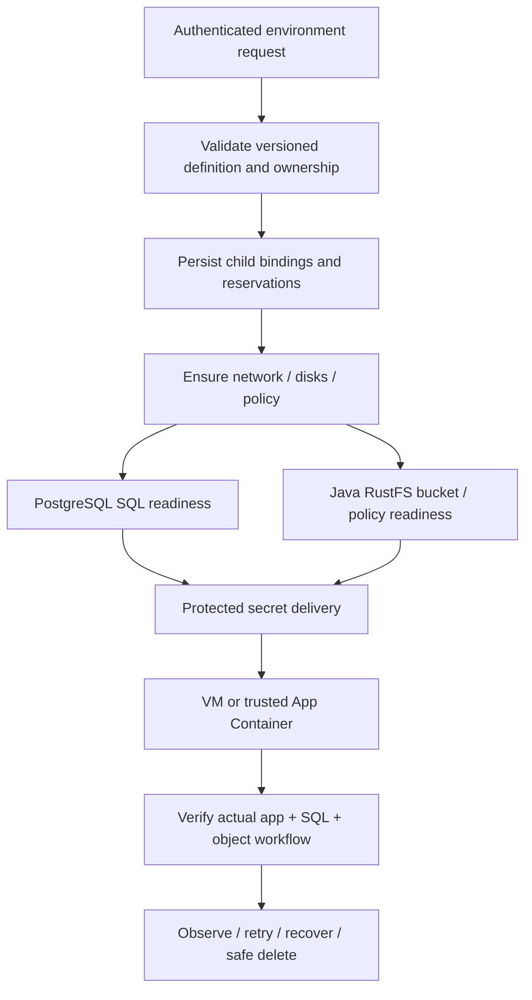

# CoveStack V5 — Application Environments and Typed Templates

| Document control | Value |
| --- | --- |
| Updated | 4 November 2026 |
| Authority | Detailed current product specification; aligned to the [canonical catalogue](../docs/product/CoveStack-Product-Architecture-and-Service-Catalogue.md) and [product SRS](../docs/product/CoveStack-Product-SRS.md) |
| Evidence | Target design, not a completion certificate; source and actual test results determine implementation status |
| Compatibility | V5 is a documentation label; current wire contract remains 1.1.0; future fields/kinds/versions require coordinated review |

## 1. User outcome and bounded scope

A developer should request a usable owned environment rather than manually assemble unrelated resources. Core environment ownership/readiness/retry is distinct from later rich reusable templates, previews and deployment automation. A bounded app/PostgreSQL/bucket definition is a useful first example, not a permanent academic one-template restriction. No arbitrary user-programmable DAG/script engine is promised.

## 2. Example environment and dependencies

| Child | Desired role | Actual readiness before dependent work |
| --- | --- | --- |
| Private network/subnet | Owned addressing and separation | Allocations and default-deny policy applied and verified |
| NICs/disks/volumes | Attachments/capacity/data retention | Owned correct host/provider bindings and capacity reserved |
| PostgreSQL | Application data | Real SQL connection, scoped user and durable volume |
| RustFS bucket | Application objects | Java creates/reconciles owned bucket/key/policy on operator service; actual scoped object access |
| App VM or trusted container | Runnable application | Approved image/initialization, credentials delivered by protected reference, real app health/data flow |
| Optional extra frontend/backend | Typed bounded expansion | Same ownership/admission/readiness semantics; no automatic public route |

## 3. Durable orchestration model

Account/project owns environment; definition version and nonsecret validated inputs/secret references are immutable request inputs. Stable typed child-role bindings precede execution. Persist dependency edges/readiness requirements and explicit shared-resource references; detect cycles/incompatible locality. Idempotency creates one owned environment and one logical child per binding. Target table/JSON shapes require B+D/C/A review; these human stage names are not new wire states.

Definitions may contain documented typed component/dependency JSON; inputs contain validated values and secret references. These are explicit schema exceptions, not hidden ownership/business keys in generic JSON. Do not place passwords/kubeconfigs or arbitrary shell into template documents.

## 4. Failure, retry and compensation

| Event | Required response |
| --- | --- |
| Child fails/never becomes ready | Record actual operation/error; environment is not ready; dependent app does not get fictional endpoint |
| Same-key retry | Return/resume original logical bindings, inspect uncertain provider task and avoid duplicate child |
| Agent/server restart | Rebuild from authoritative child/attempt/reservation records plus scoped runtime inventory |
| Definition update | Validate typed diff, ownership and capacity delta; stale worker cannot apply another revision |
| Compensation | Remove only safe newly owned disposable children; retained/shared data stays; report incomplete compensation |
| Environment delete | Authorize, disable routes when applicable, reverse owned dependency order, detach shared references and retain explicit data |
| Cancel/client timeout | Cancellation intent is not proof backend action stopped; inspect actual task/outcome before next mutation |

Operator RustFS service is never deleted with a tenant bucket/environment. A shared DB/network/volume survives deletion of another environment's reference. Full rollback of external infrastructure is not a DB transaction.

## 5. CLI/API experience — Planned

One authenticated environment request returns operation identity and pending result; finite wait observes actual child/aggregate status. List/get JSON is scoped and redacted. Retry after partial failure is explainable; user can see owned child IDs, failed dependency and retention choices. Future Terraform/UI are API consumers; no hidden second state database. No runnable stack CLI command is claimed before its code/API exists.

## 6. Acceptance

Test 15: usable app + PostgreSQL + RustFS bucket, partial failure recorded, retry/restart resumes without duplicate children. Add two-frontend/backend example only when supported typed definition exists; foreign account/project denied, quota failure no orphan, shared dependencies survive, retained data restores and unknown provider response never starts conflicting mutation. Verify actual app read/write of SQL rows and object bytes, not merely three resource records. C owns acceptance; B coordination/SQL, A executor, D API/DTO, E CLI.

## Historical traceability

The [previous body of this file](../docs/archive/V5-before-full-product-alignment-2026-11-04.md#v5-covestack-stack-templates) is preserved unchanged as historical reference, including earlier requirements/DDL/acceptance text. It is not current VM/RustFS setup guidance. Use this active body, the linked canonical domain specifications and [actual implementation evidence](CoveStack-Implementation-Status.md) for new work. No source, migrations, contracts, tests, configuration or runtime state is changed by this document.
