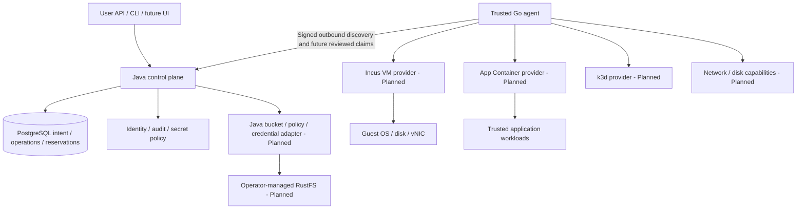

# CoveStack V5 — Technical Design and Team Architecture

| Document control | Value |
| --- | --- |
| Updated | 4 November 2026 |
| Authority | Detailed current product specification; aligned to the [canonical catalogue](../docs/product/CoveStack-Product-Architecture-and-Service-Catalogue.md) and [product SRS](../docs/product/CoveStack-Product-SRS.md) |
| Evidence | Target design, not a completion certificate; source and actual test results determine implementation status |
| Compatibility | V5 is a documentation label; current wire contract remains 1.1.0; future fields/kinds/versions require coordinated review |

## 1. Purpose and product scope

CoveStack is an open-source, local-first infrastructure control plane for account-owned environments on machines the user controls. The product should turn requests into actual infrastructure with capacity admission, durable operations, safe recovery and observable ownership. A public-cloud account is not required by target local functionality; optional external DNS, updates or integrations have separately disclosed prerequisites.

Primary compute is a **VM Instance with its own guest kernel**. **App Container** is separate, shared-kernel compute for trusted applications. Incus/QEMU/KVM is the preferred VM evaluation stack, not an implemented driver. RustFS is the preferred **Planned** object-storage provider. Existing Java/Spring/JDBC control plane and Go agent remain; no wholesale language rewrite.

### 1.1 Product value that must be demonstrated

| Capability | Platform responsibility | Evidence needed |
| --- | --- | --- |
| Account-owned infrastructure | Authorize accounts/projects/actions and persist owner-bound IDs | Foreign API/disk/network/bucket access denied under concurrency |
| Environment orchestration | Typed dependencies, readiness, partial retry, safe shared-resource cleanup | Usable application/SQL/object workflow and interrupted retry without duplicate children |
| Crash-safe reconciliation | Inspect owned provider tasks/objects against desired state | Lost response/worker crash produces one resource and preserves unrelated objects |
| Capacity-aware scheduling | Account quotas plus physical host reservations/compatibility/freshness | Concurrent requests cannot overspend; refusal is explainable |
| Security and verified recovery | Scoped identities, private policy, audit and actual restored data | Revocation, denied packets and known rows/bytes/file hashes after restoration |

Incus, Proxmox and other platforms already supply substantial infrastructure capabilities. This is a product hypothesis, not a uniqueness claim or evidence of adoption. Compare complete workflows fairly: [research](../docs/platform/competitive-analysis.md).

### 1.2 Core and future scope

The [22 core catalogue entries](CoveStack-Service-Catalog.md#1-core-product-services-and-capabilities) include runtimes, shared platform capabilities and interfaces—not 22 microservices. The [future catalogue](CoveStack-Extended-Roadmap.md) is dependency-bound expansion. Historical academic service counts, node/network/template caps and dates do not constrain product functionality. No product deadline, production density or release sequence is invented.

### 1.3 Evidence and maturity

G1: PostgreSQL desired state and generation are authoritative. G2: crash-safe inspection/reconciliation rebuilds state/config without duplicates. G3: account authorization denies foreign API resources (404 without existence leak) and actual traffic/storage boundaries are tested. G4: meaningful failure acceptance runs in CI on an authorized capable runner. **Acceptance Gates Passed** requires this evidence; **Supported** additionally needs a declared subset, qualified profile and maintenance policy.

Use Proposed, Planned, In Progress, Partially Implemented, Implemented, Runtime Verified, Acceptance Gates Passed, Supported, Deferred and Blocked. Record component source evidence separately from a whole service's runtime gate. Current product is Experimental; no supported production profile. Signed polling exists but runtime execution does not.

## 2. HLD — planes and authority

| Plane | Responsibility | Trust / current boundary |
| --- | --- | --- |
| User management | CLI/API, eventual UI, account/project membership and exports | API-only; no backend sockets or direct database access |
| Control plane | Java validation/auth/ownership/idempotency/operations/environment coordination | Durable transactions and policy; no arbitrary host shell |
| Resource state | PostgreSQL intent, generation, reservations, tasks, claims and audit | DB source of truth; Valkey is only replay authority |
| Trusted agent | Go signed outbound contexts, future assigned-work validation and execution | One process/host, protected account contexts; actual assignment implementation pending |
| Runtime | Incus VM, separate OCI and k3d plus network/storage capabilities | Privileged interfaces accessible only to trusted operator/agent |
| Tenant data | Guest kernels/disks/NICs, app/SQL/S3/Kubernetes traffic | Default-deny policy and real isolation evidence required |
| Identity/secrets | Token hashes, protected signing keys, role checks, secret references | Mature custody provider under review; no plaintext in ordinary resources/logs |
| Scheduling | Physical budget plus account/environment placement policy | No competing backend scheduler/allocator; multi-host future |
| Observability/recovery | Fresh observations, sanitized events/logs, independent backups | Stored observations are not guaranteed health; files written are not verified restore |

Arrows are target responsibilities, not a deployed stack. The agent's signature authenticates a credential; server-stored host/account assignment and authorization must still be implemented.

### 2.1 Capacity and failure domains

Developer laptop and single-host development profiles are distinct from a qualified self-hosted production profile. An old 8 GB machine is a historical development constraint, not a supported size. Reserve platform peak, VM/device overhead, images/disks/backups, Kubernetes and outstanding tasks. Stale host evidence blocks admission; unknown provider outcomes retain reservations. Single-host deployment is not HA. See [capacity](../docs/platform/capacity.md).

## 3. LLD — request, execution and convergence

1. Authenticate identity and authorize account/project/action before looking up or mutating resources.
2. Validate type/image/spec, backend capabilities, dependency readiness, quotas and physical capacity.
3. Atomically record desired generation, operation, idempotent response, reservations and events; no backend call inside that transaction.
4. Return durable operation identity; discover assigned work read-only. Future claim/renew/report messages require coordinated contract evolution.
5. Claim the authorized current attempt; inspect exact owned provider object/task before creating. Unknown outcome blocks conflicting mutation.
6. Configure disk/NIC/policy/guest initialization under reviewed per-resource host exclusion; verify actual guest/application readiness.
7. Apply convergence only for matching resource, assignment, generation, owner and epoch; release lease owner/expiry together, keep epoch. Progress never advances acknowledgement.
8. Schedule fresh observations/reconciliation. Delete only owned dependencies under retention policy, then release confirmed-clean capacity/addresses.

DB fencing prevents stale DB reports; it does not automatically fence Incus/Docker/k3d side effects. Parent/child exclusion, actual task inspection and safe takeover are separate mandatory controls. Lease expiry alone is not permission to recreate/delete a resource.

### 3.1 Contract gate

Current 1.1.0 contains legacy compute/container-shaped specs and no complete advanced claim protocol. Do not turn these into VM instructions or claim a target wire version from this documentation. Future VM/App Container types, host capability/assignment, claims, renewals, network/storage attachment and reservations require B+D+A/C-approved schemas, fixtures and generated outputs. Detailed [API](CoveStack-API-and-Compatibility.md) and [schema](CoveStack-Database-Schema.md) separate present versus proposed.

## 4. Resource and provider model

| Resource | Backend role | CoveStack-owned behavior |
| --- | --- | --- |
| VM Instance | Incus API over QEMU/KVM preferred evaluation | Owned image/disk/NIC/capacity, guest readiness, safe lifecycle/restore and crash recovery |
| App Container | Reviewed Docker/OCI runtime | Distinct trusted-workload policy, image/resources/volumes/health and safe update/cleanup |
| Kubernetes | k3d CLI candidate over Docker; test exact k3d/k3s pair | Owned clusters/ports, scoped kubeconfig, measured quota, recovery and cleanup |
| PostgreSQL | Reviewed workload backend with persistent storage | Scoped DB credentials/private endpoint, actual SQL readiness, data backup/restore |
| Object storage | Operator-managed RustFS preferred planned provider | Java account-owned bucket/key/policy reconciliation, real byte access, restart and verified recovery |
| Networks/volumes | Incus/Linux/host capabilities | Owned allocation/attachments/default deny and capacity; no two authoritative allocators |

Future providers implement versioned capability/conformance boundaries. Do not expose privileged API shapes directly as tenant authority, run untrusted plugins, or silently fall back from VM to container. Full [resource specifications](CoveStack-Resource-Services.md).

## 5. Environment-level workflow

A bounded environment may contain frontend/backend VM or trusted container, PostgreSQL, bucket, network, NICs, volumes and firewall/secrets. Persist typed child bindings before creation; reserve safe dependency footprint, verify actual dependency readiness, and recover partial creation by stable IDs. Retry resumes; compensation does not erase retained data or shared dependencies. No arbitrary DAG/script engine. See [environment design](CoveStack-Stack-Templates.md).

## 6. Interfaces and automation

CLI, provider and inventory use only the authenticated API. CLI mutations have idempotency keys, create returns pending, finite wait polls actual convergence, and list/get offer stable JSON. Kubeconfig/keys are separately authorized exports, never ordinary list/get/observations. Terraform/OpenTofu optional provider starts only with real approved compute/Kubernetes APIs. Ansible installer and later inventory are separate scopes. [Automation](CoveStack-Terraform-and-Ansible.md).

## 7. Roles and first shared integration

A owns agent/client/signing/drivers/reconcile/CI/installer; B Java core/all SQL; C auth/security/all acceptance/Java IPAM; D Java DTO/API/fixtures, no Go; E thin Go CLI/packaging/later provider. Future scheduler ownership is reviewed. B+C real server/credential/assignment and A's existing signed no-execution loop are the immediate integration—not VM execution. [Roles](Team_Roles.md), [workflow](CoveStack-Project-Workflow.md), [team checkpoint](../TEAM-FIRST-CHECKPOINT.md).

## 8. Decisions required before implementation

| Decision | Required review |
| --- | --- |
| VM/App Container migration and external terminology | B+D+A+C; no silent old container conversion |
| Incus/OS/kernel/image/storage/network compatibility | A+C/B; approved host spike and actual failure evidence |
| Claim/renew/report and trusted account/host assignment | B+D+A+C; exact authority and unknown-task policy |
| Public/internal/provider IDs and schema/retention | B+D; C tenancy/keys; A runtime |
| RustFS artifact/admin API/custody/backup and private route | B+C+A; actual scoped object and restore tests |
| Shared client/module and CLI auth boundary | A+B+C+E; signing is not ordinary user auth |
| Capacity pool, network ranges, port rules and overcommit | B+C+A; measured profile, no invented values |
| License / third-party distribution | Apache-2.0 adopted; exact bundled notices/rights still reviewed |

## 9. Reading and verification

Read [V5 index](README.md), catalogue/SRS, this design, roles/workflow, setup/constraints, API/schema, resource specs, gates and acceptance. Runtime proof follows [tests](CoveStack-Testing-and-Acceptance.md) and [operations](CoveStack-Operations-and-Recovery.md). Older exports are stale until separately regenerated and checked; documentation does not certify production readiness.

## Historical traceability

The [previous body of this file](../docs/archive/V5-before-full-product-alignment-2026-11-04.md#v5-docsv5-do-team) is preserved unchanged as historical reference, including earlier requirements/DDL/acceptance text. It is not current VM/RustFS setup guidance. Use this active body, the linked canonical domain specifications and [actual implementation evidence](CoveStack-Implementation-Status.md) for new work. No source, migrations, contracts, tests, configuration or runtime state is changed by this document.
