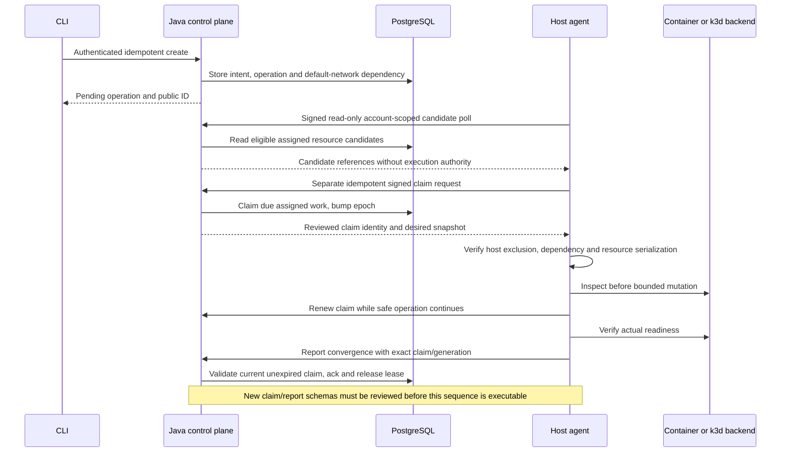

# CoveStack V5 — Technical Design and Team Architecture

| Document control        | Value                                                                   |
| ----------------------- | ----------------------------------------------------------------------- |
| Product / documentation | **CoveStack / V5**                                                      |
| Updated                 | **15 October 2026**                                                     |
| Submission deadline     | **Monday, 25 January 2027**                                             |
| Compatibility names     | Server: `kan-server`; agent: `kan-agent`                                |
| Status                  | Target design and implementation guidance; not a completion certificate |

## 1. Purpose and scope

**A local cloud control plane with an account-scoped, crash-safe resource model. Docker and k3d are replaceable execution backends.**

CORE-5 is the SRS/deliverable scope. CLI is the first interface; no UI work during CORE-5. Every service defaults to **Planned**. Replaceability is an architecture target, not evidence of interchangeable drivers today. The single integration template has PostgreSQL, MinIO and an app Droplet; it is not a DAG engine.

| User problem                             | Platform response                              | Evidence                           |
| ---------------------------------------- | ---------------------------------------------- | ---------------------------------- |
| Repeated manual environment setup        | One reviewed integration template              | Test 15: retry without duplicates  |
| Shared lab users need scoped access      | Account-owned resources and action permissions | Cross-account denial tests         |
| Workloads need scoped connectivity       | Account-owned private network and credentials  | Tests 11–14                        |
| Failures cause uncertain state           | Desired/observed state and durable operations  | Restart without duplication        |
| Infrastructure needs credible evaluation | ITISS configuration, tests and runbooks        | Clean install and measured restore |

### 1.1 Why this is not a wrapper

The comparison concerns the account-scoped platform contract, not unique ownership of runtime mechanisms. These are target assertions, not claims of current capability.

| Docker/k3d/MinIO alone cannot do X             | CoveStack does Y — target                          | Evidence                     |
| ---------------------------------------------- | -------------------------------------------------- | ---------------------------- |
| Enforce our account/resource API policy        | Multi-tenancy with other-account 404               | Test 3                       |
| Persist our desired/observed generations       | DB-authoritative intent and convergence            | Tests 1, 5                   |
| Fence our competing agent identities           | Lease owner/epoch and exact-generation ack         | Test 2                       |
| Resume our container/cluster operation records | Inspect deterministic identity before create       | Tests 1, 7                   |
| Atomically reserve our API request keys        | One resource/result transaction                    | Test 4                       |
| Supply our measured owned-data restore result  | Backup, restore and canonical dataset verification | Test 11                      |
| Enforce our scoped kubeconfig API export       | No kubeconfig in list/get/observations             | Test 8                       |
| Issue our account-scoped bucket credentials    | Java bucket/policy reconcile                       | Tests 12, 13                 |
| Allocate according to our account/host policy  | Collision-free owned subnet/IP reservations        | Test 14                      |
| Expose our Terraform-usable /v2 contract       | Optional API-only Droplet/Kubernetes provider      | Provider lifecycle/JSON gate |

### 1.2 Two scope layers

| Layer                       | Scope                                                                       | Status         |
| --------------------------- | --------------------------------------------------------------------------- | -------------- |
| CORE-5 SRS/deliverables     | Droplets; required Kubernetes; Managed PostgreSQL; Object storage; VPC/IPAM | Planned        |
| Cross-cutting, not services | Security, recovery, CLI, optional Terraform, one stack demo, Ansible Part 1 | Planned        |
| Extended track, not SRS     | [Roadmap](CoveStack-Extended-Roadmap.md); dependency gates first            | Extended track |

### 1.3 Service Gate Rule

**Service Gate Rule:** A service is called **Supported** only after all four gates pass and its status is **Gates passed**: **G1** a DB row holds desired state and generation; **G2** reconciliation survives a crash without duplicates and rebuilds state/configuration from DB rows; **G3** another account receives **404**; **G4** one service failure test runs in CI. The DB is the source of truth, never a container, cluster, bucket, proxy or configuration file.

Status vocabulary: **Planned | In progress | Gates passed | Extended track**. CORE-5 defaults to **Planned**; the extended track defaults to **Extended track**. Do not promote a status from documentation or a mock result.

See [Service Gates](CoveStack-Service-Gates.md).

## 2. Architecture

```text
Go/cobra CLI / optional thin Terraform provider
                         |
                  Authenticated API
                         |
            kan-server services and policy
                   /               \
       PostgreSQL desired state   Replay store
                         |
            Signed outbound agent polling
                         |
               kan-agent reconciliation
                 /             \
       Generic container       k3d CLI
       (network helper)        driver
                 \             /
             Observations and operation results
```

| Component                 | Responsibility                                                | Authority boundary                          |
| ------------------------- | ------------------------------------------------------------- | ------------------------------------------- |
| `kan-server`              | Accounts, resource/stack records, actions, leases, API policy | Does not grant public clients daemon access |
| `kan-agent`               | Validate work, inspect/converge owned infrastructure          | Trusted high-authority host component       |
| PostgreSQL                | Durable desired intent, ownership and action records          | Private; migrations and backups reviewed    |
| Valkey                    | Authenticated replay-related storage                          | Private; outage policy fails closed         |
| Docker                    | Container execution, bridge/IPAM primitives                   | Never mounted into user workloads           |
| k3d / k3s                 | Local Kubernetes execution                                    | Protected kubeconfig and bounded ports      |
| Java bucket/VPC reconcile | Server-owned desired records and allocator                    | Not new bucket/VPC agent kinds              |

CLI, Terraform provider and Ansible inventory talk **ONLY to the authenticated API**; none import or call Docker/k3d. Ansible Part 1 is the operator installation playbook, a distinct infrastructure activity. Only two workload drivers are planned: generic container and k3d. PostgreSQL/MinIO processes use container image/env/volume/labels/health; network execution is a helper inside it.

### 2.1 Agreed host/account agent model — Planned

Team agreement recorded on 15 October 2026; this is a target design, not acceptance evidence.

| Boundary | Required behavior | Owner |
|---|---|---|
| Deployment | One kan-agent process per physical host; start with one assigned account, then prove two | A |
| Authentication | Separate service credential and immutable signed HTTP client/polling context per assigned account; no global credential/account selector | A; C security |
| Assignment | Server validates credential account and stored agent assignment on work, observations and inventory | B; C tests |
| Host identity | All account contexts map to one canonical physical-host identity; DB enforces max 2 clusters across accounts | B; A integration |
| Scheduling | Shared bounded execution; per-resource serialization, account-context binding and bounded per-account scheduling | A |
| Account failures | Backoff/cancel rejected/revoked account context; no fallback credential, cross-account work, cleanup inference or stopping healthy contexts | A; C tests |
| Credential lifecycle | Protected operator-controlled delivery/storage, rotation and revocation; no CLI user-token reuse; never mutate shared client credentials | C policy; B server; A loader |
| Trust boundary | One agent controls host runtime and holds assigned secrets; this is not hostile-tenant process isolation | C+A |

Provisioning transport, secret storage mechanism, reload/rotation policy and credential-to-agent lookup must be finalized B+C+A before that integration. Do not invent APIs, wire fields, database tables or secret paths. Separate account clients may share a safe transport, never mutable credential state. Start with single-account lifecycle/failure evidence, then add the second account. Any new protocol fields need coordinated schema, fixtures and generated outputs.

### 2.2 HLD — control, execution and data paths

Status: **Planned**. The following resolves architecture choices at design level; code, contracts and acceptance evidence remain future work.

| Boundary | Target responsibility / dependency |
|---|---|
| User control plane | CLI → authenticated Java API → account-scoped DB transaction; return durable operation/public ID immediately |
| Agent control plane | Assigned account clients → signed work/claim/report exchange; Java derives account/host, never trusts a caller-selected account |
| Execution host | One process-wide OS exclusion lock plus serialized resource execution; only generic container and k3d backends |
| Network control | Java owns VPC/IP reservations; a separate signed internal network-control exchange carries approved intent/results to the agent network helper; route/payload names TBD with B+D |
| Dependency admission | Ensure the account's default VPC before any Droplet/DB runtime attachment; its record can exist while pending; do not start workload execution until network convergence |
| Shared storage bootstrap | One operator-owned MinIO process/volume on this host, with persisted platform-owned compute.instance intent and the generic container backend; bootstrap must establish operator account/assignment before agent work |
| Bucket control | Java reconciles storage.bucket and account credentials through private MinIO administration; stack creates a scoped bucket, not another shared server |
| Data paths | App → private PostgreSQL or approved shared S3 endpoint; kubectl → separately authorized Kubernetes API; these do not pass through the agent polling endpoint |
| Administrative secrets | Operator installation provisions protected host-side secret material; work carries approved nonsecret references only; no root/admin secret values in agent payloads |
| Isolation | Workload routes deny control-plane DB/cache/daemon; shared S3 access is explicit and policy-scoped; trusted agent/host compromise is outside tenant isolation guarantee |

MinIO administration and tenant S3 operations can share the S3 API listener. Do not claim separate ports alone isolate administration: protect root/admin credentials and policies; keep console/operator routes private. Java must have a reviewed private path to that API. Secret custody, actual ports/paths, operator identity issuance, key recovery and rotation mechanics remain B+C/A implementation decisions; no values or wire names are chosen here.

The MinIO process is an operator-owned platform dependency, not a tenant-created sixth service. Register its desired runtime before execution through the reviewed bootstrap workflow. Extend reviewed compute spec/secret-reference mapping only through coordinated schemas/fixtures/generated outputs; do not put arbitrary env/root credentials into an unreviewed existing payload.

### 2.3 HLD — failure boundaries and capacity

| Failure | Target behavior |
|---|---|
| API/DB/replay authentication unavailable | No new authorized mutations; retain workloads; admitted backend actions may still settle, so inspect before resuming |
| One account credential rejected | Isolate/backoff that context; no fallback credential; other assigned contexts continue |
| Agent main dies while k3d child/backend request runs | Treat outcome as uncertain until settled; no competing operation on that identity |
| Resource drifts after convergence | Periodic DB-scheduled inspection reclaims it without inventing a new desired generation |
| MinIO restart | Java rechecks buckets/credential policy after dependency readiness; object recovery needs retained volume/backup, not DB metadata alone |
| Host lost | Restore control-plane DB, keys and owned data; a same-host backup is insufficient evidence |

The 2-cluster cap is an upper bound, not a promise every allowed workload fits simultaneously. Move the host spike to the first host-preparation stage, before committing driver work. Measure Java, control-plane DB, workload DB, Valkey, MinIO, applications and one/two bounded clusters together. Reserve platform headroom and enforce workload CPU/memory/PID/disk admission; values and tested combinations are TBD after measurements. Reject requests exceeding the measured budget even below the cluster-count cap. No version, port range or RAM-per-cluster estimate is promoted to a tested fact.

## 3. State and reconciliation

| Concept            | Rule                                                                |
| ------------------ | ------------------------------------------------------------------- |
| Resource identity  | Stable logical ID plus account, host/agent and kind                 |
| Desired generation | Version of requested specification; increment transactionally       |
| Observation        | Actual state, time, generation acknowledgment and lease identity    |
| Progress           | Separate guarded statement; never changes acked_generation          |
| Convergence        | Acknowledge only after actual requested state/readiness is verified |
| Stale report       | Ignore safely; cannot overwrite newer desired intent                |
| Failed attempt     | Record failure; retry is bounded and traceable                      |
| Agent restart      | Inspect reserved ownership identifiers before creating              |
| Server outage      | Pause new work; do not infer deletion from failed/empty polls       |

Convergence acknowledgment requires id, lease_owner, lease_epoch match **and generation = :gen**. Zero rows means rejected/stale. Accepted convergence clears lease_owner and lease_expires_at together and keeps lease_epoch unchanged. Progress never releases/acknowledges convergence. The design requires unexpired claims for renewal, reports and acknowledgment, checked using the DB clock. Epoch fences DB writes; it does not fence Docker/k3d side effects. See the host exclusion and uncertain-operation rules below. See [reference schema/queries](CoveStack-Database-Schema.md).

A controller checks what exists and brings it toward the requested state. Starting a fresh container on every poll is not reconciliation. Serialize work for the same logical resource; introduce bounded concurrency only after lease/fencing and per-resource deduplication work.

The current contract source remains `contracts/lifecycle-rules.json` version 1.1.0. **V5 is the documentation version, not a wire-protocol version.** New stack/network/ingress messages require coordinated schema changes, fixtures and generated Go/Java outputs. Do not invent undocumented strings in an agent work payload.

### 3.1 LLD — mutation sequence and contract gate

> **Architecture Note:** The codebase currently operates on wire contract v1.1.0. The advanced epoch lease-fencing capabilities described in this schema represent Target Contract v1.2.0, which is scheduled for the upcoming integration sprint prior to the January 25th freeze.



| LLD decision | Target invariant |
|---|---|
| Claim correlation | Keep /work read-only; acquire authority through a separate signed idempotent claim exchange binding account, host, resource, generation and epoch |
| Contract gap | Existing 1.1.0 resource/observation shapes do not define the full claim token/renewal protocol; route, headers/fields and errors remain TBD with B+D/C/A |
| Renewal | DB-clock expiry and same owner/epoch/generation required; expiry/change/revocation stops new mutations and rejects old reports |
| Completion | Validate kind-specific readiness, exact generation, authorized assignment, epoch and unexpired lease; clear both lease fields; keep epoch |
| Periodic inspection | Schedule next_attempt_at after convergence for nonterminal live rows; due inspections remain eligible even when acked_generation equals generation |
| Health-only inspection | Obtain a fresh claim for the inspected generation; update guarded observations without advancing acked_generation; release/reschedule only the matching claim |
| Drift repair | Inspect current intent and Ensure under that claim; keep desired generation unchanged when intent did not change; no fake user operation |
| Backend exclusion | Process lock plus per-resource serialization; long-lived child commands retain operation exclusion until settled |
| Uncertain action | Timeout/cancel is not proof a backend request stopped; do not issue replacement/delete/recreate until prior operation is proven settled |
| Restart/takeover | Acquire host exclusion, recover outstanding backend operation identity and inspect deterministic objects before new work; ambiguity requires operator recovery, not automatic lock expiry |

There is no atomic transaction across PostgreSQL and Docker/k3d. Do not claim strict exactly-once execution or that DB fencing prevents every stale runtime action. If an old process/child is paused or an API request may still execute, fail closed for that resource. An already admitted action may finish during an outage; no new mutation may start without current authorization. Operator recovery must settle the old execution and preserve owned data before enabling retry. Local locks/checkpoints are execution evidence, not a second desired-state database.

Detailed claims, inspection scheduling, health/retry predicates and network rows are in [Schema section 7](CoveStack-Database-Schema.md#7-concurrency-and-reference-queries). No tests pass from this sequence alone.

## 4. Ownership and consistency

| Boundary           | Required behavior                                                                                  |
| ------------------ | -------------------------------------------------------------------------------------------------- |
| Account scope      | Derive identity from authentication; validate every object action                                  |
| Database writes    | Account predicate and optimistic/version checks; avoid whole-row observation overwrite             |
| Idempotency        | Scope request key, store fingerprint and result atomically                                         |
| Lease/fencing | Old claims cannot write DB results; runtime mutations require host exclusion and a current claim; uncertain backend operations block takeover |
| Runtime labels     | Proposed kan.account/kan.resource/kan.agent contract; review before use; not present compatibility |
| Garbage collection | Complete scoped inventory plus explicit deletion intent and grace policy                           |
| Secret data        | Separate authorized retrieval from ordinary metadata listings                                      |

## 5. Resource services and stack composition

The Service Catalog and stack topic files now use the approved CORE-5 scope. [CORE-5 SRS](CoveStack-SRS-Scope.md) and [Service Gates](CoveStack-Service-Gates.md) govern service scope and evidence. A stack records child identities and fixed order; it exposes each resource's safe metadata and records partial failure/retry, not a new orchestration engine.

### 5.1 Droplets / compute instances — Planned

Execution backend only (Docker). Platform value: tenancy, desired/observed generation, lease and fencing, crash-safe restart.

Container-backed, single host, never called a VM. Generic container driver inspects deterministic owned identity before create; API-only CLI create/delete/get evidence is tests 1–6. No host daemon socket in user workloads.

### 5.2 Kubernetes — Planned, REQUIRED

Execution backend only (k3d). Platform value: ownership, scoping, crash-safe lifecycle, quota, scoped kubeconfig.

| Logic we own                                                                 | k3d alone cannot         |
| ---------------------------------------------------------------------------- | ------------------------ |
| Account-owned clusters, proposed labels kan.account, kan.resource, kan.agent | k3d has no tenants       |
| Desired/observed cluster state (name, k3s version, node count, generation)   | no desired state         |
| Crash-safe create: kill agent mid-create => exactly 1 cluster                | create is not idempotent |
| API-port allocator, reserved BEFORE create, keyed by resource ID             | takes any port           |
| Scoped kubeconfig export on demand; never in list/get/observations           | prints it to anyone      |
| Node-pool scale via reconcile                                                | manual                   |
| Quota: 2-cluster host cap, per-account share inside it, node limits          | none                     |
| Delete removes all labeled containers, volumes, networks                     | can leave leftovers      |
| DO-shaped /v2/kubernetes/clusters subset                                     | not in k3d               |

This table describes the missing CoveStack account/policy semantics at the execution boundary; it does not claim unauthenticated users can access a protected host's k3d command. Labels are proposed, and node-pool/attachment message changes need coordinated contract work.

| Limit/prerequisite  | Target                                                                        |
| ------------------- | ----------------------------------------------------------------------------- |
| Host                | One 8 GB AlmaLinux VM                                                         |
| Cluster cap         | Maximum 2 per host; third rejected with documented quota error TBD with B+D   |
| Shape               | 1 server + maximum 2 agent nodes each                                         |
| Version             | One pinned tested k3d+k3s pair; values TBD after spike                        |
| Memory estimate     | 0.5–1 GB/cluster: unverified estimate, confirm in K8s host spike              |
| Early host spike | One day at first host preparation: cgroup v2, SELinux, firewalld, total workload RAM and tested pair |
| Execution           | Shell out to pinned k3d CLI, not library; verify each flag before documenting |

Ensure finds a half-created cluster by proposed labels/deterministic name and finishes it or cleans owned partial objects before recreating under the same name. Port is reserved first; tests 7–10 prove crash, tenancy, cleanup and quota.

### 5.3 Managed PostgreSQL — Planned

Execution backend only (container). Platform value: volume ownership, backup/restore, credential scoping.

Acceptance requires backup, measured restore, scoped credentials and private networking together. Generic container driver reattaches owned volume; test 11 verifies rows/checksum and cross-account denial. No service is labeled managed without those acceptance items.

### 5.4 Object storage — Planned

Execution backend only (MinIO). Platform value: per-account credentials, bucket scoping, cross-account denial.

One operator-owned shared MinIO process uses the container driver; the fixed stack creates a scoped bucket in that process, not a new server. Java server reconciles physical buckets and scoped credential policy from DB rows; storage.bucket remains server-owned. Tests 12–13 prove denied key usage and rebuild. Root storage credentials remain private.

### 5.5 VPC/IPAM — Planned

Execution backend only (Docker bridge). Platform value: allocator, ownership, collision-free subnets and IPs.

One private network/account; no custom CIDR. C owns Java allocator; B owns SQL; A owns container-driver network helper. Test 14 includes ten parallel IP allocations within one VPC and ten accounts allocating networks concurrently. Pool values TBD A+B. VPC has no kind in 1.1.0: server-owned design, state and compute attachment decision B+A; no invented wire fields.

## 6. API layers

| Interface                   | Policy                                                        |
| --------------------------- | ------------------------------------------------------------- |
| Internal agent routes       | Shared `KAN1` signing contract; private route                 |
| Provider-style `/v2` routes | Tested bounded DigitalOcean subset; Bearer permissions        |
| Management routes           | CORE-5 stack/network/account records; scoped authorization    |
| Minimal liveness            | Small non-sensitive response only                             |
| Detailed doctor             | Authenticated account/admin scope; no sensitive public status |

Every list/get supports stable JSON for automation. CLI mutations send an idempotency key; create returns pending immediately and --wait polls convergence. Get exposes desired/converged generation, lease and observed state, never kubeconfig or secret credentials. Kubeconfig is authorized export on demand.

Provider compatibility is an endpoint-by-endpoint target matrix. Same-looking JSON and paths do not imply full provider parity. SSH key validation and action completion need their exact tested mappings; unknown new message strings are TBD with B. IDs: internal uuid, prefixed CLI public_id, numeric /v2 provider_id; B+D finalize.

## 7. Extended track (not in SRS)

Detailed design is preserved in [Extended Roadmap](CoveStack-Extended-Roadmap.md), not CORE-5 deliverables. B/C/D/E server-side work may start from 1 December only if CORE-5 duties are not blocked and dependency gates pass. A's extended Go work starts only after all CORE-5 gates pass. A one-week delay stops all extended work. The track continues after submission; demo/viva mention is bonus only after Gates passed.

## 8. Decision records required before code

| CORE-5 decision                                                                | Owner            |
| ------------------------------------------------------------------------------ | ---------------- |
| Go module layout and planned signer move to pkg/kanclient                      | A+B+C            |
| CLI/agent boundary                                                             | A+E              |
| k3d+k3s pinned pair, API-port range, kubeconfig delivery                       | A+B+C            |
| Subnet pool, Java allocator and compute attachment                             | B+A; C allocator |
| MinIO scoped/admin credential model, custody, rotation and server network path | B+C              |
| Account-scoped clients in one process/host; assignment/custody details                  | B+C+A            |
| Backup storage format and retention                                            | B+A              |
| ID mapping and missing contract vocabulary                                     | B+D              |

Extended tool/policy decisions move to the roadmap; values are not invented. See [Known constraints](CoveStack-Complete-Working-Setup.md#10-known-constraints), added in Batch 2.

### 8.1 Planned folder layout — no code move in this task

```text
covestack-cloud/
  contracts/
  pkg/kanclient/                  signer + HTTP API client (planned)
  cmd/covestack/                  cobra CLI (E)
  kan-agent/                      container/k3d drivers, network helper, reconcile (A)
  kan-server/                     Java core/security/API (B, C, D)
  terraform-provider-covestack/    thin optional Go layer (E, after CLI)
  ansible/                        Part 1 roles; inventory later
  deploy/
  docs/
```

Root/client/agent Go module layout is a decision record; the current module cannot import a new root package merely because this tree is drawn. No go.mod or signer relocation occurs here.

### 8.2 Architecture decisions resolved versus pending encoding

| Review gap | Design resolution | Implementation gate |
|---|---|---|
| Claim fencing missing on wire | Correlated claim/renew/report protocol with DB-clock expiry | B+D schema, A client and C negative fixtures before mutation |
| Runtime fencing overclaim | Host exclusion, serialization and fail-closed uncertain-operation recovery | A+C stale-worker/backend tests |
| Converged drift invisible | DB-scheduled leased inspections and same-intent repair | B scheduler/query, A inspection and C test variants |
| Unleased health update | Fresh inspection claim; no health acknowledgment | B/A guarded reports; C proves lease release/stale rejection |
| VPC execution gap/order | Separate signed network control and default-network prerequisite | B+D/A contract; C allocator/tests |
| MinIO bootstrap ambiguity | Shared operator-owned process; tenant bucket child; protected host secret references | B+C/A bootstrap/private-route/recovery evidence |
| Stack cut contradicts test 15 | Keep fixed stack and installer; cut extended/optional provider work | Workflow/SRS agree; no mentor scope reduction assumed |

These are target decisions for implementation review, not claims that the contract now contains the messages or that acceptance passed. Numeric timeouts/intervals, secret storage product, protocol field/route names, VPC states and tested backend versions remain TBD with the named owners.

## 9. Reading order

Read [SRS scope](CoveStack-SRS-Scope.md), [Service Gates](CoveStack-Service-Gates.md), [Acceptance](CoveStack-AntiWrapper-Acceptance.md), [Schema](CoveStack-Database-Schema.md), [Go Handover](CoveStack-Go-Handover.md), then [Extended Roadmap](CoveStack-Extended-Roadmap.md) for deferred design. Workflow, roles, setup and topic files follow CORE-5; deferred detail is preserved in the roadmap. [V5 index](README.md#4-reading-order-and-teammate-sharing) gives the team reading order.
