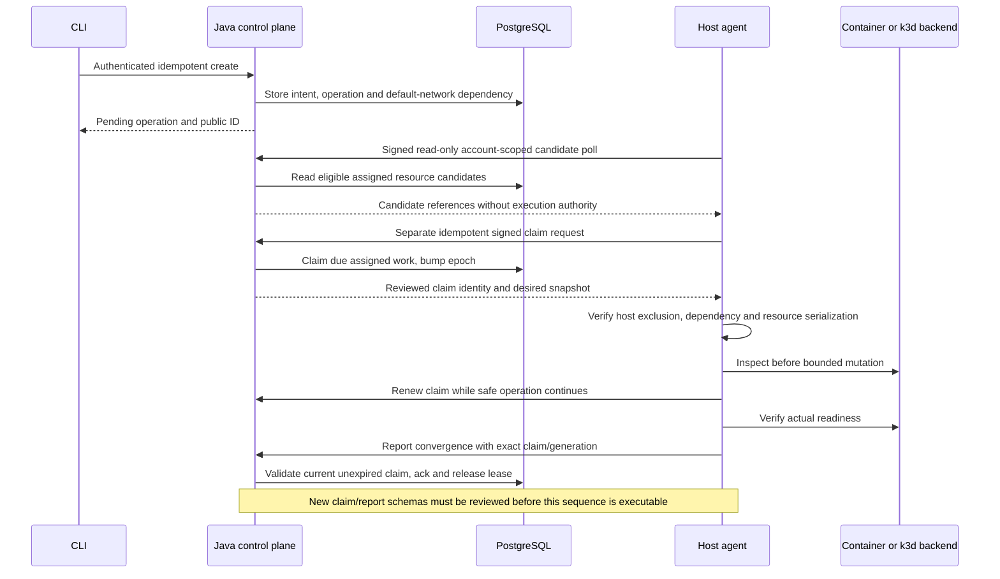

# Historical V5 snapshot before full product alignment

Snapshot: 4 November 2026. These original document bodies are retained unchanged for requirements, schema, traceability and past planning. They are not current VM/RustFS/product instructions. Active detailed guidance remains in [V5](../../V5/README.md), aligned to the [product catalogue](../product/CoveStack-Product-Architecture-and-Service-Catalogue.md). Old relative links and headings describe the original V5 layout. No historical test result is converted into current acceptance.

- [CoveStack-API-and-Compatibility.md](#v5-covestack-api-and-compatibility)
- [CoveStack-AntiWrapper-Acceptance.md](#v5-covestack-antiwrapper-acceptance)
- [CoveStack-Anuj-Next-Steps.md](#v5-covestack-anuj-next-steps)
- [CoveStack-Complete-Working-Setup.md](#v5-covestack-complete-working-setup)
- [CoveStack-Current-Setup-Fixes.md](#v5-covestack-current-setup-fixes)
- [CoveStack-Database-Schema.md](#v5-covestack-database-schema)
- [CoveStack-Extended-Roadmap.md](#v5-covestack-extended-roadmap)
- [CoveStack-Go-Handover.md](#v5-covestack-go-handover)
- [CoveStack-Implementation-Status.md](#v5-covestack-implementation-status)
- [CoveStack-Instance-Metadata.md](#v5-covestack-instance-metadata)
- [CoveStack-Operations-and-Recovery.md](#v5-covestack-operations-and-recovery)
- [CoveStack-PDF-and-Formatting.md](#v5-covestack-pdf-and-formatting)
- [CoveStack-Project-Workflow.md](#v5-covestack-project-workflow)
- [CoveStack-Publication-Domains-and-Tunneling.md](#v5-covestack-publication-domains-and-tunneling)
- [CoveStack-References-and-Decision-Log.md](#v5-covestack-references-and-decision-log)
- [CoveStack-Resource-Services.md](#v5-covestack-resource-services)
- [CoveStack-SRS-Scope.md](#v5-covestack-srs-scope)
- [CoveStack-Security-and-ITISS.md](#v5-covestack-security-and-itiss)
- [CoveStack-Service-Catalog.md](#v5-covestack-service-catalog)
- [CoveStack-Service-Gates.md](#v5-covestack-service-gates)
- [CoveStack-Stack-Templates.md](#v5-covestack-stack-templates)
- [CoveStack-Team-START-HERE.md](#v5-covestack-team-start-here)
- [CoveStack-Terraform-and-Ansible.md](#v5-covestack-terraform-and-ansible)
- [CoveStack-Testing-and-Acceptance.md](#v5-covestack-testing-and-acceptance)
- [CoveStack-UI-CLI-and-Monitoring.md](#v5-covestack-ui-cli-and-monitoring)
- [CoveStack-VPC-IPAM-and-Networking.md](#v5-covestack-vpc-ipam-and-networking)
- [DocsV5-DO_Team.md](#v5-docsv5-do-team)
- [Folder_Structure_Explanation.md](#v5-folder-structure-explanation)
- [README.md](#v5-readme)
- [Team_Roles.md](#v5-team-roles)
- [tools.md](#v5-tools)

<a id="v5-covestack-api-and-compatibility"></a>

## Snapshot: CoveStack-API-and-Compatibility.md

<!-- BEGIN ORIGINAL CoveStack-API-and-Compatibility.md -->
# Architecture transition notice — 4 November 2026

> **Superseded design reference.** Active guidance: [platform README](../docs/platform/README.md). Old container-Droplet architecture, two-driver ceiling, fixed sizing and delivery claims below are historical. The active platform docs define VM compute, a distinct App Container and evidence-based releases.
>
> The original V5 body is retained below without changing its requirements, DDL, test numbers or historical evidence. It must not be read as the current VM architecture or supported setup. [Academic transition](../docs/platform/academic-transition.md) records unresolved SRS/deadline decisions; [contract 1.1.0](../contracts/README.md) remains unchanged. No VM backend or production profile is implemented by this notice.

Current product scope: [canonical architecture and service catalogue](../docs/product/CoveStack-Product-Architecture-and-Service-Catalogue.md); product scope is independent of historical academic CORE-5.

<!-- Historical body preserved below; see supersession notice above. -->

# CoveStack V5 — API Boundaries and Compatibility Matrix

| Document control        | Value                                                                   |
| ----------------------- | ----------------------------------------------------------------------- |
| Product / documentation | **CoveStack / V5**                                                      |
| Updated                 | **15 October 2026**                                                     |
| Submission deadline     | **Monday, 25 January 2027**                                             |
| Compatibility names     | Server: `kan-server`; agent: `kan-agent`                                |
| Status                  | Target design and implementation guidance; not a completion certificate |

## 1. One backend model

All user-facing interfaces call core authorized services. Provider-style and management controllers adapt those services; they must not implement duplicate resource state or bypass account checks.

| API area              | Consumer                                 | Policy                                                           |
| --------------------- | ---------------------------------------- | ---------------------------------------------------------------- |
| Internal signed agent | Go worker                                | Service identity and private route                               |
| Provider-style subset | Tested /v2 consumers                     | Bearer account scope and exact DTO mapping; no full parity claim |
| CoveStack management  | CLI and optional provider                | CORE-5 resources and one stack integration; stable JSON          |
| S3 endpoint           | Application/S3 client                    | Scoped storage credential and signed protocol                    |
| Kubernetes API        | Authorized kubectl/workload operator     | Protected kubeconfig and route                                   |
| Extended interfaces   | [Roadmap](CoveStack-Extended-Roadmap.md) | Prior interface design relocated; not SRS scope                  |

## 2. Existing internal endpoint inventory

| Method | Path                                         | Purpose                             |
| ------ | -------------------------------------------- | ----------------------------------- |
| POST   | `/internal/v1/agent/heartbeat`               | Presence and installed capabilities |
| GET    | `/internal/v1/agent/work`                    | Scoped desired work                 |
| PUT    | `/internal/v1/agent/resources/{id}/observed` | State/generation observation        |
| GET    | `/internal/v1/agent/known-ids`               | Defined complete scoped inventory   |
| POST   | `/internal/v1/agent/events`                  | Bounded report/event input          |

GET work/known-ids scopes are authenticated agent/account plus advertised supportedKinds, excluding server-owned groups/buckets. No caller-selected account parameter exists. Current service-key verification derives accountId/accessKeyId/kind; Agreed target: one agent process per physical host; separate service credential and authenticated polling context per assigned account. B owns server assignment validation; C credential provisioning/rotation/revocation; A isolated clients and shared bounded execution. Provisioning/storage details still need B+C+A review; no new wire fields. Ownership labels do not grant account scope. Known-ids cleanup requires a complete scoped inventory; a timeout/partial response authorizes no deletion.

Actual request/response shapes remain in `contracts/internal-api.yaml`. V5 does not replace them or certify running controllers. New fields/routes require reviewed schemas, examples and tests.

### 2.1 Required protocol work before mutation — LLD contract gate

Contract 1.1.0 remains unchanged. The shapes currently define generation and observedAt, but not a complete claim/renewal correlation or standalone VPC execution exchange. The target protocol must provide the following semantics; **all new route/header/field/error names and missing enums are TBD with B+D, reviewed by A+C**. No table entry below is an invented wire string.

| Exchange | Required semantics / negative evidence |
|---|---|
| Claim acquisition/delivery | /work remains read-only candidate discovery, including auth-smoke; a separate signed idempotent mutation binds account/host/resource/generation/epoch/expiry; candidate data alone is not authority |
| Renewal | Same authenticated assignment, owner/epoch/generation; unexpired by DB clock; loss/change/revocation rejected; no expired-claim revival |
| Convergence report | Echo reviewed claim correlation; current generation/readiness; DB expiry/fence validation; atomic ack and lease release |
| Progress/inspection report | Distinguish leased attempt progress, healthy inspection completion and actual convergence; health null-generation payload alone is not sufficient correlation |
| Scheduled inspection | Fresh claim even after acked_generation equals generation; stale result cannot overwrite a new generation; no health acknowledgment |
| Network control | Separate signed internal exchange for server-owned VPC intent/claim/renew/report; no fake VPC /work kind or bucket overload |
| Generic runtime mapping | Reviewed operator-only image/volume/host-secret references for shared MinIO; no root/admin secret values in work |

Keep GET work/known-ids non-mutating. Candidate discovery does not reserve a lease or authorize execution. Claim/renew/report mutations need stable request-idempotency semantics; retry signs fresh bytes/nonce but reuses the same logical request key. Lost claim response must not bump epochs again or reserve additional work on replay. Exact encoding remains TBD with B+D/A/C.

Implement together: reviewed schemas/source generator inputs, positive/negative fixtures, generated outputs, Java DTO/controllers and Go client. Freeze the correlated design before using multiple workers or runtime mutations. Current signing scopes authenticate a request; they do not substitute for claim possession. Lifecycle 1.1.0 vocabulary stays authoritative; message-schema/version coordination does not follow from documentation version V5.

B owns assignment, claim transactions, schedule and DB predicates. D owns DTO/schema alignment. A owns client correlation, renewals and runtime exclusion. C owns expiry/stale/cross-account and uncertain-side-effect tests. The HLD/LLD is in [Main design](DocsV5-DO_Team.md#31-lld--mutation-sequence-and-contract-gate) and [Schema concurrency](CoveStack-Database-Schema.md#7-concurrency-and-reference-queries).

## 3. CORE-5 management models

| Model              | Required semantics                                                                                     |
| ------------------ | ------------------------------------------------------------------------------------------------------ |
| Resource/operation | Account scope, generation, lease/epoch; operation states queued, running, completed, failed, cancelled |
| VPC/IPAM           | Server-owned intent; one private network/account; unknown states TBD with B; attachment schema B+A     |
| Stack/template     | One immutable template version and fixed sequence; child IDs; no DAG engine                            |
| IDs                | Internal uuid; CLI prefixed public_id; /v2 numeric provider_id; B+D finalize                           |
| Automation JSON    | Stable list/get output for every service; no credential/kubeconfig content                             |

CLI, Terraform provider and future inventory use only authenticated API, never Docker/k3d or direct DB. Every mutating CLI command carries an idempotency key; pending is user-facing behavior, not a newly invented operation state. Create returns immediately; --wait polls. Endpoint additions/fields/error strings need B+D review and coordinated schemas/fixtures/generated outputs; absent values are TBD with B.

## 4. Compatibility register

| Field              | Record per tested feature              |
| ------------------ | -------------------------------------- |
| Endpoint/method    | Exact supported operation              |
| Request fields     | Required/optional/unsupported          |
| Response and error | Actual status/body and pagination      |
| Client/tool        | Version tested and endpoint override   |
| Async behavior     | Polling/timeout/action result          |
| Limitation         | Container/cluster/provider differences |

DigitalOcean-style IDs/actions need explicit mappings rather than leaking internal identifiers by accident. A custom Terraform provider does not automatically make the standard DigitalOcean provider compatible. A real S3 endpoint is distinct from a management bucket record. Website reachability is distinct from Kubernetes admin connectivity.

## 5. Cross-interface conflicts

Store a durable operation once, then let CLI wait or inspect it. Protect concurrent writes with optimistic/version checks and idempotency. Define optional provider ownership of desired fields. Broader UI/IaC conflict rules are preserved in the roadmap, not an early UI task.

## 6. Secrets and error policy

Ordinary resource responses contain safe metadata. Passwords, tokens and kubeconfigs use separately authorized retrieval with restricted logging. Errors name the failed operation without returning secret configuration or upstream response dumps. Other-account GET/DELETE/kubeconfig requests return 404 with no existence leak; tests verify side effects as well as status.

## 7. Acceptance

C owns tests 1–15 and every acceptance fixture from day 1. A reviews Go/client and wire integration; B schema/core; D Java /v2 DTOs/fixtures; E thin CLI and later provider. D writes no Go. Test real clients, negative cases and the mandatory bounded Kubernetes subset; do not return success-shaped stubs.

**Service Gate Rule:** A service is called **Supported** only after all four gates pass and its status is **Gates passed**: **G1** a DB row holds desired state and generation; **G2** reconciliation survives a crash without duplicates and rebuilds state/configuration from DB rows; **G3** another account receives **404**; **G4** one service failure test runs in CI. The DB is the source of truth, never a container, cluster, bucket, proxy or configuration file.

Status vocabulary: **Planned | In progress | Gates passed | Extended track**. CORE-5 defaults to **Planned**; the extended track defaults to **Extended track**. Do not promote a status from documentation or a mock result.

[Gates](CoveStack-Service-Gates.md) · [Acceptance](CoveStack-AntiWrapper-Acceptance.md) · [Schema](CoveStack-Database-Schema.md) · [Go handover](CoveStack-Go-Handover.md) · [Roadmap](CoveStack-Extended-Roadmap.md) · [SRS scope](CoveStack-SRS-Scope.md).

<!-- END ORIGINAL CoveStack-API-and-Compatibility.md -->

<a id="v5-covestack-antiwrapper-acceptance"></a>

## Snapshot: CoveStack-AntiWrapper-Acceptance.md

<!-- BEGIN ORIGINAL CoveStack-AntiWrapper-Acceptance.md -->
# Architecture transition notice — 4 November 2026

> **Superseded design reference.** Active guidance: [platform readiness](../docs/platform/readiness.md). Old container-specific assertions remain historical requirements needing VM mapping and additional container coverage, not proof of guest-kernel acceptance.
>
> The original V5 body is retained below without changing its requirements, DDL, test numbers or historical evidence. It must not be read as the current VM architecture or supported setup. [Academic transition](../docs/platform/academic-transition.md) records unresolved SRS/deadline decisions; [contract 1.1.0](../contracts/README.md) remains unchanged. No VM backend or production profile is implemented by this notice.

Current product scope: [canonical architecture and service catalogue](../docs/product/CoveStack-Product-Architecture-and-Service-Catalogue.md); product scope is independent of historical academic CORE-5.

<!-- Historical body preserved below; see supersession notice above. -->

# CoveStack V5 — State Reconciliation Acceptance and CORE-5 Viva

| Document control        | Value                                                                   |
| ----------------------- | ----------------------------------------------------------------------- |
| Product / documentation | **CoveStack / V5**                                                      |
| Updated                 | **20 October 2026**                                                     |
| Submission deadline     | **Monday, 25 January 2027**                                             |
| Compatibility names     | Server: `kan-server`; agent: `kan-agent`                                |
| Status                  | Target design and implementation guidance; not a completion certificate |

## 1. Scope and wrapper definition

> **Wrapper definition:** A CLI/API handler that directly runs docker run, k3d cluster create or writes proxy configuration without persisted desired state fails this acceptance design. Execution belongs behind durable intent and reconciliation, not in user-interface handlers.

**Service Gate Rule:** A service is called **Supported** only after all four gates pass and its status is **Gates passed**: **G1** a DB row holds desired state and generation; **G2** reconciliation survives a crash without duplicates and rebuilds state/configuration from DB rows; **G3** another account receives **404**; **G4** one service failure test runs in CI. The DB is the source of truth, never a container, cluster, bucket, proxy or configuration file.

Status vocabulary: **Planned | In progress | Gates passed | Extended track**. CORE-5 defaults to **Planned**; the extended track defaults to **Extended track**. Do not promote a status from documentation or a mock result.

C owns ALL acceptance tests from day 1. The owner column also identifies implementation/pairing owners. All tests below are targets; no passing results are asserted.

## 2. CORE-5 acceptance — SRS tests

| Test                    | Exact assertion                                                                                                                                          | Owner                                       | Runs in CI      | Schema constraint relied on                                       |
| ----------------------- | -------------------------------------------------------------------------------------------------------------------------------------------------------- | ------------------------------------------- | --------------- | ----------------------------------------------------------------- |
| 1 — Container crash     | Kill -9 agent after container create, before acknowledgment; restart: exactly one owned container and target convergence.                                | C owns tests; A/C pairing                   | Required target | Resource ID/name uniqueness; generation and fenced acknowledgment |
| 2 — Fencing             | A claims; lease expires; B claims; A acknowledges: reject A without changing convergence.                                                                | C owns tests; B/C pairing                   | Required target | Lease owner/epoch match; expiry decision B                        |
| 3 — Tenant              | A GET/DELETE on B resource returns 404; no side effect or existence leak.                                                                                | C owns tests; C pairing                     | Required target | Account predicates and composite ownership FKs                    |
| 4 — Idempotency         | Same key ×10 parallel creates yields one resource/ID; different body with same key returns 422.                                                          | C owns tests; B/C pairing                   | Required target | Account/key PK, fingerprint, one transaction                      |
| 5 — Stale generation    | Report generation 3 after desired generation 4: ignored; acknowledgment and current observed state unchanged.                                            | C owns tests; B/C pairing                   | Required target | Acknowledgment equality; separate guarded progress statement      |
| 6 — Server down         | Stop server: agent creates and deletes nothing while disconnected.                                                                                       | C owns tests; A/C pairing                   | Required target | DB authoritative intent; no cleanup from failed poll              |
| 7 — Kubernetes crash    | Kill -9 agent mid cluster create; restart: exactly one deterministic cluster and target convergence.                                                     | C owns tests; A/C pairing                   | Required target | Cluster identity, reserved port and proposed labels               |
| 8 — Kubernetes tenant   | B fetches A kubeconfig: 404; kubeconfig absent from list/get/observations.                                                                               | C owns tests; C/D pairing                   | Required target | Account FK/predicate; kubeconfig reference only                   |
| 9 — Kubernetes cleanup  | Delete cluster: no owned container, volume or network with kan.resource=<id> remains.                                                                    | C owns tests; A/C pairing                   | Required target | Proposed label contract and ownership inventory                   |
| 10 — Kubernetes quota   | Third cluster on host: documented quota error; existing clusters unchanged.                                                                              | C owns tests; B/C pairing                   | Required target | Host cap transaction lock and derived count                       |
| 11 — PostgreSQL restore | Back up known rows, delete test data, restore: rows and canonical dataset checksum match; B cannot reach A DB.                                           | C owns tests; A/B/C pairing                 | Required target | Owned volume/backup/credentials and private routing               |
| 12 — MinIO tenant       | A access key on B bucket: denied; API requests for B resource by A return 404.                                                                           | C owns tests; C/B pairing                   | Required target | Scoped bucket credentials and account predicates                  |
| 13 — MinIO rebuild      | Restart MinIO; Java server reconciles bucket and credential policy from DB rows, without duplicate or cross-account binding.                             | C owns tests; B/C pairing                   | Required target | storage.bucket is server-owned; ciphertext custody TBD B+C        |
| 14 — VPC allocation     | 10 parallel IP allocations in one VPC: no duplicates; 10 accounts create VPCs concurrently: no CIDR overlap; A cannot see B network; no user CIDR input. | C owns tests; C/B; A network checks pairing | Required target | Subnet exclusion, live-IP uniqueness, one VPC/account             |
| 15 — Stack              | One CLI command provisions PostgreSQL + MinIO + app Droplet; partial failure recorded; retry resumes without duplicate children.                         | C owns tests; B/C/E; A execution pairing    | Required target | Stack/role uniqueness and idempotent child records                |

Test 14 does not permit custom user CIDRs: overlap is exercised against allocator/database proposals. Tests 11/12 include protocol/network denial alongside the account-scoped API 404 rule. K8s quota error name/status is **TBD with B+D**; do not invent an error wire string. Proposed `kan.account`, `kan.resource`, `kan.agent` labels need coordinated review; they are not present compatibility.

## 3. Reference concurrency design

**Reference design, B finalizes; not executable, not migration-ready.** Resources propose generation, acked_generation, lease_owner, lease_epoch, lease_expires_at and deleted_at. Exact schemas/SQL are in [Database Schema](CoveStack-Database-Schema.md).

| Flow                 | Required invariant                                                                                                                                                        |
| -------------------- | ------------------------------------------------------------------------------------------------------------------------------------------------------------------------- |
| Claim                | Verified credential account/agent context, not caller-selected account; agreed separate account credentials/clients in one host process; assignment details B+C+A; SKIP LOCKED, bump epoch, reference 30-second lease               |
| Acknowledge          | id, lease_owner, lease_epoch match AND generation = :gen; zero rows rejected; accepted ack clears lease_owner and lease_expires_at together, leaves lease_epoch unchanged |
| Progress             | Separate guarded statement; never touches acked_generation                                                                                                                |
| Expiry | Renewal, reports and ack require current epoch/generation and unexpired claim by DB clock; runtime exclusion is separate from DB fencing |
| Idempotent create    | Account/key reservation, resource, operation/event and response in ONE transaction                                                                                        |
| Fingerprint mismatch | Same key and different normalized request body: 422                                                                                                                       |
| Retry                | Refresh/resume durable operation, not duplicate runtime create                                                                                                            |

### 3.1 Account-context acceptance — extends existing tests

C owns these cases; they supplement existing numbers, not new service/test IDs. Test 3: account A credentials cannot fetch/report/ack B work, including forged resource IDs; server checks assignment as well as account. Test 6: revoke/fail one account context while another keeps polling; no credential fallback or cleanup from failed inventory. Tests 1–2: restart both contexts and reject stale epochs without duplicates. Test 10: accounts share the canonical host cap; concurrent third-cluster request is rejected under the DB lock. Add client-level tests for immutable credentials and correct request/response context routing. Agent compromise remains a trusted-host risk, not isolation solved by separate credentials.

### 3.2 HLD/LLD regression variants — existing test numbers

| Existing test | Additional exact target | Owner |
|---|---|---|
| 1 | After initial convergence, remove the test container; periodic inspection repairs it with unchanged desired generation and exactly one owned runtime | C; A+B integration |
| 2 | Expired renew/ack rejected; pause the old runtime worker or leave a child/API action unresolved; a new worker must not start conflicting mutation until prior execution settles | C; A+B |
| 3 | Correct account but wrong assigned agent/claim rejected; user input cannot select another account's network or runtime | C; B+D+A |
| 5 | After ack releases lease, fresh inspection updates health without changing acked_generation; delayed old inspection cannot overwrite a newer desired generation | C; B+A |
| 6 | With server down before dispatch, no new mutations start; already submitted backend action may settle and must be inspected before retry; a failed inventory never means delete | C; A |
| 7 | Kill main while k3d child is active; preserve operation exclusion and recover without a competing create/delete; explicit uncertain outcome blocks unsafe takeover | C; A |
| 9–10 | Deleting/partially created clusters retain API-port and host-cap reservations until verified cleanup; third cluster cannot bypass capacity during deletion | C; B+A |
| 11 | Default VPC converges before DB attachment; backup/key recovery is measured; shared-host backup limits are stated | C; B+A |
| 12–13 | Shared MinIO bootstrap/secret references and private administration verified; Java rebuilds policy after restart; known objects still readable from retained data | C; B+A |
| 14 | Standalone VPC creation/restart/deletion reaches network helper through reviewed signed exchange; stale network claim rejected; deletion with attached/reserved workload denied; network-only API form is not enough | C; B+D+A |
| 15 | First stack automatically ensures default VPC, DB, tenant bucket in shared MinIO and app; retry no duplicates; deleting stack cannot delete shared MinIO process or another account's bucket | C; B+E+A |

These are targets, not passing results. Do not add E9 or renumber 1–15/E1–E8. OS exclusion, backend settlement and DB epoch fencing are different evidence; a rejected DB acknowledgment alone does not prove runtime exclusion. No test asserts strict exactly-once execution across arbitrary failures. Under tests 2/4/6, assert GET work/known-ids/auth-smoke changes no lease; duplicate same-key claim after lost response returns the same epoch/result, not a second resource or revived expired lease.

### 3.3 User experience assertions — Planned, existing tests

C owns these public API/CLI integration assertions under existing tests 1–15. Direct helper calls, schema presence and successful process startup do not establish a usable service. Record revision, environment, expected/actual result and sanitized evidence; no new requirement IDs or wire strings.

| Existing test | Additional experience assertion | Implementation pairing |
| --- | --- | --- |
| 3 | Two accounts can use the same friendly resource name; list/get/delete remain scoped; foreign IDs return 404 without leakage | B/D/E with C |
| 1, 2, 5, 6 | During controlled crash/outage, get distinguishes desired/converged revision and observation freshness, with sanitized error; old observations never imply fresh health; no secret values | B/D/E and A with C |
| 7–10 | Authorized export yields usable kubeconfig; deploy a bounded test workload and read its result; denial and cleanup still pass | A/B/D/E with C |
| 11 | Connect using scoped credentials; write/read known rows; remove test rows, restore and compare canonical dataset/checksum | A/B with C |
| 12, 13 | Upload/download exact bytes with scoped credentials; restart MinIO and verify retained object checksum; other-account key denied | B and A with C |
| 14 | In addition to allocation races, prove intended same-account app/DB connectivity and cross-account network denial using actual traffic; control-plane ports remain inaccessible | C allocator, A helper, B records |
| 15 | One fixed stack yields an app that writes/reads PostgreSQL and uploads/downloads an object; retry a partial failure without duplicate children; deletion follows retention policy | B/A/E with C |

Use a reviewed app image and documented app invocation/access path. The local or private endpoint need not be internet reachable; public exposure stays in the extended roadmap. Capability help must state actual limits and reject unsupported options; B/D/E agree response mappings, not invented wire values. A clean-host teammate walkthrough is installer evidence, not a new service gate.

## 4. CORE-5 live demo and recorded evidence

Live highlights: tests 1, 3, 4 and the CLI get view showing desired versus converged generation, lease and observed state. Remaining tests are CI output/recorded video. Record a backup video; do not rely on hotspot access alone. CLI cross-build/run evidence uses two actual OSes, not compilation alone.

## 5. CORE-5 viva questions

| Question                                 | Honest answer — target, not current claim                                                                                       |
| ---------------------------------------- | ------------------------------------------------------------------------------------------------------------------------------- |
| 1. Crash mid-create?                     | DB intent survives. Ensure inspects deterministic owned identity before another create; test 1 must prove one container.        |
| 2. Two agents?                           | Lease epoch changes on reclaim. An old owner/epoch acknowledgment is rejected; host exclusion separately blocks competing runtime mutation. Test 2 covers both.                                |
| 3. Why not just Docker?                  | Docker is execution. Our target is account-scoped DB intent, fencing and crash-safe lifecycle; claim evidence only after gates. |
| 4. Why not just k3d?                     | k3d executes a cluster request. Our target adds tenancy, port reservation, quotas, reconciliation and scoped kubeconfig.        |
| 5. Why not containers for data services? | Execution is reused. Our target adds volume ownership, measured restore and per-account storage credentials.                    |
| 6. Is a Droplet a VM?                    | No. CORE-5 compute is container-backed on one host. It has no independent-kernel VM boundary.                                   |
| 7. A reads B kubeconfig?                 | API must return 404; kubeconfig stays out of list/get/observations. Test 8 supplies evidence.                                   |
| 8. Server down?                          | Agent performs no new create/delete. No poll result means no authoritative deletion intent.                                     |
| 9. Why only two clusters?                | The 8 GB single-host budget is constrained. The per-cluster estimate is unverified until the host spike.                        |
| 10. Why no direct CLI DB access?         | Authenticated API centralizes policy/idempotency. CLI stores configuration only, not resource state.                            |
| 11. Which services are Gates passed?     | None are promoted by this document. Inspect the current gate register and C's CI evidence.                                      |
| 12. What is not implemented?             | This is target design, not a certificate. Missing gates and contract decisions are recorded explicitly.                         |

## Appendix A. Extended track tests — not SRS acceptance

Extended features may be shown only as bonus after Gates passed. These tests do not enlarge the SRS.

| Test                   | Exact assertion                                                                                            | Owner                               | Runs in CI      | Schema constraint relied on                        |
| ---------------------- | ---------------------------------------------------------------------------------------------------------- | ----------------------------------- | --------------- | -------------------------------------------------- |
| E1 — ASG               | Delete an active desired member: replacement respects cooldown/min/max; server down: no scaling.           | C owns tests; B/C/A pairing         | Required target | Parent ownership and DB policy                     |
| E2 — Load balancing    | Kill backend: health removes it; delete proxy config: regenerate from DB rows.                             | C owns tests; D/B/C/A pairing       | Required target | Owned backend FKs; observations are derived        |
| E3 — Snapshot          | Snapshot, change file, restore new Droplet: original hash; B cannot read snapshot.                         | C owns tests; D/A/C pairing         | Required target | Account resource/image binding                     |
| E4 — Metadata          | A cannot read B metadata; no agent/cloud secrets returned.                                                 | C owns tests; C/A/B pairing         | Required target | Bound self-identity                                |
| E5 — Publication       | Unknown hostname: 404; resource deletion removes route; public route cannot reach private management port. | C owns tests; A/B/C pairing         | Required target | Unique owned hostname and approved resource        |
| E6 — Domains           | Unverified domain serves nothing; reassignment never serves old tenant.                                    | C owns tests; C/B/A pairing         | Required target | Claim/verification revision binding                |
| E7 — Monitoring        | Stop agent: display stale/unknown, never healthy; alert fires and is recorded.                             | C owns tests; C/B/A pairing         | Required target | Freshness thresholds TBD with B; recorded evidence |
| E8 — Ansible inventory | Bob inventory contains none of Alice Droplets; inventory uses CLI JSON/API, never docker ps.               | C owns tests; E/C; A review pairing | Required target | API account predicate                              |

React has an API-only read-only list/interface gate plus relevant account tests; it creates no tables. E1–E8 are the eight named extended acceptance tests, not nine separate service numbers.

### Batch 2 checklist

Batch 2 added the exact heading **## 10. Known constraints**. The [SRS constraint target](CoveStack-Complete-Working-Setup.md#10-known-constraints) now resolves; this checklist records the cross-link correction, not application acceptance.

[Service gates](CoveStack-Service-Gates.md) · [Schema](CoveStack-Database-Schema.md) · [SRS](CoveStack-SRS-Scope.md) · [Extended roadmap](CoveStack-Extended-Roadmap.md) · [Go handover](CoveStack-Go-Handover.md).

<!-- END ORIGINAL CoveStack-AntiWrapper-Acceptance.md -->

<a id="v5-covestack-anuj-next-steps"></a>

## Snapshot: CoveStack-Anuj-Next-Steps.md

<!-- BEGIN ORIGINAL CoveStack-Anuj-Next-Steps.md -->
# Architecture transition notice — 4 November 2026

> **Superseded design reference.** Active guidance: [platform contributing](../docs/platform/contributing.md). Agent loop exists. Next authorized integration is real Java/credential/assignment evidence, then reviewed VM/claim/network protocol and an authorized host evaluation; no recreation of the loop.
>
> The original V5 body is retained below without changing its requirements, DDL, test numbers or historical evidence. It must not be read as the current VM architecture or supported setup. [Academic transition](../docs/platform/academic-transition.md) records unresolved SRS/deadline decisions; [contract 1.1.0](../contracts/README.md) remains unchanged. No VM backend or production profile is implemented by this notice.

Current product scope: [canonical architecture and service catalogue](../docs/product/CoveStack-Product-Architecture-and-Service-Catalogue.md); product scope is independent of historical academic CORE-5.

<!-- Historical body preserved below; see supersession notice above. -->

# CoveStack V5 — Anuj Implementation and ITISS Work Order

| Document control        | Value                                                                   |
| ----------------------- | ----------------------------------------------------------------------- |
| Product / documentation | **CoveStack / V5**                                                      |
| Updated                 | **27 October 2026**                                                     |
| Submission deadline     | **Monday, 25 January 2027**                                             |
| Compatibility names     | Server: `kan-server`; agent: `kan-agent`                                |
| Status                  | Target design and implementation guidance; not a completion certificate |

## 1. Current starting point

Config/signing/lifecycle source and auth-smoke are inspection evidence only; no service is Gates passed from file presence. The next A work is reviewed client/polling, production agent and generic container reconciliation. Do not reapply old patches or rename compatibility packages. No code changes happen in this documentation task.

**Service Gate Rule:** A service is called **Supported** only after all four gates pass and its status is **Gates passed**: **G1** a DB row holds desired state and generation; **G2** reconciliation survives a crash without duplicates and rebuilds state/configuration from DB rows; **G3** another account receives **404**; **G4** one service failure test runs in CI. The DB is the source of truth, never a container, cluster, bucket, proxy or configuration file.

Status vocabulary: **Planned | In progress | Gates passed | Extended track**. CORE-5 defaults to **Planned**; the extended track defaults to **Extended track**. Do not promote a status from documentation or a mock result.

## 2. Immediate implementation sequence

| Order | A work                                                  | Acceptance/review                                                     |
| ----- | ------------------------------------------------------- | --------------------------------------------------------------------- |
| 1     | Review local config/tests; schema and signed-poll scope | Implement agreed one-process/per-account-client model after assignment/custody review; no cross-account shortcut |
| 2     | Plan module layout and signer move into pkg/kanclient   | A+B+C review; move not performed now                                  |
| 3     | Typed HTTP client and injected-transport tests          | Finite timeout, cancellation, no redirects, bounded body              |
| 4     | Production heartbeat/poll/shutdown main                 | Real server/auth-smoke; advertise only installed reviewed kinds       |
| 5     | Generic container driver and reconcile                  | Tests 1–6 with C; B owns all lease/fence/idempotency SQL              |
| 6     | Docker network helper inside container driver           | C Java allocator; B records; test 14; attachment contract change B+A  |
| 7     | k3d CLI driver after early host spike; revalidate in November                | Tests 7–10; max 2 clusters/host; reserved port and scoped kubeconfig  |
| 8     | PostgreSQL and MinIO process/volume lifecycle           | Tests 11–13; Java reconciles buckets/credentials                      |
| 9     | One stack integration; Ansible Part 1 and evidence      | Test 15; installer second run changed=0                               |

Only two workload drivers: container and k3d. Generic container inputs are image/env/volume/labels/health. Proposed kan.* reserved labels require approval. Unknown states/wire fields remain TBD with B; contract 1.1.0 wins.

A types and can explain agent Go; AI-generated code is reference only. E owns thin CLI, never agent/signing/drivers/reconcile. Follow CLI service order droplet → vpc → k8s → db → bucket → stack, waiting for the previous failure test in CI.

### 2.1 HLD/LLD changes to your first slices

Run the total-host capacity spike at first host preparation, not after committing the combined workload shape. Before mutation, pair with B+D/C on claim/renew/report and separate signed network-control schemas; existing 1.1.0 fields do not define the full protocol. Do not add wire fields alone.

Acquire host OS exclusion, serialize resource mutations, retain child-operation exclusion and record durable attempts with B. A timeout does not prove a backend stopped. Ambiguous old execution blocks conflicting takeover until settled; DB epoch rejection alone is insufficient. Renew only current unexpired claims and stop new mutations when authorization is lost.

Default VPC execution is needed for the first real Droplet. Add periodic inspection of converged rows, using fresh claims and no health acknowledgment. Repair drift with unchanged desired generation; stale inspection cannot overwrite newer intent. For MinIO, execute one operator-owned shared process/volume from reviewed intent/host secret references; Java owns tenant buckets and the stack owns a bucket child, not the shared process. Preserve the fixed stack/test 15 and installer; optional/extended work is cut first.

These are Planned implementation duties. [HLD](DocsV5-DO_Team.md#22-hld--control-execution-and-data-paths) and [LLD](CoveStack-Database-Schema.md#7-concurrency-and-reference-queries) define the precise dependencies and failure evidence.

### 2.2 User experience responsibilities — Planned

Your immediate milestone remains one-account signed communication, no-work handling, bounded retries and clean shutdown against the real server. Add execution only after reviewed claim/network schemas. These experience checks accompany the existing order; do not start extended features to satisfy them.

| When | Your work | Pairing/evidence |
| --- | --- | --- |
| Container reconciliation | Run a reviewed app; preserve resource identity across restart; emit bounded sanitized observations/errors with freshness | B/D API and E display; C tests 1–6 |
| Network helper | Execute allocated network attachments; prove intended app/DB paths and cross-account denial | C allocator/tests, B records; test 14 |
| Kubernetes driver | Ensure usable scoped API access; deploy/read a bounded test workload after recovery | B/D/E integration; C tests 7–10 |
| Persistence and stack | Preserve volumes; app reads/writes DB and object bytes; help restore known data | B owns bucket reconcile/stack records; C tests 11–15; E CLI |
| Installer and ITISS | Teammate clean-host walkthrough, outage timeline, traffic matrix and measured restore | C reviews sanitized evidence; Ansible Part 1 |

You do not take over CLI output, SQL, bucket administration or the acceptance suite. Agree image, endpoint/secret delivery and API representation with their owners. See [experience assertions](CoveStack-AntiWrapper-Acceptance.md#33-user-experience-assertions--planned-existing-tests).

### 2.3 First milestone decision — single-account communication, Planned

Selected starting plan on 27 October 2026: one agent process, one assigned account and one dedicated service signing credential; short polling and no workload execution. Later add isolated account contexts under the existing host model. This is an implementation target authorized for planning, not a claim of server readiness, completed security review or a new wire release. Existing contract rules win; operational defaults below are selected starting values to test with B+C, not protocol constants.

| Item | Starting decision | Authority / owner |
| --- | --- | --- |
| Same-host origin | http://localhost:4700; real listening address must be confirmed | Existing internal-api.yaml development origin; B starts/configures server |
| Remote origin | Verified HTTPS; no TLS-verification bypass | Existing config rejects remote plain HTTP; B+C provide actual endpoint |
| Settings | KAN_SERVER_URL, KAN_ACCESS_KEY, KAN_SECRET_KEY, KAN_RULES_PATH | Existing environment loader; no automatic .env loading or invented config fields |
| Credential | Dedicated service key for one account/agent assignment; no default/shared key | C securely generates/issues; B stores trusted assignment; A loads secret |
| Stored secret | Signing ciphertext plus key version; Bearer tokens remain hash-only | B+C finalize master-key custody, algorithm implementation and rotation; no key stored alongside ciphertext in ordinary DB rows |
| Work request | GET /internal/v1/agent/work; read-only, not a claim | Current contract; verified credential determines account |
| No work | HTTP 200, JSON [] | Existing array schema; reject malformed/null responses and do not introduce 204 as the normal result |
| Capability | supportedKinds: [] until an installed driver passes review | Existing heartbeat supports empty list; server must return no executable work |
| Request timeout | 10 seconds per attempt | Selected initial client behavior; finite and cancellation-aware |
| Normal poll | 5-second base interval, with bounded small jitter | Selected initial client behavior; A+C test bounds; never busy-loop |
| Temporary failures | Backoff from 1 second, doubling to a 30-second cap, with bounded jitter; reset after valid success | Network/timeout and transient 5xx; rebuild/sign each attempt |
| Rate limit | For 429 respect valid Retry-After, with cancellable waiting; invalid value uses backoff | B+C+A review supported parsing/wait bounds; no immediate retry loop |
| Authentication/config errors | 401/403 or invalid config stops this account loop with sanitized diagnostic | No endless retry with invalid credentials; later other account contexts remain independent |
| Redirects | Refuse all redirects; do not forward signed credentials | Existing client boundary target |
| Shutdown | Ctrl+C/termination cancels HTTP request, polling wait and backoff; no next request | A implements context/signal handling |

Use response-size bounds and validate decoded data; exact local bound is A+B/C review, not the signed request-body limit. Other nonretryable 4xx and malformed/oversized responses are explicit errors, not empty successful polls. Never log keys, signatures, raw secret-bearing payloads or kubeconfigs. HMAC authenticates bytes; HTTPS protects confidentiality.

#### Start discussion and delivery checklist

| Order | Owner | Required action / result |
| --- | --- | --- |
| 1 | B+C+A | Confirm actual listening URL, account identity and trusted credential-to-host lookup; KeyService currently supplies account/key/kind, not proof of host assignment |
| 2 | B | Boot real Java server with reviewed foundational migrations and required replay store; existing extended migrations alone do not bootstrap the DB |
| 3 | C+B | Provision dedicated service key, store encrypted verifier secret and trusted account/agent assignment; deliver secret once by protected channel, never chat/source/logs; test revoke/unknown key |
| 4 | A | Review existing config, sigv1 and auth-smoke; reuse signer; agree module layout before moving into pkg/kanclient |
| 5 | A+B+C | Valid signed GET receives 200 []; stop/restart server to prove backoff/recovery; invalid credentials stop; Ctrl+C interrupts request and wait |
| 6 | C with A | Record unit/mock versus real-server results separately; no-work check does not pass any resource gate |
| 7 | B+D+A/C | Before execution: finalize separate signed idempotent claim, renewal and progress/convergence schemas, fixtures and generated outputs |

Heartbeat currently requires agentVersion, dockerVersion and supportedKinds. Agree a truthful dockerVersion source before sending it; do not invent a fake version or advertise unavailable drivers. The initial signed GET/auth-smoke can establish communication before heartbeat integration. With empty capabilities, unexpected nonempty work is a protocol/capability error: no dispatch, no success acknowledgment and no cleanup. Empty/failed polls never authorize deleting local objects.

The agent never writes platform SQL or selects its account from a request/label. B validates assignment from verified service identity; C controls eligibility/custody; A implements isolated clients. Exact assignment storage/provisioning is still B+C+A review, not silently solved by these defaults.

#### Exit criteria and next step

A real server accepts the valid signature and returns 200 []; an outage triggers bounded backoff and recovery; invalid credentials produce a safe stop; cancellation exits promptly; credentials are absent from logs. C records the revision/environment/results. Claim and execute nothing in this milestone. Then implement one owned Droplet lifecycle only after claim/network protocol review, with C's crash/fencing evidence; E continues the CLI without agent ownership.

## 3. Client rules

| Concern         | Requirement                                                        |
| --------------- | ------------------------------------------------------------------ |
| Context/timeout | Caller cancellation, finite HTTP timeout                           |
| Redirects       | Refuse forwarding signed credentials                               |
| Request bytes   | Marshal once; sign/transmit identical bytes                        |
| Response size   | Bounded read; detect overflow                                      |
| Status/JSON     | Non-2xx and malformed data are errors                              |
| Retry           | Fresh signed request; mutations need agreed idempotency            |
| Logging         | No secret structs, canonical real-key payloads or full kubeconfigs |

Coordinate endpoints, retry/idempotency, agent leases and readiness with B. Test using synthetic credentials; a fake verifier is not the deployed auth/store.

## 4. First compute acceptance

Create one owned container-backed Droplet, inspect by approved labels before create, restart after mid-create crash, converge without duplicates and delete only the owned resource. Preserve volumes/unrelated resources. Never describe Droplets as VMs. Server outage or incomplete/empty poll must not trigger cleanup.

Epoch is the fence; convergence ack requires exact generation/owner/epoch and clears lease_owner plus lease_expires_at together, leaving epoch unchanged. Progress is separate and never changes acked_generation. A reviews agent integration; B owns SQL; C owns tests. Lifecycle success mapping uses existing contract strings only.

Agreed target: one agent process per physical host; separate service credential and authenticated polling context per assigned account. B owns server assignment validation; C credential provisioning/rotation/revocation; A isolated clients and shared bounded execution. Provisioning/storage details still need B+C+A review; no new wire fields.

## 5. ITISS parallel track

| CORE-5 phase | Evidence                                                                             |
| ------------ | ------------------------------------------------------------------------------------ |
| Foundation   | AlmaLinux VM/version/resource budget, threat model, real signing/replay tests and CI |
| Compute      | Privilege/mount review, crash/fence/isolation tests with C                           |
| Network      | Pool/allocator decision, private firewall and actual denied paths                    |
| Kubernetes   | One-day host spike: cgroup v2, SELinux, firewalld, memory and tested k3d+k3s flags   |
| Data         | Owned volumes/credentials; measured backup/restore and cross-account denial          |
| Install      | Vault/no_log/checksums/systemd hardening; second run changed=0                       |

Publication/TLS/tunnel, metadata, metrics/alerts/incidents and dynamic inventory remain Extended track evidence in the roadmap. A begins extended Go only after all CORE-5 gates pass. If A is one week behind, all extended work stops.

Ask mentor in writing whether ITISS students may own agent/driver Go; if not, name a developer and record handover. Confirmation remains pending.

## 6. Learning sequence

Study structs/pointers/interfaces/errors, HTTP/JSON/readers, contexts/timers/signals, tests and then concurrency. Inspect one fixture/result before coding. Use Go documentation and the prior learning guide if present; V5 does not replace code-level walkthroughs.

## 7. Dated targets

| Period                          | A checkpoint                                                      |
| ------------------------------- | ----------------------------------------------------------------- |
| 14–31 October 2026              | Client/main/poll/auth-smoke and schema review                     |
| 1–20 November 2026              | Container/reconcile/fencing integration; revalidate early capacity spike   |
| 21 November–5 December 2026     | Tests 1–6 in CI and network helper/allocator integration          |
| 6–20 December 2026              | Required bounded K8s and tests 7–10                               |
| 21 December 2026–5 January 2027 | PostgreSQL/MinIO process lifecycle and restore with C/B           |
| 6–10 January 2027               | One stack and Ansible Part 1                                      |
| 11–25 January 2027              | Freeze, clean-VM test, two-OS CLI evidence, viva and backup video |

No new CORE-5 features after 10 January. Never cut tests 1–15; cut extended work first and report any unmet gate honestly. Final deadline: Monday, 25 January 2027.

[Service gates](CoveStack-Service-Gates.md) · [Acceptance](CoveStack-AntiWrapper-Acceptance.md) · [Schema](CoveStack-Database-Schema.md) · [Go handover](CoveStack-Go-Handover.md) · [Extended roadmap](CoveStack-Extended-Roadmap.md) · [SRS scope](CoveStack-SRS-Scope.md).

<!-- END ORIGINAL CoveStack-Anuj-Next-Steps.md -->

<a id="v5-covestack-complete-working-setup"></a>

## Snapshot: CoveStack-Complete-Working-Setup.md

<!-- BEGIN ORIGINAL CoveStack-Complete-Working-Setup.md -->
# Architecture transition notice — 4 November 2026

> **Superseded design reference.** Active guidance: [platform installation-and-operations](../docs/platform/installation-and-operations.md). No supported VM/product installer exists. 8 GB is a lab constraint, not production sizing; preflight/capacity evidence is required. Existing sandbox runtime restrictions remain.
>
> The original V5 body is retained below without changing its requirements, DDL, test numbers or historical evidence. It must not be read as the current VM architecture or supported setup. [Academic transition](../docs/platform/academic-transition.md) records unresolved SRS/deadline decisions; [contract 1.1.0](../contracts/README.md) remains unchanged. No VM backend or production profile is implemented by this notice.

Current product scope: [canonical architecture and service catalogue](../docs/product/CoveStack-Product-Architecture-and-Service-Catalogue.md); product scope is independent of historical academic CORE-5.

<!-- Historical body preserved below; see supersession notice above. -->

# CoveStack V5 — Setup, Deployment and Verification

| Document control        | Value                                                                   |
| ----------------------- | ----------------------------------------------------------------------- |
| Product / documentation | **CoveStack / V5**                                                      |
| Updated                 | **27 October 2026**                                                     |
| Submission deadline     | **Monday, 25 January 2027**                                             |
| Compatibility names     | Server: `kan-server`; agent: `kan-agent`                                |
| Status                  | Target design and implementation guidance; not a completion certificate |

## 1. Scope of this setup

**This guide describes target deployment and required evidence.** These instructions separate usable baseline checks from the target installation. Do not run a fictional CLI/main entry point and treat failure as an environment problem.

| Stage               | What can be verified                                                           |
| ------------------- | ------------------------------------------------------------------------------ |
| Current baseline    | Go tests/vet, signing vectors, lifecycle generation, Java library tests        |
| Infrastructure      | Compose configuration and private Postgres/Valkey/Mailpit readiness            |
| Backend gate        | Application entry point, migrations, concrete auth and API routing             |
| Agent gate          | Configuration, signed client, polling and real resource driver                 |
| CORE-5 target       | Droplets, required Kubernetes, Managed PostgreSQL, Object storage and VPC/IPAM |
| Extended deployment | Separate [roadmap](CoveStack-Extended-Roadmap.md); no CORE-5 UI work           |

## 2. Environment inventory

Record the exact tested versions before release. Existing pins are repository observations, not blanket recommendations for future installs.

| Tool           | Current repository expectation                      | Verify                                                     |
| -------------- | --------------------------------------------------- | ---------------------------------------------------------- |
| Go             | Language directive 1.22; preferred toolchain 1.27.2 | Actual executable and CI selection                         |
| Java           | 25 in `kan-server/pom.xml`                          | Both runtime and compiler                                  |
| Spring Boot    | Parent 3.5.16 in inspected POM                      | Dependency availability and real build                     |
| PostgreSQL     | Compose requests a reviewed 17 image                | Exact image/digest and mount layout                        |
| Valkey         | Compose requests a reviewed 8 image                 | Authentication and replay persistence                      |
| Docker/Compose | Needed for current execution/infra                  | Engine, compose plugin and firewall backend                |
| k3d/k3s        | Required CORE-5 integration                         | One tested pair; pin after host spike; max 2 clusters/host |

Use the [tool matrix](tools.md). Review support/security updates before choosing release versions; do not change pins only because a course uses another release.

## 3. Clone and work on a feature branch

```bash
git clone https://github.com/Ciago-Technologies/covestack-cloud.git
cd covestack-cloud
git status -sb
git remote -v
```

Use the agreed reviewed baseline branch. If baseline PRs are merged:

```bash
git switch main
git pull --ff-only origin main
git switch -c feat/your-task
```

Do not share deployment secrets. Read V5 roles and status before accepting implementation tasks.

## 4. Baseline checks

From the repository root:

```bash
python3 contracts/sign_example.py
python3 contracts/check_lifecycle.py
(cd kan-agent && go test -race ./...)
(cd kan-agent && go vet ./...)
(cd kan-server && mvn --batch-mode --no-transfer-progress verify)
```

| Result                           | Interpretation                                              |
| -------------------------------- | ----------------------------------------------------------- |
| Vector/schema pass               | Contract evidence only                                      |
| Go unit/race pass                | Exercised implementation paths, not all production behavior |
| Maven verify pass                | Library/build result; application boot needs an entry point |
| Network/cache/dependency failure | Incomplete verification, not success                        |
| Local toolchain fallback         | Label actual tested version; not pinned-version evidence    |

The inspected Boot plugin has `skip=true` while the server lacks the application main. B must enable packaging after that entry point and configuration exist, then verify the packaged app actually boots.

### 4.1 Planned CLI dependency and packaging gates

Run after the reviewed Go module layout and cmd/covestack exist, from the owning module root. These are verification targets, not commands for a fictional current main:

```bash
go list -deps ./cmd/covestack | grep -i -e docker -e k3d
GOOS=linux GOARCH=amd64 go build -o /tmp/covestack-linux-amd64 ./cmd/covestack
GOOS=darwin GOARCH=arm64 go build -o /tmp/covestack-darwin-arm64 ./cmd/covestack
GOOS=windows GOARCH=amd64 go build -o /tmp/covestack-windows-amd64.exe ./cmd/covestack
```

Dependency grep must print nothing; CI must separately check go list succeeded, since grep's no-match exit alone cannot prove a build. CLI imports no Docker/k3d, calls only authenticated API, and uses no local DB. Cross-builds require actual CLI runs on two OSes; they do not prove runtime portability.

## 5. Private infrastructure configuration

Create `deploy/.env` from the tracked template **only if absent**. Choose reviewed exact image references rather than leaving blanks or using `latest`. Preserve an existing configured file.

| Local file                         | Purpose                                             |
| ---------------------------------- | --------------------------------------------------- |
| `deploy/.env`                      | Postgres, Valkey and Mailpit image references       |
| `deploy/secrets/postgres_password` | Database password secret                            |
| `deploy/secrets/valkey.conf`       | Authenticated Valkey configuration from template    |
| `deploy/secrets/agent.env`         | Agent server origin and service credential settings |

Generate secrets using a cryptographic source and store locally; do not paste them into repository docs. Restrict the secret directory to the owner and files to required readers. The agent signing secret and infrastructure passwords are different credentials.

```bash
docker compose --env-file deploy/.env -f deploy/docker-compose.yml config --quiet
docker compose --env-file deploy/.env -f deploy/docker-compose.yml up -d
docker compose --env-file deploy/.env -f deploy/docker-compose.yml ps
```

| Existing host listener | Intended access                         |
| ---------------------- | --------------------------------------- |
| `127.0.0.1:5432`       | Control-plane PostgreSQL                |
| `127.0.0.1:6390`       | Valkey host access; container port 6379 |
| `127.0.0.1:1025`       | Mailpit SMTP capture                    |
| `127.0.0.1:8025`       | Private Mailpit UI                      |

Compose starts these dependencies, not Java or the full Go agent. Existing PostgreSQL volumes retain initialized credentials. Rotate intentionally; never delete volumes merely to make a new environment variable take effect.

## 6. Backend integration gate

| Step                                        | Owner/evidence                                |
| ------------------------------------------- | --------------------------------------------- |
| Add application main and real configuration | B: package and boot                           |
| Apply fresh migrations                      | B: clean-database evidence                    |
| Implement active credential/token lookup    | C: real store and revocation                  |
| Provision account-bound service key         | C/B: restricted issuance and custody review   |
| Register scoped APIs                        | B/C/D: Java HTTP tests; E consumes API        |
| Configure replay store                      | C/A: authenticated store and outage rejection |

Start the server using the entry point/artifact B has actually added. Until then, no production startup command is asserted. Keep internal agent traffic on a private host route and preserve signed authority/path/query bytes.

## 7. Agent configuration and smoke

The local config loader reads process environment, not `.env` automatically. `KAN_RULES_PATH` defaults to `../contracts/sigv1-rules.json` when executed from `kan-agent`.

```bash
set -a
source deploy/secrets/agent.env
set +a
(cd kan-agent && go run ./cmd/auth-smoke)
unset KAN_ACCESS_KEY KAN_SECRET_KEY KAN_SERVER_URL KAN_RULES_PATH
```

Source only your trusted file. Real server-side credentials are required. Expected smoke statuses are valid 200, replay 401, invalid MAC 401, preserved valid request 200 and nonce tampering 401. A mocked handler test is not this deployment test.

The planned production agent must load settings once, reuse a finite-timeout/no-redirect client, handle shutdown, heartbeat/poll, inspect ownership and reconcile installed supported kinds. Publish an actual main command only with reviewed build/runtime evidence. Agreed target: one agent process per physical host; separate service credential and authenticated polling context per assigned account. B owns server assignment validation; C credential provisioning/rotation/revocation; A isolated clients and shared bounded execution. Provisioning/storage details still need B+C+A review; no new wire fields. Do not add caller-selected account wire fields.

### 7.1 Single-account starting configuration — Planned

Use the [first milestone decision](CoveStack-Anuj-Next-Steps.md#23-first-milestone-decision--single-account-communication-planned) as the communication checklist. Same-host development origin is http://localhost:4700 from the current contract, not evidence that a server is running; localhost means the agent's own host/network namespace. Remote server access requires verified HTTPS. Do not bypass the existing origin validation for a LAN address.

C provisions one dedicated service credential; B validates its stored account/agent assignment; A loads the existing KAN_* environment variables. Issue by protected channel, restrict local secret-file readers, never commit or log secrets, and use separate verifier key custody. The loader does not auto-discover secret files. Credential issuance/rotation is server administration, not agent self-enrollment or a shared development default.

The initial client uses a 10-second request timeout, 5-second normal polling base with bounded jitter and temporary-failure backoff from 1 second to a 30-second cap. These are selected starting defaults requiring test evidence, not new environment variables or wire fields. Valid 429 Retry-After handling stays cancellable; 401/403 stops the account loop. Each retry is freshly signed. No-work is 200 []; malformed responses are errors. Start with empty capabilities and no execution; agree truthful required heartbeat version values before sending heartbeat. No production-agent command is asserted until A adds and verifies the entry point.

B+C+A record actual server readiness, issuance/assignment and live smoke results before calling this milestone verified. Remaining claim/renew/report schema work blocks runtime execution, not reading existing signing code or developing isolated transport tests.

## 8. Target environment installation sequence

| Order    | Configuration                                                       | Verify before next step                                     |
| -------- | ------------------------------------------------------------------- | ----------------------------------------------------------- |
| 1        | Single AlmaLinux lab VM; private control-plane PostgreSQL 17/Valkey | Resource budget and protected listeners                     |
| 2        | Java auth/core, signed Go agent, thin CLI                           | Real auth; tests 1–6 through API                            |
| 3        | Server-owned VPC/IPAM and container-driver network helper           | Test 14; network attachment schema decision B+A             |
| Before 4 | Early one-day K8s host spike; repeat integration check in November                                  | cgroup v2, SELinux, firewalld, RAM; one tested k3d+k3s pair |
| 4        | Required k3d driver, reserved API port, scoped kubeconfig           | Tests 7–10; hard cap 2 clusters                             |
| 5        | PostgreSQL and MinIO on generic container driver                    | Tests 11–13; server-side bucket/credential rebuild          |
| 6        | One fixed-sequence Postgres + MinIO + app Droplet stack             | Test 15; partial failure/retry; no DAG engine               |
| 7        | Ansible Part 1 installer and optional thin Terraform                | Repeat install; API-only provider for Droplet/K8s           |

### 8.1 K8s host spike prerequisite

One day at first host preparation, before committing driver capacity and before installation step 4; revalidate in November: test AlmaLinux cgroup v2, SELinux and firewalld; record the combined Java/DB/cache/MinIO/application RAM/CPU/disk plus one and two clusters and cleanup results. The **0.5–1 GB per cluster is an unverified estimate, confirm in K8s host spike**. Hard cap: 2 clusters/host; each 1 server + max 2 agents. Record one tested/pinned k3d+k3s pair, API-port range and every CLI flag against that version. Fixtures are not release pins.

The k3d driver shells out to the CLI, not the library. After a crash, Ensure finds a half-created cluster using the proposed reserved-label contract, then finishes it or deletes/recreates under the same deterministic name. Third cluster request needs an explicit documented quota error; its wire value remains TBD with B. Kubeconfig export is separately authorized and absent from list/get/observations.

### 8.1.1 Startup, claim protocol and shared storage prerequisites

Do not launch multiple agent processes for different accounts. A holds an OS host exclusion lock, uses per-resource serialization and recovers outstanding children/backend requests before mutations. Losing a DB lease or timing out does not prove a Docker/k3d request stopped; uncertain outcomes block conflicting work until proven settled. No local lock file is desired-state authority. The reviewed claim/renew/report protocol must exist before mutation; current 1.1.0 does not encode the full fence exchange.

Default-VPC intent and the separate signed network-control exchange must converge before Droplet/DB attachment. Provision one operator-owned shared MinIO process/volume from durable platform-owned intent; install protected host secret references out of band. Java needs reviewed private administration connectivity; tenant apps get explicit scoped S3 access, not root keys or console access. The stack creates a tenant bucket in shared MinIO and never owns that process. No bootstrap command/path is asserted until actually added and tested.

Periodic inspection is DB scheduled after convergence and uses fresh claims; health completion does not advance acked_generation. Test drift removal, expired renewal, stale inspection and host takeover, not only initial create/ack. Preserve reservations while cluster/network cleanup is pending.

### 8.2 Ansible install playbook — Part 1

| Target layout/control                                                  | Acceptance                                                                        |
| ---------------------------------------------------------------------- | --------------------------------------------------------------------------------- |
| ansible/site.yml; roles/docker, roles/infra, roles/server, roles/agent | Reviewed host install, not tenant inventory                                       |
| systemd NoNewPrivileges and ProtectSystem=strict                       | Explicit writable paths; test daemon behavior without weakening settings silently |
| ansible-vault and no_log for sensitive tasks                           | Custody/access B+C review; no plaintext secret logs                               |
| Checksum-verified binaries                                             | Record source/version/checksum and fail on mismatch                               |
| ansible-lint                                                           | Pass on actual reviewed playbook                                                  |
| Repeatability                                                          | Second run changed=0; record both results                                         |

No playbook or systemd file is created in this docs batch. Inventory Part 2 and its SSH/Python/API-key-injection prerequisites are relocated to the [extended roadmap](CoveStack-Extended-Roadmap.md#11-ansible-inventory-part-2). The operator installer is separate from tenant workload configuration.

### 8.3 Planned folder layout — no code moves

```text
covestack-cloud/
  contracts/
  pkg/kanclient/                  Go signer + HTTP API client (planned)
  cmd/covestack/                  Go cobra CLI (E; planned)
  kan-agent/                      Go (A): container, k3d, reconcile
  kan-server/                     Java (B, C, D)
  terraform-provider-covestack/   Go (E; after CLI)
  ansible/                        Part 1 site.yml/roles; inventory later
  deploy/
  docs/
```

Signer relocation and module layout are Planned workflow decisions, not actions in this batch. Network execution is a helper within the generic container driver; only two workload drivers exist in the target architecture. PostgreSQL/MinIO processes use image/env/volume/labels/health configuration on that driver; Java owns bucket/credential reconciliation.

Do not attach user databases to the control-plane network. Historical proxy-topology warnings remain in the extended roadmap: a proxy container's localhost is not the host. Tool choices are TBD decision records.

## 9. Clean-machine release acceptance

A teammate performs a clean-VM installation without ad hoc auth bypasses and records source revision, actual tools, tests and limits. Preserve data on routine shutdown; **down -v and blanket pruning are not repair instructions**. Existing PostgreSQL volumes retain initialized credentials; an env change is not a credential rotation.

### 9.1 Five-minute CORE-5 evidence script — CLI only

All commands below are target behavior, not asserted current executables. Live highlights: **tests 1, 3, 4 and get view**. Show the remaining evidence as CI output or recorded video.

| Mode/test                  | Exact evidence                                                                                                                                |
| -------------------------- | --------------------------------------------------------------------------------------------------------------------------------------------- |
| Live 4                     | create --wait; repeat the same idempotency key → same ID; parallel same-key test in CI                                                        |
| Live 1                     | kill -9 kan-agent after container create before ack; restart; docker ps --filter label=kan.resource shows exactly one owned instance          |
| Live 3                     | Bob get Alice public ID → 404; no existence leak                                                                                              |
| Live get                   | Desired versus converged generation, lease and observed state                                                                                 |
| CI/video 2, 5, 6           | Expired-owner ack rejected by epoch; stale generation ignored; server down makes agent create/delete nothing                                  |
| CI/video dependency outage | Stop control-plane PostgreSQL → covestack droplet list fails clearly; stop agent → create remains pending and --wait times out clearly        |
| CI/video 7–10              | Cluster mid-create crash → one cluster; Bob kubeconfig → 404; list/get omit kubeconfig; delete cleans labeled objects; third cluster rejected |
| CI/video 11                | PostgreSQL backup, delete known rows, restore → rows and checksum return; B cannot reach A DB                                                 |
| CI/video 12–13             | A key denied on B bucket; restart MinIO, Java server recreates buckets/credentials from DB                                                    |
| CI/video 14                | Ten parallel IP allocations in one VPC → no duplicate; ten accounts create VPCs → no overlapping CIDR; tenant denial                          |
| CI/video 15                | One stack command; partial failure recorded; retry resumes without duplicates                                                                 |
| Installer/package          | Second Ansible run changed=0; cross-build three targets; CLI demonstrated on two actual OSes                                                  |

kan.* inspection labels are a proposed reserved-label contract, not established compatibility; approve them before using these assertions. CLI never calls Docker/k3d; the docker ps inspection is operator test evidence. Record a backup video; do not rely on the phone hotspot alone.

**Service Gate Rule:** A service is called **Supported** only after all four gates pass and its status is **Gates passed**: **G1** a DB row holds desired state and generation; **G2** reconciliation survives a crash without duplicates and rebuilds state/configuration from DB rows; **G3** another account receives **404**; **G4** one service failure test runs in CI. The DB is the source of truth, never a container, cluster, bucket, proxy or configuration file.

Status vocabulary: **Planned | In progress | Gates passed | Extended track**. CORE-5 defaults to **Planned**; the extended track defaults to **Extended track**. Do not promote a status from documentation or a mock result.

[Service gates](CoveStack-Service-Gates.md) · [Acceptance](CoveStack-AntiWrapper-Acceptance.md) · [Schema](CoveStack-Database-Schema.md) · [Go handover](CoveStack-Go-Handover.md) · [Extended roadmap](CoveStack-Extended-Roadmap.md) · [SRS scope](CoveStack-SRS-Scope.md).

## 10. Known constraints

| Constraint          | Value                                 | Effect on scope                                                  | Status  |
| ------------------- | ------------------------------------- | ---------------------------------------------------------------- | ------- |
| Host RAM            | 8 GB, single AlmaLinux VM             | Host spike measures actual workload budget                       | Planned |
| Kubernetes host cap | Max 2 clusters per host               | Transaction lock and derived count; explicit rejection for third | Planned |
| Nodes per cluster   | 1 server + max 2 agents               | One bounded tested shape/version                                 | Planned |
| Host/network model  | Single host; no multi-host networking | Multi-host is Optional future work                               | Planned |
| Droplets            | Containers, not VMs                   | No VM/kernel isolation claim                                     | Planned |
| Institute network   | Phone hotspot; no LAN/WiFi            | No router-level DNS/DHCP; backup demo video required             | Planned |
| Go capacity         | One Go developer plus one Go learner  | A agent ownership; E thin CLI; review bottleneck controlled      | Planned |
| Priority            | Extended track never delays CORE-5    | Stop/cut extended work first                                     | Planned |

[Service gates](CoveStack-Service-Gates.md) · [Acceptance](CoveStack-AntiWrapper-Acceptance.md) · [Schema](CoveStack-Database-Schema.md) · [Go handover](CoveStack-Go-Handover.md) · [Extended roadmap](CoveStack-Extended-Roadmap.md) · [SRS scope](CoveStack-SRS-Scope.md).

<!-- END ORIGINAL CoveStack-Complete-Working-Setup.md -->

<a id="v5-covestack-current-setup-fixes"></a>

## Snapshot: CoveStack-Current-Setup-Fixes.md

<!-- BEGIN ORIGINAL CoveStack-Current-Setup-Fixes.md -->
# Architecture transition notice — 4 November 2026

> **Superseded design reference.** Active guidance: [platform README](../docs/platform/README.md). Old container-Droplet architecture, two-driver ceiling, fixed sizing and delivery claims below are historical. The active platform docs define VM compute, a distinct App Container and evidence-based releases.
>
> The original V5 body is retained below without changing its requirements, DDL, test numbers or historical evidence. It must not be read as the current VM architecture or supported setup. [Academic transition](../docs/platform/academic-transition.md) records unresolved SRS/deadline decisions; [contract 1.1.0](../contracts/README.md) remains unchanged. No VM backend or production profile is implemented by this notice.

Current product scope: [canonical architecture and service catalogue](../docs/product/CoveStack-Product-Architecture-and-Service-Catalogue.md); product scope is independent of historical academic CORE-5.

<!-- Historical body preserved below; see supersession notice above. -->

# CoveStack V5 — Baseline Audit and Extension Checklist

| Document control        | Value                                                                   |
| ----------------------- | ----------------------------------------------------------------------- |
| Product / documentation | **CoveStack / V5**                                                      |
| Updated                 | **15 October 2026**                                                     |
| Submission deadline     | **Monday, 25 January 2027**                                             |
| Compatibility names     | Server: `kan-server`; agent: `kan-agent`                                |
| Status                  | Target design and implementation guidance; not a completion certificate |

## 1. Preserved baseline findings

The 38 baseline audit IDs remain review inputs. Their older target dates are superseded by the V5 workflow. The table preserves the required remedy and acceptance but does **not** mark every finding unimplemented or resolved. Link each ID to current commits/tests before setting its status. **Historical remedy text is not a live implementation claim, version/tool decision or extra SRS requirement.** Current role/scope/contract decisions override it; items 23, 29–32 and other broader portions are deferred where outside CORE-5.

| ID  | Required remedy                                                                                                                                                                                    | Acceptance                                                                                   |
| --- | -------------------------------------------------------------------------------------------------------------------------------------------------------------------------------------------------- | -------------------------------------------------------------------------------------------- |
| 1   | Unsigned nonce permits modified replay → require/sign nonce and key ID, collect them in Java and regenerate signatures                                                                             | Change only nonce/key ID without resigning: rejected                                         |
| 2   | Nonces stored before authentication → verify first, then atomic authenticated SET NX EX; invalid ingress separately limited                                                                        | Bad signature does not consume nonce; concurrent identical valid requests execute once       |
| 3   | readAllBytes unbounded → enforce 1 MiB declared and actual-byte cap, including chunked input, with 413                                                                                             | Oversized known-key bad-MAC/chunked input rejected without full allocation                   |
| 4   | Public/Kan routes skipped and no wiring → register filters and explicitly cover all routes except minimal liveness                                                                                 | Real HTTP routing rejects unsigned/invalid requests on protected paths                       |
| 5   | Secret-only lookup lacks identity/kind → active account/key/kind/permissions record, trusted principal and scoped reads/updates                                                                    | User credential denied on agent route; cross-account IDs denied; principal exists            |
| 6   | Memory store ignores TTL/restarts → shared atomic store; bounded expiring test-only fallback                                                                                                       | Replay rejected across instances/restart policy; store outage fails closed                   |
| 7   | Missing required signed headers silently omitted → reject missing/duplicate/ambiguous input and define normalization                                                                               | Missing host/content type/nonce fails; raw-path/query edge vectors agree                     |
| 8   | Python signs all supplied headers → shared selection policy; load real vectors and UTF-8 bytes                                                                                                     | Python/Java/Go compare same complete header inputs                                           |
| 9   | Startup commands target nonexistent apps → implement entry points; fix Compose path and runnable Go command                                                                                        | Clean checkout runs documented app and real agent                                            |
| 10  | Boot 3.3.5 outside Java 25 support → reviewed maintained compatible parent + one tested matrix                                                                                                     | Java 25 build/package/boot passes; dependency scan triaged                                   |
| 11  | Postgres Flyway plugin absent → add aligned flyway-database-postgresql; mail starter before email                                                                                                  | Actual Postgres migration succeeds from empty database                                       |
| 12  | Only Gitleaks exists → Java verify, Go test/vet, contract validation and integration checks                                                                                                        | Real required CI jobs execute and fail on regressions                                        |
| 13  | Unverified archive/moving tags → pinned action commits/tools/images and checksum verification                                                                                                      | Tampered download fails; release artifacts/digests reproducible                              |
| 14  | Default secrets/implicit networking → separate secrets/config, explicit backend/storage and workload-account policies                                                                              | Backend inaccessible from client/workload IP; no default passwords                           |
| 15  | AOF without managed persistence policy → named /data volume; authenticated durable store and fail-closed loss handling                                                                             | Store replacement/restart preserves valid-window protection or blocks until recovery         |
| 16  | Missing timestamp/nonnullable generation → required observedAt, nullable int64 generation, report ordering and applied response                                                                    | Null health reports/schema examples pass; stale report ignored                               |
| 17  | Conflicting kinds/states → corrected per-kind vocabulary from design section 5; add DB stopped state                                                                                               | Every accepted state/example valid for its kind                                              |
| 18  | Planned features outside contract → complete seven-kind lifecycle catalog including storage.bucket; groups excluded from agent work; extra ssh-keys/lb-members APIs still require separate schemas | Unsupported kinds reject; extensions validated before drivers merge                          |
| 19  | Auth only prose, unconstrained values → required signing header/security declarations, bounded typed specs, complete scoped snapshots                                                              | Examples/negative payloads validated; partial known-ID response never deletes objects        |
| 20  | Failure acknowledged as success → preserve successful generation, record attempt/error and schedule bounded retry; action errors truthfully                                                        | Failed create/stop/delete never completes successfully                                       |
| 21  | Old generation/timestamp can corrupt state → scoped locked validation, monotonic success, generation/sequence/epoch and timestamp bounds                                                           | Newer intent survives old-generation/newer-time reports                                      |
| 22  | active→active cannot express reboot → explicit restart intent and executed marker                                                                                                                  | Process/container start actually changes; retry does not blindly repeat                      |
| 23  | Only active/recent count creates excess replacements → pending reservations, parent binding, deadlines, serialized scaling, scale-down and outage pause                                            | Slow pull/agent outage stays within desired/max; failed children retired                     |
| 24  | User DB joins control-plane network → account workload network, narrow allowed client routes                                                                                                       | User DB cannot reach backend IP/ports                                                        |
| 25  | Shared root password/shell interpolation → key-only SSH, safe file write/argument arrays, bind/firewall policy                                                                                     | Real SSH works; malicious key/name cannot execute shell data                                 |
| 26  | Plain Ubuntu/no tested sshd capability setup → pinned SSH-ready image with reviewed minimum and real session tests                                                                                 | Key login and session work under exact release capabilities                                  |
| 27  | Recreated DB loses attached-data identity; MinIO mounts wrong path → labeled named DB volumes and miniodata:/data, restore/deletion policy                                                         | Tables/objects survive replacement; backup restore passes                                    |
| 28  | Prefixes/root creds do not isolate S3 → per-account credential policies and scoped physical-bucket metadata                                                                                        | A credential cannot read/write/list B bucket                                                 |
| 29  | Forwarding reaches guest interface, loopback-only services inaccessible → correct guest listeners/proxy, DNS TCP+UDP, laptop-address answer                                                        | Two-device DNS/TLS and user service endpoints pass                                           |
| 30  | Signed Host rewritten; internal publicly proxied; Mailpit HTTP treated as HTTPS → authority preservation, internal denial and explicit restricted TLS/tunnel                                       | Public internal request blocked; private signed Host test succeeds                           |
| 31  | Invalid top-level fragment/stale member updates → valid conf.d include, nginx -t, safe directory replacement and health/IP refresh                                                                 | LB boot/reload and member removal/empty pool behavior pass                                   |
| 32  | Invented snapshot endpoint/full-disk claim → type snapshot action, scoped public image IDs and documented volume exclusion                                                                         | godo snapshot action works; volumes not claimed as captured                                  |
| 33  | Concurrent token race/undefined columns/weak audit → atomic fingerprinted claim, consistent lock/revocation model and append-only identity/outcome audit                                           | Concurrent create yields one resource; altered-token payload rejects; audit immutable to app |
| 34  | Unrestricted credentials/overwritten kubeconfig/auth mismatch → local bootstrap, restrictive ACL/mode, atomic writes, Bearer CLI and separate/merged kubeconfig                                    | Credential mode passes; original kubeconfig preserved                                        |
| 35  | Ignored errors/timeouts/always-zero script → checked errors and bounded assertions, nonzero failed checks, accurate limited-compliance claims                                                      | Deliberate bad state/failed control makes test/script fail                                   |
| 36  | Converged crashes missed/terminal rows churn/partial list dangerous → retry/health protocol, fencing, complete scoped snapshot, deletion acknowledgement/deleted_at                                | Crash heals, stopped resources stay stopped, partial responses never destroy live data       |
| 37  | Conflicting algorithm/scope/layout/versions → one corrected design/workflow and actual executable contract                                                                                         | No active contradictory recipes; docs match reviewed entry-point/feature evidence            |
| 38  | Incorrect weekdays → corrected 2026 dates and explicit submission buffer                                                                                                                           | Calendar dates verified; Dec 15 is Tuesday                                                   |

## 2. Location register

| ID  | Original code/configuration area                                                               |
| --- | ---------------------------------------------------------------------------------------------- |
| 1   | contracts/sigv1-rules.json; Java KanSigV1AuthFilter/KanSigV1; Go sigv1/sign.go; vectors/Python |
| 2   | KanSigV1AuthFilter.doFilterInternal; production NonceStore                                     |
| 3   | CachedBodyHttpServletRequest constructor; ingress settings                                     |
| 4   | New Spring app/filter registration, Bearer verifier and route policy                           |
| 5   | KeyService credential model, filter principal and repositories                                 |
| 6   | New ValkeyNonceStore; InMemoryNonceStore; profiles                                             |
| 7   | Java/Go canonicalization and rules validation                                                  |
| 8   | contracts/sign_example.py; Java tests; vectors                                                 |
| 9   | README, Java application/config/migrations, kan-agent/cmd/kan-agent/main.go                    |
| 10  | kan-server/pom.xml; wrapper/CI/runtime images/versions.env                                     |
| 11  | kan-server/pom.xml and migrations                                                              |
| 12  | .github/workflows/                                                                             |
| 13  | secrets-scan workflow; versions/install/image manifests                                        |
| 14  | deploy/docker-compose.yml; local secrets/networks; VM firewall                                 |
| 15  | Valkey Compose volume/config and readiness/recovery                                            |
| 16  | contracts/internal-api.yaml ObservedReport; examples; Java/Go DTOs                             |
| 17  | contracts/FROZEN-STATES.md; YAML/examples; all fakes/drivers                                   |
| 18  | YAML kind/spec enum and additional agent paths                                                 |
| 19  | OpenAPI security/headers/specs/errors and known-ID protocol                                    |
| 20  | Agent reconcile.handle; Java observed/action/retry service                                     |
| 21  | Observed service/repository; schema/DTO epoch/sequence                                         |
| 22  | Work spec, OperationService, agent restart driver                                              |
| 23  | AsgScheduler/group repo; periodic agent inspection/lease                                       |
| 24  | Managed DB driver/workload network policy                                                      |
| 25  | SSH image build, key injection and host command runners                                        |
| 26  | Image catalog, Dockerfile and HostConfig capability profile                                    |
| 27  | Managed DB volume lifecycle; MinIO Compose                                                     |
| 28  | SpacesService, token/policy issuer, S3 client mapping                                          |
| 29  | VM NAT/DNS/firewall/proxy configs and client metadata                                          |
| 30  | Nginx/host policy and private agent URL                                                        |
| 31  | LB config generator/persistent directory/membership loop; web workload image                   |
| 32  | Droplet action API, SnapshotService/image mapping/docs                                         |
| 33  | Idempotency/operation/credential/event migrations and services                                 |
| 34  | CLI bootstrap/config/kubeconfig export; auth matrix                                            |
| 35  | SDK tests, hardening/health scripts, isolation evidence                                        |
| 36  | Work predicate, periodic inspect, agent lease, orphan cleanup and GC                           |
| 37  | All Claude guides plus repo README/contracts/runtime config                                    |
| 38  | Workflow/calendar                                                                              |

## 3. Current scope and decision register

| CORE-5/cross-cutting item | Required review                                                                                                   |
| ------------------------- | ----------------------------------------------------------------------------------------------------------------- |
| VPC/IPAM                  | C Java allocator; B SQL; A helper; ten IP allocations/ten account VPCs; no custom CIDR                            |
| Polling                   | Agreed one process/host; separate credential/client per account; assignment/custody detail B+C+A                                       |
| Stack                     | One fixed template, idempotent children and retained data; no DAG engine                                          |
| CLI/optional Terraform    | E thin API client/provider; D Java fixtures; A Go review; no runtime imports                                      |
| Installer                 | A Part 1; checksum/vault/no_log/lint and second run changed=0                                                     |
| Schema/auth               | No schema exists yet; Flyway declared; B finalizes staged migrations; service signing versus hash-only API tokens |

Broader gateway/domain, metadata, React/metrics and DAG requirements are preserved in the [roadmap](CoveStack-Extended-Roadmap.md). The 38 IDs remain intact in both historical tables; none is an invented new requirement ID. Do not reapply a historical remedy to undo a corrected baseline or select an old tool/version from this audit.

**Service Gate Rule:** A service is called **Supported** only after all four gates pass and its status is **Gates passed**: **G1** a DB row holds desired state and generation; **G2** reconciliation survives a crash without duplicates and rebuilds state/configuration from DB rows; **G3** another account receives **404**; **G4** one service failure test runs in CI. The DB is the source of truth, never a container, cluster, bucket, proxy or configuration file.

Status vocabulary: **Planned | In progress | Gates passed | Extended track**. CORE-5 defaults to **Planned**; the extended track defaults to **Extended track**. Do not promote a status from documentation or a mock result.

[Gates](CoveStack-Service-Gates.md) · [Acceptance](CoveStack-AntiWrapper-Acceptance.md) · [Schema](CoveStack-Database-Schema.md) · [Go handover](CoveStack-Go-Handover.md) · [Roadmap](CoveStack-Extended-Roadmap.md) · [SRS scope](CoveStack-SRS-Scope.md).

<!-- END ORIGINAL CoveStack-Current-Setup-Fixes.md -->

<a id="v5-covestack-database-schema"></a>

## Snapshot: CoveStack-Database-Schema.md

<!-- BEGIN ORIGINAL CoveStack-Database-Schema.md -->
# Architecture transition notice — 4 November 2026

> **Superseded design reference.** Active guidance: [platform architecture](../docs/platform/architecture.md). VM disk/NIC/backend identity, distinct App Container records, host capacity and provider-task reservations need B-reviewed schema design. Old reference DDL is not migration-ready and was not modified.
>
> The original V5 body is retained below without changing its requirements, DDL, test numbers or historical evidence. It must not be read as the current VM architecture or supported setup. [Academic transition](../docs/platform/academic-transition.md) records unresolved SRS/deadline decisions; [contract 1.1.0](../contracts/README.md) remains unchanged. No VM backend or production profile is implemented by this notice.

Current product scope: [canonical architecture and service catalogue](../docs/product/CoveStack-Product-Architecture-and-Service-Catalogue.md); product scope is independent of historical academic CORE-5.

<!-- Historical body preserved below; see supersession notice above. -->

# CoveStack V5 — Database Schema Reference

| Document control        | Value                                                                   |
| ----------------------- | ----------------------------------------------------------------------- |
| Product / documentation | **CoveStack / V5**                                                      |
| Updated                 | **23 October 2026**                                                     |
| Submission deadline     | **Monday, 25 January 2027**                                             |
| Compatibility names     | Server: `kan-server`; agent: `kan-agent`                                |
| Status                  | Target design and implementation guidance; not a completion certificate |

## 1. Document control

**Reference design, B finalizes. Not executable, not migration-ready.** The DDL below is a target reference, not an applied schema. Repository SQL for publications and domains exists separately; section 11 records its exact scope and differences. This edit creates no SQL/migration and queries no database. Angle-bracket TBD constraints deliberately prevent treating this document as executable SQL. Java uses JdbcClient/plain SQL, not JPA/Hibernate; the agent and ordinary clients never connect directly to the platform database.

## 2. Scope and conventions

| Convention      | Rule                                                                                                     |
| --------------- | -------------------------------------------------------------------------------------------------------- |
| Database        | PostgreSQL 17; no newer features claimed                                                                 |
| Names           | snake_case; plural tables; singular columns; explicit unit suffixes                                      |
| Identity        | Internal uuid; application-supplied in reference; final generation strategy B                            |
| External IDs    | Unique prefixed public_id for CLI; numeric provider_id for /v2; B+D finalize prefix/mapping              |
| Dates           | timestamptz, UTC; created_at on every table; updated_at on mutable tables only                           |
| Mutable rows    | bigint row_version; optimistic checks                                                                    |
| Tenancy         | account_id NOT NULL on every tenant table; explicit composite FKs                                        |
| Deletion        | RESTRICT by default; resource soft deletion only through resources.deleted_at                            |
| JSON            | Specs/observations; documented request-result/error payloads; reviewed stack definition/inputs exception |
| Enums           | Contract 1.1.0 values only; anything missing TBD with B                                                  |
| Secret material | api_tokens hashes; signing_credentials service-kind ciphertext and key version                           |

Global records: accounts are tenancy roots; users are global login identities; agents are host registry; subnet_pool and reviewed template registries are operator-global. They are not tenant resource lists. B+C must review access and credential-to-host binding. Every owned/support record remains account-scoped. Proposed exception: audit_log may contain unauthenticated security events with no trusted account; nullable scope versus a separate security-events table remains B+C decision, not a settled schema.

JSON contains no hidden ownership/uniqueness/business keys. Resources spec/observed/last_error shapes remain in coordinated schemas; last_error contains sanitized error details. Idempotency response_body is a documented API result snapshot, not a second resource registry. Template definition contains fixed components/order/validated inputs; stack inputs contain accepted nonsecret inputs/secret references. These exceptions are explicit; no DAG engine.

### 2.1 Contract state matrix

| Kind                    | Desired state CHECK            | Phase from observed-state contract                                                             |
| ----------------------- | ------------------------------ | ---------------------------------------------------------------------------------------------- |
| `compute.instance`      | `active`, `off`, `archive`     | `new`, `provisioning`, `starting`, `active`, `stopping`, `off`, `deleting`, `archive`, `error` |
| `db.instance`           | `online`, `stopped`, `deleted` | `creating`, `starting`, `online`, `stopping`, `stopped`, `deleting`, `deleted`, `error`        |
| `k8s.cluster`           | `active`, `deleted`            | `provisioning`, `running`, `degraded`, `deleting`, `deleted`, `error`                          |
| `compute.group`         | `active`, `deleted`            | `new`, `active`, `scaling`, `degraded`, `deleting`, `deleted`, `error`                         |
| `compute.snapshot`      | `available`, `deleted`         | `creating`, `available`, `deleting`, `deleted`, `error`                                        |
| `network.load-balancer` | `active`, `deleted`            | `new`, `provisioning`, `active`, `degraded`, `deleting`, `deleted`, `error`                    |
| `storage.bucket`        | `available`, `deleted`         | `creating`, `available`, `deleting`, `deleted`, `error`                                        |

Resources phase is the proposed relational name for the existing observed-state vocabulary, not a new wire field. Kind-specific acknowledgment mapping remains authoritative; correct phase plus runtime readiness is required before acknowledgment. db.instance reserved states resizing/migrating/forking are excluded. Shared resources CHECK includes known extended kinds for future design, but CORE-5 APIs admit only the core subset; no extended service is thereby available.

VPC is server-owned in a separate record because no VPC contract kind exists. desired_state/phase are TBD with B; network attachment message changes require B+A coordination. Buckets remain server-owned; the agent's generic driver only runs MinIO.

Operation states: queued, running, completed, failed, cancelled. Mail states: queued, delivering, delivered, failed. Present/absent and in_progress/errored are rejected substitutions. New role/status/engine/backup enums are unresolved rather than guessed. Signing kind service is explicitly approved and matches the inspected filter.

### 2.2 Authority, identifiers and report semantics — Planned

| Concern        | Authoritative rule                                                                        | Implementation consequence                                                                                                      |
| -------------- | ----------------------------------------------------------------------------------------- | ------------------------------------------------------------------------------------------------------------------------------- |
| IDs            | Internal UUID; prefixed public_id for CLI; numeric provider_id for supported /v2 mappings | B+D finalize uniqueness, allocation and DTO mapping; no text ULID replacement or assumed UUID-to-number conversion              |
| Identity       | Accounts own resources; users join through memberships                                    | Do not hide RBAC in accounts JSON or confuse a user with an account                                                             |
| Credentials    | Bearer tokens are hash-only; service signing secrets are encrypted with key version       | C+B finalize custody/rotation; do not combine both into one recoverable access_keys table                                       |
| Writes         | Java validates requests and commits all platform DB changes                               | Agent submits authenticated reports, not direct SQL writes; separate columns do not by themselves prevent stale writes          |
| Intent         | generation identifies accepted desired state/spec                                         | Relevant mutation increments generation and schedules work atomically; row_version is optimistic concurrency, not a lease fence |
| Observation    | observed/observed_at describe inspected runtime evidence                                  | observed_generation follows the reviewed report contract; freshness is separate from revision equality                          |
| Convergence    | acked_generation records accepted kind-specific successful convergence                    | Only exact current claim/generation plus readiness may advance it; progress/health never acknowledges success                   |
| Work ownership | Account/agent assignment and live lease owner/epoch fence reports                         | One host process uses separate account credentials/clients; OS exclusion also protects actual runtime mutation                  |
| Retry          | Caller key identifies an intended request; fingerprint detects a changed request          | Do not generate the logical key solely from the body hash; identical intentional requests can use different keys                |

### 2.3 Workflow-to-schema coverage — Planned

These are requirements for the existing CORE-5 and cross-cutting workflow, not extra services. C owns acceptance tests; B owns SQL, D DTO alignment, A agent execution, E API-only CLI. Only two drivers exist: generic container and k3d; network execution is a container-driver helper.

| Workflow                | Durable records                                                                      | Required effect and evidence                                                                                    |
| ----------------------- | ------------------------------------------------------------------------------------ | --------------------------------------------------------------------------------------------------------------- |
| Authenticate and assign | accounts, users, account_members, agents, api_tokens, signing_credentials            | Verified identity and server-owned assignments; single-account client first, multiple contexts later            |
| Submit/retry a request  | resources, operations, idempotency_keys, resource_events, audit_log                  | Atomic intent/result; same key returns original result; changed body rejected; tests 3–5                        |
| Reconcile a Droplet     | resources, droplets, volumes when needed                                             | Approved image runs a usable app; inspect before create; restart without duplicates; tests 1–6                  |
| Default private network | subnet_pool, vpcs, ip_allocations                                                    | Network converges before attachment; allocation races and actual isolation pass test 14                         |
| Provision Kubernetes    | resources, k8s_clusters, port_allocations, account_quotas                            | 1 server plus at most 2 agents; max 2 clusters/host; scoped kubeconfig deploys a workload; tests 7–10           |
| Operate PostgreSQL      | resources, db_instances, volumes, backups, restore_jobs                              | Scoped private SQL access, real rows, persistent data and measured restore; test 11                             |
| Operate object storage  | Shared operator compute intent/volume; tenant resources, buckets, bucket_credentials | Java reconciles bucket policy; exact object bytes survive process restart; tests 12–13                          |
| Fixed application stack | stack_templates, stack_template_versions, stacks, stack_resources                    | One fixed sequence; app uses DB and bucket; retry preserves child identity; test 15                             |
| Inspect and diagnose    | Scoped resource/operation/event records and observation timestamps                   | CLI displays intent, convergence, freshness and sanitized errors from API; stale evidence is not current health |
| Install and recover     | Forward migrations, protected DB/key backups and operating evidence                  | Ansible Part 1 clean-host install; teammate walkthrough and recovery; no extra installer/CLI/provider/UI tables |

VPCs have no lifecycle-contract kind; their separate signed execution protocol is TBD with B+A/D/C. Server-owned buckets never become agent bucket work. Terraform remains optional and limited to Droplet/Kubernetes; no new template engine, queue or application-CI service is added.

## 3. ERD — Layer 1 reference

The ERD includes every Layer 1 table. **Relationships only; columns are in section 4.** It is reference structure, not deployed schema. Mermaid-aware rendering is needed; existing print helpers are not modified in this batch.

```mermaid
erDiagram
    accounts ||--o{ account_members : "account_id"
    users ||--o{ account_members : "user_id"
    accounts ||--o{ api_tokens : "account_id"
    users ||--o{ api_tokens : "user_id"
    accounts ||--o{ signing_credentials : "account_id"
    agents ||--o{ signing_credentials : "agent_id"
    accounts ||--o{ resources : "account_id"
    agents ||--o{ resources : "agent_id"
    agents ||--o{ resources : "lease_owner"
    accounts ||--o{ operations : "account_id"
    resources ||--o{ operations : "account_id, resource_id"
    operations ||--o{ operations : "account_id, retry_of"
    accounts ||--o{ resource_events : "account_id"
    resources ||--o{ resource_events : "account_id, resource_id"
    operations ||--o{ resource_events : "account_id, operation_id"
    accounts ||--o{ idempotency_keys : "account_id"
    resources ||--o{ idempotency_keys : "account_id, resource_id"
    accounts ||--o{ resource_tags : "account_id"
    resources ||--o{ resource_tags : "account_id, resource_id"
    accounts ||--o{ volumes : "account_id"
    accounts ||--o{ ssh_keys : "account_id"
    accounts ||--o{ vpcs : "account_id"
    agents ||--o{ vpcs : "agent_id / lease_owner"
    subnet_pool ||--o{ vpcs : "pool_id"
    accounts ||--o{ ip_allocations : "account_id"
    vpcs ||--o{ ip_allocations : "account_id, vpc_id"
    resources ||--o{ ip_allocations : "account_id, resource_id"
    accounts ||--o{ port_allocations : "account_id"
    agents ||--o{ port_allocations : "agent_id"
    resources ||--o{ port_allocations : "account_id, resource_id; live reservations only"
    accounts ||--o{ droplets : "account_id"
    resources ||--o{ droplets : "account_id, resource_id"
    vpcs ||--o{ droplets : "account_id, vpc_id"
    accounts ||--o{ k8s_clusters : "account_id"
    resources ||--o{ k8s_clusters : "account_id, resource_id"
    accounts ||--o{ k8s_node_pools : "account_id"
    k8s_clusters ||--o{ k8s_node_pools : "account_id, cluster_id"
    accounts ||--o{ db_instances : "account_id"
    resources ||--o{ db_instances : "account_id, resource_id"
    volumes ||--o{ db_instances : "account_id, volume_id"
    vpcs ||--o{ db_instances : "account_id, vpc_id"
    accounts ||--o{ buckets : "account_id"
    resources ||--o{ buckets : "account_id, resource_id"
    accounts ||--o{ bucket_credentials : "account_id"
    buckets ||--o{ bucket_credentials : "account_id, bucket_id"
    accounts ||--o{ account_quotas : "account_id"
    accounts ||--o{ backups : "account_id"
    resources ||--o{ backups : "account_id, resource_id"
    accounts ||--o{ restore_jobs : "account_id"
    backups ||--o{ restore_jobs : "account_id, backup_id"
    operations ||--o{ restore_jobs : "account_id, operation_id"
    resources ||--o{ restore_jobs : "account_id, target_resource_id"
    stack_templates ||--o{ stack_template_versions : "template_id"
    accounts ||--o{ stacks : "account_id"
    stack_template_versions ||--o{ stacks : "template_version_id"
    accounts ||--o{ stack_resources : "account_id"
    stacks ||--o{ stack_resources : "account_id, stack_id"
    resources ||--o{ stack_resources : "account_id, resource_id"
    accounts |o--o{ audit_log : "optional account_id"
    accounts ||--o{ mail_outbox : "account_id"
    resources ||--o{ mail_outbox : "account_id, resource_id"
    operations ||--o{ mail_outbox : "account_id, operation_id"
```



## 4. Layer 1 table-by-table specifications

All are **Planned**. B owns schema; C reviews tenancy/secrets and owns tests; A reviews agent-facing state/leases/ports/labels; D reviews DTO/ID alignment.

### 4.1 accounts

| Property         | Reference specification                          |
| ---------------- | ------------------------------------------------ |
| Purpose          | Account boundary; public IDs never reused        |
| Owner / layer    | B/C; Layer 1                                     |
| Status           | Planned                                          |
| Tenancy          | Operator/global identity; B+C access review      |
| PK               | `PRIMARY KEY (id)`                               |
| FK               | None specified beyond referenced policy          |
| Unique/exclusion | `UNIQUE (public_id)`                             |
| CHECK            | None specified beyond referenced policy          |
| Indexes          | PK/unique indexes; additional tuning B finalizes |

| Column        | Type / null / default                 | Purpose                                                  |
| ------------- | ------------------------------------- | -------------------------------------------------------- |
| `id`          | `uuid`; NOT NULL                      | Application-supplied identity; UUID strategy B finalizes |
| `public_id`   | `text`; NOT NULL                      | public id                                                |
| `name`        | `text`; NOT NULL                      | name                                                     |
| `created_at`  | `timestamptz`; NOT NULL DEFAULT now() | UTC creation                                             |
| `updated_at`  | `timestamptz`; NOT NULL DEFAULT now() | UTC last write; append-only records unchanged            |
| `row_version` | `bigint`; NOT NULL DEFAULT 0          | Optimistic concurrency                                   |

### 4.2 users

| Property         | Reference specification                            |
| ---------------- | -------------------------------------------------- |
| Purpose          | Global login identity; hash algorithm B+C finalize |
| Owner / layer    | C/B; Layer 1                                       |
| Status           | Planned                                            |
| Tenancy          | Operator/global identity; B+C access review        |
| PK               | `PRIMARY KEY (id)`                                 |
| FK               | None specified beyond referenced policy            |
| Unique/exclusion | `UNIQUE (email)`                                   |
| CHECK            | None specified beyond referenced policy            |
| Indexes          | PK/unique indexes; additional tuning B finalizes   |

| Column          | Type / null / default                 | Purpose                                                  |
| --------------- | ------------------------------------- | -------------------------------------------------------- |
| `id`            | `uuid`; NOT NULL                      | Application-supplied identity; UUID strategy B finalizes |
| `email`         | `citext`; NOT NULL                    | email                                                    |
| `password_hash` | `text`; NOT NULL                      | password hash                                            |
| `created_at`    | `timestamptz`; NOT NULL DEFAULT now() | UTC creation                                             |
| `updated_at`    | `timestamptz`; NOT NULL DEFAULT now() | UTC last write; append-only records unchanged            |
| `row_version`   | `bigint`; NOT NULL DEFAULT 0          | Optimistic concurrency                                   |

### 4.3 account_members

| Property         | Reference specification                                                                                                                |
| ---------------- | -------------------------------------------------------------------------------------------------------------------------------------- |
| Purpose          | Associate global user with account and role                                                                                            |
| Owner / layer    | C/B; Layer 1                                                                                                                           |
| Status           | Planned                                                                                                                                |
| Tenancy          | account_id NOT NULL                                                                                                                    |
| PK               | `PRIMARY KEY (account_id, user_id)`                                                                                                    |
| FK               | `FOREIGN KEY (account_id) REFERENCES accounts(id) ON DELETE RESTRICT`; `FOREIGN KEY (user_id) REFERENCES users(id) ON DELETE RESTRICT` |
| Unique/exclusion | `UNIQUE (account_id, user_id)`                                                                                                         |
| CHECK            | `CHECK (<TBD with B: role — membership enum absent from contract>)`                                                                    |
| Indexes          | PK/unique indexes; additional tuning B finalizes                                                                                       |

| Column        | Type / null / default                 | Purpose                                       |
| ------------- | ------------------------------------- | --------------------------------------------- |
| `account_id`  | `uuid`; NOT NULL                      | Account boundary; explicit FK                 |
| `user_id`     | `uuid`; NOT NULL                      | user id                                       |
| `role`        | `text`; NOT NULL                      | role                                          |
| `created_at`  | `timestamptz`; NOT NULL DEFAULT now() | UTC creation                                  |
| `updated_at`  | `timestamptz`; NOT NULL DEFAULT now() | UTC last write; append-only records unchanged |
| `row_version` | `bigint`; NOT NULL DEFAULT 0          | Optimistic concurrency                        |

### 4.4 agents

| Property         | Reference specification                                                                 |
| ---------------- | --------------------------------------------------------------------------------------- |
| Purpose          | Global execution-host registry; account access via signing credentials                  |
| Owner / layer    | A/B/C; Layer 1                                                                          |
| Status           | Planned                                                                                 |
| Tenancy          | Operator/global identity; B+C access review                                             |
| PK               | `PRIMARY KEY (id)`                                                                      |
| FK               | None specified beyond referenced policy                                                 |
| Unique/exclusion | `UNIQUE (host_fingerprint)`                                                             |
| CHECK            | `CHECK (max_clusters = 2)`; `CHECK (<TBD with B: status — agent presence enum absent>)` |
| Indexes          | PK/unique indexes; additional tuning B finalizes                                        |

| Column              | Type / null / default                      | Purpose                                                  |
| ------------------- | ------------------------------------------ | -------------------------------------------------------- |
| `id`                | `uuid`; NOT NULL                           | Application-supplied identity; UUID strategy B finalizes |
| `host_fingerprint`  | `text`; NOT NULL                           | host fingerprint                                         |
| `version`           | `text`; NOT NULL                           | version                                                  |
| `status`            | `text`; NOT NULL                           | status                                                   |
| `last_heartbeat_at` | `timestamptz`; NULL                        | last heartbeat at                                        |
| `capabilities`      | `text[]`; NOT NULL DEFAULT ARRAY[]::text[] | capabilities                                             |
| `max_clusters`      | `integer`; NOT NULL DEFAULT 2              | max clusters                                             |
| `created_at`        | `timestamptz`; NOT NULL DEFAULT now()      | UTC creation                                             |
| `updated_at`        | `timestamptz`; NOT NULL DEFAULT now()      | UTC last write; append-only records unchanged            |
| `row_version`       | `bigint`; NOT NULL DEFAULT 0               | Optimistic concurrency                                   |

### 4.5 api_tokens

| Property         | Reference specification                                                                                                                |
| ---------------- | -------------------------------------------------------------------------------------------------------------------------------------- |
| Purpose          | Hash-only opaque Bearer verification; no recoverable token                                                                             |
| Owner / layer    | C/B; Layer 1                                                                                                                           |
| Status           | Planned                                                                                                                                |
| Tenancy          | account_id NOT NULL                                                                                                                    |
| PK               | `PRIMARY KEY (id)`                                                                                                                     |
| FK               | `FOREIGN KEY (account_id) REFERENCES accounts(id) ON DELETE RESTRICT`; `FOREIGN KEY (user_id) REFERENCES users(id) ON DELETE RESTRICT` |
| Unique/exclusion | `UNIQUE (account_id, id)`; `UNIQUE (token_hash)`                                                                                       |
| CHECK            | `CHECK (<TBD with B: status — token eligibility enum; hash algorithm/custody B+C>)`                                                    |
| Indexes          | PK/unique indexes; additional tuning B finalizes                                                                                       |

| Column         | Type / null / default                      | Purpose                                                  |
| -------------- | ------------------------------------------ | -------------------------------------------------------- |
| `id`           | `uuid`; NOT NULL                           | Application-supplied identity; UUID strategy B finalizes |
| `account_id`   | `uuid`; NOT NULL                           | Account boundary; explicit FK                            |
| `user_id`      | `uuid`; NULL                               | user id                                                  |
| `token_hash`   | `bytea`; NOT NULL                          | token hash                                               |
| `scopes`       | `text[]`; NOT NULL DEFAULT ARRAY[]::text[] | scopes                                                   |
| `status`       | `text`; NOT NULL                           | status                                                   |
| `expires_at`   | `timestamptz`; NULL                        | expires at                                               |
| `revoked_at`   | `timestamptz`; NULL                        | revoked at                                               |
| `last_used_at` | `timestamptz`; NULL                        | last used at                                             |
| `created_at`   | `timestamptz`; NOT NULL DEFAULT now()      | UTC creation                                             |
| `updated_at`   | `timestamptz`; NOT NULL DEFAULT now()      | UTC last write; append-only records unchanged            |
| `row_version`  | `bigint`; NOT NULL DEFAULT 0               | Optimistic concurrency                                   |

### 4.6 signing_credentials

| Property         | Reference specification                                                                                                                  |
| ---------------- | ---------------------------------------------------------------------------------------------------------------------------------------- |
| Purpose          | Account-scoped encrypted KAN1 service secret                                                                                             |
| Owner / layer    | C/B; Layer 1                                                                                                                             |
| Status           | Planned                                                                                                                                  |
| Tenancy          | account_id NOT NULL                                                                                                                      |
| PK               | `PRIMARY KEY (id)`                                                                                                                       |
| FK               | `FOREIGN KEY (account_id) REFERENCES accounts(id) ON DELETE RESTRICT`; `FOREIGN KEY (agent_id) REFERENCES agents(id) ON DELETE RESTRICT` |
| Unique/exclusion | `UNIQUE (account_id, id)`; `UNIQUE (key_id)`                                                                                             |
| CHECK            | `CHECK (kind = 'service')`; `CHECK (secret_key_version > 0)`; `CHECK (<TBD with B: status — credential eligibility enum absent>)`        |
| Indexes          | PK/unique indexes; additional tuning B finalizes                                                                                         |

| Column               | Type / null / default                      | Purpose                                                  |
| -------------------- | ------------------------------------------ | -------------------------------------------------------- |
| `id`                 | `uuid`; NOT NULL                           | Application-supplied identity; UUID strategy B finalizes |
| `account_id`         | `uuid`; NOT NULL                           | Account boundary; explicit FK                            |
| `agent_id`           | `uuid`; NOT NULL                           | agent id                                                 |
| `kind`               | `text`; NOT NULL                           | kind                                                     |
| `key_id`             | `text`; NOT NULL                           | key id                                                   |
| `secret_ciphertext`  | `bytea`; NOT NULL                          | secret ciphertext                                        |
| `secret_key_version` | `integer`; NOT NULL                        | secret key version                                       |
| `scopes`             | `text[]`; NOT NULL DEFAULT ARRAY[]::text[] | scopes                                                   |
| `status`             | `text`; NOT NULL                           | status                                                   |
| `expires_at`         | `timestamptz`; NULL                        | expires at                                               |
| `revoked_at`         | `timestamptz`; NULL                        | revoked at                                               |
| `last_used_at`       | `timestamptz`; NULL                        | last used at                                             |
| `created_at`         | `timestamptz`; NOT NULL DEFAULT now()      | UTC creation                                             |
| `updated_at`         | `timestamptz`; NOT NULL DEFAULT now()      | UTC last write; append-only records unchanged            |
| `row_version`        | `bigint`; NOT NULL DEFAULT 0               | Optimistic concurrency                                   |

### 4.7 resources

| Property         | Reference specification                                                                                                                                                                                                                                                                                                                                                                                                                                                                                                                                                                                                                                                                                                                                                                                                                                                                                                                                                                                                                                                                                                                                                                                                                                                                                                                                                                                                                                                                                                                                                                                                                                                                                                                                                                                                                                                          |
| ---------------- | -------------------------------------------------------------------------------------------------------------------------------------------------------------------------------------------------------------------------------------------------------------------------------------------------------------------------------------------------------------------------------------------------------------------------------------------------------------------------------------------------------------------------------------------------------------------------------------------------------------------------------------------------------------------------------------------------------------------------------------------------------------------------------------------------------------------------------------------------------------------------------------------------------------------------------------------------------------------------------------------------------------------------------------------------------------------------------------------------------------------------------------------------------------------------------------------------------------------------------------------------------------------------------------------------------------------------------------------------------------------------------------------------------------------------------------------------------------------------------------------------------------------------------------------------------------------------------------------------------------------------------------------------------------------------------------------------------------------------------------------------------------------------------------------------------------------------------------------------------------------------------- |
| Purpose          | Authoritative kind-specific desired intent; no presence enum                                                                                                                                                                                                                                                                                                                                                                                                                                                                                                                                                                                                                                                                                                                                                                                                                                                                                                                                                                                                                                                                                                                                                                                                                                                                                                                                                                                                                                                                                                                                                                                                                                                                                                                                                                                                                     |
| Owner / layer    | B/A/C; Layer 1                                                                                                                                                                                                                                                                                                                                                                                                                                                                                                                                                                                                                                                                                                                                                                                                                                                                                                                                                                                                                                                                                                                                                                                                                                                                                                                                                                                                                                                                                                                                                                                                                                                                                                                                                                                                                                                                   |
| Status           | Planned                                                                                                                                                                                                                                                                                                                                                                                                                                                                                                                                                                                                                                                                                                                                                                                                                                                                                                                                                                                                                                                                                                                                                                                                                                                                                                                                                                                                                                                                                                                                                                                                                                                                                                                                                                                                                                                                          |
| Tenancy          | account_id NOT NULL                                                                                                                                                                                                                                                                                                                                                                                                                                                                                                                                                                                                                                                                                                                                                                                                                                                                                                                                                                                                                                                                                                                                                                                                                                                                                                                                                                                                                                                                                                                                                                                                                                                                                                                                                                                                                                                              |
| PK               | `PRIMARY KEY (id)`                                                                                                                                                                                                                                                                                                                                                                                                                                                                                                                                                                                                                                                                                                                                                                                                                                                                                                                                                                                                                                                                                                                                                                                                                                                                                                                                                                                                                                                                                                                                                                                                                                                                                                                                                                                                                                                               |
| FK               | `FOREIGN KEY (account_id) REFERENCES accounts(id) ON DELETE RESTRICT`; `FOREIGN KEY (agent_id) REFERENCES agents(id) ON DELETE RESTRICT`; `FOREIGN KEY (lease_owner) REFERENCES agents(id) ON DELETE RESTRICT`                                                                                                                                                                                                                                                                                                                                                                                                                                                                                                                                                                                                                                                                                                                                                                                                                                                                                                                                                                                                                                                                                                                                                                                                                                                                                                                                                                                                                                                                                                                                                                                                                                                                   |
| Unique/exclusion | `UNIQUE (account_id, id)`; `UNIQUE (public_id)`; `UNIQUE (provider_id)`                                                                                                                                                                                                                                                                                                                                                                                                                                                                                                                                                                                                                                                                                                                                                                                                                                                                                                                                                                                                                                                                                                                                                                                                                                                                                                                                                                                                                                                                                                                                                                                                                                                                                                                                                                                                          |
| CHECK            | `CHECK (kind IN ('compute.instance', 'db.instance', 'k8s.cluster', 'compute.group', 'compute.snapshot', 'network.load-balancer', 'storage.bucket'))`; `CHECK ((kind = 'compute.instance' AND desired_state IN ('active', 'off', 'archive')) OR (kind = 'db.instance' AND desired_state IN ('online', 'stopped', 'deleted')) OR (kind = 'k8s.cluster' AND desired_state IN ('active', 'deleted')) OR (kind = 'compute.group' AND desired_state IN ('active', 'deleted')) OR (kind = 'compute.snapshot' AND desired_state IN ('available', 'deleted')) OR (kind = 'network.load-balancer' AND desired_state IN ('active', 'deleted')) OR (kind = 'storage.bucket' AND desired_state IN ('available', 'deleted')))`; `CHECK ((kind = 'compute.instance' AND phase IN ('new', 'provisioning', 'starting', 'active', 'stopping', 'off', 'deleting', 'archive', 'error')) OR (kind = 'db.instance' AND phase IN ('creating', 'starting', 'online', 'stopping', 'stopped', 'deleting', 'deleted', 'error')) OR (kind = 'k8s.cluster' AND phase IN ('provisioning', 'running', 'degraded', 'deleting', 'deleted', 'error')) OR (kind = 'compute.group' AND phase IN ('new', 'active', 'scaling', 'degraded', 'deleting', 'deleted', 'error')) OR (kind = 'compute.snapshot' AND phase IN ('creating', 'available', 'deleting', 'deleted', 'error')) OR (kind = 'network.load-balancer' AND phase IN ('new', 'provisioning', 'active', 'degraded', 'deleting', 'deleted', 'error')) OR (kind = 'storage.bucket' AND phase IN ('creating', 'available', 'deleting', 'deleted', 'error')))`; `CHECK (generation > 0 AND acked_generation >= 0 AND acked_generation <= generation)`; `CHECK (lease_epoch >= 0 AND attempt_count >= 0)`; `CHECK (observed_generation IS NULL OR observed_generation BETWEEN 1 AND generation)`; `CHECK (lease_owner IS NULL OR lease_expires_at IS NOT NULL)` |
| Indexes          | `CREATE UNIQUE INDEX resources_live_name ON resources(account_id, kind, name) WHERE deleted_at IS NULL;`; `CREATE INDEX resources_claim ON resources(next_attempt_at, lease_expires_at, id);`                                                                                                                                                                                                                                                                                                                                                                                                                                                                                                                                                                                                                                                                                                                                                                                                                                                                                                                                                                                                                                                                                                                                                                                                                                                                                                                                                                                                                                                                                                                                                                                                                                                                                    |

| Column                | Type / null / default                 | Purpose                                                           |
| --------------------- | ------------------------------------- | ----------------------------------------------------------------- |
| `id`                  | `uuid`; NOT NULL                      | Application-supplied identity; UUID strategy B finalizes          |
| `account_id`          | `uuid`; NOT NULL                      | Account boundary; explicit FK                                     |
| `public_id`           | `text`; NOT NULL                      | public id                                                         |
| `provider_id`         | `bigint`; NULL                        | provider id                                                       |
| `kind`                | `text`; NOT NULL                      | kind                                                              |
| `name`                | `text`; NOT NULL                      | name                                                              |
| `spec`                | `jsonb`; NOT NULL                     | spec                                                              |
| `spec_hash`           | `text`; NOT NULL                      | spec hash                                                         |
| `generation`          | `bigint`; NOT NULL DEFAULT 1          | generation                                                        |
| `acked_generation`    | `bigint`; NOT NULL DEFAULT 0          | acked generation                                                  |
| `desired_state`       | `text`; NOT NULL                      | desired state                                                     |
| `phase`               | `text`; NOT NULL                      | phase                                                             |
| `observed`            | `jsonb`; NULL                         | observed                                                          |
| `observed_generation` | `bigint`; NULL                        | observed generation                                               |
| `observed_at`         | `timestamptz`; NULL                   | observed at                                                       |
| `agent_id`            | `uuid`; NULL                          | agent id                                                          |
| `lease_owner`         | `uuid`; NULL                          | lease owner                                                       |
| `lease_epoch`         | `bigint`; NOT NULL DEFAULT 0          | lease epoch                                                       |
| `lease_expires_at`    | `timestamptz`; NULL                   | lease expires at                                                  |
| `attempt_count`       | `integer`; NOT NULL DEFAULT 0         | attempt count                                                     |
| `next_attempt_at`     | `timestamptz`; NULL                   | Next retry or periodic inspection; interval B+A after measurement |
| `last_error`          | `jsonb`; NULL                         | last error                                                        |
| `deleted_at`          | `timestamptz`; NULL                   | deleted at                                                        |
| `created_at`          | `timestamptz`; NOT NULL DEFAULT now() | UTC creation                                                      |
| `updated_at`          | `timestamptz`; NOT NULL DEFAULT now() | UTC last write; append-only records unchanged                     |
| `row_version`         | `bigint`; NOT NULL DEFAULT 0          | Optimistic concurrency                                            |

### 4.8 operations

| Property         | Reference specification                                                                                                                                                                                                                                               |
| ---------------- | --------------------------------------------------------------------------------------------------------------------------------------------------------------------------------------------------------------------------------------------------------------------- |
| Purpose          | Durable operation attempts; contract states only                                                                                                                                                                                                                      |
| Owner / layer    | B; Layer 1                                                                                                                                                                                                                                                            |
| Status           | Planned                                                                                                                                                                                                                                                               |
| Tenancy          | account_id NOT NULL                                                                                                                                                                                                                                                   |
| PK               | `PRIMARY KEY (id)`                                                                                                                                                                                                                                                    |
| FK               | `FOREIGN KEY (account_id) REFERENCES accounts(id) ON DELETE RESTRICT`; `FOREIGN KEY (account_id, resource_id) REFERENCES resources(account_id, id) ON DELETE RESTRICT`; `FOREIGN KEY (account_id, retry_of) REFERENCES operations(account_id, id) ON DELETE RESTRICT` |
| Unique/exclusion | `UNIQUE (account_id, id)`; `UNIQUE (provider_id)`                                                                                                                                                                                                                     |
| CHECK            | `CHECK (status IN ('queued', 'running', 'completed', 'failed', 'cancelled'))`; `CHECK (requested_generation > 0)`                                                                                                                                                     |
| Indexes          | `CREATE INDEX operations_resource ON operations(account_id, resource_id, created_at);`                                                                                                                                                                                |

| Column                 | Type / null / default                 | Purpose                                                             |
| ---------------------- | ------------------------------------- | ------------------------------------------------------------------- |
| `id`                   | `uuid`; NOT NULL                      | Application-supplied identity; UUID strategy B finalizes            |
| `provider_id`          | `bigint`; NULL; UNIQUE when present   | Numeric /v2 action identifier; allocation and required mappings B+D |
| `account_id`           | `uuid`; NOT NULL                      | Account boundary; explicit FK                                       |
| `resource_id`          | `uuid`; NOT NULL                      | resource id                                                         |
| `status`               | `text`; NOT NULL                      | status                                                              |
| `requested_generation` | `bigint`; NOT NULL                    | requested generation                                                |
| `retry_of`             | `uuid`; NULL                          | retry of                                                            |
| `created_at`           | `timestamptz`; NOT NULL DEFAULT now() | UTC creation                                                        |
| `updated_at`           | `timestamptz`; NOT NULL DEFAULT now() | UTC last write; append-only records unchanged                       |
| `row_version`          | `bigint`; NOT NULL DEFAULT 0          | Optimistic concurrency                                              |

### 4.9 resource_events

| Property         | Reference specification                                                                                                                                                                                                                                                   |
| ---------------- | ------------------------------------------------------------------------------------------------------------------------------------------------------------------------------------------------------------------------------------------------------------------------- |
| Purpose          | INSERT-only event evidence; no application update/delete                                                                                                                                                                                                                  |
| Owner / layer    | C/B; Layer 1                                                                                                                                                                                                                                                              |
| Status           | Planned                                                                                                                                                                                                                                                                   |
| Tenancy          | account_id NOT NULL                                                                                                                                                                                                                                                       |
| PK               | `PRIMARY KEY (id)`                                                                                                                                                                                                                                                        |
| FK               | `FOREIGN KEY (account_id) REFERENCES accounts(id) ON DELETE RESTRICT`; `FOREIGN KEY (account_id, resource_id) REFERENCES resources(account_id, id) ON DELETE RESTRICT`; `FOREIGN KEY (account_id, operation_id) REFERENCES operations(account_id, id) ON DELETE RESTRICT` |
| Unique/exclusion | `UNIQUE (account_id, id)`                                                                                                                                                                                                                                                 |
| CHECK            | `CHECK (<TBD with B: event_type — event names not in lifecycle contract>)`                                                                                                                                                                                                |
| Indexes          | `CREATE INDEX resource_events_resource ON resource_events(account_id, resource_id, created_at);`                                                                                                                                                                          |

| Column         | Type / null / default                           | Purpose                       |
| -------------- | ----------------------------------------------- | ----------------------------- |
| `id`           | `bigint GENERATED ALWAYS AS IDENTITY`; NOT NULL | Event identity                |
| `account_id`   | `uuid`; NOT NULL                                | Account boundary; explicit FK |
| `resource_id`  | `uuid`; NOT NULL                                | resource id                   |
| `operation_id` | `uuid`; NULL                                    | operation id                  |
| `event_type`   | `text`; NOT NULL                                | event type                    |
| `message`      | `text`; NOT NULL                                | message                       |
| `created_at`   | `timestamptz`; NOT NULL DEFAULT now()           | UTC creation                  |

### 4.10 idempotency_keys

| Property         | Reference specification                                                                                                                                                |
| ---------------- | ---------------------------------------------------------------------------------------------------------------------------------------------------------------------- |
| Purpose          | Request reservation/result written with resource insert                                                                                                                |
| Owner / layer    | B/C; Layer 1                                                                                                                                                           |
| Status           | Planned                                                                                                                                                                |
| Tenancy          | account_id NOT NULL                                                                                                                                                    |
| PK               | `PRIMARY KEY (account_id, key)`                                                                                                                                        |
| FK               | `FOREIGN KEY (account_id) REFERENCES accounts(id) ON DELETE RESTRICT`; `FOREIGN KEY (account_id, resource_id) REFERENCES resources(account_id, id) ON DELETE RESTRICT` |
| Unique/exclusion | None specified beyond referenced policy                                                                                                                                |
| CHECK            | `CHECK (fingerprint_sha256 ~ '^[0-9a-f]{64}$')`; `CHECK (response_status IS NULL OR response_status BETWEEN 100 AND 599)`                                              |
| Indexes          | `CREATE INDEX idempotency_keys_expiry ON idempotency_keys(expires_at);`                                                                                                |

| Column               | Type / null / default                 | Purpose                                       |
| -------------------- | ------------------------------------- | --------------------------------------------- |
| `account_id`         | `uuid`; NOT NULL                      | Account boundary; explicit FK                 |
| `key`                | `text`; NOT NULL                      | key                                           |
| `fingerprint_sha256` | `text`; NOT NULL                      | fingerprint sha256                            |
| `response_status`    | `integer`; NULL                       | response status                               |
| `response_body`      | `jsonb`; NULL                         | response body                                 |
| `resource_id`        | `uuid`; NULL                          | resource id                                   |
| `expires_at`         | `timestamptz`; NOT NULL               | expires at                                    |
| `created_at`         | `timestamptz`; NOT NULL DEFAULT now() | UTC creation                                  |
| `updated_at`         | `timestamptz`; NOT NULL DEFAULT now() | UTC last write; append-only records unchanged |
| `row_version`        | `bigint`; NOT NULL DEFAULT 0          | Optimistic concurrency                        |

### 4.11 resource_tags

| Property         | Reference specification                                                                                                                                                |
| ---------------- | ---------------------------------------------------------------------------------------------------------------------------------------------------------------------- |
| Purpose          | Normalized business tag keys; reserved labels not user-editable                                                                                                        |
| Owner / layer    | B/C; Layer 1                                                                                                                                                           |
| Status           | Planned                                                                                                                                                                |
| Tenancy          | account_id NOT NULL                                                                                                                                                    |
| PK               | `PRIMARY KEY (account_id, resource_id, key)`                                                                                                                           |
| FK               | `FOREIGN KEY (account_id) REFERENCES accounts(id) ON DELETE RESTRICT`; `FOREIGN KEY (account_id, resource_id) REFERENCES resources(account_id, id) ON DELETE RESTRICT` |
| Unique/exclusion | None specified beyond referenced policy                                                                                                                                |
| CHECK            | None specified beyond referenced policy                                                                                                                                |
| Indexes          | PK/unique indexes; additional tuning B finalizes                                                                                                                       |

| Column        | Type / null / default                 | Purpose                                       |
| ------------- | ------------------------------------- | --------------------------------------------- |
| `account_id`  | `uuid`; NOT NULL                      | Account boundary; explicit FK                 |
| `resource_id` | `uuid`; NOT NULL                      | resource id                                   |
| `key`         | `text`; NOT NULL                      | key                                           |
| `value`       | `text`; NOT NULL                      | value                                         |
| `created_at`  | `timestamptz`; NOT NULL DEFAULT now() | UTC creation                                  |
| `updated_at`  | `timestamptz`; NOT NULL DEFAULT now() | UTC last write; append-only records unchanged |
| `row_version` | `bigint`; NOT NULL DEFAULT 0          | Optimistic concurrency                        |

### 4.12 volumes

| Property         | Reference specification                                               |
| ---------------- | --------------------------------------------------------------------- |
| Purpose          | Owned persistent attachment; retention not a new resource kind        |
| Owner / layer    | B/A; Layer 1                                                          |
| Status           | Planned                                                               |
| Tenancy          | account_id NOT NULL                                                   |
| PK               | `PRIMARY KEY (id)`                                                    |
| FK               | `FOREIGN KEY (account_id) REFERENCES accounts(id) ON DELETE RESTRICT` |
| Unique/exclusion | `UNIQUE (account_id, id)`; `UNIQUE (runtime_ref)`                     |
| CHECK            | `CHECK (size_gb > 0)`                                                 |
| Indexes          | PK/unique indexes; additional tuning B finalizes                      |

| Column             | Type / null / default                 | Purpose                                                  |
| ------------------ | ------------------------------------- | -------------------------------------------------------- |
| `id`               | `uuid`; NOT NULL                      | Application-supplied identity; UUID strategy B finalizes |
| `account_id`       | `uuid`; NOT NULL                      | Account boundary; explicit FK                            |
| `size_gb`          | `integer`; NOT NULL                   | size gb                                                  |
| `retain_on_delete` | `boolean`; NOT NULL                   | retain on delete                                         |
| `runtime_ref`      | `text`; NOT NULL                      | runtime ref                                              |
| `created_at`       | `timestamptz`; NOT NULL DEFAULT now() | UTC creation                                             |
| `updated_at`       | `timestamptz`; NOT NULL DEFAULT now() | UTC last write; append-only records unchanged            |
| `row_version`      | `bigint`; NOT NULL DEFAULT 0          | Optimistic concurrency                                   |

### 4.13 ssh_keys

| Property         | Reference specification                                               |
| ---------------- | --------------------------------------------------------------------- |
| Purpose          | Owned validated public keys                                           |
| Owner / layer    | C/B; Layer 1                                                          |
| Status           | Planned                                                               |
| Tenancy          | account_id NOT NULL                                                   |
| PK               | `PRIMARY KEY (id)`                                                    |
| FK               | `FOREIGN KEY (account_id) REFERENCES accounts(id) ON DELETE RESTRICT` |
| Unique/exclusion | `UNIQUE (account_id, id)`; `UNIQUE (account_id, fingerprint)`         |
| CHECK            | None specified beyond referenced policy                               |
| Indexes          | PK/unique indexes; additional tuning B finalizes                      |

| Column        | Type / null / default                 | Purpose                                                  |
| ------------- | ------------------------------------- | -------------------------------------------------------- |
| `id`          | `uuid`; NOT NULL                      | Application-supplied identity; UUID strategy B finalizes |
| `account_id`  | `uuid`; NOT NULL                      | Account boundary; explicit FK                            |
| `name`        | `text`; NOT NULL                      | name                                                     |
| `fingerprint` | `text`; NOT NULL                      | fingerprint                                              |
| `public_key`  | `text`; NOT NULL                      | public key                                               |
| `created_at`  | `timestamptz`; NOT NULL DEFAULT now() | UTC creation                                             |
| `updated_at`  | `timestamptz`; NOT NULL DEFAULT now() | UTC last write; append-only records unchanged            |
| `row_version` | `bigint`; NOT NULL DEFAULT 0          | Optimistic concurrency                                   |

### 4.14 subnet_pool

| Property         | Reference specification                          |
| ---------------- | ------------------------------------------------ |
| Purpose          | Operator allocator pool; values TBD A+B          |
| Owner / layer    | B/C/A; Layer 1                                   |
| Status           | Planned                                          |
| Tenancy          | Operator/global identity; B+C access review      |
| PK               | `PRIMARY KEY (id)`                               |
| FK               | None specified beyond referenced policy          |
| Unique/exclusion | `UNIQUE (cidr)`                                  |
| CHECK            | `CHECK (generation > 0)`                         |
| Indexes          | PK/unique indexes; additional tuning B finalizes |

| Column        | Type / null / default                 | Purpose                                                  |
| ------------- | ------------------------------------- | -------------------------------------------------------- |
| `id`          | `uuid`; NOT NULL                      | Application-supplied identity; UUID strategy B finalizes |
| `cidr`        | `cidr`; NOT NULL                      | cidr                                                     |
| `generation`  | `bigint`; NOT NULL DEFAULT 1          | generation                                               |
| `created_at`  | `timestamptz`; NOT NULL DEFAULT now() | UTC creation                                             |
| `updated_at`  | `timestamptz`; NOT NULL DEFAULT now() | UTC last write; append-only records unchanged            |
| `row_version` | `bigint`; NOT NULL DEFAULT 0          | Optimistic concurrency                                   |

### 4.15 vpcs

| Property         | Reference specification                                                                                                                                                                                                                                                               |
| ---------------- | ------------------------------------------------------------------------------------------------------------------------------------------------------------------------------------------------------------------------------------------------------------------------------------- |
| Purpose          | Server-owned network intent; no new wire kind                                                                                                                                                                                                                                         |
| Owner / layer    | C/B/A; Layer 1                                                                                                                                                                                                                                                                        |
| Status           | Planned                                                                                                                                                                                                                                                                               |
| Tenancy          | account_id NOT NULL                                                                                                                                                                                                                                                                   |
| PK               | `PRIMARY KEY (id)`                                                                                                                                                                                                                                                                    |
| FK               | `FOREIGN KEY (account_id) REFERENCES accounts(id) ON DELETE RESTRICT`; `FOREIGN KEY (agent_id) REFERENCES agents(id) ON DELETE RESTRICT`; `FOREIGN KEY (pool_id) REFERENCES subnet_pool(id) ON DELETE RESTRICT`; `FOREIGN KEY (lease_owner) REFERENCES agents(id) ON DELETE RESTRICT` |
| Unique/exclusion | `UNIQUE (account_id, id)`; `UNIQUE (account_id)`; `UNIQUE (public_id)`; `UNIQUE (bridge_name)`; `EXCLUDE USING gist (cidr inet_ops WITH &&)`                                                                                                                                          |
| CHECK            | `CHECK (generation > 0 AND acked_generation BETWEEN 0 AND generation)`; `CHECK (lease_epoch >= 0)`; `CHECK (lease_owner IS NULL OR lease_expires_at IS NOT NULL)`; `CHECK (<TBD with B: desired_state/phase — no VPC contract kind; server-owned mapping B+A>)`                       |
| Indexes          | PK/unique indexes; additional tuning B finalizes                                                                                                                                                                                                                                      |

| Column             | Type / null / default                 | Purpose                                                      |
| ------------------ | ------------------------------------- | ------------------------------------------------------------ |
| `id`               | `uuid`; NOT NULL                      | Application-supplied identity; UUID strategy B finalizes     |
| `account_id`       | `uuid`; NOT NULL                      | Account boundary; explicit FK                                |
| `public_id`        | `text`; NOT NULL                      | public id                                                    |
| `agent_id`         | `uuid`; NOT NULL                      | agent id                                                     |
| `pool_id`          | `uuid`; NOT NULL                      | pool id                                                      |
| `cidr`             | `cidr`; NOT NULL                      | cidr                                                         |
| `bridge_name`      | `text`; NOT NULL                      | bridge name                                                  |
| `desired_state`    | `text`; NOT NULL                      | desired state                                                |
| `phase`            | `text`; NOT NULL                      | phase                                                        |
| `generation`       | `bigint`; NOT NULL DEFAULT 1          | generation                                                   |
| `acked_generation` | `bigint`; NOT NULL DEFAULT 0          | acked generation                                             |
| `lease_owner`      | `uuid`; NULL                          | Authenticated assigned agent holding network execution claim |
| `lease_epoch`      | `bigint`; NOT NULL DEFAULT 0          | Network claim fence; not a wire-field declaration            |
| `lease_expires_at` | `timestamptz`; NULL                   | DB-clock expiry                                              |
| `observed_at`      | `timestamptz`; NULL                   | Validated network inspection time                            |
| `next_attempt_at`  | `timestamptz`; NULL                   | Retry/periodic bridge inspection                             |
| `last_error`       | `jsonb`; NULL                         | Sanitized network execution error; shape TBD with B          |
| `created_at`       | `timestamptz`; NOT NULL DEFAULT now() | UTC creation                                                 |
| `updated_at`       | `timestamptz`; NOT NULL DEFAULT now() | UTC last write; append-only records unchanged                |
| `row_version`      | `bigint`; NOT NULL DEFAULT 0          | Optimistic concurrency                                       |

### 4.16 ip_allocations

| Property         | Reference specification                                                                                                                                                                                                                                       |
| ---------------- | ------------------------------------------------------------------------------------------------------------------------------------------------------------------------------------------------------------------------------------------------------------- |
| Purpose          | Account-scoped IP leases inside owned VPC                                                                                                                                                                                                                     |
| Owner / layer    | C/B/A; Layer 1                                                                                                                                                                                                                                                |
| Status           | Planned                                                                                                                                                                                                                                                       |
| Tenancy          | account_id NOT NULL                                                                                                                                                                                                                                           |
| PK               | `PRIMARY KEY (id)`                                                                                                                                                                                                                                            |
| FK               | `FOREIGN KEY (account_id) REFERENCES accounts(id) ON DELETE RESTRICT`; `FOREIGN KEY (account_id, vpc_id) REFERENCES vpcs(account_id, id) ON DELETE RESTRICT`; `FOREIGN KEY (account_id, resource_id) REFERENCES resources(account_id, id) ON DELETE RESTRICT` |
| Unique/exclusion | `UNIQUE (account_id, id)`                                                                                                                                                                                                                                     |
| CHECK            | None specified beyond referenced policy                                                                                                                                                                                                                       |
| Indexes          | `CREATE UNIQUE INDEX ip_allocations_live ON ip_allocations(vpc_id, ip) WHERE released_at IS NULL;`; `CREATE INDEX ip_allocations_account ON ip_allocations(account_id, vpc_id);`                                                                              |

| Column        | Type / null / default                 | Purpose                                                  |
| ------------- | ------------------------------------- | -------------------------------------------------------- |
| `id`          | `uuid`; NOT NULL                      | Application-supplied identity; UUID strategy B finalizes |
| `account_id`  | `uuid`; NOT NULL                      | Account boundary; explicit FK                            |
| `vpc_id`      | `uuid`; NOT NULL                      | vpc id                                                   |
| `resource_id` | `uuid`; NULL                          | resource id                                              |
| `ip`          | `inet`; NOT NULL                      | ip                                                       |
| `released_at` | `timestamptz`; NULL                   | released at                                              |
| `created_at`  | `timestamptz`; NOT NULL DEFAULT now() | UTC creation                                             |
| `updated_at`  | `timestamptz`; NOT NULL DEFAULT now() | UTC last write; append-only records unchanged            |
| `row_version` | `bigint`; NOT NULL DEFAULT 0          | Optimistic concurrency                                   |

### 4.17 port_allocations

| Property         | Reference specification                                                                                                                                                                                                                   |
| ---------------- | ----------------------------------------------------------------------------------------------------------------------------------------------------------------------------------------------------------------------------------------- |
| Purpose          | Reserve host API port before cluster creation                                                                                                                                                                                             |
| Owner / layer    | B/A; Layer 1                                                                                                                                                                                                                              |
| Status           | Planned                                                                                                                                                                                                                                   |
| Tenancy          | account_id NOT NULL                                                                                                                                                                                                                       |
| PK               | `PRIMARY KEY (id)`                                                                                                                                                                                                                        |
| FK               | `FOREIGN KEY (account_id) REFERENCES accounts(id) ON DELETE RESTRICT`; `FOREIGN KEY (agent_id) REFERENCES agents(id) ON DELETE RESTRICT`; `FOREIGN KEY (account_id, resource_id) REFERENCES resources(account_id, id) ON DELETE RESTRICT` |
| Unique/exclusion | `UNIQUE (account_id, id)`; live agent/port and account/resource uniqueness through partial indexes                                                                                                                                        |
| CHECK            | `CHECK (port BETWEEN 1 AND 65535)`                                                                                                                                                                                                        |
| Indexes          | `port_allocations_live_port(agent_id, port)` and `port_allocations_live_resource(account_id, resource_id)` WHERE released_at IS NULL                                                                                                      |

| Column        | Type / null / default                 | Purpose                                                                            |
| ------------- | ------------------------------------- | ---------------------------------------------------------------------------------- |
| `id`          | `uuid`; NOT NULL                      | Application-supplied identity; UUID strategy B finalizes                           |
| `account_id`  | `uuid`; NOT NULL                      | Account boundary; explicit FK                                                      |
| `agent_id`    | `uuid`; NOT NULL                      | agent id                                                                           |
| `resource_id` | `uuid`; NOT NULL                      | resource id                                                                        |
| `port`        | `integer`; NOT NULL                   | port                                                                               |
| `released_at` | `timestamptz`; NULL                   | Set only after owned cluster endpoint/runtime cleanup; NULL means live reservation |
| `created_at`  | `timestamptz`; NOT NULL DEFAULT now() | UTC creation                                                                       |
| `updated_at`  | `timestamptz`; NOT NULL DEFAULT now() | UTC last write; append-only records unchanged                                      |
| `row_version` | `bigint`; NOT NULL DEFAULT 0          | Optimistic concurrency                                                             |

### 4.18 droplets

| Property         | Reference specification                                                                                                                                                                                                                                       |
| ---------------- | ------------------------------------------------------------------------------------------------------------------------------------------------------------------------------------------------------------------------------------------------------------- |
| Purpose          | Container-backed compute, never VM                                                                                                                                                                                                                            |
| Owner / layer    | A/B; Layer 1                                                                                                                                                                                                                                                  |
| Status           | Planned                                                                                                                                                                                                                                                       |
| Tenancy          | account_id NOT NULL                                                                                                                                                                                                                                           |
| PK               | `PRIMARY KEY (resource_id)`                                                                                                                                                                                                                                   |
| FK               | `FOREIGN KEY (account_id) REFERENCES accounts(id) ON DELETE RESTRICT`; `FOREIGN KEY (account_id, resource_id) REFERENCES resources(account_id, id) ON DELETE RESTRICT`; `FOREIGN KEY (account_id, vpc_id) REFERENCES vpcs(account_id, id) ON DELETE RESTRICT` |
| Unique/exclusion | `UNIQUE (container_name)`; `UNIQUE (account_id, resource_id)`                                                                                                                                                                                                 |
| CHECK            | None specified beyond referenced policy                                                                                                                                                                                                                       |
| Indexes          | PK/unique indexes; additional tuning B finalizes                                                                                                                                                                                                              |

| Column           | Type / null / default                 | Purpose                                       |
| ---------------- | ------------------------------------- | --------------------------------------------- |
| `account_id`     | `uuid`; NOT NULL                      | Account boundary; explicit FK                 |
| `resource_id`    | `uuid`; NOT NULL                      | resource id                                   |
| `image`          | `text`; NOT NULL                      | image                                         |
| `size_slug`      | `text`; NOT NULL                      | size slug                                     |
| `vpc_id`         | `uuid`; NOT NULL                      | vpc id                                        |
| `private_ip`     | `inet`; NULL                          | private ip                                    |
| `container_name` | `text`; NOT NULL                      | container name                                |
| `created_at`     | `timestamptz`; NOT NULL DEFAULT now() | UTC creation                                  |
| `updated_at`     | `timestamptz`; NOT NULL DEFAULT now() | UTC last write; append-only records unchanged |
| `row_version`    | `bigint`; NOT NULL DEFAULT 0          | Optimistic concurrency                        |

### 4.19 k8s_clusters

| Property         | Reference specification                                                                                                                                                |
| ---------------- | ---------------------------------------------------------------------------------------------------------------------------------------------------------------------- |
| Purpose          | Required bounded k3d cluster; reference-only kubeconfig                                                                                                                |
| Owner / layer    | A/B/D; Layer 1                                                                                                                                                         |
| Status           | Planned                                                                                                                                                                |
| Tenancy          | account_id NOT NULL                                                                                                                                                    |
| PK               | `PRIMARY KEY (resource_id)`                                                                                                                                            |
| FK               | `FOREIGN KEY (account_id) REFERENCES accounts(id) ON DELETE RESTRICT`; `FOREIGN KEY (account_id, resource_id) REFERENCES resources(account_id, id) ON DELETE RESTRICT` |
| Unique/exclusion | `UNIQUE (account_id, resource_id)`                                                                                                                                     |
| CHECK            | `CHECK (node_count BETWEEN 1 AND 3)`; `CHECK (api_port BETWEEN 1 AND 65535)`                                                                                           |
| Indexes          | PK/unique indexes; additional tuning B finalizes                                                                                                                       |

| Column           | Type / null / default                 | Purpose                                       |
| ---------------- | ------------------------------------- | --------------------------------------------- |
| `account_id`     | `uuid`; NOT NULL                      | Account boundary; explicit FK                 |
| `resource_id`    | `uuid`; NOT NULL                      | resource id                                   |
| `k3s_version`    | `text`; NOT NULL                      | k3s version                                   |
| `node_count`     | `integer`; NOT NULL                   | node count                                    |
| `api_port`       | `integer`; NOT NULL                   | api port                                      |
| `kubeconfig_ref` | `text`; NULL                          | kubeconfig ref                                |
| `created_at`     | `timestamptz`; NOT NULL DEFAULT now() | UTC creation                                  |
| `updated_at`     | `timestamptz`; NOT NULL DEFAULT now() | UTC last write; append-only records unchanged |
| `row_version`    | `bigint`; NOT NULL DEFAULT 0          | Optimistic concurrency                        |

### 4.20 k8s_node_pools

| Property         | Reference specification                                                                                                                                                           |
| ---------------- | --------------------------------------------------------------------------------------------------------------------------------------------------------------------------------- |
| Purpose          | Node-pool count; cluster message additions coordinated                                                                                                                            |
| Owner / layer    | B/A/D; Layer 1                                                                                                                                                                    |
| Status           | Planned                                                                                                                                                                           |
| Tenancy          | account_id NOT NULL                                                                                                                                                               |
| PK               | `PRIMARY KEY (id)`                                                                                                                                                                |
| FK               | `FOREIGN KEY (account_id) REFERENCES accounts(id) ON DELETE RESTRICT`; `FOREIGN KEY (account_id, cluster_id) REFERENCES k8s_clusters(account_id, resource_id) ON DELETE RESTRICT` |
| Unique/exclusion | `UNIQUE (account_id, id)`; `UNIQUE (account_id, cluster_id)`                                                                                                                      |
| CHECK            | `CHECK (count BETWEEN 0 AND 2)`                                                                                                                                                   |
| Indexes          | PK/unique indexes; additional tuning B finalizes                                                                                                                                  |

| Column        | Type / null / default                 | Purpose                                                  |
| ------------- | ------------------------------------- | -------------------------------------------------------- |
| `id`          | `uuid`; NOT NULL                      | Application-supplied identity; UUID strategy B finalizes |
| `account_id`  | `uuid`; NOT NULL                      | Account boundary; explicit FK                            |
| `cluster_id`  | `uuid`; NOT NULL                      | cluster id                                               |
| `count`       | `integer`; NOT NULL                   | count                                                    |
| `created_at`  | `timestamptz`; NOT NULL DEFAULT now() | UTC creation                                             |
| `updated_at`  | `timestamptz`; NOT NULL DEFAULT now() | UTC last write; append-only records unchanged            |
| `row_version` | `bigint`; NOT NULL DEFAULT 0          | Optimistic concurrency                                   |

### 4.21 db_instances

| Property         | Reference specification                                                                                                                                                                                                                                                                                                                                    |
| ---------------- | ---------------------------------------------------------------------------------------------------------------------------------------------------------------------------------------------------------------------------------------------------------------------------------------------------------------------------------------------------------- |
| Purpose          | PostgreSQL with private routing, owned data and secret ref                                                                                                                                                                                                                                                                                                 |
| Owner / layer    | B/A/C; Layer 1                                                                                                                                                                                                                                                                                                                                             |
| Status           | Planned                                                                                                                                                                                                                                                                                                                                                    |
| Tenancy          | account_id NOT NULL                                                                                                                                                                                                                                                                                                                                        |
| PK               | `PRIMARY KEY (resource_id)`                                                                                                                                                                                                                                                                                                                                |
| FK               | `FOREIGN KEY (account_id) REFERENCES accounts(id) ON DELETE RESTRICT`; `FOREIGN KEY (account_id, resource_id) REFERENCES resources(account_id, id) ON DELETE RESTRICT`; `FOREIGN KEY (account_id, volume_id) REFERENCES volumes(account_id, id) ON DELETE RESTRICT`; `FOREIGN KEY (account_id, vpc_id) REFERENCES vpcs(account_id, id) ON DELETE RESTRICT` |
| Unique/exclusion | `UNIQUE (account_id, resource_id)`                                                                                                                                                                                                                                                                                                                         |
| CHECK            | `CHECK (<TBD with B: engine — PostgreSQL identifier spelling is not in wire schema>)`; `CHECK (<TBD with B: backup_policy — policy vocabulary absent>)`                                                                                                                                                                                                    |
| Indexes          | PK/unique indexes; additional tuning B finalizes                                                                                                                                                                                                                                                                                                           |

| Column             | Type / null / default                 | Purpose                                       |
| ------------------ | ------------------------------------- | --------------------------------------------- |
| `account_id`       | `uuid`; NOT NULL                      | Account boundary; explicit FK                 |
| `resource_id`      | `uuid`; NOT NULL                      | resource id                                   |
| `engine`           | `text`; NOT NULL                      | engine                                        |
| `version`          | `text`; NOT NULL                      | version                                       |
| `volume_id`        | `uuid`; NOT NULL                      | volume id                                     |
| `vpc_id`           | `uuid`; NOT NULL                      | vpc id                                        |
| `private_endpoint` | `text`; NOT NULL                      | private endpoint                              |
| `credential_ref`   | `text`; NOT NULL                      | credential ref                                |
| `backup_policy`    | `text`; NOT NULL                      | backup policy                                 |
| `created_at`       | `timestamptz`; NOT NULL DEFAULT now() | UTC creation                                  |
| `updated_at`       | `timestamptz`; NOT NULL DEFAULT now() | UTC last write; append-only records unchanged |
| `row_version`      | `bigint`; NOT NULL DEFAULT 0          | Optimistic concurrency                        |

### 4.22 buckets

| Property         | Reference specification                                                                                                                                                |
| ---------------- | ---------------------------------------------------------------------------------------------------------------------------------------------------------------------- |
| Purpose          | Server-owned physical/logical S3 bucket                                                                                                                                |
| Owner / layer    | B/C; Layer 1                                                                                                                                                           |
| Status           | Planned                                                                                                                                                                |
| Tenancy          | account_id NOT NULL                                                                                                                                                    |
| PK               | `PRIMARY KEY (resource_id)`                                                                                                                                            |
| FK               | `FOREIGN KEY (account_id) REFERENCES accounts(id) ON DELETE RESTRICT`; `FOREIGN KEY (account_id, resource_id) REFERENCES resources(account_id, id) ON DELETE RESTRICT` |
| Unique/exclusion | `UNIQUE (name)`; `UNIQUE (account_id, resource_id)`                                                                                                                    |
| CHECK            | None specified beyond referenced policy                                                                                                                                |
| Indexes          | PK/unique indexes; additional tuning B finalizes                                                                                                                       |

| Column        | Type / null / default                 | Purpose                                       |
| ------------- | ------------------------------------- | --------------------------------------------- |
| `account_id`  | `uuid`; NOT NULL                      | Account boundary; explicit FK                 |
| `resource_id` | `uuid`; NOT NULL                      | resource id                                   |
| `name`        | `text`; NOT NULL                      | name                                          |
| `created_at`  | `timestamptz`; NOT NULL DEFAULT now() | UTC creation                                  |
| `updated_at`  | `timestamptz`; NOT NULL DEFAULT now() | UTC last write; append-only records unchanged |
| `row_version` | `bigint`; NOT NULL DEFAULT 0          | Optimistic concurrency                        |

### 4.23 bucket_credentials

| Property         | Reference specification                                                                                                                                                     |
| ---------------- | --------------------------------------------------------------------------------------------------------------------------------------------------------------------------- |
| Purpose          | Per-account S3 credential/policy references                                                                                                                                 |
| Owner / layer    | C/B; Layer 1                                                                                                                                                                |
| Status           | Planned                                                                                                                                                                     |
| Tenancy          | account_id NOT NULL                                                                                                                                                         |
| PK               | `PRIMARY KEY (id)`                                                                                                                                                          |
| FK               | `FOREIGN KEY (account_id) REFERENCES accounts(id) ON DELETE RESTRICT`; `FOREIGN KEY (account_id, bucket_id) REFERENCES buckets(account_id, resource_id) ON DELETE RESTRICT` |
| Unique/exclusion | `UNIQUE (account_id, id)`; `UNIQUE (access_key_id)`                                                                                                                         |
| CHECK            | `CHECK (secret_key_version > 0)`; `CHECK (<TBD with B: status/permissions — credential/policy enum absent>)`                                                                |
| Indexes          | PK/unique indexes; additional tuning B finalizes                                                                                                                            |

| Column               | Type / null / default                 | Purpose                                                  |
| -------------------- | ------------------------------------- | -------------------------------------------------------- |
| `id`                 | `uuid`; NOT NULL                      | Application-supplied identity; UUID strategy B finalizes |
| `account_id`         | `uuid`; NOT NULL                      | Account boundary; explicit FK                            |
| `bucket_id`          | `uuid`; NOT NULL                      | bucket id                                                |
| `access_key_id`      | `text`; NOT NULL                      | access key id                                            |
| `secret_ciphertext`  | `bytea`; NOT NULL                     | secret ciphertext                                        |
| `secret_key_version` | `integer`; NOT NULL                   | secret key version                                       |
| `permissions`        | `text[]`; NOT NULL                    | permissions                                              |
| `status`             | `text`; NOT NULL                      | status                                                   |
| `created_at`         | `timestamptz`; NOT NULL DEFAULT now() | UTC creation                                             |
| `updated_at`         | `timestamptz`; NOT NULL DEFAULT now() | UTC last write; append-only records unchanged            |
| `row_version`        | `bigint`; NOT NULL DEFAULT 0          | Optimistic concurrency                                   |

### 4.24 account_quotas

| Property         | Reference specification                                                                                                                                                      |
| ---------------- | ---------------------------------------------------------------------------------------------------------------------------------------------------------------------------- |
| Purpose          | Limit record; usage derived from resources only                                                                                                                              |
| Owner / layer    | B; Layer 1                                                                                                                                                                   |
| Status           | Planned                                                                                                                                                                      |
| Tenancy          | account_id NOT NULL                                                                                                                                                          |
| PK               | `PRIMARY KEY (account_id, kind)`                                                                                                                                             |
| FK               | `FOREIGN KEY (account_id) REFERENCES accounts(id) ON DELETE RESTRICT`                                                                                                        |
| Unique/exclusion | None specified beyond referenced policy                                                                                                                                      |
| CHECK            | `CHECK (kind IN ('compute.instance', 'db.instance', 'k8s.cluster', 'compute.group', 'compute.snapshot', 'network.load-balancer', 'storage.bucket'))`; `CHECK ("limit" >= 0)` |
| Indexes          | PK/unique indexes; additional tuning B finalizes                                                                                                                             |

| Column        | Type / null / default                 | Purpose                                       |
| ------------- | ------------------------------------- | --------------------------------------------- |
| `account_id`  | `uuid`; NOT NULL                      | Account boundary; explicit FK                 |
| `kind`        | `text`; NOT NULL                      | kind                                          |
| `limit`       | `integer`; NOT NULL                   | limit                                         |
| `created_at`  | `timestamptz`; NOT NULL DEFAULT now() | UTC creation                                  |
| `updated_at`  | `timestamptz`; NOT NULL DEFAULT now() | UTC last write; append-only records unchanged |
| `row_version` | `bigint`; NOT NULL DEFAULT 0          | Optimistic concurrency                        |

### 4.25 backups

| Property         | Reference specification                                                                                                                                                          |
| ---------------- | -------------------------------------------------------------------------------------------------------------------------------------------------------------------------------- |
| Purpose          | Owned verified data artifact and restore evidence                                                                                                                                |
| Owner / layer    | B/A; Layer 1                                                                                                                                                                     |
| Status           | Planned                                                                                                                                                                          |
| Tenancy          | account_id NOT NULL                                                                                                                                                              |
| PK               | `PRIMARY KEY (id)`                                                                                                                                                               |
| FK               | `FOREIGN KEY (account_id) REFERENCES accounts(id) ON DELETE RESTRICT`; `FOREIGN KEY (account_id, resource_id) REFERENCES resources(account_id, id) ON DELETE RESTRICT`           |
| Unique/exclusion | `UNIQUE (account_id, id)`                                                                                                                                                        |
| CHECK            | `CHECK (size_bytes >= 0)`; `CHECK (checksum_sha256 ~ '^[0-9a-f]{64}$')`; `CHECK (<TBD with B: kind/status — db_dump/volume request and backup states are not contract strings>)` |
| Indexes          | PK/unique indexes; additional tuning B finalizes                                                                                                                                 |

| Column                  | Type / null / default                 | Purpose                                                  |
| ----------------------- | ------------------------------------- | -------------------------------------------------------- |
| `id`                    | `uuid`; NOT NULL                      | Application-supplied identity; UUID strategy B finalizes |
| `account_id`            | `uuid`; NOT NULL                      | Account boundary; explicit FK                            |
| `resource_id`           | `uuid`; NOT NULL                      | resource id                                              |
| `kind`                  | `text`; NOT NULL                      | kind                                                     |
| `storage_ref`           | `text`; NOT NULL                      | storage ref                                              |
| `size_bytes`            | `bigint`; NOT NULL                    | size bytes                                               |
| `checksum_sha256`       | `text`; NOT NULL                      | checksum sha256                                          |
| `status`                | `text`; NOT NULL                      | status                                                   |
| `retention_until`       | `timestamptz`; NULL                   | retention until                                          |
| `restore_verified_at`   | `timestamptz`; NULL                   | restore verified at                                      |
| `restore_verified_rows` | `bigint`; NULL                        | restore verified rows                                    |
| `created_at`            | `timestamptz`; NOT NULL DEFAULT now() | UTC creation                                             |
| `updated_at`            | `timestamptz`; NOT NULL DEFAULT now() | UTC last write; append-only records unchanged            |
| `row_version`           | `bigint`; NOT NULL DEFAULT 0          | Optimistic concurrency                                   |

### 4.26 restore_jobs

| Property         | Reference specification                                                                                                                                                                                                                                                                                                                                                       |
| ---------------- | ----------------------------------------------------------------------------------------------------------------------------------------------------------------------------------------------------------------------------------------------------------------------------------------------------------------------------------------------------------------------------- |
| Purpose          | Restore execution with separate evidence                                                                                                                                                                                                                                                                                                                                      |
| Owner / layer    | B/A; Layer 1                                                                                                                                                                                                                                                                                                                                                                  |
| Status           | Planned                                                                                                                                                                                                                                                                                                                                                                       |
| Tenancy          | account_id NOT NULL                                                                                                                                                                                                                                                                                                                                                           |
| PK               | `PRIMARY KEY (id)`                                                                                                                                                                                                                                                                                                                                                            |
| FK               | `FOREIGN KEY (account_id) REFERENCES accounts(id) ON DELETE RESTRICT`; `FOREIGN KEY (account_id, backup_id) REFERENCES backups(account_id, id) ON DELETE RESTRICT`; `FOREIGN KEY (account_id, operation_id) REFERENCES operations(account_id, id) ON DELETE RESTRICT`; `FOREIGN KEY (account_id, target_resource_id) REFERENCES resources(account_id, id) ON DELETE RESTRICT` |
| Unique/exclusion | `UNIQUE (account_id, id)`                                                                                                                                                                                                                                                                                                                                                     |
| CHECK            | `CHECK (status IN ('queued', 'running', 'completed', 'failed', 'cancelled'))`                                                                                                                                                                                                                                                                                                 |
| Indexes          | PK/unique indexes; additional tuning B finalizes                                                                                                                                                                                                                                                                                                                              |

| Column               | Type / null / default                 | Purpose                                                  |
| -------------------- | ------------------------------------- | -------------------------------------------------------- |
| `id`                 | `uuid`; NOT NULL                      | Application-supplied identity; UUID strategy B finalizes |
| `account_id`         | `uuid`; NOT NULL                      | Account boundary; explicit FK                            |
| `backup_id`          | `uuid`; NOT NULL                      | backup id                                                |
| `operation_id`       | `uuid`; NOT NULL                      | operation id                                             |
| `target_resource_id` | `uuid`; NOT NULL                      | target resource id                                       |
| `status`             | `text`; NOT NULL                      | status                                                   |
| `created_at`         | `timestamptz`; NOT NULL DEFAULT now() | UTC creation                                             |
| `updated_at`         | `timestamptz`; NOT NULL DEFAULT now() | UTC last write; append-only records unchanged            |
| `row_version`        | `bigint`; NOT NULL DEFAULT 0          | Optimistic concurrency                                   |

### 4.27 stack_templates

| Property         | Reference specification                               |
| ---------------- | ----------------------------------------------------- |
| Purpose          | Operator global registry; one V1 integration template |
| Owner / layer    | B; Layer 1                                            |
| Status           | Planned                                               |
| Tenancy          | Operator/global identity; B+C access review           |
| PK               | `PRIMARY KEY (id)`                                    |
| FK               | None specified beyond referenced policy               |
| Unique/exclusion | `UNIQUE (name)`                                       |
| CHECK            | None specified beyond referenced policy               |
| Indexes          | PK/unique indexes; additional tuning B finalizes      |

| Column        | Type / null / default                 | Purpose                                                  |
| ------------- | ------------------------------------- | -------------------------------------------------------- |
| `id`          | `uuid`; NOT NULL                      | Application-supplied identity; UUID strategy B finalizes |
| `name`        | `text`; NOT NULL                      | name                                                     |
| `created_at`  | `timestamptz`; NOT NULL DEFAULT now() | UTC creation                                             |
| `updated_at`  | `timestamptz`; NOT NULL DEFAULT now() | UTC last write; append-only records unchanged            |
| `row_version` | `bigint`; NOT NULL DEFAULT 0          | Optimistic concurrency                                   |

### 4.28 stack_template_versions

| Property         | Reference specification                                                       |
| ---------------- | ----------------------------------------------------------------------------- |
| Purpose          | Immutable reviewed definition and schema hash                                 |
| Owner / layer    | B; Layer 1                                                                    |
| Status           | Planned                                                                       |
| Tenancy          | Operator/global identity; B+C access review                                   |
| PK               | `PRIMARY KEY (id)`                                                            |
| FK               | `FOREIGN KEY (template_id) REFERENCES stack_templates(id) ON DELETE RESTRICT` |
| Unique/exclusion | `UNIQUE (template_id, version)`                                               |
| CHECK            | `CHECK (schema_hash ~ '^[0-9a-f]{64}$')`                                      |
| Indexes          | PK/unique indexes; additional tuning B finalizes                              |

| Column        | Type / null / default                 | Purpose                                                  |
| ------------- | ------------------------------------- | -------------------------------------------------------- |
| `id`          | `uuid`; NOT NULL                      | Application-supplied identity; UUID strategy B finalizes |
| `template_id` | `uuid`; NOT NULL                      | template id                                              |
| `version`     | `text`; NOT NULL                      | version                                                  |
| `definition`  | `jsonb`; NOT NULL                     | definition                                               |
| `schema_hash` | `text`; NOT NULL                      | schema hash                                              |
| `created_at`  | `timestamptz`; NOT NULL DEFAULT now() | UTC creation                                             |

### 4.29 stacks

| Property         | Reference specification                                                                                                                                              |
| ---------------- | -------------------------------------------------------------------------------------------------------------------------------------------------------------------- |
| Purpose          | Owned fixed-sequence integration record; no DAG engine                                                                                                               |
| Owner / layer    | B; Layer 1                                                                                                                                                           |
| Status           | Planned                                                                                                                                                              |
| Tenancy          | account_id NOT NULL                                                                                                                                                  |
| PK               | `PRIMARY KEY (id)`                                                                                                                                                   |
| FK               | `FOREIGN KEY (account_id) REFERENCES accounts(id) ON DELETE RESTRICT`; `FOREIGN KEY (template_version_id) REFERENCES stack_template_versions(id) ON DELETE RESTRICT` |
| Unique/exclusion | `UNIQUE (account_id, id)`; `UNIQUE (public_id)`                                                                                                                      |
| CHECK            | `CHECK (generation > 0)`; `CHECK (<TBD with B: status — stack vocabulary absent>)`                                                                                   |
| Indexes          | PK/unique indexes; additional tuning B finalizes                                                                                                                     |

| Column                | Type / null / default                 | Purpose                                                  |
| --------------------- | ------------------------------------- | -------------------------------------------------------- |
| `id`                  | `uuid`; NOT NULL                      | Application-supplied identity; UUID strategy B finalizes |
| `account_id`          | `uuid`; NOT NULL                      | Account boundary; explicit FK                            |
| `public_id`           | `text`; NOT NULL                      | public id                                                |
| `template_version_id` | `uuid`; NOT NULL                      | template version id                                      |
| `inputs`              | `jsonb`; NOT NULL                     | inputs                                                   |
| `status`              | `text`; NOT NULL                      | status                                                   |
| `generation`          | `bigint`; NOT NULL DEFAULT 1          | generation                                               |
| `created_at`          | `timestamptz`; NOT NULL DEFAULT now() | UTC creation                                             |
| `updated_at`          | `timestamptz`; NOT NULL DEFAULT now() | UTC last write; append-only records unchanged            |
| `row_version`         | `bigint`; NOT NULL DEFAULT 0          | Optimistic concurrency                                   |

### 4.30 stack_resources

| Property         | Reference specification                                                                                                                                                                                                                                           |
| ---------------- | ----------------------------------------------------------------------------------------------------------------------------------------------------------------------------------------------------------------------------------------------------------------- |
| Purpose          | Account-safe child identity and fixed order                                                                                                                                                                                                                       |
| Owner / layer    | B; Layer 1                                                                                                                                                                                                                                                        |
| Status           | Planned                                                                                                                                                                                                                                                           |
| Tenancy          | account_id NOT NULL                                                                                                                                                                                                                                               |
| PK               | `PRIMARY KEY (account_id, stack_id, resource_id)`                                                                                                                                                                                                                 |
| FK               | `FOREIGN KEY (account_id) REFERENCES accounts(id) ON DELETE RESTRICT`; `FOREIGN KEY (account_id, stack_id) REFERENCES stacks(account_id, id) ON DELETE RESTRICT`; `FOREIGN KEY (account_id, resource_id) REFERENCES resources(account_id, id) ON DELETE RESTRICT` |
| Unique/exclusion | `UNIQUE (stack_id, role)`; `UNIQUE (stack_id, resource_id)`; `UNIQUE (stack_id, ordinal)`                                                                                                                                                                         |
| CHECK            | `CHECK (ordinal >= 0)`; `CHECK (<TBD with B: role — component roles reviewed by B; no new wire strings>)`                                                                                                                                                         |
| Indexes          | PK/unique indexes; additional tuning B finalizes                                                                                                                                                                                                                  |

| Column        | Type / null / default                 | Purpose                                       |
| ------------- | ------------------------------------- | --------------------------------------------- |
| `account_id`  | `uuid`; NOT NULL                      | Account boundary; explicit FK                 |
| `stack_id`    | `uuid`; NOT NULL                      | stack id                                      |
| `resource_id` | `uuid`; NOT NULL                      | resource id                                   |
| `role`        | `text`; NOT NULL                      | role                                          |
| `ordinal`     | `integer`; NOT NULL                   | ordinal                                       |
| `created_at`  | `timestamptz`; NOT NULL DEFAULT now() | UTC creation                                  |
| `updated_at`  | `timestamptz`; NOT NULL DEFAULT now() | UTC last write; append-only records unchanged |
| `row_version` | `bigint`; NOT NULL DEFAULT 0          | Optimistic concurrency                        |

### 4.31 audit_log

| Property         | Reference specification                                                                |
| ---------------- | -------------------------------------------------------------------------------------- |
| Purpose          | INSERT-only audit evidence; not tamper-proof guarantee                                 |
| Owner / layer    | C/E/B; Layer 1                                                                         |
| Status           | Planned                                                                                |
| Tenancy          | Proposed nullable account_id for unauthenticated security events; B+C decision pending |
| PK               | `PRIMARY KEY (id)`                                                                     |
| FK               | `FOREIGN KEY (account_id) REFERENCES accounts(id) ON DELETE RESTRICT`                  |
| Unique/exclusion | `UNIQUE (account_id, id)`                                                              |
| CHECK            | `CHECK (<TBD with B: action/outcome — audit vocabulary absent>)`                       |
| Indexes          | `CREATE INDEX audit_log_account_time ON audit_log(account_id, created_at);`            |

| Column       | Type / null / default                           | Purpose                                                                      |
| ------------ | ----------------------------------------------- | ---------------------------------------------------------------------------- |
| `id`         | `bigint GENERATED ALWAYS AS IDENTITY`; NOT NULL | Event identity                                                               |
| `account_id` | `uuid`; NULL (proposed option)                  | Trusted account when authenticated; NULL only when no trusted account exists |
| `actor`      | `text`; NOT NULL                                | actor                                                                        |
| `action`     | `text`; NOT NULL                                | action                                                                       |
| `target`     | `text`; NOT NULL                                | target                                                                       |
| `outcome`    | `text`; NOT NULL                                | outcome                                                                      |
| `request_id` | `text`; NOT NULL                                | request id                                                                   |
| `source_ip`  | `inet`; NULL                                    | source ip                                                                    |
| `prev_hash`  | `bytea`; NULL                                   | prev hash                                                                    |
| `row_hash`   | `bytea`; NOT NULL                               | row hash                                                                     |
| `created_at` | `timestamptz`; NOT NULL DEFAULT now()           | UTC creation                                                                 |

### 4.32 mail_outbox

| Property         | Reference specification                                                                                                                                                                                                                                                   |
| ---------------- | ------------------------------------------------------------------------------------------------------------------------------------------------------------------------------------------------------------------------------------------------------------------------- |
| Purpose          | Post-commit notification intent, not sixth service                                                                                                                                                                                                                        |
| Owner / layer    | C/E/B; Layer 1                                                                                                                                                                                                                                                            |
| Status           | Planned                                                                                                                                                                                                                                                                   |
| Tenancy          | account_id NOT NULL                                                                                                                                                                                                                                                       |
| PK               | `PRIMARY KEY (id)`                                                                                                                                                                                                                                                        |
| FK               | `FOREIGN KEY (account_id) REFERENCES accounts(id) ON DELETE RESTRICT`; `FOREIGN KEY (account_id, resource_id) REFERENCES resources(account_id, id) ON DELETE RESTRICT`; `FOREIGN KEY (account_id, operation_id) REFERENCES operations(account_id, id) ON DELETE RESTRICT` |
| Unique/exclusion | `UNIQUE (account_id, id)`                                                                                                                                                                                                                                                 |
| CHECK            | `CHECK (status IN ('queued', 'delivering', 'delivered', 'failed'))`; `CHECK (attempt_count >= 0)`                                                                                                                                                                         |
| Indexes          | PK/unique indexes; additional tuning B finalizes                                                                                                                                                                                                                          |

| Column            | Type / null / default                 | Purpose                                                  |
| ----------------- | ------------------------------------- | -------------------------------------------------------- |
| `id`              | `uuid`; NOT NULL                      | Application-supplied identity; UUID strategy B finalizes |
| `account_id`      | `uuid`; NOT NULL                      | Account boundary; explicit FK                            |
| `resource_id`     | `uuid`; NOT NULL                      | resource id                                              |
| `operation_id`    | `uuid`; NOT NULL                      | operation id                                             |
| `recipient`       | `text`; NOT NULL                      | recipient                                                |
| `status`          | `text`; NOT NULL                      | status                                                   |
| `attempt_count`   | `integer`; NOT NULL DEFAULT 0         | attempt count                                            |
| `next_attempt_at` | `timestamptz`; NULL                   | next attempt at                                          |
| `created_at`      | `timestamptz`; NOT NULL DEFAULT now() | UTC creation                                             |
| `updated_at`      | `timestamptz`; NOT NULL DEFAULT now() | UTC last write; append-only records unchanged            |
| `row_version`     | `bigint`; NOT NULL DEFAULT 0          | Optimistic concurrency                                   |

## 5. Layer 1 reference DDL

**Reference design, B finalizes; not executable, not migration-ready.** Placeholder CHECK expressions require decisions before any future Flyway migration. citext extension availability/setup is a B decision. PostgreSQL GiST inet_ops syntax/exclusion behavior must pass C's schema test before migration approval. No native uuidv7 claim. No migrations are created here.

### accounts

```sql
CREATE TABLE accounts (
    id uuid NOT NULL,
    public_id text NOT NULL,
    name text NOT NULL,
    created_at timestamptz NOT NULL DEFAULT now(),
    updated_at timestamptz NOT NULL DEFAULT now(),
    row_version bigint NOT NULL DEFAULT 0,
    PRIMARY KEY (id),
    UNIQUE (public_id)
);
COMMENT ON TABLE accounts IS 'Reference design, B finalizes; CORE-5 reference; not a live schema';
ALTER TABLE accounts ADD CHECK (row_version >= 0);

```

### users

```sql
CREATE TABLE users (
    id uuid NOT NULL,
    email citext NOT NULL,
    password_hash text NOT NULL,
    created_at timestamptz NOT NULL DEFAULT now(),
    updated_at timestamptz NOT NULL DEFAULT now(),
    row_version bigint NOT NULL DEFAULT 0,
    PRIMARY KEY (id),
    UNIQUE (email)
);
COMMENT ON TABLE users IS 'Reference design, B finalizes; CORE-5 reference; not a live schema';
ALTER TABLE users ADD CHECK (row_version >= 0);

```

### account_members

```sql
CREATE TABLE account_members (
    account_id uuid NOT NULL,
    user_id uuid NOT NULL,
    role text NOT NULL,
    created_at timestamptz NOT NULL DEFAULT now(),
    updated_at timestamptz NOT NULL DEFAULT now(),
    row_version bigint NOT NULL DEFAULT 0,
    PRIMARY KEY (account_id, user_id),
    FOREIGN KEY (account_id) REFERENCES accounts(id) ON DELETE RESTRICT,
    FOREIGN KEY (user_id) REFERENCES users(id) ON DELETE RESTRICT,
    UNIQUE (account_id, user_id),
    CHECK (<TBD with B: role — membership enum absent from contract>)
);
COMMENT ON TABLE account_members IS 'Reference design, B finalizes; CORE-5 reference; not a live schema';
ALTER TABLE account_members ADD CHECK (row_version >= 0);

```

### agents

```sql
CREATE TABLE agents (
    id uuid NOT NULL,
    host_fingerprint text NOT NULL,
    version text NOT NULL,
    status text NOT NULL,
    last_heartbeat_at timestamptz NULL,
    capabilities text[] NOT NULL DEFAULT ARRAY[]::text[],
    max_clusters integer NOT NULL DEFAULT 2,
    created_at timestamptz NOT NULL DEFAULT now(),
    updated_at timestamptz NOT NULL DEFAULT now(),
    row_version bigint NOT NULL DEFAULT 0,
    PRIMARY KEY (id),
    UNIQUE (host_fingerprint),
    CHECK (max_clusters = 2),
    CHECK (<TBD with B: status — agent presence enum absent>)
);
COMMENT ON TABLE agents IS 'Reference design, B finalizes; CORE-5 reference; not a live schema';
ALTER TABLE agents ADD CHECK (row_version >= 0);

```

### api_tokens

```sql
CREATE TABLE api_tokens (
    id uuid NOT NULL,
    account_id uuid NOT NULL,
    user_id uuid NULL,
    token_hash bytea NOT NULL,
    scopes text[] NOT NULL DEFAULT ARRAY[]::text[],
    status text NOT NULL,
    expires_at timestamptz NULL,
    revoked_at timestamptz NULL,
    last_used_at timestamptz NULL,
    created_at timestamptz NOT NULL DEFAULT now(),
    updated_at timestamptz NOT NULL DEFAULT now(),
    row_version bigint NOT NULL DEFAULT 0,
    PRIMARY KEY (id),
    FOREIGN KEY (account_id) REFERENCES accounts(id) ON DELETE RESTRICT,
    UNIQUE (account_id, id),
    FOREIGN KEY (user_id) REFERENCES users(id) ON DELETE RESTRICT,
    UNIQUE (token_hash),
    CHECK (<TBD with B: status — token eligibility enum; hash algorithm/custody B+C>)
);
COMMENT ON TABLE api_tokens IS 'Reference design, B finalizes; CORE-5 reference; not a live schema';
ALTER TABLE api_tokens ADD CHECK (row_version >= 0);

```

### signing_credentials

```sql
CREATE TABLE signing_credentials (
    id uuid NOT NULL,
    account_id uuid NOT NULL,
    agent_id uuid NOT NULL,
    kind text NOT NULL,
    key_id text NOT NULL,
    secret_ciphertext bytea NOT NULL,
    secret_key_version integer NOT NULL,
    scopes text[] NOT NULL DEFAULT ARRAY[]::text[],
    status text NOT NULL,
    expires_at timestamptz NULL,
    revoked_at timestamptz NULL,
    last_used_at timestamptz NULL,
    created_at timestamptz NOT NULL DEFAULT now(),
    updated_at timestamptz NOT NULL DEFAULT now(),
    row_version bigint NOT NULL DEFAULT 0,
    PRIMARY KEY (id),
    FOREIGN KEY (account_id) REFERENCES accounts(id) ON DELETE RESTRICT,
    UNIQUE (account_id, id),
    FOREIGN KEY (agent_id) REFERENCES agents(id) ON DELETE RESTRICT,
    CHECK (kind = 'service'),
    UNIQUE (key_id),
    CHECK (secret_key_version > 0),
    CHECK (<TBD with B: status — credential eligibility enum absent>)
);
COMMENT ON TABLE signing_credentials IS 'Reference design, B finalizes; CORE-5 reference; not a live schema';
ALTER TABLE signing_credentials ADD CHECK (row_version >= 0);

```

### resources

```sql
CREATE TABLE resources (
    id uuid NOT NULL,
    account_id uuid NOT NULL,
    public_id text NOT NULL,
    provider_id bigint NULL,
    kind text NOT NULL,
    name text NOT NULL,
    spec jsonb NOT NULL,
    spec_hash text NOT NULL,
    generation bigint NOT NULL DEFAULT 1,
    acked_generation bigint NOT NULL DEFAULT 0,
    desired_state text NOT NULL,
    phase text NOT NULL,
    observed jsonb NULL,
    observed_generation bigint NULL,
    observed_at timestamptz NULL,
    agent_id uuid NULL,
    lease_owner uuid NULL,
    lease_epoch bigint NOT NULL DEFAULT 0,
    lease_expires_at timestamptz NULL,
    attempt_count integer NOT NULL DEFAULT 0,
    next_attempt_at timestamptz NULL,
    last_error jsonb NULL,
    deleted_at timestamptz NULL,
    created_at timestamptz NOT NULL DEFAULT now(),
    updated_at timestamptz NOT NULL DEFAULT now(),
    row_version bigint NOT NULL DEFAULT 0,
    PRIMARY KEY (id),
    FOREIGN KEY (account_id) REFERENCES accounts(id) ON DELETE RESTRICT,
    UNIQUE (account_id, id),
    FOREIGN KEY (agent_id) REFERENCES agents(id) ON DELETE RESTRICT,
    FOREIGN KEY (lease_owner) REFERENCES agents(id) ON DELETE RESTRICT,
    UNIQUE (public_id),
    UNIQUE (provider_id),
    CHECK (kind IN ('compute.instance', 'db.instance', 'k8s.cluster', 'compute.group', 'compute.snapshot', 'network.load-balancer', 'storage.bucket')),
    CHECK ((kind = 'compute.instance' AND desired_state IN ('active', 'off', 'archive')) OR (kind = 'db.instance' AND desired_state IN ('online', 'stopped', 'deleted')) OR (kind = 'k8s.cluster' AND desired_state IN ('active', 'deleted')) OR (kind = 'compute.group' AND desired_state IN ('active', 'deleted')) OR (kind = 'compute.snapshot' AND desired_state IN ('available', 'deleted')) OR (kind = 'network.load-balancer' AND desired_state IN ('active', 'deleted')) OR (kind = 'storage.bucket' AND desired_state IN ('available', 'deleted'))),
    CHECK ((kind = 'compute.instance' AND phase IN ('new', 'provisioning', 'starting', 'active', 'stopping', 'off', 'deleting', 'archive', 'error')) OR (kind = 'db.instance' AND phase IN ('creating', 'starting', 'online', 'stopping', 'stopped', 'deleting', 'deleted', 'error')) OR (kind = 'k8s.cluster' AND phase IN ('provisioning', 'running', 'degraded', 'deleting', 'deleted', 'error')) OR (kind = 'compute.group' AND phase IN ('new', 'active', 'scaling', 'degraded', 'deleting', 'deleted', 'error')) OR (kind = 'compute.snapshot' AND phase IN ('creating', 'available', 'deleting', 'deleted', 'error')) OR (kind = 'network.load-balancer' AND phase IN ('new', 'provisioning', 'active', 'degraded', 'deleting', 'deleted', 'error')) OR (kind = 'storage.bucket' AND phase IN ('creating', 'available', 'deleting', 'deleted', 'error'))),
    CHECK (generation > 0 AND acked_generation >= 0 AND acked_generation <= generation),
    CHECK (lease_epoch >= 0 AND attempt_count >= 0),
    CHECK (observed_generation IS NULL OR observed_generation BETWEEN 1 AND generation),
    CHECK (lease_owner IS NULL OR lease_expires_at IS NOT NULL)
);
COMMENT ON TABLE resources IS 'Reference design, B finalizes; CORE-5 reference; not a live schema';
ALTER TABLE resources ADD CHECK (row_version >= 0);
CREATE UNIQUE INDEX resources_live_name ON resources(account_id, kind, name) WHERE deleted_at IS NULL;
CREATE INDEX resources_claim ON resources(next_attempt_at, lease_expires_at, id);
```

### operations

```sql
CREATE TABLE operations (
    id uuid NOT NULL,
    provider_id bigint NULL,
    account_id uuid NOT NULL,
    resource_id uuid NOT NULL,
    status text NOT NULL,
    requested_generation bigint NOT NULL,
    retry_of uuid NULL,
    created_at timestamptz NOT NULL DEFAULT now(),
    updated_at timestamptz NOT NULL DEFAULT now(),
    row_version bigint NOT NULL DEFAULT 0,
    PRIMARY KEY (id),
    UNIQUE (provider_id),
    FOREIGN KEY (account_id) REFERENCES accounts(id) ON DELETE RESTRICT,
    UNIQUE (account_id, id),
    FOREIGN KEY (account_id, resource_id) REFERENCES resources(account_id, id) ON DELETE RESTRICT,
    FOREIGN KEY (account_id, retry_of) REFERENCES operations(account_id, id) ON DELETE RESTRICT,
    CHECK (status IN ('queued', 'running', 'completed', 'failed', 'cancelled')),
    CHECK (requested_generation > 0)
);
COMMENT ON TABLE operations IS 'Reference design, B finalizes; CORE-5 reference; not a live schema';
ALTER TABLE operations ADD CHECK (row_version >= 0);
CREATE INDEX operations_resource ON operations(account_id, resource_id, created_at);
```

### resource_events

```sql
CREATE TABLE resource_events (
    id bigint GENERATED ALWAYS AS IDENTITY NOT NULL,
    account_id uuid NOT NULL,
    resource_id uuid NOT NULL,
    operation_id uuid NULL,
    event_type text NOT NULL,
    message text NOT NULL,
    created_at timestamptz NOT NULL DEFAULT now(),
    PRIMARY KEY (id),
    FOREIGN KEY (account_id) REFERENCES accounts(id) ON DELETE RESTRICT,
    UNIQUE (account_id, id),
    FOREIGN KEY (account_id, resource_id) REFERENCES resources(account_id, id) ON DELETE RESTRICT,
    FOREIGN KEY (account_id, operation_id) REFERENCES operations(account_id, id) ON DELETE RESTRICT,
    CHECK (<TBD with B: event_type — event names not in lifecycle contract>)
);
COMMENT ON TABLE resource_events IS 'Reference design, B finalizes; CORE-5 reference; not a live schema';
CREATE INDEX resource_events_resource ON resource_events(account_id, resource_id, created_at);
```

### idempotency_keys

```sql
CREATE TABLE idempotency_keys (
    account_id uuid NOT NULL,
    "key" text NOT NULL,
    fingerprint_sha256 text NOT NULL,
    response_status integer NULL,
    response_body jsonb NULL,
    resource_id uuid NULL,
    expires_at timestamptz NOT NULL,
    created_at timestamptz NOT NULL DEFAULT now(),
    updated_at timestamptz NOT NULL DEFAULT now(),
    row_version bigint NOT NULL DEFAULT 0,
    PRIMARY KEY (account_id, key),
    FOREIGN KEY (account_id) REFERENCES accounts(id) ON DELETE RESTRICT,
    FOREIGN KEY (account_id, resource_id) REFERENCES resources(account_id, id) ON DELETE RESTRICT,
    CHECK (fingerprint_sha256 ~ '^[0-9a-f]{64}$'),
    CHECK (response_status IS NULL OR response_status BETWEEN 100 AND 599)
);
COMMENT ON TABLE idempotency_keys IS 'Reference design, B finalizes; CORE-5 reference; not a live schema';
ALTER TABLE idempotency_keys ADD CHECK (row_version >= 0);
CREATE INDEX idempotency_keys_expiry ON idempotency_keys(expires_at);
```

### resource_tags

```sql
CREATE TABLE resource_tags (
    account_id uuid NOT NULL,
    resource_id uuid NOT NULL,
    "key" text NOT NULL,
    value text NOT NULL,
    created_at timestamptz NOT NULL DEFAULT now(),
    updated_at timestamptz NOT NULL DEFAULT now(),
    row_version bigint NOT NULL DEFAULT 0,
    PRIMARY KEY (account_id, resource_id, key),
    FOREIGN KEY (account_id) REFERENCES accounts(id) ON DELETE RESTRICT,
    FOREIGN KEY (account_id, resource_id) REFERENCES resources(account_id, id) ON DELETE RESTRICT
);
COMMENT ON TABLE resource_tags IS 'Reference design, B finalizes; CORE-5 reference; not a live schema';
ALTER TABLE resource_tags ADD CHECK (row_version >= 0);

```

### volumes

```sql
CREATE TABLE volumes (
    id uuid NOT NULL,
    account_id uuid NOT NULL,
    size_gb integer NOT NULL,
    retain_on_delete boolean NOT NULL,
    runtime_ref text NOT NULL,
    created_at timestamptz NOT NULL DEFAULT now(),
    updated_at timestamptz NOT NULL DEFAULT now(),
    row_version bigint NOT NULL DEFAULT 0,
    PRIMARY KEY (id),
    FOREIGN KEY (account_id) REFERENCES accounts(id) ON DELETE RESTRICT,
    UNIQUE (account_id, id),
    UNIQUE (runtime_ref),
    CHECK (size_gb > 0)
);
COMMENT ON TABLE volumes IS 'Reference design, B finalizes; CORE-5 reference; not a live schema';
ALTER TABLE volumes ADD CHECK (row_version >= 0);

```

### ssh_keys

```sql
CREATE TABLE ssh_keys (
    id uuid NOT NULL,
    account_id uuid NOT NULL,
    name text NOT NULL,
    fingerprint text NOT NULL,
    public_key text NOT NULL,
    created_at timestamptz NOT NULL DEFAULT now(),
    updated_at timestamptz NOT NULL DEFAULT now(),
    row_version bigint NOT NULL DEFAULT 0,
    PRIMARY KEY (id),
    FOREIGN KEY (account_id) REFERENCES accounts(id) ON DELETE RESTRICT,
    UNIQUE (account_id, id),
    UNIQUE (account_id, fingerprint)
);
COMMENT ON TABLE ssh_keys IS 'Reference design, B finalizes; CORE-5 reference; not a live schema';
ALTER TABLE ssh_keys ADD CHECK (row_version >= 0);

```

### subnet_pool

```sql
CREATE TABLE subnet_pool (
    id uuid NOT NULL,
    cidr cidr NOT NULL,
    generation bigint NOT NULL DEFAULT 1,
    created_at timestamptz NOT NULL DEFAULT now(),
    updated_at timestamptz NOT NULL DEFAULT now(),
    row_version bigint NOT NULL DEFAULT 0,
    PRIMARY KEY (id),
    UNIQUE (cidr),
    CHECK (generation > 0)
);
COMMENT ON TABLE subnet_pool IS 'Reference design, B finalizes; CORE-5 reference; not a live schema';
ALTER TABLE subnet_pool ADD CHECK (row_version >= 0);

```

### vpcs

```sql
CREATE TABLE vpcs (
    id uuid NOT NULL,
    account_id uuid NOT NULL,
    public_id text NOT NULL,
    agent_id uuid NOT NULL,
    pool_id uuid NOT NULL,
    cidr cidr NOT NULL,
    bridge_name text NOT NULL,
    desired_state text NOT NULL,
    phase text NOT NULL,
    generation bigint NOT NULL DEFAULT 1,
    acked_generation bigint NOT NULL DEFAULT 0,
    lease_owner uuid NULL,
    lease_epoch bigint NOT NULL DEFAULT 0,
    lease_expires_at timestamptz NULL,
    observed_at timestamptz NULL,
    next_attempt_at timestamptz NULL,
    last_error jsonb NULL,
    created_at timestamptz NOT NULL DEFAULT now(),
    updated_at timestamptz NOT NULL DEFAULT now(),
    row_version bigint NOT NULL DEFAULT 0,
    PRIMARY KEY (id),
    FOREIGN KEY (account_id) REFERENCES accounts(id) ON DELETE RESTRICT,
    UNIQUE (account_id, id),
    FOREIGN KEY (agent_id) REFERENCES agents(id) ON DELETE RESTRICT,
    FOREIGN KEY (lease_owner) REFERENCES agents(id) ON DELETE RESTRICT,
    FOREIGN KEY (pool_id) REFERENCES subnet_pool(id) ON DELETE RESTRICT,
    UNIQUE (account_id),
    UNIQUE (public_id),
    UNIQUE (bridge_name),
    EXCLUDE USING gist (cidr inet_ops WITH &&),
    CHECK (generation > 0 AND acked_generation BETWEEN 0 AND generation),
    CHECK (lease_epoch >= 0),
    CHECK (lease_owner IS NULL OR lease_expires_at IS NOT NULL),
    CHECK (<TBD with B: desired_state/phase — no VPC contract kind; server-owned mapping B+A>)
);
COMMENT ON TABLE vpcs IS 'Reference design, B finalizes; CORE-5 reference; not a live schema';
ALTER TABLE vpcs ADD CHECK (row_version >= 0);

```

### ip_allocations

```sql
CREATE TABLE ip_allocations (
    id uuid NOT NULL,
    account_id uuid NOT NULL,
    vpc_id uuid NOT NULL,
    resource_id uuid NULL,
    ip inet NOT NULL,
    released_at timestamptz NULL,
    created_at timestamptz NOT NULL DEFAULT now(),
    updated_at timestamptz NOT NULL DEFAULT now(),
    row_version bigint NOT NULL DEFAULT 0,
    PRIMARY KEY (id),
    FOREIGN KEY (account_id) REFERENCES accounts(id) ON DELETE RESTRICT,
    UNIQUE (account_id, id),
    FOREIGN KEY (account_id, vpc_id) REFERENCES vpcs(account_id, id) ON DELETE RESTRICT,
    FOREIGN KEY (account_id, resource_id) REFERENCES resources(account_id, id) ON DELETE RESTRICT
);
COMMENT ON TABLE ip_allocations IS 'Reference design, B finalizes; CORE-5 reference; not a live schema';
ALTER TABLE ip_allocations ADD CHECK (row_version >= 0);
CREATE UNIQUE INDEX ip_allocations_live ON ip_allocations(vpc_id, ip) WHERE released_at IS NULL;
CREATE INDEX ip_allocations_account ON ip_allocations(account_id, vpc_id);
```

### port_allocations

```sql
CREATE TABLE port_allocations (
    id uuid NOT NULL,
    account_id uuid NOT NULL,
    agent_id uuid NOT NULL,
    resource_id uuid NOT NULL,
    port integer NOT NULL,
    released_at timestamptz NULL,
    created_at timestamptz NOT NULL DEFAULT now(),
    updated_at timestamptz NOT NULL DEFAULT now(),
    row_version bigint NOT NULL DEFAULT 0,
    PRIMARY KEY (id),
    FOREIGN KEY (account_id) REFERENCES accounts(id) ON DELETE RESTRICT,
    UNIQUE (account_id, id),
    FOREIGN KEY (agent_id) REFERENCES agents(id) ON DELETE RESTRICT,
    FOREIGN KEY (account_id, resource_id) REFERENCES resources(account_id, id) ON DELETE RESTRICT,
    CHECK (port BETWEEN 1 AND 65535)
);
COMMENT ON TABLE port_allocations IS 'Reference design, B finalizes; CORE-5 reference; not a live schema';
ALTER TABLE port_allocations ADD CHECK (row_version >= 0);

CREATE UNIQUE INDEX port_allocations_live_port ON port_allocations(agent_id, port) WHERE released_at IS NULL;
CREATE UNIQUE INDEX port_allocations_live_resource ON port_allocations(account_id, resource_id) WHERE released_at IS NULL;

```

### droplets

```sql
CREATE TABLE droplets (
    account_id uuid NOT NULL,
    resource_id uuid NOT NULL,
    image text NOT NULL,
    size_slug text NOT NULL,
    vpc_id uuid NOT NULL,
    private_ip inet NULL,
    container_name text NOT NULL,
    created_at timestamptz NOT NULL DEFAULT now(),
    updated_at timestamptz NOT NULL DEFAULT now(),
    row_version bigint NOT NULL DEFAULT 0,
    PRIMARY KEY (resource_id),
    FOREIGN KEY (account_id) REFERENCES accounts(id) ON DELETE RESTRICT,
    FOREIGN KEY (account_id, resource_id) REFERENCES resources(account_id, id) ON DELETE RESTRICT,
    FOREIGN KEY (account_id, vpc_id) REFERENCES vpcs(account_id, id) ON DELETE RESTRICT,
    UNIQUE (container_name),
    UNIQUE (account_id, resource_id)
);
COMMENT ON TABLE droplets IS 'Reference design, B finalizes; CORE-5 reference; not a live schema';
ALTER TABLE droplets ADD CHECK (row_version >= 0);

```

### k8s_clusters

```sql
CREATE TABLE k8s_clusters (
    account_id uuid NOT NULL,
    resource_id uuid NOT NULL,
    k3s_version text NOT NULL,
    node_count integer NOT NULL,
    api_port integer NOT NULL,
    kubeconfig_ref text NULL,
    created_at timestamptz NOT NULL DEFAULT now(),
    updated_at timestamptz NOT NULL DEFAULT now(),
    row_version bigint NOT NULL DEFAULT 0,
    PRIMARY KEY (resource_id),
    FOREIGN KEY (account_id) REFERENCES accounts(id) ON DELETE RESTRICT,
    FOREIGN KEY (account_id, resource_id) REFERENCES resources(account_id, id) ON DELETE RESTRICT,
    CHECK (node_count BETWEEN 1 AND 3),
    CHECK (api_port BETWEEN 1 AND 65535),
    UNIQUE (account_id, resource_id)
);
COMMENT ON TABLE k8s_clusters IS 'Reference design, B finalizes; CORE-5 reference; not a live schema';
ALTER TABLE k8s_clusters ADD CHECK (row_version >= 0);

```

### k8s_node_pools

```sql
CREATE TABLE k8s_node_pools (
    id uuid NOT NULL,
    account_id uuid NOT NULL,
    cluster_id uuid NOT NULL,
    "count" integer NOT NULL,
    created_at timestamptz NOT NULL DEFAULT now(),
    updated_at timestamptz NOT NULL DEFAULT now(),
    row_version bigint NOT NULL DEFAULT 0,
    PRIMARY KEY (id),
    FOREIGN KEY (account_id) REFERENCES accounts(id) ON DELETE RESTRICT,
    UNIQUE (account_id, id),
    FOREIGN KEY (account_id, cluster_id) REFERENCES k8s_clusters(account_id, resource_id) ON DELETE RESTRICT,
    UNIQUE (account_id, cluster_id),
    CHECK (count BETWEEN 0 AND 2)
);
COMMENT ON TABLE k8s_node_pools IS 'Reference design, B finalizes; CORE-5 reference; not a live schema';
ALTER TABLE k8s_node_pools ADD CHECK (row_version >= 0);

```

### db_instances

```sql
CREATE TABLE db_instances (
    account_id uuid NOT NULL,
    resource_id uuid NOT NULL,
    engine text NOT NULL,
    version text NOT NULL,
    volume_id uuid NOT NULL,
    vpc_id uuid NOT NULL,
    private_endpoint text NOT NULL,
    credential_ref text NOT NULL,
    backup_policy text NOT NULL,
    created_at timestamptz NOT NULL DEFAULT now(),
    updated_at timestamptz NOT NULL DEFAULT now(),
    row_version bigint NOT NULL DEFAULT 0,
    PRIMARY KEY (resource_id),
    FOREIGN KEY (account_id) REFERENCES accounts(id) ON DELETE RESTRICT,
    FOREIGN KEY (account_id, resource_id) REFERENCES resources(account_id, id) ON DELETE RESTRICT,
    FOREIGN KEY (account_id, volume_id) REFERENCES volumes(account_id, id) ON DELETE RESTRICT,
    FOREIGN KEY (account_id, vpc_id) REFERENCES vpcs(account_id, id) ON DELETE RESTRICT,
    CHECK (<TBD with B: engine — PostgreSQL identifier spelling is not in wire schema>),
    CHECK (<TBD with B: backup_policy — policy vocabulary absent>),
    UNIQUE (account_id, resource_id)
);
COMMENT ON TABLE db_instances IS 'Reference design, B finalizes; CORE-5 reference; not a live schema';
ALTER TABLE db_instances ADD CHECK (row_version >= 0);

```

### buckets

```sql
CREATE TABLE buckets (
    account_id uuid NOT NULL,
    resource_id uuid NOT NULL,
    name text NOT NULL,
    created_at timestamptz NOT NULL DEFAULT now(),
    updated_at timestamptz NOT NULL DEFAULT now(),
    row_version bigint NOT NULL DEFAULT 0,
    PRIMARY KEY (resource_id),
    FOREIGN KEY (account_id) REFERENCES accounts(id) ON DELETE RESTRICT,
    FOREIGN KEY (account_id, resource_id) REFERENCES resources(account_id, id) ON DELETE RESTRICT,
    UNIQUE (name),
    UNIQUE (account_id, resource_id)
);
COMMENT ON TABLE buckets IS 'Reference design, B finalizes; CORE-5 reference; not a live schema';
ALTER TABLE buckets ADD CHECK (row_version >= 0);

```

### bucket_credentials

```sql
CREATE TABLE bucket_credentials (
    id uuid NOT NULL,
    account_id uuid NOT NULL,
    bucket_id uuid NOT NULL,
    access_key_id text NOT NULL,
    secret_ciphertext bytea NOT NULL,
    secret_key_version integer NOT NULL,
    permissions text[] NOT NULL,
    status text NOT NULL,
    created_at timestamptz NOT NULL DEFAULT now(),
    updated_at timestamptz NOT NULL DEFAULT now(),
    row_version bigint NOT NULL DEFAULT 0,
    PRIMARY KEY (id),
    FOREIGN KEY (account_id) REFERENCES accounts(id) ON DELETE RESTRICT,
    UNIQUE (account_id, id),
    FOREIGN KEY (account_id, bucket_id) REFERENCES buckets(account_id, resource_id) ON DELETE RESTRICT,
    UNIQUE (access_key_id),
    CHECK (secret_key_version > 0),
    CHECK (<TBD with B: status/permissions — credential/policy enum absent>)
);
COMMENT ON TABLE bucket_credentials IS 'Reference design, B finalizes; CORE-5 reference; not a live schema';
ALTER TABLE bucket_credentials ADD CHECK (row_version >= 0);

```

### account_quotas

```sql
CREATE TABLE account_quotas (
    account_id uuid NOT NULL,
    kind text NOT NULL,
    "limit" integer NOT NULL,
    created_at timestamptz NOT NULL DEFAULT now(),
    updated_at timestamptz NOT NULL DEFAULT now(),
    row_version bigint NOT NULL DEFAULT 0,
    PRIMARY KEY (account_id, kind),
    FOREIGN KEY (account_id) REFERENCES accounts(id) ON DELETE RESTRICT,
    CHECK (kind IN ('compute.instance', 'db.instance', 'k8s.cluster', 'compute.group', 'compute.snapshot', 'network.load-balancer', 'storage.bucket')),
    CHECK ("limit" >= 0)
);
COMMENT ON TABLE account_quotas IS 'Reference design, B finalizes; CORE-5 reference; not a live schema';
ALTER TABLE account_quotas ADD CHECK (row_version >= 0);

```

### backups

```sql
CREATE TABLE backups (
    id uuid NOT NULL,
    account_id uuid NOT NULL,
    resource_id uuid NOT NULL,
    kind text NOT NULL,
    storage_ref text NOT NULL,
    size_bytes bigint NOT NULL,
    checksum_sha256 text NOT NULL,
    status text NOT NULL,
    retention_until timestamptz NULL,
    restore_verified_at timestamptz NULL,
    restore_verified_rows bigint NULL,
    created_at timestamptz NOT NULL DEFAULT now(),
    updated_at timestamptz NOT NULL DEFAULT now(),
    row_version bigint NOT NULL DEFAULT 0,
    PRIMARY KEY (id),
    FOREIGN KEY (account_id) REFERENCES accounts(id) ON DELETE RESTRICT,
    UNIQUE (account_id, id),
    FOREIGN KEY (account_id, resource_id) REFERENCES resources(account_id, id) ON DELETE RESTRICT,
    CHECK (size_bytes >= 0),
    CHECK (checksum_sha256 ~ '^[0-9a-f]{64}$'),
    CHECK (<TBD with B: kind/status — db_dump/volume request and backup states are not contract strings>)
);
COMMENT ON TABLE backups IS 'Reference design, B finalizes; CORE-5 reference; not a live schema';
ALTER TABLE backups ADD CHECK (row_version >= 0);

```

### restore_jobs

```sql
CREATE TABLE restore_jobs (
    id uuid NOT NULL,
    account_id uuid NOT NULL,
    backup_id uuid NOT NULL,
    operation_id uuid NOT NULL,
    target_resource_id uuid NOT NULL,
    status text NOT NULL,
    created_at timestamptz NOT NULL DEFAULT now(),
    updated_at timestamptz NOT NULL DEFAULT now(),
    row_version bigint NOT NULL DEFAULT 0,
    PRIMARY KEY (id),
    FOREIGN KEY (account_id) REFERENCES accounts(id) ON DELETE RESTRICT,
    UNIQUE (account_id, id),
    FOREIGN KEY (account_id, backup_id) REFERENCES backups(account_id, id) ON DELETE RESTRICT,
    FOREIGN KEY (account_id, operation_id) REFERENCES operations(account_id, id) ON DELETE RESTRICT,
    FOREIGN KEY (account_id, target_resource_id) REFERENCES resources(account_id, id) ON DELETE RESTRICT,
    CHECK (status IN ('queued', 'running', 'completed', 'failed', 'cancelled'))
);
COMMENT ON TABLE restore_jobs IS 'Reference design, B finalizes; CORE-5 reference; not a live schema';
ALTER TABLE restore_jobs ADD CHECK (row_version >= 0);

```

### stack_templates

```sql
CREATE TABLE stack_templates (
    id uuid NOT NULL,
    name text NOT NULL,
    created_at timestamptz NOT NULL DEFAULT now(),
    updated_at timestamptz NOT NULL DEFAULT now(),
    row_version bigint NOT NULL DEFAULT 0,
    PRIMARY KEY (id),
    UNIQUE (name)
);
COMMENT ON TABLE stack_templates IS 'Reference design, B finalizes; CORE-5 reference; not a live schema';
ALTER TABLE stack_templates ADD CHECK (row_version >= 0);

```

### stack_template_versions

```sql
CREATE TABLE stack_template_versions (
    id uuid NOT NULL,
    template_id uuid NOT NULL,
    version text NOT NULL,
    definition jsonb NOT NULL,
    schema_hash text NOT NULL,
    created_at timestamptz NOT NULL DEFAULT now(),
    PRIMARY KEY (id),
    FOREIGN KEY (template_id) REFERENCES stack_templates(id) ON DELETE RESTRICT,
    UNIQUE (template_id, version),
    CHECK (schema_hash ~ '^[0-9a-f]{64}$')
);
COMMENT ON TABLE stack_template_versions IS 'Reference design, B finalizes; CORE-5 reference; not a live schema';

```

### stacks

```sql
CREATE TABLE stacks (
    id uuid NOT NULL,
    account_id uuid NOT NULL,
    public_id text NOT NULL,
    template_version_id uuid NOT NULL,
    inputs jsonb NOT NULL,
    status text NOT NULL,
    generation bigint NOT NULL DEFAULT 1,
    created_at timestamptz NOT NULL DEFAULT now(),
    updated_at timestamptz NOT NULL DEFAULT now(),
    row_version bigint NOT NULL DEFAULT 0,
    PRIMARY KEY (id),
    FOREIGN KEY (account_id) REFERENCES accounts(id) ON DELETE RESTRICT,
    UNIQUE (account_id, id),
    FOREIGN KEY (template_version_id) REFERENCES stack_template_versions(id) ON DELETE RESTRICT,
    UNIQUE (public_id),
    CHECK (generation > 0),
    CHECK (<TBD with B: status — stack vocabulary absent>)
);
COMMENT ON TABLE stacks IS 'Reference design, B finalizes; CORE-5 reference; not a live schema';
ALTER TABLE stacks ADD CHECK (row_version >= 0);

```

### stack_resources

```sql
CREATE TABLE stack_resources (
    account_id uuid NOT NULL,
    stack_id uuid NOT NULL,
    resource_id uuid NOT NULL,
    role text NOT NULL,
    ordinal integer NOT NULL,
    created_at timestamptz NOT NULL DEFAULT now(),
    updated_at timestamptz NOT NULL DEFAULT now(),
    row_version bigint NOT NULL DEFAULT 0,
    PRIMARY KEY (account_id, stack_id, resource_id),
    FOREIGN KEY (account_id) REFERENCES accounts(id) ON DELETE RESTRICT,
    FOREIGN KEY (account_id, stack_id) REFERENCES stacks(account_id, id) ON DELETE RESTRICT,
    FOREIGN KEY (account_id, resource_id) REFERENCES resources(account_id, id) ON DELETE RESTRICT,
    UNIQUE (stack_id, role),
    UNIQUE (stack_id, resource_id),
    UNIQUE (stack_id, ordinal),
    CHECK (ordinal >= 0),
    CHECK (<TBD with B: role — component roles reviewed by B; no new wire strings>)
);
COMMENT ON TABLE stack_resources IS 'Reference design, B finalizes; CORE-5 reference; not a live schema';
ALTER TABLE stack_resources ADD CHECK (row_version >= 0);

```

### audit_log

```sql
CREATE TABLE audit_log (
    id bigint GENERATED ALWAYS AS IDENTITY NOT NULL,
    account_id uuid NULL,
    actor text NOT NULL,
    action text NOT NULL,
    target text NOT NULL,
    outcome text NOT NULL,
    request_id text NOT NULL,
    source_ip inet NULL,
    prev_hash bytea NULL,
    row_hash bytea NOT NULL,
    created_at timestamptz NOT NULL DEFAULT now(),
    PRIMARY KEY (id),
    FOREIGN KEY (account_id) REFERENCES accounts(id) ON DELETE RESTRICT,
    UNIQUE (account_id, id),
    CHECK (<TBD with B: action/outcome — audit vocabulary absent>)
);
COMMENT ON TABLE audit_log IS 'Reference design, B finalizes; CORE-5 reference; not a live schema';
CREATE INDEX audit_log_account_time ON audit_log(account_id, created_at);
```

### mail_outbox

```sql
CREATE TABLE mail_outbox (
    id uuid NOT NULL,
    account_id uuid NOT NULL,
    resource_id uuid NOT NULL,
    operation_id uuid NOT NULL,
    recipient text NOT NULL,
    status text NOT NULL,
    attempt_count integer NOT NULL DEFAULT 0,
    next_attempt_at timestamptz NULL,
    created_at timestamptz NOT NULL DEFAULT now(),
    updated_at timestamptz NOT NULL DEFAULT now(),
    row_version bigint NOT NULL DEFAULT 0,
    PRIMARY KEY (id),
    FOREIGN KEY (account_id) REFERENCES accounts(id) ON DELETE RESTRICT,
    UNIQUE (account_id, id),
    FOREIGN KEY (account_id, resource_id) REFERENCES resources(account_id, id) ON DELETE RESTRICT,
    FOREIGN KEY (account_id, operation_id) REFERENCES operations(account_id, id) ON DELETE RESTRICT,
    CHECK (status IN ('queued', 'delivering', 'delivered', 'failed')),
    CHECK (attempt_count >= 0)
);
COMMENT ON TABLE mail_outbox IS 'Reference design, B finalizes; CORE-5 reference; not a live schema';
ALTER TABLE mail_outbox ADD CHECK (row_version >= 0);

```

## 6. Integrity, tenancy and security

### 6.1 Unauthenticated audit events — B+C open decision

| Option                                                 | Tradeoff                                                                                                                 |
| ------------------------------------------------------ | ------------------------------------------------------------------------------------------------------------------------ |
| Nullable audit_log.account_id (reference option shown) | Keeps one append-only stream; account FK validates non-NULL values; NULL security events require operator-only access    |
| Separate security-events table                         | Tenant audit stays NOT NULL; adds schema/tests/retention and combined incident-query work; no such table is created here |

The reference now allows NULL so failed logins/unauthenticated requests can be recorded. B+C must approve or replace this option. For an authenticated tenant event, use the trusted principal account, never caller-supplied attribution; NULL must not bypass tenant-audit enforcement. No account-facing query may expose NULL security events or another account. Global/operator event access and conditional enforcement are TBD with B+C.

| Boundary            | Required policy                                                                                                                                 |
| ------------------- | ----------------------------------------------------------------------------------------------------------------------------------------------- |
| Owned references    | Composite account/id FK; repository query always account predicate                                                                              |
| Kind extensions     | B verifies each kind-table row matches its resources.kind; FK alone cannot prove discriminator                                                  |
| Private IP          | Allocator validates containment, reservations and actual execution assignment                                                                   |
| Cluster API port    | Reserve before create; reconcile actual usage; release after owned runtime/network cleanup; partial indexes retain history and allow safe reuse |
| Host quota          | Lock one canonical agents host row; count derived active/reserved resources, not a second usage counter                                         |
| RLS                 | Optional defense in depth via current_setting('app.account_id'); B+C decision; no cross-session leakage                                         |
| Migrator role       | DDL/extension authority, never application credential                                                                                           |
| App role            | DML only; no DDL/superuser; no UPDATE/DELETE resource_events/audit_log                                                                          |
| Readonly role       | Scoped read access, not global tenant bypass                                                                                                    |
| Secret rotation     | Ciphertext/key version; custody B+C; hashes for Bearer tokens                                                                                   |
| Kubeconfig/password | References only, never spec/observed or normal list/get                                                                                         |
| Transport           | Postgres loopback in V1; TLS outside local                                                                                                      |
| Timeouts            | statement_timeout, lock_timeout, idle_in_transaction_session_timeout per role; values B                                                         |

Reference privilege names below are placeholders, not provisioned credentials/roles:

```sql
REVOKE UPDATE, DELETE ON resource_events, audit_log FROM <app role: TBD with B>;
-- Migrator/app/readonly GRANTs and RLS policies: B+C finalize before migration.
```

MinIO bucket reconciliation runs in Java, so the server needs an authorized MinIO administration path. Root/admin credentials are not tenant bucket keys and must never enter agent work, UI, ordinary metadata or logs. **Open decision B+C:** who holds/injects the admin credential, key rotation/recovery and the private server → MinIO network path. No credential or proxy/network configuration is chosen here.

Token plaintext is returned only at authorized issuance, never stored/retrieved afterward. Signing secrets must be decryptable by the verifier under protected custody; they are not listed by API. A CHECK cannot prevent a previously stored discriminator changing by itself: role permissions/update logic for immutable kind are B+C decisions. Hash-chain audit fields do not prove tamper resistance against privileged administrators.

## 7. Concurrency and reference queries

> **Architecture Note:** The codebase currently operates on wire contract v1.1.0. The advanced epoch lease-fencing capabilities described in this schema represent Target Contract v1.2.0, which is scheduled for the upcoming integration sprint prior to the January 25th freeze.

### 7.1 Locking and quota

| Flow               | Reference policy                                                                                                                                                                          |
| ------------------ | ----------------------------------------------------------------------------------------------------------------------------------------------------------------------------------------- |
| Claim/ack          | READ COMMITTED plus row locks; account comes from verified service principal; one process/host, account-specific credentials/clients; B validates assignment, B+C+A finalize provisioning |
| Two-cluster cap    | Per-canonical-agent advisory lock plus derived count within create transaction                                                                                                            |
| Account share      | Account quota inside host cap; value TBD with B                                                                                                                                           |
| IP/port allocation | Advisory/row lock or SERIALIZABLE; uniqueness/exclusion as final guard                                                                                                                    |
| Retry              | Bounded retry on serialization/deadlock failure; no duplicated intent                                                                                                                     |
| Lock order         | B finalizes one order: host, account quota/pool, resources, owned child rows                                                                                                              |
| Runtime names      | Deterministic container/cluster name from resource ID; naming syntax B+A                                                                                                                  |

Agent host registry/fingerprint must be canonical across accounts; multiple aliases of one physical host cannot evade the two-cluster cap. Joining tenant resources to a global host does not authorize cross-account read/write. Startup/restart rebuilds port and IP knowledge from DB plus inspected owned execution objects.

### 7.2 Claim — agreed account-scoped polling; assignment details B+C+A

Read-only sources: contracts/examples/get-work-response-all-services.json, contracts/examples/get-work-response-k8s.json and contracts/internal-api.yaml. Work is assigned to the authenticated agent/account and advertised supportedKinds; server-owned buckets/groups are excluded. Both examples carry the same kan.io/account label. That label records ownership but is not authentication or permission to select an account. Example versions are fixtures, not a release pin.

The GET work operation has no account selector. The current signing filter looks up X-Kan-Access-Key, validates a service credential and builds kan.principal from its accountId/accessKeyId/kind. The contract does not define a cross-account credential registry, account switching flow or an agent-ID wire field. The trusted agent assignment lookup behind that credential also needs B+C+A review.

**One request is scoped to its verified credential account.** Team-agreed target on 15 October 2026: one agent process per physical host, with separate service credentials and immutable authenticated client/polling contexts for each assigned account, sharing a bounded execution coordinator. A global host row never authorizes global work polling. B validates stored account/agent assignments; C owns credential provisioning/custody/rotation/revocation review; A implements isolated clients. Assignment lookup and credential delivery/storage details remain to be finalized B+C+A. This is a design decision, not a running feature; no new wire field is invented.

The query belongs to a separate signed idempotent claim mutation, not GET /work. GET work/known-ids and auth-smoke stay read-only. Reserve the claim request key and its validated response atomically with the lease update; duplicate same-body requests return the original claim result without bumping epoch or claiming another row. Replaying an expired result never revives it; the agent starts a new logical claim attempt only after checking outcome/expiry. Route/key-field names remain TBD with B+D/A/C.

Reference query below follows the agreed account-scoped model; **assignment lookup/provisioning details remain TBD with B+C+A**. It is not executable/migration-ready. Parameters named authenticated_account_id/authenticated_agent_id are server-side context derived and authorized before the query, never caller-provided query/body fields. validated_supported_kinds comes from reviewed installed capabilities/heartbeat and agent-owned contract kinds; no pending driver may be advertised. Owner authorization is separate from SKIP LOCKED.

```sql
BEGIN;
WITH candidate AS (
    SELECT id FROM resources
    WHERE account_id = :authenticated_account_id
      AND agent_id = :authenticated_agent_id
      AND kind = ANY(:validated_supported_kinds)
      AND (
          (acked_generation < generation
           AND (next_attempt_at IS NULL OR next_attempt_at <= now()))
          OR (acked_generation = generation
              AND next_attempt_at IS NOT NULL AND next_attempt_at <= now())
      )
      AND NOT (
          (kind = 'compute.instance' AND desired_state = 'archive' AND acked_generation = generation)
          OR (kind <> 'compute.instance' AND desired_state = 'deleted' AND acked_generation = generation)
      )
      AND (lease_owner IS NULL OR lease_expires_at <= now())
    ORDER BY next_attempt_at NULLS FIRST, id
    FOR UPDATE SKIP LOCKED LIMIT 1
)
UPDATE resources r
SET lease_owner = :authenticated_agent_id, lease_epoch = r.lease_epoch + 1,
    lease_expires_at = now() + interval '30 seconds',
    updated_at = now(), row_version = r.row_version + 1
FROM candidate c WHERE r.id = c.id
  AND r.account_id = :authenticated_account_id
  AND r.agent_id = :authenticated_agent_id
RETURNING r.*;
COMMIT;
```

The 30-second duration is an untested reference, not a release pin. Renew long operations before expiry using the DB clock and the same authorized owner/epoch/generation. Reject expiry/change/revocation; no renewal revives an expired claim. Actual interval, lead time and endpoint/field/error encoding remain B+A/C/D review. Runtime takeover is separately blocked until prior backend actions are settled; SQL reclaim is not permission to race an old Docker/k3d command. Server-owned buckets/groups use their Java scheduler and must never enter validated_supported_kinds.

### 7.3 Fenced convergence acknowledgment and separate progress

Runtime readiness, kind-specific success mapping, observation ordering and no-future generation validation occur before acknowledgment. The equality predicate is mandatory; zero rows means rejected/stale. On accepted convergence, clear lease_owner AND lease_expires_at together, satisfying the lease CHECK; leave lease_epoch unchanged. A new desired generation can then be claimed without waiting for the old timeout. Progress does not release the lease or acknowledge convergence.

```sql
UPDATE resources
SET acked_generation = :gen, observed_generation = :gen,
    lease_owner = NULL, lease_expires_at = NULL,
    next_attempt_at = :next_inspection_at_or_null_for_terminal,
    phase = :contract_success_state, observed = :validated_observed,
    observed_at = :observed_at, updated_at = now(), row_version = row_version + 1
WHERE account_id = :authenticated_account_id AND id = :id
  AND agent_id = :authenticated_agent_id
  AND lease_owner = :authenticated_agent_id AND lease_epoch = :lease_epoch
  AND generation = :gen
  AND lease_expires_at > now();

-- Progress is a separate statement; no acked_generation assignment.
UPDATE resources
SET phase = :contract_progress_state, observed = :validated_observed,
    observed_at = :observed_at, updated_at = now(), row_version = row_version + 1
WHERE account_id = :authenticated_account_id AND id = :id
  AND agent_id = :authenticated_agent_id
  AND lease_owner = :authenticated_agent_id AND lease_epoch = :lease_epoch
  AND generation = :current_generation
  AND lease_expires_at > now();
```

Stale generation 3 after desired 4 updates neither convergence nor progress. No report is authorized solely by a current principal or a generation guessed from DB state: bind the report to the reviewed claim identity. Observation ordering/sequence encoding remains coordinated B+A/C/D contract work. This progress statement is for a currently claimed attempt, not an unleased post-convergence heartbeat.

### 7.3.1 Renewal, health completion and failure — reference predicates

All SQL is reference design, B finalizes; not executable/migration-ready. Named parameters are server-validated design variables, not approved wire fields.

```sql
-- Renew only a live unchanged claim; never revive an expired epoch.
UPDATE resources
SET lease_expires_at = now() + :reviewed_lease_duration,
    updated_at = now(), row_version = row_version + 1
WHERE account_id = :authenticated_account_id AND id = :id
  AND agent_id = :authenticated_agent_id AND lease_owner = :authenticated_agent_id
  AND lease_epoch = :claimed_epoch AND generation = :claimed_generation
  AND lease_expires_at > now();

-- Fresh periodic inspection, healthy at the already-acknowledged generation.
-- Observation time/order, assignment and contract phase validated before this statement.
UPDATE resources
SET phase = :validated_current_phase, observed = :validated_observed,
    observed_at = :observed_at, next_attempt_at = :next_inspection_at,
    lease_owner = NULL, lease_expires_at = NULL,
    updated_at = now(), row_version = row_version + 1
WHERE account_id = :authenticated_account_id AND id = :id
  AND agent_id = :authenticated_agent_id AND lease_owner = :authenticated_agent_id
  AND lease_epoch = :claimed_epoch AND generation = :claimed_generation
  AND acked_generation = generation AND lease_expires_at > now();
```

Health completion never assigns acked_generation or observed_generation. The claim correlates the inspected generation even if the health report's existing observedGeneration is null. If newer desired intent arrives, old health completion updates zero rows. A lost lease leaves observations unchanged and requires a fresh claim.

On definitive failure, persist sanitized last_error/attempt_count/next retry and release only the matching live claim; leave successful generation unchanged. On uncertain backend outcome, retain operation evidence and block new resource mutation until runtime settlement is proven; do not turn a timeout into an ordinary retry. Exact error payload shape and operator-resolution protocol are TBD with B+C+A/D, not new lifecycle states.

### 7.3.2 Inspection scheduling and host execution

A new desired mutation resets next_attempt_at for immediate eligibility in the same transaction; it must not wait behind a previous inspection deadline. Nonterminal convergence sets next_attempt_at to the next measured inspection deadline; terminal convergence clears it. Due clean inspections reschedule it. Repair does not increment desired generation unless the user's specification changes. Reconstruct due inspection work from durable rows after agent restart; event streams are hints, not the only trigger. Claim ordering/fairness must prevent periodic work starving new intent. Keep claim/renew/report transactions short; never hold DB locks during backend commands. The agent uses a conservative monotonic execution deadline derived from the reviewed lease exchange; local wall-clock skew must not extend server authority.

Before submitting any resource backend mutation, record its durable internal execution attempt under operations with existing queued/running/completed/failed/cancelled semantics and claim correlation; no fake user action is created. Correlation schema/type encoding is TBD with B and reviewed with A+C/D. Record proven settlement afterward. Reconcile attempts whose prior backend outcome is uncertain remain blocked from mutation even if SQL admits a fresh inspection claim.

A acquires process-wide OS host exclusion and serializes every resource/backend mutation. Child commands retain operation exclusion until they settle; parent death does not prove a child or submitted daemon request stopped. No new agent execution begins during ambiguous recovery. The database epoch only fences DB updates; runtime operations do not implement that epoch. Distinct agents in the fencing test may exercise DB claims without simultaneously receiving authority to mutate the same host backend. C must also test the paused/uncertain-runtime case separately under existing test 2.

### 7.4 Idempotent create

Reference transaction/control flow; colon placeholders and IF branches are not runnable SQL scripts.

```sql
BEGIN;
INSERT INTO idempotency_keys
    (account_id, key, fingerprint_sha256, expires_at)
VALUES (:account_id, :key, :request_sha256, :expires_at)
ON CONFLICT DO NOTHING;
-- If conflict: SELECT ... FOR UPDATE under the same account/key.
-- Fingerprint differs: rollback; API 422.
-- Fingerprint matches: return stored status/body; no new resource.
-- If reservation inserted: validate quota under canonical host lock.
INSERT INTO resources (<reviewed columns>) VALUES (<validated intent>);
INSERT INTO operations (<reviewed columns>) VALUES (<queued operation>);
INSERT INTO resource_events (<reviewed columns>) VALUES (<reviewed event>);
-- Optional mail_outbox intent belongs in this resource transaction.
UPDATE idempotency_keys
SET resource_id = :resource_id, response_status = :pending_status,
    response_body = :safe_response, updated_at = now(), row_version = row_version + 1
WHERE account_id = :account_id AND key = :key;
COMMIT;
```

A conflicting inserter waits for the transaction outcome, then reads the stored result. Rollback cannot leave a committed empty reservation from a failed create. Response/status representation and expiry/reuse policy B+C+D finalize. An idempotency key is account-scoped; the chosen endpoint/body fingerprint normalization must be documented.

### 7.4.1 Transaction boundaries and relational integrity — Planned

| Flow                     | Transaction and validation before external execution                                                                                                                                        |
| ------------------------ | ------------------------------------------------------------------------------------------------------------------------------------------------------------------------------------------- |
| Resource create/update   | Bind verified account; validate kind/spec and secret references; reserve idempotency; lock quota/host as needed; persist resource, kind row, operation and event together                   |
| DigitalOcean action      | Allocate numeric operations.provider_id for exposed /v2 actions in that transaction; preserve it across retries; action type/timestamps and public-ID non-reuse policy remain B+D decisions |
| Claim                    | GET /work stays read-only; separate reviewed mutation reserves claim idempotency and lease atomically; never run backend commands inside the transaction                                    |
| Kubernetes create/delete | Under canonical host lock count live plus provisioning/deleting reservations across accounts; reserve API port before create; retain port/quota until owned cleanup is confirmed            |
| Network attachment       | Verify account, host, subnet containment and matching live IP allocation; resource kind/host must agree with VPC; prevent network teardown while attachments/reservations remain            |
| Secret retrieval         | Authorize separate delivery for DB credentials, S3 keys and kubeconfig; never cache plaintext in idempotency response_body, events, spec or observed                                        |
| Stack progression        | Persist each child binding before advancing; one stack cannot create duplicate children for a role on retry; wait for real dependency readiness                                             |
| Event linkage            | An event's operation must refer to that same resource/account; composite account FKs alone do not guarantee same-resource linkage; B chooses extra constraint or transactional validation   |

Kind tables must match resources.kind, not merely reference an owned resource. Enforce discriminator, host/port allocation and IP-reference consistency through reviewed relational constraints and/or locked Java transactions; section 12 tracks the exact encoding. CORE-5 node_count is total nodes, 1–3 with exactly one server. If deferred k8s_node_pools is introduced, its agent count must equal node_count minus one; do not maintain conflicting counts.

Creation-time private endpoints/addresses and kubeconfig references need a defined unavailable-to-ready representation: db_instances.private_endpoint is currently NOT NULL in the target, droplets.private_ip is nullable. B+D/A must decide derivation versus nullability before migration; never store fictional connection values. Likewise operation claim correlation/settlement and backup verification metadata need finalized durable shapes before runtime acceptance.

For idempotency, normalize endpoint/method and validated body under one reviewed rule; include every semantic input without secret plaintext retention. Expiry never allows deleting an in-flight reservation or losing duplicate protection for an outstanding backend operation. Repeated polls and observations are not new desired mutations. Protocol names, action fields and optional output encodings remain TBD with B+D/A/C/E.

### 7.5 Server-owned VPC execution — LLD target

Java allocates the default network row before the first Droplet/DB; resource insert may remain pending while its network dependency converges. A separate signed network-control exchange carries an assigned account/host VPC snapshot and claim identity, receives progress/completion and renews leases. It does not add a VPC kind to /work or overload storage.bucket. Route/field names, VPC states and capability negotiation remain TBD with B+D/A/C; reviewed schemas, fixtures and generated outputs are prerequisites.

Reuse vpcs generation/ack/lease fields for row-scoped network execution claims with the same expiry/epoch rules; do not insert VPC work into operations.resource_id against a nonexistent resources kind. Use the row's current lease/generation/phase as durable network-attempt evidence; exact phase values remain TBD with B. A recovered unfinished/expired network execution is uncertain until backend settlement/inspection proves its outcome. Store bounded network failure/inspection evidence on vpcs; any future unified operation API needs separately reviewed target mapping. Do not hold a DB transaction open across bridge creation. C's allocator and B's reservation transaction remain authoritative; A only applies and inspects approved addressing.

Workload creation is not execution-ready until the required network generation is converged and ownership/host matches. Lock the VPC and resource when admitting attachments/deletion: reject network teardown with live/reserved attachments; keep IP leases and bridge identity until backend removal is confirmed. Periodic VPC inspection repairs the same deterministic bridge/leases only after conflicting runtime operations settle. Do not silently detach workloads or release CIDRs on timeout. Table/FK checks supplement Java validation of IP containment, reserved addresses, resource/VPC host match and matching allocation references.

### 7.6 Shared MinIO bootstrap — LLD target

One operator-owned compute.instance runtime row drives the shared MinIO process/volume through the generic container driver; it is not a bucket-owned container or new wire kind. Bootstrap provisions the operator account/host assignment and durable process/volume intent before execution; register the reviewed internal image/secret-reference mapping through coordinated compute schemas where needed. Work never contains root/admin secret values; trusted installation mounts operator-controlled secret material. Exact credential storage/delivery and paths remain C+B/A review.

The fixed stack creates/reuses its account default VPC, PostgreSQL instance/volume, storage.bucket with scoped credentials, and app Droplet. stack_resources references the tenant bucket, never owns/deletes the shared MinIO process. Java waits for shared endpoint readiness, then idempotently applies bucket/credential policies under serialized bucket ownership. Loss/restart of that process does not authorize recreating or deleting tenant data. Policy rebuild cannot recreate lost objects; volume/artifact recovery and verified object readback are separate acceptance evidence.

Private Java administration and explicitly permitted tenant S3 access may share a listener. MinIO authorization and protected operator keys enforce administrative separation; console access stays operator-only. Server DB/signing/audit storage keys and MinIO administrator keys have distinct custody/rotation roles. No secret mechanism, endpoint port, credential value or network pool is invented by this reference.

## 8. Data lifecycle

Deletion is versioned desired intent using each kind's terminal desired value: compute.instance archive, db.instance/k8s.cluster/storage.bucket deleted. Set resources.deleted_at for deletion intent, increment generation, then confirm cleanup under ownership. Claim logic must still process deleting rows. VPC deletion is server-owned, vocabulary TBD with B; no present/absent substitution.

Retention defaults are TBD with B+A. Keep referenced data under RESTRICT until policy permits purge. Retain resource identity/tombstone rows to enforce never-reused public_id/provider_id after runtime/data cleanup; UNIQUE alone cannot prevent reuse after a hard row purge. Any alternative identity-retention policy needs B+D approval. GC needs a complete scoped inventory plus grace period, never failed/partial known IDs. Backup correctness is demonstrated by restore; record verified rows and canonical dataset checksum, not merely a checksum of the dump file. Also back up/restore the control-plane DB and protected key material under a separate procedure.

## 9. Migration policy

Flyway is declared. The repository currently contains V5**create_publications.sql and V6**create_domains.sql, but no foundational accounts/resources migrations were found; these files are not evidence of a bootstrappable or applied schema. V5 requires accounts(id) and resources(account_id, id); V6 requires accounts(id). An empty-database migration run is therefore blocked until B supplies the reviewed prerequisites. Never edit an applied migration. B first determines applied history; then plans forward-only prerequisites/changes and expand/contract for breaking changes, with restore notes. CI must apply the approved chain to empty PostgreSQL 17 and run C's schema tests. Extended SQL already exists in the default Flyway location: documentation cannot make it conditionally excluded. B must decide the migration-location/release policy before CORE-5 packaging; no file is moved or migration rewritten here. This task creates no SQL/migration file.

### 9.1 Migration order — proposal, B finalizes

These V1–V4 labels are logical delivery stages, not approved Flyway filenames or lifecycle-contract versions. Existing versions 5 and 6 are already occupied; B must inspect deployed history before allocating any actual versions, and cannot assume numbering gaps are safe on a database that already applied later versions. Keep all reference specs; B chooses versioned Flyway filenames and prerequisite constraints after review. Deferred child tables are not silently required in an earlier migration; create their optional paths only when a test needs them.

| Stage                            | Tables                                                                                                                                         | Boundary                                                          |
| -------------------------------- | ---------------------------------------------------------------------------------------------------------------------------------------------- | ----------------------------------------------------------------- |
| V1 core                          | accounts, users, account_members, agents, api_tokens, signing_credentials, resources, operations, resource_events, idempotency_keys, audit_log | Auth/intent/idempotency and crash/fence tests                     |
| V2                               | volumes, subnet_pool, vpcs, ip_allocations, droplets, ssh_keys, port_allocations, k8s_clusters, account_quotas                                 | Compute/network/cluster identity, allocation and quota            |
| V3                               | db_instances, backups, restore_jobs, buckets, bucket_credentials                                                                               | Restore/scoped-data acceptance                                    |
| V4                               | stack_templates, stack_template_versions, stacks, stack_resources                                                                              | One integration template and test 15                              |
| Deferred until a test needs them | resource_tags, mail_outbox, k8s_node_pools                                                                                                     | Specs retained; no extra service or unconditional early migration |

## 10. Schema acceptance tests — C owns tests

| Test                | Required assertion                                                                                                                               |
| ------------------- | ------------------------------------------------------------------------------------------------------------------------------------------------ |
| Fresh database      | Approved Flyway migrations apply to empty PostgreSQL 17                                                                                          |
| Composite ownership | Cross-account resource/child reference rejected                                                                                                  |
| Name index          | Live account/kind/name unique; tombstoned name may be reused; public_id never reused                                                             |
| Generations         | acked_generation greater than generation rejected                                                                                                |
| Fence               | Old epoch acknowledgment updates zero rows                                                                                                       |
| Idempotency         | Ten same-key concurrent requests: one resource; different body 422                                                                               |
| VPC                 | Overlap exclusion; one VPC/account; ten accounts no overlap                                                                                      |
| IP/port             | Ten live IP allocations unique; duplicate live host/port/resource rejected; release permits reuse after verified cleanup                         |
| Cluster cap         | Third host cluster rejected without side effects                                                                                                 |
| Privileges          | App role cannot UPDATE/DELETE audit/events; unauthenticated audit fixture accepted under proposed nullable option and hidden from tenant queries |
| Secrets             | Ciphertext differs from plaintext fixture; Bearer token not stored plaintext                                                                     |
| Concurrent claims   | Two claimers get distinct eligible rows                                                                                                          |
| Backup              | Restore rows and canonical dataset checksum match                                                                                                |

Additional C-owned cases: expired renew/ack updates zero rows; clean inspection leaves acked_generation unchanged; converged runtime deletion is repaired without a new desired generation; terminal rows are not periodically recreated; stale inspection cannot overwrite a new generation; paused/uncertain runtime blocks conflicting takeover; VPC claim fencing and network-before-workload admission; deleting clusters keep ports/quota until cleanup; shared MinIO restart preserves objects and stack deletion leaves the shared process intact.

These support [CORE-5 tests 1–15](CoveStack-AntiWrapper-Acceptance.md). Layer 2 tests are in Appendix B and are not SRS requirements.

### 10.1 End-to-end workflow evidence — existing tests 1–15

| Scenario             | Required assertion                                                                                                                                                 |
| -------------------- | ------------------------------------------------------------------------------------------------------------------------------------------------------------------ |
| Account lab          | Same friendly name can exist in separate accounts; API, credentials, kubeconfig and intended network paths remain scoped                                           |
| Resource transaction | Failure rolls back idempotency/resource/child/operation/event together; same-key retries reuse the result; distinct keys are not body-hash-deduplicated            |
| Truthful get         | Desired and acknowledged revisions, observation time and sanitized errors remain distinguishable; progress is not convergence and old evidence is not fresh health |
| Kubernetes           | Host reservations enforce 2-cluster cap; 1 server plus max 2 agents; usable scoped kubeconfig deploys a bounded workload; failed cleanup retains quota and ports   |
| Data services        | Actual SQL rows and exact object bytes survive promised restarts; backup restore verifies canonical rows/checksum, not just dump-file checksum                     |
| Fixed stack          | App uses DB and bucket through authorized references; retry preserves child bindings; retained data/shared MinIO survive scoped deletion                           |
| Relational linkage   | Wrong kind child, wrong-host reservation, mismatched IP and event-operation resource linkage are rejected by finalized constraints/transactions                    |

These refine existing gates rather than declare passing results. C records real API/CLI and backend evidence; A provides agent/installer/ITISS observations, B SQL, D mappings and E CLI. See [experience assertions](CoveStack-AntiWrapper-Acceptance.md#33-user-experience-assertions--planned-existing-tests).

## 11. Repository migrations versus target schema

Inspection snapshot: 23 October 2026. File presence does not establish application boot, applied Flyway history or a live schema. No database was queried. Java uses JDBC; no JPA entities or repositories were found.

| Existing source               | Actual definitions                                                                                                                                       | Target difference / required review                                                                                                        |
| ----------------------------- | -------------------------------------------------------------------------------------------------------------------------------------------------------- | ------------------------------------------------------------------------------------------------------------------------------------------ |
| V5\_\_create_publications.sql | publications: id, account_id, resource_id, domain_id, load_balancer_id, hostname, upstream_port, generation, status, created_at, updated_at, row_version | Target adds tenant-composite domain/LB FKs and nonnegative row_version; existing file has neither; dependencies accounts/resources missing |
| V6\_\_create_domains.sql      | domains: id, account_id, hostname, claim_generation, status, created_at, updated_at, row_version                                                         | Target nonnegative row_version is absent in file; hostname normalization/reassignment requires transactional policy                        |
| V6\_\_create_domains.sql      | domain_verifications: id, account_id, domain_id, claim_generation, method, proof_ref, verified_at, created_at, updated_at, row_version                   | Composite account/domain FK exists; target row_version guard absent; current-claim binding and positive proof generation need B+C review   |
| Layer 1 reference             | All 32 Layer 1 table specs are proposed; foundational migration files were not found                                                                     | Keep target; deliver staged migrations and runtime tests; no live/core schema claim                                                        |

| Existing SQL vocabulary                                                  | Interpretation                                                                                            |
| ------------------------------------------------------------------------ | --------------------------------------------------------------------------------------------------------- |
| publications.status: new, provisioning, active, deleting, deleted, error | Existing local SQL values; not lifecycle-rules.json publication wire states                               |
| domains.status: pending, verified, failed                                | Existing local SQL values; not lifecycle-contract domain states                                           |
| domain_verifications.method: dns-01                                      | Existing local SQL constraint; DNS challenge format, resolver behavior and expiry are still B+C decisions |

Appendix A now quotes these existing local constraints rather than obsolete TBDs for the same columns. This does not authorize new work kinds/messages, claim feature readiness or resolve missing desired/observed generation fields for extended reconciliation. Keep every target table; no drop or rename is proposed. Differences require B-reviewed future migrations after checking applied history, never silent edits to applied files.

### 11.1 Simplified guide reconciliation

The root Kan Cloud simple guide PDF is explanatory historical input, not the migration authority. Its PostgreSQL 16, text ULIDs, merged access_keys, operation in-progress/errored and merged observation/convergence do not replace this project's PostgreSQL 17, UUID/public/provider IDs, split credentials and contract states. Poll cadence and encryption algorithm in that guide are not approved release settings. DB permissions enforce append-only writes; administrators remain in the threat model. C+B approve custody rather than assuming a cipher name settles key management.

## 12. Open decisions

| Decision                                                                                                         | Owner                   |
| ---------------------------------------------------------------------------------------------------------------- | ----------------------- |
| Missing enums/engine/roles/events/statuses                                                                       | B+D; C security review  |
| RLS and role/session isolation                                                                                   | B+C                     |
| UUID generation and provider/public ID mapping                                                                   | B+D                     |
| Ciphertext keys/hash algorithm/custody                                                                           | B+C                     |
| Claim/renew/report encoding and observation ordering                                                             | B+D+A; C security tests |
| Account-scoped model agreed; finalize credential provisioning/custody and trusted credential-to-agent assignment | B+C+A                   |
| Unauthenticated audit: nullable reference option versus separate security-events table/access                    | B+C                     |
| Shared MinIO bootstrap/secret delivery, rotation and private server path                                         | B+C+A                   |
| Retention/backup storage format                                                                                  | B+A                     |
| Subnet pool and VPC state/compute attachment                                                                     | B+A; C allocator        |
| citext extension and GiST exclusion approval                                                                     | B; C tests              |
| Fixed stack definition/inputs shape                                                                              | B+D; C secrets          |
| Kind-table discriminator and agent/resource-port integrity                                                       | B+C+A                   |

### 12.1 Remaining workflow decisions before executable migrations

| Decision                                                         | Owner / acceptance condition                                                      |
| ---------------------------------------------------------------- | --------------------------------------------------------------------------------- |
| Foundational migration chain and already-numbered extended files | B; inspect applied history; empty PostgreSQL 17 migration test with C             |
| Numeric action ID, action type/timestamps and identity retention | B+D; /v2 DTO and retry mapping without invented action enums                      |
| Creation-time endpoint and credential-reference readiness        | B+D+A/C; real provisioning with no fake endpoint/secret                           |
| Durable claim/attempt correlation and observation ordering       | B+A+D/C; paused worker, restart and out-of-order reports rejected                 |
| Network allocation/attachment and node-count consistency         | B+C+A; locked validation/constraints plus real traffic and quota tests            |
| Extended hostname normalization, current proof and reassignment  | B+C; canonical uniqueness, no stale verified tenant routing, E6                   |
| Extended route readiness and generation acknowledgment           | B+A+C/D; final schema/message changes and E5; current SQL is only a partial model |

Documentation version V5 is not wire version 1.1.0 or an approved next wire version. Existing architecture-note scheduling elsewhere is a planning statement, not a coordinated schema release. New messages require reviewed schemas, fixtures and generated outputs before the agent uses them.

## Appendix A. Extended track schema — NOT in V1 migrations

Status: **Extended track**. Known lifecycle kinds reuse contract 1.1.0 states; new vocabularies are TBD with B. Layer 2 shares resources/account IDs, not a second resource model. CLI, Terraform, Ansible and UI create no tables. All tables below need their own G1–G4 evidence before a Supported claim.

### load_balancers

| Property           | Reference specification                                                                                                                                                                                                                                                                                |
| ------------------ | ------------------------------------------------------------------------------------------------------------------------------------------------------------------------------------------------------------------------------------------------------------------------------------------------------ |
| Purpose            | Extended track HTTP listener intent                                                                                                                                                                                                                                                                    |
| Owner / layer      | B/D/A; Layer 2                                                                                                                                                                                                                                                                                         |
| Status             | Extended track                                                                                                                                                                                                                                                                                         |
| PK/FK/unique/CHECK | `PRIMARY KEY (id)`; `FOREIGN KEY (account_id) REFERENCES accounts(id) ON DELETE RESTRICT`; `UNIQUE (account_id, id)`; `FOREIGN KEY (account_id, resource_id) REFERENCES resources(account_id, id) ON DELETE RESTRICT`; `UNIQUE (account_id, resource_id)`; `CHECK (listener_port BETWEEN 1 AND 65535)` |
| Indexes            | PK/unique indexes; tuning B finalizes                                                                                                                                                                                                                                                                  |

| Column          | Type / null / default                 | Purpose                                                  |
| --------------- | ------------------------------------- | -------------------------------------------------------- |
| `id`            | `uuid`; NOT NULL                      | Application-supplied identity; UUID strategy B finalizes |
| `account_id`    | `uuid`; NOT NULL                      | Account boundary; explicit FK                            |
| `resource_id`   | `uuid`; NOT NULL                      | resource id                                              |
| `listener_port` | `integer`; NOT NULL                   | listener port                                            |
| `created_at`    | `timestamptz`; NOT NULL DEFAULT now() | UTC creation                                             |
| `updated_at`    | `timestamptz`; NOT NULL DEFAULT now() | UTC last write; append-only records unchanged            |
| `row_version`   | `bigint`; NOT NULL DEFAULT 0          | Optimistic concurrency                                   |

**Reference design, B finalizes; not executable, not migration-ready.**

```sql
CREATE TABLE load_balancers (
    id uuid NOT NULL,
    account_id uuid NOT NULL,
    resource_id uuid NOT NULL,
    listener_port integer NOT NULL,
    created_at timestamptz NOT NULL DEFAULT now(),
    updated_at timestamptz NOT NULL DEFAULT now(),
    row_version bigint NOT NULL DEFAULT 0,
    PRIMARY KEY (id),
    FOREIGN KEY (account_id) REFERENCES accounts(id) ON DELETE RESTRICT,
    UNIQUE (account_id, id),
    FOREIGN KEY (account_id, resource_id) REFERENCES resources(account_id, id) ON DELETE RESTRICT,
    UNIQUE (account_id, resource_id),
    CHECK (listener_port BETWEEN 1 AND 65535)
);
COMMENT ON TABLE load_balancers IS 'Reference design, B finalizes; Extended track, not V1 migrations';
ALTER TABLE load_balancers ADD CHECK (row_version >= 0);

```

### health_check_configs

| Property           | Reference specification                                                                                                                                                                                                                                                                                                                                          |
| ------------------ | ---------------------------------------------------------------------------------------------------------------------------------------------------------------------------------------------------------------------------------------------------------------------------------------------------------------------------------------------------------------- |
| Purpose            | Extended track approved probe policy                                                                                                                                                                                                                                                                                                                             |
| Owner / layer      | B/C/A; Layer 2                                                                                                                                                                                                                                                                                                                                                   |
| Status             | Extended track                                                                                                                                                                                                                                                                                                                                                   |
| PK/FK/unique/CHECK | `PRIMARY KEY (id)`; `FOREIGN KEY (account_id) REFERENCES accounts(id) ON DELETE RESTRICT`; `UNIQUE (account_id, id)`; `FOREIGN KEY (account_id, load_balancer_id) REFERENCES load_balancers(account_id, id) ON DELETE RESTRICT`; `CHECK (interval_seconds > 0 AND timeout_seconds > 0)`; `CHECK (<TBD with B: method — health method/defaults decision record>)` |
| Indexes            | PK/unique indexes; tuning B finalizes                                                                                                                                                                                                                                                                                                                            |

| Column             | Type / null / default                 | Purpose                                                  |
| ------------------ | ------------------------------------- | -------------------------------------------------------- |
| `id`               | `uuid`; NOT NULL                      | Application-supplied identity; UUID strategy B finalizes |
| `account_id`       | `uuid`; NOT NULL                      | Account boundary; explicit FK                            |
| `load_balancer_id` | `uuid`; NOT NULL                      | load balancer id                                         |
| `method`           | `text`; NOT NULL                      | method                                                   |
| `path`             | `text`; NOT NULL                      | path                                                     |
| `interval_seconds` | `integer`; NOT NULL                   | interval seconds                                         |
| `timeout_seconds`  | `integer`; NOT NULL                   | timeout seconds                                          |
| `created_at`       | `timestamptz`; NOT NULL DEFAULT now() | UTC creation                                             |
| `updated_at`       | `timestamptz`; NOT NULL DEFAULT now() | UTC last write; append-only records unchanged            |
| `row_version`      | `bigint`; NOT NULL DEFAULT 0          | Optimistic concurrency                                   |

**Reference design, B finalizes; not executable, not migration-ready.**

```sql
CREATE TABLE health_check_configs (
    id uuid NOT NULL,
    account_id uuid NOT NULL,
    load_balancer_id uuid NOT NULL,
    method text NOT NULL,
    path text NOT NULL,
    interval_seconds integer NOT NULL,
    timeout_seconds integer NOT NULL,
    created_at timestamptz NOT NULL DEFAULT now(),
    updated_at timestamptz NOT NULL DEFAULT now(),
    row_version bigint NOT NULL DEFAULT 0,
    PRIMARY KEY (id),
    FOREIGN KEY (account_id) REFERENCES accounts(id) ON DELETE RESTRICT,
    UNIQUE (account_id, id),
    FOREIGN KEY (account_id, load_balancer_id) REFERENCES load_balancers(account_id, id) ON DELETE RESTRICT,
    CHECK (interval_seconds > 0 AND timeout_seconds > 0),
    CHECK (<TBD with B: method — health method/defaults decision record>)
);
COMMENT ON TABLE health_check_configs IS 'Reference design, B finalizes; Extended track, not V1 migrations';
ALTER TABLE health_check_configs ADD CHECK (row_version >= 0);

```

### lb_backends

| Property           | Reference specification                                                                                                                                                                                                                                                                                                                                                                                              |
| ------------------ | -------------------------------------------------------------------------------------------------------------------------------------------------------------------------------------------------------------------------------------------------------------------------------------------------------------------------------------------------------------------------------------------------------------------- |
| Purpose            | Extended track owned backend references; health evidence derived                                                                                                                                                                                                                                                                                                                                                     |
| Owner / layer      | B/D/A; Layer 2                                                                                                                                                                                                                                                                                                                                                                                                       |
| Status             | Extended track                                                                                                                                                                                                                                                                                                                                                                                                       |
| PK/FK/unique/CHECK | `PRIMARY KEY (id)`; `FOREIGN KEY (account_id) REFERENCES accounts(id) ON DELETE RESTRICT`; `UNIQUE (account_id, id)`; `FOREIGN KEY (account_id, load_balancer_id) REFERENCES load_balancers(account_id, id) ON DELETE RESTRICT`; `FOREIGN KEY (account_id, resource_id) REFERENCES resources(account_id, id) ON DELETE RESTRICT`; `UNIQUE (load_balancer_id, resource_id, port)`; `CHECK (port BETWEEN 1 AND 65535)` |
| Indexes            | PK/unique indexes; tuning B finalizes                                                                                                                                                                                                                                                                                                                                                                                |

| Column             | Type / null / default                 | Purpose                                                  |
| ------------------ | ------------------------------------- | -------------------------------------------------------- |
| `id`               | `uuid`; NOT NULL                      | Application-supplied identity; UUID strategy B finalizes |
| `account_id`       | `uuid`; NOT NULL                      | Account boundary; explicit FK                            |
| `load_balancer_id` | `uuid`; NOT NULL                      | load balancer id                                         |
| `resource_id`      | `uuid`; NOT NULL                      | resource id                                              |
| `port`             | `integer`; NOT NULL                   | port                                                     |
| `healthy`          | `boolean`; NULL                       | healthy                                                  |
| `checked_at`       | `timestamptz`; NULL                   | checked at                                               |
| `created_at`       | `timestamptz`; NOT NULL DEFAULT now() | UTC creation                                             |
| `updated_at`       | `timestamptz`; NOT NULL DEFAULT now() | UTC last write; append-only records unchanged            |
| `row_version`      | `bigint`; NOT NULL DEFAULT 0          | Optimistic concurrency                                   |

**Reference design, B finalizes; not executable, not migration-ready.**

```sql
CREATE TABLE lb_backends (
    id uuid NOT NULL,
    account_id uuid NOT NULL,
    load_balancer_id uuid NOT NULL,
    resource_id uuid NOT NULL,
    port integer NOT NULL,
    healthy boolean NULL,
    checked_at timestamptz NULL,
    created_at timestamptz NOT NULL DEFAULT now(),
    updated_at timestamptz NOT NULL DEFAULT now(),
    row_version bigint NOT NULL DEFAULT 0,
    PRIMARY KEY (id),
    FOREIGN KEY (account_id) REFERENCES accounts(id) ON DELETE RESTRICT,
    UNIQUE (account_id, id),
    FOREIGN KEY (account_id, load_balancer_id) REFERENCES load_balancers(account_id, id) ON DELETE RESTRICT,
    FOREIGN KEY (account_id, resource_id) REFERENCES resources(account_id, id) ON DELETE RESTRICT,
    UNIQUE (load_balancer_id, resource_id, port),
    CHECK (port BETWEEN 1 AND 65535)
);
COMMENT ON TABLE lb_backends IS 'Reference design, B finalizes; Extended track, not V1 migrations';
ALTER TABLE lb_backends ADD CHECK (row_version >= 0);

```

### asg_groups

| Property           | Reference specification                                                                                                                                                                                                                                                                                                                                                            |
| ------------------ | ---------------------------------------------------------------------------------------------------------------------------------------------------------------------------------------------------------------------------------------------------------------------------------------------------------------------------------------------------------------------------------- |
| Purpose            | Extended track desired group policy                                                                                                                                                                                                                                                                                                                                                |
| Owner / layer      | B; Layer 2                                                                                                                                                                                                                                                                                                                                                                         |
| Status             | Extended track                                                                                                                                                                                                                                                                                                                                                                     |
| PK/FK/unique/CHECK | `PRIMARY KEY (id)`; `FOREIGN KEY (account_id) REFERENCES accounts(id) ON DELETE RESTRICT`; `UNIQUE (account_id, id)`; `FOREIGN KEY (account_id, resource_id) REFERENCES resources(account_id, id) ON DELETE RESTRICT`; `UNIQUE (account_id, resource_id)`; `CHECK (min_count >= 0 AND min_count <= desired_count AND desired_count <= max_count)`; `CHECK (cooldown_seconds >= 0)` |
| Indexes            | PK/unique indexes; tuning B finalizes                                                                                                                                                                                                                                                                                                                                              |

| Column             | Type / null / default                 | Purpose                                                  |
| ------------------ | ------------------------------------- | -------------------------------------------------------- |
| `id`               | `uuid`; NOT NULL                      | Application-supplied identity; UUID strategy B finalizes |
| `account_id`       | `uuid`; NOT NULL                      | Account boundary; explicit FK                            |
| `resource_id`      | `uuid`; NOT NULL                      | resource id                                              |
| `min_count`        | `integer`; NOT NULL                   | min count                                                |
| `desired_count`    | `integer`; NOT NULL                   | desired count                                            |
| `max_count`        | `integer`; NOT NULL                   | max count                                                |
| `cooldown_seconds` | `integer`; NOT NULL                   | cooldown seconds                                         |
| `created_at`       | `timestamptz`; NOT NULL DEFAULT now() | UTC creation                                             |
| `updated_at`       | `timestamptz`; NOT NULL DEFAULT now() | UTC last write; append-only records unchanged            |
| `row_version`      | `bigint`; NOT NULL DEFAULT 0          | Optimistic concurrency                                   |

**Reference design, B finalizes; not executable, not migration-ready.**

```sql
CREATE TABLE asg_groups (
    id uuid NOT NULL,
    account_id uuid NOT NULL,
    resource_id uuid NOT NULL,
    min_count integer NOT NULL,
    desired_count integer NOT NULL,
    max_count integer NOT NULL,
    cooldown_seconds integer NOT NULL,
    created_at timestamptz NOT NULL DEFAULT now(),
    updated_at timestamptz NOT NULL DEFAULT now(),
    row_version bigint NOT NULL DEFAULT 0,
    PRIMARY KEY (id),
    FOREIGN KEY (account_id) REFERENCES accounts(id) ON DELETE RESTRICT,
    UNIQUE (account_id, id),
    FOREIGN KEY (account_id, resource_id) REFERENCES resources(account_id, id) ON DELETE RESTRICT,
    UNIQUE (account_id, resource_id),
    CHECK (min_count >= 0 AND min_count <= desired_count AND desired_count <= max_count),
    CHECK (cooldown_seconds >= 0)
);
COMMENT ON TABLE asg_groups IS 'Reference design, B finalizes; Extended track, not V1 migrations';
ALTER TABLE asg_groups ADD CHECK (row_version >= 0);

```

### asg_instances

| Property           | Reference specification                                                                                                                                                                                                                                                                                                                                |
| ------------------ | ------------------------------------------------------------------------------------------------------------------------------------------------------------------------------------------------------------------------------------------------------------------------------------------------------------------------------------------------------ |
| Purpose            | Extended track owned parent/member reservation                                                                                                                                                                                                                                                                                                         |
| Owner / layer      | B/A; Layer 2                                                                                                                                                                                                                                                                                                                                           |
| Status             | Extended track                                                                                                                                                                                                                                                                                                                                         |
| PK/FK/unique/CHECK | `PRIMARY KEY (id)`; `FOREIGN KEY (account_id) REFERENCES accounts(id) ON DELETE RESTRICT`; `UNIQUE (account_id, id)`; `FOREIGN KEY (account_id, group_id) REFERENCES asg_groups(account_id, id) ON DELETE RESTRICT`; `FOREIGN KEY (account_id, resource_id) REFERENCES resources(account_id, id) ON DELETE RESTRICT`; `UNIQUE (group_id, resource_id)` |
| Indexes            | PK/unique indexes; tuning B finalizes                                                                                                                                                                                                                                                                                                                  |

| Column        | Type / null / default                 | Purpose                                                  |
| ------------- | ------------------------------------- | -------------------------------------------------------- |
| `id`          | `uuid`; NOT NULL                      | Application-supplied identity; UUID strategy B finalizes |
| `account_id`  | `uuid`; NOT NULL                      | Account boundary; explicit FK                            |
| `group_id`    | `uuid`; NOT NULL                      | group id                                                 |
| `resource_id` | `uuid`; NOT NULL                      | resource id                                              |
| `created_at`  | `timestamptz`; NOT NULL DEFAULT now() | UTC creation                                             |
| `updated_at`  | `timestamptz`; NOT NULL DEFAULT now() | UTC last write; append-only records unchanged            |
| `row_version` | `bigint`; NOT NULL DEFAULT 0          | Optimistic concurrency                                   |

**Reference design, B finalizes; not executable, not migration-ready.**

```sql
CREATE TABLE asg_instances (
    id uuid NOT NULL,
    account_id uuid NOT NULL,
    group_id uuid NOT NULL,
    resource_id uuid NOT NULL,
    created_at timestamptz NOT NULL DEFAULT now(),
    updated_at timestamptz NOT NULL DEFAULT now(),
    row_version bigint NOT NULL DEFAULT 0,
    PRIMARY KEY (id),
    FOREIGN KEY (account_id) REFERENCES accounts(id) ON DELETE RESTRICT,
    UNIQUE (account_id, id),
    FOREIGN KEY (account_id, group_id) REFERENCES asg_groups(account_id, id) ON DELETE RESTRICT,
    FOREIGN KEY (account_id, resource_id) REFERENCES resources(account_id, id) ON DELETE RESTRICT,
    UNIQUE (group_id, resource_id)
);
COMMENT ON TABLE asg_instances IS 'Reference design, B finalizes; Extended track, not V1 migrations';
ALTER TABLE asg_instances ADD CHECK (row_version >= 0);

```

### snapshots

| Property           | Reference specification                                                                                                                                                                                                                                                                                                                                                                                         |
| ------------------ | --------------------------------------------------------------------------------------------------------------------------------------------------------------------------------------------------------------------------------------------------------------------------------------------------------------------------------------------------------------------------------------------------------------- |
| Purpose            | Extended track filesystem image reference; no persistent-data backup                                                                                                                                                                                                                                                                                                                                            |
| Owner / layer      | B/D/A; Layer 2                                                                                                                                                                                                                                                                                                                                                                                                  |
| Status             | Extended track                                                                                                                                                                                                                                                                                                                                                                                                  |
| PK/FK/unique/CHECK | `PRIMARY KEY (id)`; `FOREIGN KEY (account_id) REFERENCES accounts(id) ON DELETE RESTRICT`; `UNIQUE (account_id, id)`; `FOREIGN KEY (account_id, resource_id) REFERENCES resources(account_id, id) ON DELETE RESTRICT`; `FOREIGN KEY (account_id, source_resource_id) REFERENCES resources(account_id, id) ON DELETE RESTRICT`; `UNIQUE (account_id, resource_id)`; `CHECK (checksum_sha256 ~ '^[0-9a-f]{64}$')` |
| Indexes            | PK/unique indexes; tuning B finalizes                                                                                                                                                                                                                                                                                                                                                                           |

| Column               | Type / null / default                 | Purpose                                                  |
| -------------------- | ------------------------------------- | -------------------------------------------------------- |
| `id`                 | `uuid`; NOT NULL                      | Application-supplied identity; UUID strategy B finalizes |
| `account_id`         | `uuid`; NOT NULL                      | Account boundary; explicit FK                            |
| `resource_id`        | `uuid`; NOT NULL                      | resource id                                              |
| `source_resource_id` | `uuid`; NOT NULL                      | source resource id                                       |
| `storage_ref`        | `text`; NOT NULL                      | storage ref                                              |
| `checksum_sha256`    | `text`; NOT NULL                      | checksum sha256                                          |
| `created_at`         | `timestamptz`; NOT NULL DEFAULT now() | UTC creation                                             |
| `updated_at`         | `timestamptz`; NOT NULL DEFAULT now() | UTC last write; append-only records unchanged            |
| `row_version`        | `bigint`; NOT NULL DEFAULT 0          | Optimistic concurrency                                   |

**Reference design, B finalizes; not executable, not migration-ready.**

```sql
CREATE TABLE snapshots (
    id uuid NOT NULL,
    account_id uuid NOT NULL,
    resource_id uuid NOT NULL,
    source_resource_id uuid NOT NULL,
    storage_ref text NOT NULL,
    checksum_sha256 text NOT NULL,
    created_at timestamptz NOT NULL DEFAULT now(),
    updated_at timestamptz NOT NULL DEFAULT now(),
    row_version bigint NOT NULL DEFAULT 0,
    PRIMARY KEY (id),
    FOREIGN KEY (account_id) REFERENCES accounts(id) ON DELETE RESTRICT,
    UNIQUE (account_id, id),
    FOREIGN KEY (account_id, resource_id) REFERENCES resources(account_id, id) ON DELETE RESTRICT,
    FOREIGN KEY (account_id, source_resource_id) REFERENCES resources(account_id, id) ON DELETE RESTRICT,
    UNIQUE (account_id, resource_id),
    CHECK (checksum_sha256 ~ '^[0-9a-f]{64}$')
);
COMMENT ON TABLE snapshots IS 'Reference design, B finalizes; Extended track, not V1 migrations';
ALTER TABLE snapshots ADD CHECK (row_version >= 0);

```

### metadata_identities

| Property           | Reference specification                                                                                                                                                                                                                                                                                                                         |
| ------------------ | ----------------------------------------------------------------------------------------------------------------------------------------------------------------------------------------------------------------------------------------------------------------------------------------------------------------------------------------------- |
| Purpose            | Extended track bound workload self-identity policy                                                                                                                                                                                                                                                                                              |
| Owner / layer      | B/C/A; Layer 2                                                                                                                                                                                                                                                                                                                                  |
| Status             | Extended track                                                                                                                                                                                                                                                                                                                                  |
| PK/FK/unique/CHECK | `PRIMARY KEY (id)`; `FOREIGN KEY (account_id) REFERENCES accounts(id) ON DELETE RESTRICT`; `UNIQUE (account_id, id)`; `FOREIGN KEY (account_id, resource_id) REFERENCES resources(account_id, id) ON DELETE RESTRICT`; `UNIQUE (identity_ref)`; `UNIQUE (account_id, resource_id)`; `CHECK (<TBD with B: status — metadata vocabulary absent>)` |
| Indexes            | PK/unique indexes; tuning B finalizes                                                                                                                                                                                                                                                                                                           |

| Column         | Type / null / default                 | Purpose                                                  |
| -------------- | ------------------------------------- | -------------------------------------------------------- |
| `id`           | `uuid`; NOT NULL                      | Application-supplied identity; UUID strategy B finalizes |
| `account_id`   | `uuid`; NOT NULL                      | Account boundary; explicit FK                            |
| `resource_id`  | `uuid`; NOT NULL                      | resource id                                              |
| `identity_ref` | `text`; NOT NULL                      | identity ref                                             |
| `status`       | `text`; NOT NULL                      | status                                                   |
| `created_at`   | `timestamptz`; NOT NULL DEFAULT now() | UTC creation                                             |
| `updated_at`   | `timestamptz`; NOT NULL DEFAULT now() | UTC last write; append-only records unchanged            |
| `row_version`  | `bigint`; NOT NULL DEFAULT 0          | Optimistic concurrency                                   |

**Reference design, B finalizes; not executable, not migration-ready.**

```sql
CREATE TABLE metadata_identities (
    id uuid NOT NULL,
    account_id uuid NOT NULL,
    resource_id uuid NOT NULL,
    identity_ref text NOT NULL,
    status text NOT NULL,
    created_at timestamptz NOT NULL DEFAULT now(),
    updated_at timestamptz NOT NULL DEFAULT now(),
    row_version bigint NOT NULL DEFAULT 0,
    PRIMARY KEY (id),
    FOREIGN KEY (account_id) REFERENCES accounts(id) ON DELETE RESTRICT,
    UNIQUE (account_id, id),
    FOREIGN KEY (account_id, resource_id) REFERENCES resources(account_id, id) ON DELETE RESTRICT,
    UNIQUE (identity_ref),
    UNIQUE (account_id, resource_id),
    CHECK (<TBD with B: status — metadata vocabulary absent>)
);
COMMENT ON TABLE metadata_identities IS 'Reference design, B finalizes; Extended track, not V1 migrations';
ALTER TABLE metadata_identities ADD CHECK (row_version >= 0);

```

### domains

| Property           | Reference specification                                                                                                                                                                                                          |
| ------------------ | -------------------------------------------------------------------------------------------------------------------------------------------------------------------------------------------------------------------------------- |
| Purpose            | Extended track owned domain claim                                                                                                                                                                                                |
| Owner / layer      | B/C; Layer 2                                                                                                                                                                                                                     |
| Status             | Extended track                                                                                                                                                                                                                   |
| PK/FK/unique/CHECK | `PRIMARY KEY (id)`; `FOREIGN KEY (account_id) REFERENCES accounts(id) ON DELETE RESTRICT`; `UNIQUE (account_id, id)`; `UNIQUE (hostname)`; `CHECK (claim_generation > 0)`; `CHECK (status IN ('pending', 'verified', 'failed'))` |
| Indexes            | PK/unique indexes; tuning B finalizes                                                                                                                                                                                            |

| Column             | Type / null / default                 | Purpose                                                  |
| ------------------ | ------------------------------------- | -------------------------------------------------------- |
| `id`               | `uuid`; NOT NULL                      | Application-supplied identity; UUID strategy B finalizes |
| `account_id`       | `uuid`; NOT NULL                      | Account boundary; explicit FK                            |
| `hostname`         | `text`; NOT NULL                      | hostname                                                 |
| `claim_generation` | `bigint`; NOT NULL DEFAULT 1          | claim generation                                         |
| `status`           | `text`; NOT NULL                      | status                                                   |
| `created_at`       | `timestamptz`; NOT NULL DEFAULT now() | UTC creation                                             |
| `updated_at`       | `timestamptz`; NOT NULL DEFAULT now() | UTC last write; append-only records unchanged            |
| `row_version`      | `bigint`; NOT NULL DEFAULT 0          | Optimistic concurrency                                   |

**Reference design, B finalizes; not executable, not migration-ready.**

```sql
CREATE TABLE domains (
    id uuid NOT NULL,
    account_id uuid NOT NULL,
    hostname text NOT NULL,
    claim_generation bigint NOT NULL DEFAULT 1,
    status text NOT NULL,
    created_at timestamptz NOT NULL DEFAULT now(),
    updated_at timestamptz NOT NULL DEFAULT now(),
    row_version bigint NOT NULL DEFAULT 0,
    PRIMARY KEY (id),
    FOREIGN KEY (account_id) REFERENCES accounts(id) ON DELETE RESTRICT,
    UNIQUE (account_id, id),
    UNIQUE (hostname),
    CHECK (claim_generation > 0),
    CHECK (status IN ('pending', 'verified', 'failed'))
);
COMMENT ON TABLE domains IS 'Reference design, B finalizes; Extended track, not V1 migrations';
ALTER TABLE domains ADD CHECK (row_version >= 0);

```

### domain_verifications

| Property           | Reference specification                                                                                                                                                                                                                                                                |
| ------------------ | -------------------------------------------------------------------------------------------------------------------------------------------------------------------------------------------------------------------------------------------------------------------------------------- |
| Purpose            | Extended track proof bound to current claim revision                                                                                                                                                                                                                                   |
| Owner / layer      | B/C; Layer 2                                                                                                                                                                                                                                                                           |
| Status             | Extended track                                                                                                                                                                                                                                                                         |
| PK/FK/unique/CHECK | `PRIMARY KEY (id)`; `FOREIGN KEY (account_id) REFERENCES accounts(id) ON DELETE RESTRICT`; `UNIQUE (account_id, id)`; `FOREIGN KEY (account_id, domain_id) REFERENCES domains(account_id, id) ON DELETE RESTRICT`; `UNIQUE (domain_id, claim_generation)`; `CHECK (method = 'dns-01')` |
| Indexes            | PK/unique indexes; tuning B finalizes                                                                                                                                                                                                                                                  |

| Column             | Type / null / default                 | Purpose                                                  |
| ------------------ | ------------------------------------- | -------------------------------------------------------- |
| `id`               | `uuid`; NOT NULL                      | Application-supplied identity; UUID strategy B finalizes |
| `account_id`       | `uuid`; NOT NULL                      | Account boundary; explicit FK                            |
| `domain_id`        | `uuid`; NOT NULL                      | domain id                                                |
| `claim_generation` | `bigint`; NOT NULL                    | claim generation                                         |
| `method`           | `text`; NOT NULL                      | method                                                   |
| `proof_ref`        | `text`; NOT NULL                      | proof ref                                                |
| `verified_at`      | `timestamptz`; NULL                   | verified at                                              |
| `created_at`       | `timestamptz`; NOT NULL DEFAULT now() | UTC creation                                             |
| `updated_at`       | `timestamptz`; NOT NULL DEFAULT now() | UTC last write; append-only records unchanged            |
| `row_version`      | `bigint`; NOT NULL DEFAULT 0          | Optimistic concurrency                                   |

**Reference design, B finalizes; not executable, not migration-ready.**

```sql
CREATE TABLE domain_verifications (
    id uuid NOT NULL,
    account_id uuid NOT NULL,
    domain_id uuid NOT NULL,
    claim_generation bigint NOT NULL,
    method text NOT NULL,
    proof_ref text NOT NULL,
    verified_at timestamptz NULL,
    created_at timestamptz NOT NULL DEFAULT now(),
    updated_at timestamptz NOT NULL DEFAULT now(),
    row_version bigint NOT NULL DEFAULT 0,
    PRIMARY KEY (id),
    FOREIGN KEY (account_id) REFERENCES accounts(id) ON DELETE RESTRICT,
    UNIQUE (account_id, id),
    FOREIGN KEY (account_id, domain_id) REFERENCES domains(account_id, id) ON DELETE RESTRICT,
    UNIQUE (domain_id, claim_generation),
    CHECK (method = 'dns-01')
);
COMMENT ON TABLE domain_verifications IS 'Reference design, B finalizes; Extended track, not V1 migrations';
ALTER TABLE domain_verifications ADD CHECK (row_version >= 0);

```

### publications

| Property           | Reference specification                                                                                                                                                                                                                                                                                                                                                                                                                                                                                                                                                                                          |
| ------------------ | ---------------------------------------------------------------------------------------------------------------------------------------------------------------------------------------------------------------------------------------------------------------------------------------------------------------------------------------------------------------------------------------------------------------------------------------------------------------------------------------------------------------------------------------------------------------------------------------------------------------- |
| Purpose            | Extended track sole route-intent authority                                                                                                                                                                                                                                                                                                                                                                                                                                                                                                                                                                       |
| Owner / layer      | B/A/C; Layer 2                                                                                                                                                                                                                                                                                                                                                                                                                                                                                                                                                                                                   |
| Status             | Extended track                                                                                                                                                                                                                                                                                                                                                                                                                                                                                                                                                                                                   |
| PK/FK/unique/CHECK | `PRIMARY KEY (id)`; `FOREIGN KEY (account_id) REFERENCES accounts(id) ON DELETE RESTRICT`; `UNIQUE (account_id, id)`; `FOREIGN KEY (account_id, resource_id) REFERENCES resources(account_id, id) ON DELETE RESTRICT`; `FOREIGN KEY (account_id, domain_id) REFERENCES domains(account_id, id) ON DELETE RESTRICT`; `FOREIGN KEY (account_id, load_balancer_id) REFERENCES load_balancers(account_id, id) ON DELETE RESTRICT`; `UNIQUE (hostname)`; `CHECK (upstream_port BETWEEN 1 AND 65535)`; `CHECK (generation > 0)`; `CHECK (status IN ('new', 'provisioning', 'active', 'deleting', 'deleted', 'error'))` |
| Indexes            | PK/unique indexes; tuning B finalizes                                                                                                                                                                                                                                                                                                                                                                                                                                                                                                                                                                            |

| Column             | Type / null / default                 | Purpose                                                  |
| ------------------ | ------------------------------------- | -------------------------------------------------------- |
| `id`               | `uuid`; NOT NULL                      | Application-supplied identity; UUID strategy B finalizes |
| `account_id`       | `uuid`; NOT NULL                      | Account boundary; explicit FK                            |
| `resource_id`      | `uuid`; NOT NULL                      | resource id                                              |
| `domain_id`        | `uuid`; NULL                          | domain id                                                |
| `load_balancer_id` | `uuid`; NULL                          | load balancer id                                         |
| `hostname`         | `text`; NOT NULL                      | hostname                                                 |
| `upstream_port`    | `integer`; NOT NULL                   | upstream port                                            |
| `generation`       | `bigint`; NOT NULL DEFAULT 1          | generation                                               |
| `status`           | `text`; NOT NULL                      | status                                                   |
| `created_at`       | `timestamptz`; NOT NULL DEFAULT now() | UTC creation                                             |
| `updated_at`       | `timestamptz`; NOT NULL DEFAULT now() | UTC last write; append-only records unchanged            |
| `row_version`      | `bigint`; NOT NULL DEFAULT 0          | Optimistic concurrency                                   |

**Reference design, B finalizes; not executable, not migration-ready.**

```sql
CREATE TABLE publications (
    id uuid NOT NULL,
    account_id uuid NOT NULL,
    resource_id uuid NOT NULL,
    domain_id uuid NULL,
    load_balancer_id uuid NULL,
    hostname text NOT NULL,
    upstream_port integer NOT NULL,
    generation bigint NOT NULL DEFAULT 1,
    status text NOT NULL,
    created_at timestamptz NOT NULL DEFAULT now(),
    updated_at timestamptz NOT NULL DEFAULT now(),
    row_version bigint NOT NULL DEFAULT 0,
    PRIMARY KEY (id),
    FOREIGN KEY (account_id) REFERENCES accounts(id) ON DELETE RESTRICT,
    UNIQUE (account_id, id),
    FOREIGN KEY (account_id, resource_id) REFERENCES resources(account_id, id) ON DELETE RESTRICT,
    FOREIGN KEY (account_id, domain_id) REFERENCES domains(account_id, id) ON DELETE RESTRICT,
    FOREIGN KEY (account_id, load_balancer_id) REFERENCES load_balancers(account_id, id) ON DELETE RESTRICT,
    UNIQUE (hostname),
    CHECK (upstream_port BETWEEN 1 AND 65535),
    CHECK (generation > 0),
    CHECK (status IN ('new', 'provisioning', 'active', 'deleting', 'deleted', 'error'))
);
COMMENT ON TABLE publications IS 'Reference design, B finalizes; Extended track, not V1 migrations';
ALTER TABLE publications ADD CHECK (row_version >= 0);

```

### metric_samples

| Property           | Reference specification                                                                                                                                                                                                                                                                  |
| ------------------ | ---------------------------------------------------------------------------------------------------------------------------------------------------------------------------------------------------------------------------------------------------------------------------------------- |
| Purpose            | Extended track measurements, not desired state                                                                                                                                                                                                                                           |
| Owner / layer      | B/C; Layer 2                                                                                                                                                                                                                                                                             |
| Status             | Extended track                                                                                                                                                                                                                                                                           |
| PK/FK/unique/CHECK | `PRIMARY KEY (id)`; `FOREIGN KEY (account_id) REFERENCES accounts(id) ON DELETE RESTRICT`; `UNIQUE (account_id, id)`; `FOREIGN KEY (account_id, resource_id) REFERENCES resources(account_id, id) ON DELETE RESTRICT`; `CHECK (<TBD with B: metric — measurement names/units decision>)` |
| Indexes            | `CREATE INDEX metric_samples_resource_time ON metric_samples(account_id, resource_id, sampled_at);`                                                                                                                                                                                      |

| Column        | Type / null / default                 | Purpose                                                  |
| ------------- | ------------------------------------- | -------------------------------------------------------- |
| `id`          | `uuid`; NOT NULL                      | Application-supplied identity; UUID strategy B finalizes |
| `account_id`  | `uuid`; NOT NULL                      | Account boundary; explicit FK                            |
| `resource_id` | `uuid`; NOT NULL                      | resource id                                              |
| `metric`      | `text`; NOT NULL                      | metric                                                   |
| `value`       | `double precision`; NOT NULL          | value                                                    |
| `sampled_at`  | `timestamptz`; NOT NULL               | sampled at                                               |
| `created_at`  | `timestamptz`; NOT NULL DEFAULT now() | UTC creation                                             |
| `updated_at`  | `timestamptz`; NOT NULL DEFAULT now() | UTC last write; append-only records unchanged            |
| `row_version` | `bigint`; NOT NULL DEFAULT 0          | Optimistic concurrency                                   |

**Reference design, B finalizes; not executable, not migration-ready.**

```sql
CREATE TABLE metric_samples (
    id uuid NOT NULL,
    account_id uuid NOT NULL,
    resource_id uuid NOT NULL,
    metric text NOT NULL,
    value double precision NOT NULL,
    sampled_at timestamptz NOT NULL,
    created_at timestamptz NOT NULL DEFAULT now(),
    updated_at timestamptz NOT NULL DEFAULT now(),
    row_version bigint NOT NULL DEFAULT 0,
    PRIMARY KEY (id),
    FOREIGN KEY (account_id) REFERENCES accounts(id) ON DELETE RESTRICT,
    UNIQUE (account_id, id),
    FOREIGN KEY (account_id, resource_id) REFERENCES resources(account_id, id) ON DELETE RESTRICT,
    CHECK (<TBD with B: metric — measurement names/units decision>)
);
COMMENT ON TABLE metric_samples IS 'Reference design, B finalizes; Extended track, not V1 migrations';
ALTER TABLE metric_samples ADD CHECK (row_version >= 0);
CREATE INDEX metric_samples_resource_time ON metric_samples(account_id, resource_id, sampled_at);
```

### alert_rules

| Property           | Reference specification                                                                                                                                                                                                                                                                                                                  |
| ------------------ | ---------------------------------------------------------------------------------------------------------------------------------------------------------------------------------------------------------------------------------------------------------------------------------------------------------------------------------------- |
| Purpose            | Extended track durable alert intent                                                                                                                                                                                                                                                                                                      |
| Owner / layer      | B/C; Layer 2                                                                                                                                                                                                                                                                                                                             |
| Status             | Extended track                                                                                                                                                                                                                                                                                                                           |
| PK/FK/unique/CHECK | `PRIMARY KEY (id)`; `FOREIGN KEY (account_id) REFERENCES accounts(id) ON DELETE RESTRICT`; `UNIQUE (account_id, id)`; `FOREIGN KEY (account_id, resource_id) REFERENCES resources(account_id, id) ON DELETE RESTRICT`; `CHECK (duration_seconds > 0 AND generation > 0)`; `CHECK (<TBD with B: metric — selected metric/unit decision>)` |
| Indexes            | PK/unique indexes; tuning B finalizes                                                                                                                                                                                                                                                                                                    |

| Column             | Type / null / default                 | Purpose                                                  |
| ------------------ | ------------------------------------- | -------------------------------------------------------- |
| `id`               | `uuid`; NOT NULL                      | Application-supplied identity; UUID strategy B finalizes |
| `account_id`       | `uuid`; NOT NULL                      | Account boundary; explicit FK                            |
| `resource_id`      | `uuid`; NULL                          | resource id                                              |
| `metric`           | `text`; NOT NULL                      | metric                                                   |
| `threshold`        | `double precision`; NOT NULL          | threshold                                                |
| `duration_seconds` | `integer`; NOT NULL                   | duration seconds                                         |
| `generation`       | `bigint`; NOT NULL DEFAULT 1          | generation                                               |
| `created_at`       | `timestamptz`; NOT NULL DEFAULT now() | UTC creation                                             |
| `updated_at`       | `timestamptz`; NOT NULL DEFAULT now() | UTC last write; append-only records unchanged            |
| `row_version`      | `bigint`; NOT NULL DEFAULT 0          | Optimistic concurrency                                   |

**Reference design, B finalizes; not executable, not migration-ready.**

```sql
CREATE TABLE alert_rules (
    id uuid NOT NULL,
    account_id uuid NOT NULL,
    resource_id uuid NULL,
    metric text NOT NULL,
    threshold double precision NOT NULL,
    duration_seconds integer NOT NULL,
    generation bigint NOT NULL DEFAULT 1,
    created_at timestamptz NOT NULL DEFAULT now(),
    updated_at timestamptz NOT NULL DEFAULT now(),
    row_version bigint NOT NULL DEFAULT 0,
    PRIMARY KEY (id),
    FOREIGN KEY (account_id) REFERENCES accounts(id) ON DELETE RESTRICT,
    UNIQUE (account_id, id),
    FOREIGN KEY (account_id, resource_id) REFERENCES resources(account_id, id) ON DELETE RESTRICT,
    CHECK (duration_seconds > 0 AND generation > 0),
    CHECK (<TBD with B: metric — selected metric/unit decision>)
);
COMMENT ON TABLE alert_rules IS 'Reference design, B finalizes; Extended track, not V1 migrations';
ALTER TABLE alert_rules ADD CHECK (row_version >= 0);

```

### alerts

| Property           | Reference specification                                                                                                                                                                                                                                                       |
| ------------------ | ----------------------------------------------------------------------------------------------------------------------------------------------------------------------------------------------------------------------------------------------------------------------------- |
| Purpose            | Extended track recorded alert events                                                                                                                                                                                                                                          |
| Owner / layer      | B/C; Layer 2                                                                                                                                                                                                                                                                  |
| Status             | Extended track                                                                                                                                                                                                                                                                |
| PK/FK/unique/CHECK | `PRIMARY KEY (id)`; `FOREIGN KEY (account_id) REFERENCES accounts(id) ON DELETE RESTRICT`; `UNIQUE (account_id, id)`; `FOREIGN KEY (account_id, rule_id) REFERENCES alert_rules(account_id, id) ON DELETE RESTRICT`; `CHECK (<TBD with B: status — alert vocabulary absent>)` |
| Indexes            | PK/unique indexes; tuning B finalizes                                                                                                                                                                                                                                         |

| Column        | Type / null / default                 | Purpose                                                  |
| ------------- | ------------------------------------- | -------------------------------------------------------- |
| `id`          | `uuid`; NOT NULL                      | Application-supplied identity; UUID strategy B finalizes |
| `account_id`  | `uuid`; NOT NULL                      | Account boundary; explicit FK                            |
| `rule_id`     | `uuid`; NOT NULL                      | rule id                                                  |
| `observed_at` | `timestamptz`; NOT NULL               | observed at                                              |
| `status`      | `text`; NOT NULL                      | status                                                   |
| `created_at`  | `timestamptz`; NOT NULL DEFAULT now() | UTC creation                                             |
| `updated_at`  | `timestamptz`; NOT NULL DEFAULT now() | UTC last write; append-only records unchanged            |
| `row_version` | `bigint`; NOT NULL DEFAULT 0          | Optimistic concurrency                                   |

**Reference design, B finalizes; not executable, not migration-ready.**

```sql
CREATE TABLE alerts (
    id uuid NOT NULL,
    account_id uuid NOT NULL,
    rule_id uuid NOT NULL,
    observed_at timestamptz NOT NULL,
    status text NOT NULL,
    created_at timestamptz NOT NULL DEFAULT now(),
    updated_at timestamptz NOT NULL DEFAULT now(),
    row_version bigint NOT NULL DEFAULT 0,
    PRIMARY KEY (id),
    FOREIGN KEY (account_id) REFERENCES accounts(id) ON DELETE RESTRICT,
    UNIQUE (account_id, id),
    FOREIGN KEY (account_id, rule_id) REFERENCES alert_rules(account_id, id) ON DELETE RESTRICT,
    CHECK (<TBD with B: status — alert vocabulary absent>)
);
COMMENT ON TABLE alerts IS 'Reference design, B finalizes; Extended track, not V1 migrations';
ALTER TABLE alerts ADD CHECK (row_version >= 0);

```

### Derived route-render reference

Publication rows are authoritative route intent; backend healthy/checked_at values are measured observations, not desired-state authority. Resolve target addresses from trusted owned resource state. Never use arbitrary caller upstreams.

```sql
SELECT p.account_id, p.hostname, p.resource_id, p.upstream_port,
       b.resource_id AS backend_resource_id, b.port AS backend_port
FROM publications p
LEFT JOIN lb_backends b
  ON b.account_id = p.account_id
 AND b.load_balancer_id = p.load_balancer_id
 AND b.healthy IS TRUE
WHERE p.account_id = :account_id
  AND <verified/current publication predicate: TBD with B+C>;
-- Render from these rows plus authorized inspected endpoints, never config-file state.
```

### Extended integration gaps — Planned target, Extended track scope

Existing publication/domain SQL is partial relative to the extended workflow. Before rendering an authorized route, Java must validate canonical hostname uniqueness, owned live target, current domain account/claim_generation proof and the target's reachable upstream. Invalidate verification and disable the old route atomically on reassignment; stale resolver results cannot verify a newer claim. proof_ref references protected challenge material; challenge values, secrets and DNS credentials never enter ordinary resource observations/logs.

The target publications.domain_id and load_balancer_id composite FKs are future constraints, absent from V5\_\_create_publications.sql. B+C/D choose the valid resource-kind/target model for Droplet versus Kubernetes application endpoints and the LB relationship; resource_id alone does not identify a Kubernetes Service/Ingress or port-forward. A cluster API port is never an application upstream. Upstream endpoint, TLS references, route observation/converged generation, deletion/cleanup retention and hostname reuse all need finalized persisted shapes and coordinated execution messages; no field name or tunnel choice is invented here.

A sole status/generation column does not prove route convergence or satisfy G1–G4. E5/E6 must demonstrate route removal, protected management ports and proof invalidation in actual execution. No Nginx reconciler, DNS verifier, tunnel, public certificate or runtime capability is established by these CREATE TABLE statements.

## Appendix B. Extended schema tests — not SRS

| Test                | Required assertion                                           |
| ------------------- | ------------------------------------------------------------ |
| Hostname            | UNIQUE(hostname) rejects a second publication claim          |
| Domain reassignment | Invalidates old verification/route before serving new tenant |
| Backend ownership   | Composite FK rejects another account's LB member             |
| State/config loss   | Rebuild routes/members from DB intent; health is remeasured  |

[Extended roadmap](CoveStack-Extended-Roadmap.md) · [Gates](CoveStack-Service-Gates.md) · [Acceptance](CoveStack-AntiWrapper-Acceptance.md) · [SRS](CoveStack-SRS-Scope.md) · [Go handover](CoveStack-Go-Handover.md).

<!-- END ORIGINAL CoveStack-Database-Schema.md -->

<a id="v5-covestack-extended-roadmap"></a>

## Snapshot: CoveStack-Extended-Roadmap.md

<!-- BEGIN ORIGINAL CoveStack-Extended-Roadmap.md -->
# Architecture transition notice — 4 November 2026

> **Superseded design reference.** Active guidance: [platform roadmap](../docs/platform/roadmap.md). VM compute is no longer optional future work in the active target. Floci is an optional external integration; no upstream rewrite or cloud emulator replacement.
>
> The original V5 body is retained below without changing its requirements, DDL, test numbers or historical evidence. It must not be read as the current VM architecture or supported setup. [Academic transition](../docs/platform/academic-transition.md) records unresolved SRS/deadline decisions; [contract 1.1.0](../contracts/README.md) remains unchanged. No VM backend or production profile is implemented by this notice.

Current product scope: [canonical architecture and service catalogue](../docs/product/CoveStack-Product-Architecture-and-Service-Catalogue.md); product scope is independent of historical academic CORE-5.

<!-- Historical body preserved below; see supersession notice above. -->

# CoveStack V5 — Extended Development Roadmap

| Document control        | Value                                                                   |
| ----------------------- | ----------------------------------------------------------------------- |
| Product / documentation | **CoveStack / V5**                                                      |
| Updated                 | **14 October 2026**                                                     |
| Submission deadline     | **Monday, 25 January 2027**                                             |
| Compatibility names     | Server: `kan-server`; agent: `kan-agent`                                |
| Status                  | Target design and implementation guidance; not a completion certificate |
| Track status            | Extended track                                                          |

## 1. Extended development track — NOT part of SRS or deliverables

Status: **Extended track**. Entry: a feature starts only after its CORE-5 dependency has Gates passed. B/C/D/E may start server-side extended design/API/controller work from **1 December 2026** only when their CORE-5 duties are not blocked. CORE-5 reviews and failure tests always take priority. A begins extended Go execution/reconciliation only after **all CORE-5 gates pass**. If A is one week behind any checkpoint, stop all extended work.

No service here is **Supported** until status **Gates passed** and the same G1–G4 rule is evidenced: DB desired state/generation; crash-safe rebuild without duplicate; other-account API 404; CI failure test. Interfaces reuse gated backend resources and add their interface tests rather than inventing tables.

Extended features are excluded from SRS/deliverables. They may be shown only as **bonus** after Gates passed. The track continues **after 25 January 2027** as post-submission development. Cut the entire extended track first if CORE-5 is late.

## 2. Order and execution model

ASG → Load balancing → Application publication → Metadata → Monitoring → Snapshots → Domains → read-only list page → Ansible Part 2. ASG/LB reuse the Droplet controller and are the cheapest next candidates after CORE-5, not guaranteed effort estimates.

Still two workload drivers: **generic container** and **k3d**. Networking is a container-driver helper. Extended proxy configuration, health checking and snapshot work are A-owned reconcilers/helpers using those backends, not automatically additional driver types.

## 3. Auto scaling groups

| Field               | Extended-track target                                                                                                            |
| ------------------- | -------------------------------------------------------------------------------------------------------------------------------- |
| Status              | Extended track                                                                                                                   |
| Purpose             | Approved compute membership and scaling policy                                                                                   |
| Platform-value note | Execution backend only (container driver executes instances). Platform value: B controller decides policy                        |
| DB tables           | asg_groups, asg_instances; [Layer 2 schema](CoveStack-Database-Schema.md#appendix-a-extended-track-schema--not-in-v1-migrations) |
| Rebuilt from DB     | Reservations, membership and min/max policy                                                                                      |
| Tenant rule         | Other-account API returns 404; protocol-specific denial also tested                                                              |
| Owner               | B controller; C tests; A execution after CORE-5                                                                                  |
| Gate test           | E1; C owns acceptance                                                                                                            |
| CORE-5 dependency   | Droplets                                                                                                                         |
| Decisions           | Cooldown defaults and selected metric: TBD decision record                                                                       |

Missing lifecycle/state/message strings are **TBD with B**. New types require coordinated schemas, fixtures and generated outputs; contract 1.1.0 is unchanged.

## 4. Load balancing

| Field               | Extended-track target                                                                                                                                    |
| ------------------- | -------------------------------------------------------------------------------------------------------------------------------------------------------- |
| Status              | Extended track                                                                                                                                           |
| Purpose             | Owned HTTP backend distribution and health                                                                                                               |
| Platform-value note | Execution backend only (HTTP proxy, tool TBD). Platform value: owned health/membership/config recovery                                                   |
| DB tables           | load_balancers, lb_backends, health_check_configs; [Layer 2 schema](CoveStack-Database-Schema.md#appendix-a-extended-track-schema--not-in-v1-migrations) |
| Rebuilt from DB     | Owned membership/config; observed health remeasured                                                                                                      |
| Tenant rule         | Other-account API returns 404; protocol-specific denial also tested                                                                                      |
| Owner               | D API mappings; B records; C tests; A after CORE-5                                                                                                       |
| Gate test           | E2; C owns acceptance                                                                                                                                    |
| CORE-5 dependency   | Droplets and VPC/IPAM                                                                                                                                    |
| Decisions           | Proxy tool and health method: TBD decision record                                                                                                        |

Missing lifecycle/state/message strings are **TBD with B**. New types require coordinated schemas, fixtures and generated outputs; contract 1.1.0 is unchanged.

## 5. Application publication

| Field               | Extended-track target                                                                                               |
| ------------------- | ------------------------------------------------------------------------------------------------------------------- |
| Status              | Extended track                                                                                                      |
| Purpose             | Explicitly requested website exposure through shared gateway                                                        |
| Platform-value note | Execution backend only (tunnel/reverse proxy, tool TBD). Platform value: authorized route lifecycle                 |
| DB tables           | publications; [Layer 2 schema](CoveStack-Database-Schema.md#appendix-a-extended-track-schema--not-in-v1-migrations) |
| Rebuilt from DB     | Registered hostname, resource and approved port                                                                     |
| Tenant rule         | Other-account API returns 404; protocol-specific denial also tested                                                 |
| Owner               | B records; C policy; A after CORE-5                                                                                 |
| Gate test           | E5; C owns acceptance                                                                                               |
| CORE-5 dependency   | Droplets or Kubernetes and VPC/IPAM                                                                                 |
| Decisions           | Tunnel provider, proxy topology and TLS method: TBD decision record                                                 |

Missing lifecycle/state/message strings are **TBD with B**. New types require coordinated schemas, fixtures and generated outputs; contract 1.1.0 is unchanged.

Simulated public IP and direct-IP browsing attach here, not additional services. A simulated value does not route internet traffic. Real browser access needs a real gateway/hostname and DNS/TLS; managed application publication remains explicit, never automatic exposure of private management ports.

## 6. Metadata

| Field               | Extended-track target                                                                                                      |
| ------------------- | -------------------------------------------------------------------------------------------------------------------------- |
| Status              | Extended track                                                                                                             |
| Purpose             | Bound instance self-information                                                                                            |
| Platform-value note | Execution backend only (read-only metadata listener, delivery TBD). Platform value: identity and secret exclusion          |
| DB tables           | metadata_identities; [Layer 2 schema](CoveStack-Database-Schema.md#appendix-a-extended-track-schema--not-in-v1-migrations) |
| Rebuilt from DB     | Self-identity and permitted policy fields                                                                                  |
| Tenant rule         | Other-account API returns 404; protocol-specific denial also tested                                                        |
| Owner               | C policy; B records; A network delivery after CORE-5                                                                       |
| Gate test           | E4; C owns acceptance                                                                                                      |
| CORE-5 dependency   | Droplets                                                                                                                   |
| Decisions           | Delivery, route/namespace and provider subset: TBD decision record                                                         |

Missing lifecycle/state/message strings are **TBD with B**. New types require coordinated schemas, fixtures and generated outputs; contract 1.1.0 is unchanged.

## 7. Monitoring

| Field               | Extended-track target                                                                                                                      |
| ------------------- | ------------------------------------------------------------------------------------------------------------------------------------------ |
| Status              | Extended track                                                                                                                             |
| Purpose             | Observed health, metrics, events and alerts                                                                                                |
| Platform-value note | Execution backend only (measurement collector, choice TBD). Platform value: freshness and scoped alerts                                    |
| DB tables           | metric_samples, alert_rules, alerts; [Layer 2 schema](CoveStack-Database-Schema.md#appendix-a-extended-track-schema--not-in-v1-migrations) |
| Rebuilt from DB     | Alert rules; samples remain evidence, not desired-state authority                                                                          |
| Tenant rule         | Other-account API returns 404; protocol-specific denial also tested                                                                        |
| Owner               | C policy/tests; B records; A collection after CORE-5                                                                                       |
| Gate test           | E7; C owns acceptance                                                                                                                      |
| CORE-5 dependency   | CORE-5 resource/agent APIs                                                                                                                 |
| Decisions           | Metrics, freshness thresholds and alert destinations: TBD decision record                                                                  |

Missing lifecycle/state/message strings are **TBD with B**. New types require coordinated schemas, fixtures and generated outputs; contract 1.1.0 is unchanged.

## 8. Snapshots

| Field               | Extended-track target                                                                                            |
| ------------------- | ---------------------------------------------------------------------------------------------------------------- |
| Status              | Extended track                                                                                                   |
| Purpose             | Owned instance-filesystem capture/restore                                                                        |
| Platform-value note | Execution backend only (container driver image operations). Platform value: owned immutable references           |
| DB tables           | snapshots; [Layer 2 schema](CoveStack-Database-Schema.md#appendix-a-extended-track-schema--not-in-v1-migrations) |
| Rebuilt from DB     | Source/image ownership and artifact references                                                                   |
| Tenant rule         | Other-account API returns 404; protocol-specific denial also tested                                              |
| Owner               | D mappings; B records; C tests; A after CORE-5                                                                   |
| Gate test           | E3; C owns acceptance                                                                                            |
| CORE-5 dependency   | Droplets                                                                                                         |
| Decisions           | Snapshot format/storage and retention: TBD decision record                                                       |

Missing lifecycle/state/message strings are **TBD with B**. New types require coordinated schemas, fixtures and generated outputs; contract 1.1.0 is unchanged.

## 9. Domains

| Field               | Extended-track target                                                                                                                |
| ------------------- | ------------------------------------------------------------------------------------------------------------------------------------ |
| Status              | Extended track                                                                                                                       |
| Purpose             | Platform subdomains and verified custom hostnames                                                                                    |
| Platform-value note | Execution backend only (DNS/TLS provider, choice TBD). Platform value: claim ownership and reassignment safety                       |
| DB tables           | domains, domain_verifications; [Layer 2 schema](CoveStack-Database-Schema.md#appendix-a-extended-track-schema--not-in-v1-migrations) |
| Rebuilt from DB     | Current claim and verification generation                                                                                            |
| Tenant rule         | Other-account API returns 404; protocol-specific denial also tested                                                                  |
| Owner               | C verification; B records; A routes after CORE-5                                                                                     |
| Gate test           | E6; C owns acceptance                                                                                                                |
| CORE-5 dependency   | Application publication                                                                                                              |
| Decisions           | Verification method and certificate/DNS flow: TBD decision record                                                                    |

Missing lifecycle/state/message strings are **TBD with B**. New types require coordinated schemas, fixtures and generated outputs; contract 1.1.0 is unchanged.

## 10. React UI

| Field               | Extended-track target                                                                                                |
| ------------------- | -------------------------------------------------------------------------------------------------------------------- |
| Status              | Extended track                                                                                                       |
| Purpose             | Read-only list page first                                                                                            |
| Platform-value note | Execution backend only (browser API client). Platform value: shared scoped state, never runtime authority            |
| DB tables           | No new tables; [Layer 2 schema](CoveStack-Database-Schema.md#appendix-a-extended-track-schema--not-in-v1-migrations) |
| Rebuilt from DB     | Fetch authenticated list/get JSON; no browser resource registry                                                      |
| Tenant rule         | Other-account API returns 404; protocol-specific denial also tested                                                  |
| Owner               | E; C tests; A reviews any Go change                                                                                  |
| Gate test           | Interface gate + applicable tenant tests; C owns acceptance                                                          |
| CORE-5 dependency   | CORE-5 APIs                                                                                                          |
| Decisions           | Frontend/auth transport choice: TBD decision record                                                                  |

Missing lifecycle/state/message strings are **TBD with B**. New types require coordinated schemas, fixtures and generated outputs; contract 1.1.0 is unchanged.

## 11. Ansible inventory (Part 2)

| Field               | Extended-track target                                                                                                |
| ------------------- | -------------------------------------------------------------------------------------------------------------------- |
| Status              | Extended track                                                                                                       |
| Purpose             | Owned targets from CLI/API                                                                                           |
| Platform-value note | Execution backend only (Ansible inventory consumer). Platform value: authenticated scoped target selection           |
| DB tables           | No new tables; [Layer 2 schema](CoveStack-Database-Schema.md#appendix-a-extended-track-schema--not-in-v1-migrations) |
| Rebuilt from DB     | Fetch owned inventory through authenticated API                                                                      |
| Tenant rule         | Other-account API returns 404; protocol-specific denial also tested                                                  |
| Owner               | E inventory; A SSH/infra review; C tests                                                                             |
| Gate test           | E8; C owns acceptance                                                                                                |
| CORE-5 dependency   | Droplets and API SSH prerequisites                                                                                   |
| Decisions           | Approved image/SSH/Python/connectivity: TBD decision record                                                          |

Missing lifecycle/state/message strings are **TBD with B**. New types require coordinated schemas, fixtures and generated outputs; contract 1.1.0 is unchanged.

Inventory script prints JSON derived from `covestack droplet list -o json`; **NEVER docker ps**. It talks only to the authenticated API through the CLI/client. E8: Bob inventory contains none of Alice Droplets. Prerequisites: an approved sshd + Python base image and owned SSH-key injection through the API. This is distinct from the CORE-5 operator installation playbook; it creates no DB tables.

## 12. Optional future work — not additional extended services

| Catalog item                       | Classification                                             |
| ---------------------------------- | ---------------------------------------------------------- |
| Nested Docker                      | Optional future work; privilege/storage isolation review   |
| VM-backed Droplets                 | Optional future work; CORE-5 Droplets remain containers    |
| Multi-host VPC                     | Optional future work; routing/distributed allocation       |
| More DB engines                    | Optional future work; engine-specific restore/policy       |
| Full provider parity               | Optional future work; no compatibility claim               |
| Broader template customization/DAG | Preserved deferred design; not the single CORE-5 stack     |
| Unrestricted IaC jobs              | Preserved deferred design; separate execution threat model |

Do not mount the platform Docker socket into a user workload. All tool choices remain decision records; existing references/examples below are historical candidates, not selections.

## 13. Preserved design text and relocation register

The following text is preserved from existing V5 topic guides so requirements are not lost. **Every requirement here is an Extended track or Optional future work target, not a current capability or CORE-5 deliverable.** Old phase names/examples are not approved wire/schema strings; missing vocabulary is TBD with B. Old scheduling/ownership assumptions are superseded by sections 1–11.

Batch 3 replaces source-topic detail with CORE-5 guidance or relocation pointers; this appendix preserves the deferred detail. It preserves design intent, not old claims of availability. CORE-5 topics appearing as prerequisites here remain governed by the main design and gate register.

### Source: CoveStack-Instance-Metadata.md

**Relocation status: Extended track; historical design, not availability.**

#### 1. Two meanings of metadata

| Meaning                            | Reader                     | Example                               |
| ---------------------------------- | -------------------------- | ------------------------------------- |
| Control-plane resource information | Authorized UI/CLI/API user | ID, state, network and endpoint       |
| Instance metadata service          | Workload querying itself   | Own ID, hostname, private IP and tags |

These are different services. The current catalog of accounts/tags/regions does not mean an IMDS implementation exists.

#### 2. Provider contract

| Contract                | Endpoint model                             | V5 handling                                   |
| ----------------------- | ------------------------------------------ | --------------------------------------------- |
| DigitalOcean            | `/metadata/v1/` at link-local address      | Document/test selected Droplet subset         |
| AWS EC2                 | `/latest/meta-data/` and IMDSv2 token flow | Separate future compatibility module          |
| CoveStack custom fields | Explicit namespace                         | Real publication URL and simulator attributes |

Do not call generic JSON automatically AWS-compatible; many leaf metadata responses are text. DigitalOcean and AWS use different paths and semantics. [Droplet metadata](https://docs.digitalocean.com/products/droplets/how-to/access-metadata/), [AWS IMDSv2](https://docs.aws.amazon.com/AWSEC2/latest/UserGuide/configuring-instance-metadata-service.html).

#### 3. Bounded first response

| Field                             | Policy                                                    |
| --------------------------------- | --------------------------------------------------------- |
| Instance ID/hostname              | Bound to this workload                                    |
| Private address/VPC               | Actual inspected assignment                               |
| Region/tags                       | Reviewed self-information subset                          |
| Public app URL                    | Separate custom field, if published                       |
| Simulated address                 | Clearly marked; not a working URL                         |
| User data                         | Excluded initially or separately reviewed for sensitivity |
| Signing/provider/database secrets | Never included                                            |

#### 4. Delivery stages

| Stage                      | Design                                                     | Acceptance                                         |
| -------------------------- | ---------------------------------------------------------- | -------------------------------------------------- |
| First                      | Per-instance read-only sidecar; explicit internal endpoint | Only its bound instance data                       |
| Compatibility              | Namespace-local `169.254.169.254` listener                 | Correct routes/binding and provider response tests |
| Shared gateway alternative | Enforced identity/anti-spoofing                            | Cannot select another instance                     |

An HTTP listener does not automatically assign a virtual IP or intercept packets. Link-local support needs namespace/address/route setup. A controlled helper can configure the interface; the user workload should not receive host network administration privileges.

A per-instance sidecar sharing the instance network namespace can serve data bound to that instance. Assigning a link-local /32 inside separate namespaces avoids a single ambiguous host listener, but must be prototyped against actual Docker mode and host routes. Check that no genuine host/cloud metadata endpoint leaks into the workload.

#### 5. Caller identity

| Untrusted input               | Why insufficient                                           |
| ----------------------------- | ---------------------------------------------------------- |
| Requested instance/account ID | User can change it                                         |
| `X-Forwarded-For`             | Can be spoofed without a trusted proxy boundary            |
| Source IP alone               | NAT/spoofing/reuse can break identity                      |
| Token alone                   | Must be bound, scoped and validated under the chosen model |

The simplest MVP has no caller-selected target: the sidecar has only its assigned instance data. A token may mitigate some SSRF patterns but does not make an already authorized compromised workload unable to read its own metadata. Document that boundary.

#### 6. Tests and operational policy

Deny public ingress to metadata, cross-instance lookup, forged identifiers, stale data after delete/reuse and access to secret fields. Bound request rates/response sizes. Metadata can use last approved local state during a control-plane outage, with freshness explicitly represented. Delete/recreate must not deliver the old instance's account data to a new owner.

No link-local compatibility claim is accepted until a real workload query succeeds with the exact expected response and negative identity tests pass.

### Source: CoveStack-Publication-Domains-and-Tunneling.md

**Relocation status: Extended track; historical design, not availability.**

#### 1. Target publication capability

**Extended-track target: publication for eligible Droplets and Kubernetes applications. Exposure is explicit; no current capability is asserted.** One shared tunnel/gateway can carry many hostname routes; each published app receives a validated owned mapping. This is not one new tunnel per container.

```text
Internet browser
   -> real HTTPS hostname / public edge
   -> shared tunnel or VPS gateway
   -> trusted local reverse proxy
      -> Droplet application port
      -> Kubernetes ingress -> Service -> ready Pods
```

| Layer          | Responsibility                                                |
| -------------- | ------------------------------------------------------------- |
| Public DNS/TLS | Real hostname and trusted certificate                         |
| Tunnel         | Reach the private lab without inbound router forwarding       |
| Reverse proxy  | Dispatch approved hostnames to approved upstreams             |
| Application    | Listen on expected interface/port and satisfy health criteria |
| Control plane  | Account permission, domain claim and route lifecycle          |

#### 2. Request and route lifecycle

| Stage               | Required behavior                                     |
| ------------------- | ----------------------------------------------------- |
| Select resource     | Must belong to the caller                             |
| Select service/port | Allowed app endpoint, not arbitrary upstream URL      |
| Reserve hostname    | Unique account/resource binding                       |
| Configure           | Generate validated config safely; atomic apply/reload |
| Verify              | Test endpoint and record actual readiness             |
| Return              | Public URL separate from private/simulated addresses  |
| Stop/failure        | Truthful unavailable status                           |
| Delete/unpublish    | Remove routes before address/resource reuse           |

The user should not paste Docker IPs into proxy configuration. Resolve upstreams from trusted resource state. Reject configuration injection, arbitrary private URLs and attempts to publish the control-plane DB, replay store, metadata or daemon.

#### 3. Proxy topology choices

| Topology                       | Consequence                                                         |
| ------------------------------ | ------------------------------------------------------------------- |
| Proxy on host                  | Can use explicitly loopback-published workload ports                |
| Proxy in container             | Its localhost is not host localhost; requires approved connectivity |
| Proxy joined to tenant bridges | Increases cross-network reach; review compromise boundary           |
| Kubernetes path                | Stable Service/Ingress with mapped cluster ingress port             |

Record the chosen method and measure isolation. Kubernetes Pod IPs can change. Cluster admin connectivity is separate from website ingress; do not publish admin APIs just to serve an app.

Cloudflare is one candidate for public hostname routing; a VPS is another. Do not require a specific vendor unless the team's chosen deployment does. [Tunnel routing](https://developers.cloudflare.com/tunnel/concepts/routing/), [k3d service exposure](https://k3d.io/stable/usage/exposing_services/).

#### 4. Domain types

| Type                 | Initial handling                                           |
| -------------------- | ---------------------------------------------------------- |
| Team-owned subdomain | Automatically assigned within reviewed zone                |
| Customer subdomain   | Ownership challenge, DNS target and certificate validation |
| Apex domain          | Provider-specific DNS/certificate method                   |
| Local-only name      | Lab DNS; not public internet access                        |
| Fake public IP       | Not a substitute for any domain route                      |

One certificate wildcard covers one label depth. Validate the actual `app-id.apps.domain` certificate rather than assuming `*.domain` covers it. Domain registrar and DNS provider can differ.

Ordinary tunnel setup for an owned zone is not automatic arbitrary-domain support. Use a supported custom-hostname product or a tested VPS certificate flow. Validate hostname ownership separately from certificate issuance. [Custom hostname validation](https://developers.cloudflare.com/cloudflare-for-platforms/cloudflare-for-saas/domain-support/hostname-validation/).

#### 5. Security and operations

| Condition                  | Rule                                              |
| -------------------------- | ------------------------------------------------- |
| Unknown Host/SNI           | Reject/404; never default to another tenant       |
| Unverified customer domain | No serving tenant traffic                         |
| Stale route after delete   | Remove before reassignment                        |
| Provider token             | Restricted operator secret; no browser exposure   |
| Forwarded headers          | Trust only known proxies; no spoofed identity     |
| Internal signed API        | Private route; preserve original signed authority |
| Tunnel outage              | Show endpoint unavailable; resources/data remain  |
| TLS expiry                 | Monitor and test renewal/reload                   |

#### 6. First acceptance demo

Publish a Droplet app and a Kubernetes app under separate real HTTPS hostnames. Access both from mobile data or another unrelated network without VPN. Deny an unknown hostname and another account's publish request. Stop the app, restart the tunnel, delete the resource and verify route removal. Only real HTTP/HTTPS app access is promised; SSH/database/UDP publication requires separate protocol design.

### Source: CoveStack-UI-CLI-and-Monitoring.md

**Relocation status: Extended track; historical design, not availability.**

#### 1. Single source of state

**React, CLI, Terraform and Ansible use the same authenticated server services.** A UI-created resource appears in CLI results; a CLI operation appears in the UI. There is no separate synchronization database in the browser.

| Interface | Responsibility                                           |
| --------- | -------------------------------------------------------- |
| UI        | Forms, resource views, progress and authorized downloads |
| CLI       | Scriptable requests, inspect/wait and useful exit codes  |
| Backend   | Validation, account policy, durable state and actions    |
| Agent     | Actual infrastructure convergence and observations       |

#### 2. UI screens

| Screen              | Required content                                                 |
| ------------------- | ---------------------------------------------------------------- |
| Overview            | Account resource counts, recent actions and stale/unknown health |
| Create resource     | Supported images/versions/sizing/VPC and validation              |
| Stack wizard        | Template version, inputs, publication and retention choices      |
| Stack details       | Dependency progress, errors and child-resource links             |
| Resource details    | Desired/observed state, IDs and connection metadata              |
| Networks            | CIDR, attachments and allocation/error status                    |
| Publish application | Owned service/port, approved hostname and route status           |
| CLI help            | Copyable examples with placeholders                              |
| Monitoring          | Actual metrics/events and time of last observation               |

Enable only real supported operations. A form can be designed with mock fixtures during development, but a release must not show mock creation as successful provisioning.

#### 3. Forms and secret handling

| Form field             | Validation                                      |
| ---------------------- | ----------------------------------------------- |
| Image/template/version | Approved supported catalog entry                |
| CPU/memory/storage     | Valid units/ranges and account quota            |
| VPC                    | Owned and reachable on resource host            |
| Hostname               | Safe syntax, ownership and uniqueness           |
| App port               | Approved application endpoint                   |
| Persistent-data action | Explicit retain/delete choice                   |
| Password/token         | Separate secret workflow; not ordinary metadata |

Client-side checks improve feedback; the backend revalidates every input. Do not expose service signing secrets, tunnel provider credentials or kubeconfig content in general listings. Do not add a generic browser shell-command runner.

Choose a reviewed user-auth/session approach. For cookie sessions, evaluate CSRF and cookie policy; Bearer usage requires protecting user tokens. Agent signing credentials are never browser credentials. Do not claim CORS supplies authorization.

#### 4. CLI behavior

| Behavior          | Requirement                                          |
| ----------------- | ---------------------------------------------------- |
| Create            | Returns ID/action; supports explicit wait timeout    |
| Inspect/list      | Same account-scoped records as UI                    |
| JSON output       | Stable documented shape for scripts                  |
| Pending/failure   | Truthful status; meaningful nonzero exits            |
| Credentials       | Restricted local config; no secret output by default |
| Remote doctor     | Queries remote status; no local daemon assumption    |
| Kubeconfig export | Separate authorization; preserve existing files      |

CLI names in V5 examples are proposed until the executable exists. Publish actual commands and help during interface implementation, not fictional startup instructions.

#### 5. Monitoring model

| Signal                | Meaning                       | Do not infer                              |
| --------------------- | ----------------------------- | ----------------------------------------- |
| Agent last-seen       | Agent communication freshness | App readiness                             |
| Container/Pod running | Process/runtime state         | Correct app response                      |
| App probe             | Defined endpoint readiness    | Entire stack/data safety                  |
| Failed operation      | A lifecycle attempt failed    | Resource is automatically deleted         |
| Host CPU/memory/disk  | Measured host load/capacity   | Per-tenant permission to see host metrics |
| Backup age/result     | Recorded backup status        | Restore success                           |

Poll at a modest configured interval initially; show timestamps and unknown/stale states. Streaming can be added later. Host-wide metrics are admin-only unless a reviewed scoped aggregation is supplied. Alerts should have threshold, duration, destination and a tested trigger.

#### 6. User workflow acceptance

UI create → CLI inspect; CLI stop → UI update; Terraform update → both reflect same desired state; invalid/other-account actions denied in every interface. Test slow provisioning, server errors, double-submit, expiration and secret downloads. Do not duplicate provisioning logic inside React or the CLI.

### Source: Resource Services, former sections 6–8

#### 6. HTTP load balancer

| Input             | Validation                              |
| ----------------- | --------------------------------------- |
| Backend resources | Owned, allowed app endpoints            |
| Listener/rule     | Initial bounded HTTP routing behavior   |
| Health check      | Approved path/protocol and timeouts     |
| Public endpoint   | Optional registered gateway publication |

CoveStack owns membership/health decisions; the proxy executes traffic forwarding. Generate valid complete include structures, test configuration before atomically reloading, and keep the last good config on failure. Reconcile changed IP/port assignments and removed members. Define empty-pool/unhealthy behavior rather than routing to a default unrelated app.

Acceptance: actual requests reach healthy members, failed/removed backend stops receiving new traffic, invalid reload preserves service, and cross-account/private-service targets are rejected.

#### 7. Auto scaling groups

| Policy                  | Requirement                                                   |
| ----------------------- | ------------------------------------------------------------- |
| Minimum/desired/maximum | Ordered bounded values under account quota                    |
| Member template         | Approved image/size/VPC and parent ownership                  |
| Scale signal            | Actual selected metric or explicit desired-size request       |
| Cooldown                | Bounded rate of decisions and stable window                   |
| Pending capacity        | Count reserved/provisioning members                           |
| Outage                  | Pause speculative replacement when agent information is stale |

The controller—not Docker's mere ability to run replicas—decides scaling. Serialize group changes; avoid excess launches during slow image pulls. Retire failed attempts and scale down under defined ownership/data policy. Do not delete persistent data as a hidden consequence of membership replacement.

Acceptance: manual/metric-driven supported change, min/max/quota enforcement, pending counts during slow provision, cooldown, lease outage and owned member cleanup. Record the tested metrics; do not present random chart values as scaling inputs.

#### 8. Snapshots

| Snapshot contains                         | Snapshot does not contain               |
| ----------------------------------------- | --------------------------------------- |
| Selected container filesystem/image state | Mounted database/object volume data     |
| Owned immutable image reference           | VM memory/kernel state                  |
| Source/resource/account mapping           | Automatically safe reusable credentials |

Create through the documented mapped action, record immutable identity, and restrict image access. Restored instances need their own identity/SSH host-key/credential policy; copying secrets across instances is not harmless. Snapshot retention and garbage collection must respect references and owners.

Acceptance: owned snapshot action completes honestly, restored instance is usable, wrong-account image use is denied, mounted data exclusion is explicit, and unrelated images are not pruned.

### Source: broader template design, Optional future work

The fixed CORE-5 integration has no DAG engine; the broader requirements below are deferred.

#### 3. Template contract

| Field               | Required meaning                                       |
| ------------------- | ------------------------------------------------------ |
| Template ID/version | Immutable selected behavior; no silent mutable updates |
| Input schema        | Types, ranges, approved images and supported flags     |
| Dependencies        | Acyclic ordering and completion prerequisites          |
| Outputs             | Resource references and reachable endpoints            |
| Secret wiring       | Protected references, not plain JSON in listings       |
| Readiness           | Actual criteria per resource/application               |
| Retention           | Explicit persistent-data policy                        |
| Update policy       | Supported edits and replacement consequences           |

A conceptual template may declare dependencies in YAML, but the schema below is **proposed CoveStack format**, not Docker Compose or an already implemented parser:

```yaml
apiVersion: covestack.example/v1
kind: EnvironmentTemplate
metadata:
  name: web-postgres-storage
spec:
  version: "1"
  components:
    - name: network
      type: vpc
    - name: database
      type: postgres
      dependsOn: [network]
    - name: storage
      type: s3-bucket
      dependsOn: [network]
    - name: app
      type: droplet-app
      dependsOn: [database, storage]
  publication:
    enabledByUser: true
  retention:
    persistentData: retain
```

Validate cycles, unknown components, unbounded sizes and account ownership before provisioning. User customization operates within the schema; it is not raw shell/proxy/privileged-container configuration.

#### 4. Stack state and failure policy

Proposed stack states are separate from the existing resource contract and require review before implementation.

| Stack state       | Meaning                                                  |
| ----------------- | -------------------------------------------------------- |
| Validating/queued | Request accepted for checks/scheduling                   |
| Provisioning      | Child operations running in dependency order             |
| Ready             | Defined required outputs/readiness satisfied             |
| Degraded/failed   | Required component unavailable or provisioning failed    |
| Updating/deleting | Explicit action in progress                              |
| Deleted           | Required cleanup complete; retention references recorded |

Never overwrite a child's resource state to make the stack look ready. Show which components are pending, failed or retained. Store last error, operation attempt and timestamps without sensitive payloads.

| Failure                           | Required response                                     |
| --------------------------------- | ----------------------------------------------------- |
| DB fails before app               | Stop dependent step; expose cause and bounded retry   |
| Publication fails after app ready | App remains private; report publication failure       |
| Agent restarts                    | Resume from durable references; inspect before create |
| Duplicate submit                  | Same idempotent result or conflict, not second stack  |
| Partial delete                    | Preserve retryable cleanup records; no hidden leak    |
| Persistent-data retention         | Keep protected data ownership and restoration info    |

Compensating cleanup is not unconditional rollback. An app failure must not erase a database that contains user data. Default release policy retains persistent data unless the authorized user explicitly requests deletion.

### Source: inventory/configuration and platform-run automation design

Part 2/inventory is Extended track; unrestricted platform-run jobs are Optional future work, not the install playbook.

#### 4. Ansible scope

| Target                   | Supported approach                                             |
| ------------------------ | -------------------------------------------------------------- |
| Control-plane VM         | Operator-reviewed roles with appropriate privileges            |
| Container-backed Droplet | Approved image/connectivity; module/API or restricted SSH path |
| Kubernetes workload      | Authorized kubeconfig and relevant Kubernetes modules          |
| CoveStack records        | Authenticated API modules/inventory                            |

An arbitrary minimal image may lack SSH/Python requirements for ordinary Ansible modules. Validate the chosen image/transport rather than promising every playbook will work. Do not give a user Ansible job the host Docker socket to gain convenient container access.

Start with one playbook that installs/configures a supported application, reports failure clearly, and makes no unintended changes on a second run. Return owned targets and authorized connection details from inventory; secrets are protected references and sensitive tasks suppress output.

#### 5. Platform-run job model, if implemented

| Control             | Requirement                                                |
| ------------------- | ---------------------------------------------------------- |
| Execution isolation | Job cannot modify platform host or other account state     |
| Inputs              | Reviewed templates/schema; no arbitrary executable plugins |
| Identity            | Separate scoped job credential                             |
| State               | Per-account locking and protected storage                  |
| Secrets             | Restricted injection, redacted logs, lifecycle cleanup     |
| Limits              | Time, CPU/memory, process/output/network bounds            |
| Outcome             | Exit result, durable operation and failed-step detail      |
| Cancellation        | Defined partial-result/cleanup behavior                    |

A provider or playbook can execute programs and reach networks. Treat unrestricted uploads as later scope requiring a separate threat model, not moderate configuration work. Never run all account jobs with one global administrator credential.

### Source: main design, former extension/decision sections

CORE-5 network/client decisions are retained in the revised main document; remaining entries move here.

#### 7. Extension boundaries

| Extension   | Architecture requirement                                               |
| ----------- | ---------------------------------------------------------------------- |
| VPC/IPAM    | Durable lease policy plus owned bridge lifecycle                       |
| Publication | Registered hostname/resource/port mapping; explicit exposure selection |
| Metadata    | Trusted workload identity; no cloud/agent secrets                      |
| Terraform   | Provider API client with state refresh/import/lifecycle tests          |
| Ansible     | Inventory/connection method and approved configuration actions         |
| React       | Same backend state; no separate resource inventory                     |
| Monitoring  | Actual observations, timestamp and unknown/stale display               |

#### 8. Decision records required before code

Record subnet pool, IP allocator authority, proxy location/network namespace, tunnel provider, domain/certificate method, Kubernetes shape, metadata delivery method, retention defaults, and Terraform ownership of stack children. Each decision includes tradeoffs, tested assumptions and acceptance criteria.

This version preserves one-host execution as the initial target deployment. Nested Docker, VM-backed instances and multi-host networking are future/optional work; a container-backed Droplet is not a general-purpose cloud VM.

## 14. Gate evidence and reading links

[Gates](CoveStack-Service-Gates.md) · [E1–E8 acceptance](CoveStack-AntiWrapper-Acceptance.md#appendix-a-extended-track-tests--not-srs-acceptance) · [Layer 2 schema](CoveStack-Database-Schema.md) · [CORE-5 SRS](CoveStack-SRS-Scope.md) · [Go handover](CoveStack-Go-Handover.md).

### Relocated from CoveStack-Service-Catalog.md — Historical scope; extended targets / optional future work

**Historical target text; not a capability claim.** Scope/owners/dates in sections 1–12 override this text. Old sample names, states, schemas, tool candidates and estimates are not approved wire strings, version pins or decisions; missing values remain TBD with B.

#### 2. Extensions agreed for V5

| Request             | Feasible bounded version                           | Important limit                     |
| ------------------- | -------------------------------------------------- | ----------------------------------- |
| VPC                 | Owned private bridge per VPC on one host           | Local network simulation            |
| IPAM                | Non-overlapping subnet leases; recorded actual IPs | One authoritative allocation policy |
| Internet website    | Public hostname through tunnel and reverse proxy   | Host, tunnel and app must run       |
| Simulated public IP | Optional visibly simulated API/UI value            | Not internet-routable               |
| Direct IP browsing  | Real gateway or routed private access              | Fake address is insufficient        |
| Custom domain       | Verified owned name, DNS/TLS and route             | Provider-specific setup required    |
| Instance metadata   | Read-only self-metadata                            | Identity/routing must be enforced   |
| React SPA           | Scoped resources, CLI help and real health         | Backend still enforces policy       |

| Additional capability | Required delivery                                             |
| --------------------- | ------------------------------------------------------------- |
| Stack templates       | One-request dependency orchestration and resource references  |
| Terraform             | CoveStack provider for supported API resources                |
| Ansible               | Inventory/connectivity plus supported configuration workflows |
| Monitoring            | Actual metrics/events and alert evidence                      |
| Recovery              | Safe restart, bounded retry and verified restoration          |
| UI/CLI parity         | Same backend records, policy and operation results            |

### Relocated from CoveStack-Service-Catalog.md — Historical scope; extended targets / optional future work

**Historical target text; not a capability claim.** Scope/owners/dates in sections 1–12 override this text. Old sample names, states, schemas, tool candidates and estimates are not approved wire strings, version pins or decisions; missing values remain TBD with B.

#### 3. Publication is standard support, not automatic exposure

Every eligible Droplet/Kubernetes application can use the built-in publication workflow. A shared gateway is installed by the administrator. Users explicitly request publication for an approved service/port; no database, metadata or private management service becomes public merely because its resource exists.

The initial public endpoint is an HTTPS hostname. Arbitrary customer domains are a later gated extension. Kubernetes requests reach a Service/Ingress through the configured cluster ingress path, not a hardcoded Pod IP.

### Relocated from CoveStack-Service-Catalog.md — Historical scope; extended targets / optional future work

**Historical target text; not a capability claim.** Scope/owners/dates in sections 1–12 override this text. Old sample names, states, schemas, tool candidates and estimates are not approved wire strings, version pins or decisions; missing values remain TBD with B.

#### 5. Demonstrated release tiers

| Tier                  | Required outcome                                         |
| --------------------- | -------------------------------------------------------- |
| Foundation            | Real authenticated backend/agent and first compute flow  |
| Initial services      | Droplet and Kubernetes lifecycle with UI/CLI consistency |
| Network/publication   | Owned VPC, address policy and external HTTPS app         |
| Full template         | App, PostgreSQL, S3 bucket, network and publication      |
| Automation/operations | Provider, playbook, monitoring and restore evidence      |
| Expanded services     | LB, ASG and snapshots with explicit tested limits        |

All agreed services remain targets. If a gate fails, report the affected feature unsupported/pending and revise workload with the mentor; do not publish a success-shaped placeholder to preserve a timetable.

### Relocated from CoveStack-Service-Catalog.md — Historical scope; extended targets / optional future work

**Historical target text; not a capability claim.** Scope/owners/dates in sections 1–12 override this text. Old sample names, states, schemas, tool candidates and estimates are not approved wire strings, version pins or decisions; missing values remain TBD with B.

#### 7. Optional future features

| Future feature              | Reason to defer                                 |
| --------------------------- | ----------------------------------------------- |
| Nested Docker               | Privilege/storage/network complexity            |
| VM-backed Droplets          | New virtualization driver and operational model |
| Multi-host VPC              | Routing, distributed allocation and fencing     |
| Additional database engines | Engine-specific persistence/readiness tests     |
| Full provider parity        | Scope and semantics substantially exceed MVP    |

Never mount the platform Docker socket into user workloads as a shortcut to nested Docker.

### Relocated from CoveStack-VPC-IPAM-and-Networking.md — Historical alternatives; no pool decision

**Historical target text; not a capability claim.** Scope/owners/dates in sections 1–12 override this text. Old sample names, states, schemas, tool candidates and estimates are not approved wire strings, version pins or decisions; missing values remain TBD with B.

#### 1. Three separate networking concerns

| Concern           | Purpose                                             |
| ----------------- | --------------------------------------------------- |
| Private east-west | Permitted app/database/workload communication       |
| Outbound egress   | Workloads reaching approved outside destinations    |
| Public ingress    | Explicit published applications reached by visitors |

A VPC is not automatically an internet website. The initial implementation maps an owned VPC onto a user-defined bridge on one host. Shared-kernel containers remain a limited isolation model.

### Relocated from CoveStack-VPC-IPAM-and-Networking.md — Historical alternatives; no pool decision

**Historical target text; not a capability claim.** Scope/owners/dates in sections 1–12 override this text. Old sample names, states, schemas, tool candidates and estimates are not approved wire strings, version pins or decisions; missing values remain TBD with B.

#### 2. Address allocation

Example pools are illustrative and must be checked against actual routes. Choose a reviewed private pool, such as `10.80.0.0/16`, only when it does not overlap host/VM/LAN/VPN or existing Docker networks. Centrally allocate bounded subnets (for example /24) in the initial routing domain.

| Allocation                 | Authority                         | Storage                              |
| -------------------------- | --------------------------------- | ------------------------------------ |
| VPC subnet                 | CoveStack transactional allocator | Account/host/CIDR lease              |
| Container IP — MVP         | Docker IPAM                       | Inspect and record actual assignment |
| Explicit stable IP — later | One coordinated allocator         | Reserved IP plus Docker acceptance   |
| Gateway/system addresses   | Deployment policy                 | Reserved before allocation           |
| Public hostname            | CoveStack domain/route registry   | Unique verified mapping              |

Do not run two independent workload-IP allocators. Docker already provides IPAM; using it under CoveStack's owned lease policy is legitimate integration. [Docker network options](https://docs.docker.com/reference/cli/docker/network/create/).

### Relocated from CoveStack-VPC-IPAM-and-Networking.md — Historical alternatives; no pool decision

**Historical target text; not a capability claim.** Scope/owners/dates in sections 1–12 override this text. Old sample names, states, schemas, tool candidates and estimates are not approved wire strings, version pins or decisions; missing values remain TBD with B.

#### 3. Lease lifecycle

| Step      | Rule                                                  |
| --------- | ----------------------------------------------------- |
| Reserve   | Atomic uniqueness/locking, not check-then-insert race |
| Provision | Create only the intended owned bridge                 |
| Record    | Save runtime network ID and actual addressing         |
| Attach    | Validate resource/VPC account and host                |
| Recover   | Inspect/reconcile pending leases after failure        |
| Release   | Confirm attachments, ingress and metadata cleanup     |
| Reuse     | Only after owned objects have actually gone           |

Track allocation exhaustion and explicit conflicting-CIDR errors. A partially created bridge/DB lease needs a reconciled failure state; deleting unrelated networks is never a valid recovery shortcut.

### Relocated from CoveStack-VPC-IPAM-and-Networking.md — Historical alternatives; no pool decision

**Historical target text; not a capability claim.** Scope/owners/dates in sections 1–12 override this text. Old sample names, states, schemas, tool candidates and estimates are not approved wire strings, version pins or decisions; missing values remain TBD with B.

#### 4. Isolation and firewall policy

| Path                                    | Initial policy                        |
| --------------------------------------- | ------------------------------------- |
| Same VPC approved app → DB              | Allowed under selected service policy |
| Different account/VPC                   | Denied unless explicitly modeled      |
| Workload → control-plane DB/cache       | Denied                                |
| Workload → Docker management API/socket | Denied                                |
| Visitor → published app                 | Approved gateway only                 |
| Visitor → metadata/private admin        | Denied                                |

Bridge defaults and published host ports can create alternate paths. Test backend IPs, gateways, published ports and both directions. DNS lookup failure alone is not proof of isolation. Inspect the actual Docker iptables/nftables behavior; do not assume ordinary host INPUT rules govern forwarded container packets.

Kubernetes adds its own service/Pod CIDRs and network policy mechanisms. Reserve those ranges and verify cluster-to-VPC routes. A cluster network does not automatically become an isolated VPC attachment; the driver must define its boundary.

### Relocated from CoveStack-VPC-IPAM-and-Networking.md — Historical alternatives; no pool decision

**Historical target text; not a capability claim.** Scope/owners/dates in sections 1–12 override this text. Old sample names, states, schemas, tool candidates and estimates are not approved wire strings, version pins or decisions; missing values remain TBD with B.

#### 5. Address presentation

| Value                    | User meaning                                             |
| ------------------------ | -------------------------------------------------------- |
| Private IP               | Reachable only through permitted private routes          |
| Simulated public address | Explicit emulation value; not real internet reachability |
| Public HTTPS URL         | Actually routed visitor endpoint                         |
| API endpoint/kubeconfig  | Separately authorized administrative connectivity        |

Documentation-only `203.0.113.42` is a fictitious example, not an address to allocate to internet services. DNS cannot make a fake address reachable. Use a real tunnel/gateway hostname for external visitors.

### Relocated from CoveStack-VPC-IPAM-and-Networking.md — Historical alternatives; no pool decision

**Historical target text; not a capability claim.** Scope/owners/dates in sections 1–12 override this text. Old sample names, states, schemas, tool candidates and estimates are not approved wire strings, version pins or decisions; missing values remain TBD with B.

#### 6. Future constraints

| Request                   | Additional requirement                                       |
| ------------------------- | ------------------------------------------------------------ |
| Overlapping tenant ranges | Stronger namespace/routing isolation                         |
| Multi-host VPC            | Overlay or explicitly managed routing and distributed leases |
| Per-resource public IP    | Real address supply and routing; not API fields alone        |
| Private remote admin      | VPN/client routes and authentication                         |
| Hostile tenant isolation  | Evaluate VM/sandbox boundaries, not bridge names             |

### Relocated from CoveStack-API-and-Compatibility.md — Historical extended models / optional broader ownership

**Historical target text; not a capability claim.** Scope/owners/dates in sections 1–12 override this text. Old sample names, states, schemas, tool candidates and estimates are not approved wire strings, version pins or decisions; missing values remain TBD with B.

#### 3. Proposed management models

| Model              | Required semantics                                 |
| ------------------ | -------------------------------------------------- |
| Resource/action    | Stable IDs, pending/completed/failed outcome       |
| VPC/attachment     | Account/host/CIDR ownership and uniqueness         |
| Stack/template     | Immutable template version, DAG and child IDs      |
| Publication/domain | Verified hostname, approved upstream and lifecycle |
| Metrics/doctor     | Scope, timestamps and unknown/stale status         |

Endpoint paths for these extensions must be agreed before coding; illustrative names are not an implemented API. Document pagination, timeouts, errors and idempotency for each operation.

### Relocated from CoveStack-API-and-Compatibility.md — Historical extended models / optional broader ownership

**Historical target text; not a capability claim.** Scope/owners/dates in sections 1–12 override this text. Old sample names, states, schemas, tool candidates and estimates are not approved wire strings, version pins or decisions; missing values remain TBD with B.

#### 5. Cross-interface conflicts

Store a durable operation once, then let UI/CLI wait or inspect it. Protect concurrent writes with optimistic/version checks and appropriate idempotency. Define external IaC ownership; do not let UI and Terraform silently fight over the same desired fields.

### Relocated from CoveStack-Stack-Templates.md — Broader templates / customization: Optional future work; publication/UI portions Extended track

**Historical target text; not a capability claim.** Scope/owners/dates in sections 1–12 override this text. Old sample names, states, schemas, tool candidates and estimates are not approved wire strings, version pins or decisions; missing values remain TBD with B.

#### 1. The central user experience

**A stack is an owned environment containing references to individually managed resources.** One request coordinates dependencies, configuration, readiness and publication. Users still inspect each resource's metadata; the stack is not a replacement for its constituent services.

| Template                 | Resources                                                  | Gate                                      |
| ------------------------ | ---------------------------------------------------------- | ----------------------------------------- |
| Single web app           | Droplet, VPC, optional HTTPS route                         | First vertical slice                      |
| Web/data/storage         | Droplet app, PostgreSQL, bucket, VPC, publication          | First full environment                    |
| Kubernetes web/data      | Cluster/workload, PostgreSQL, bucket, network, publication | After cluster and full-stack dependencies |
| Customizable environment | Validated supported components and dependencies            | After fixed templates work                |

Selecting a template is not enough to create an arbitrary application configuration. The app must accept the template's documented environment variables or secret references. Unsupported application assumptions produce an explicit validation error.

### Relocated from CoveStack-Stack-Templates.md — Broader templates / customization: Optional future work; publication/UI portions Extended track

**Historical target text; not a capability claim.** Scope/owners/dates in sections 1–12 override this text. Old sample names, states, schemas, tool candidates and estimates are not approved wire strings, version pins or decisions; missing values remain TBD with B.

#### 2. End-to-end example

| Step           | User input/action                                 | CoveStack work                                |
| -------------- | ------------------------------------------------- | --------------------------------------------- |
| Select         | Web/data/storage template                         | Load immutable template version               |
| Configure      | Image, app port, sizing, region and network needs | Validate supported choices and quota          |
| Publish choice | Enable HTTPS with approved hostname               | Reserve route; do not expose private services |
| Submit         | UI, CLI or provider request                       | Store stack/action atomically                 |
| Provision      | User observes progress                            | Create network and persistent services first  |
| Connect        | No manual password copying required               | Issue scoped secrets and pass references      |
| Deploy         | Supported app configuration                       | Start workload and check readiness            |
| Publish        | Route usable                                      | Return actual public URL                      |
| Inspect        | CLI/UI resource view                              | Same stack/child IDs and status               |
| Remove         | Retain/delete data choice                         | Reverse dependencies with safe policy         |

Example proposed CLI, **not an existing executable command**:

```bash
covestack stack create shop --template web-postgres-storage
covestack stack inspect shop
```

### Relocated from CoveStack-Stack-Templates.md — Broader templates / customization: Optional future work; publication/UI portions Extended track

**Historical target text; not a capability claim.** Scope/owners/dates in sections 1–12 override this text. Old sample names, states, schemas, tool candidates and estimates are not approved wire strings, version pins or decisions; missing values remain TBD with B.

#### 5. Single ownership model

UI and CLI read the same server records. Terraform either manages an entire stack or separate child resources: do not let both models concurrently own the same child's desired specification. Ansible configures approved targets; the stack/provider owns resource provisioning. Record external-management ownership and supported adoption/import behavior.

### Relocated from CoveStack-Stack-Templates.md — Broader templates / customization: Optional future work; publication/UI portions Extended track

**Historical target text; not a capability claim.** Scope/owners/dates in sections 1–12 override this text. Old sample names, states, schemas, tool candidates and estimates are not approved wire strings, version pins or decisions; missing values remain TBD with B.

#### 6. Acceptance

Create through UI and inspect through CLI; repeat the same request without duplication; fail a dependency and resume; restart agent/server during provisioning; deny another account; delete with retained data; confirm actual endpoints and secret scoping. Compose already offers multi-service definitions; the evidence must establish CoveStack's controlled self-service and policies.

### Relocated from CoveStack-Terraform-and-Ansible.md — Historical broader automation; Part 2 Extended track, arbitrary runners Optional future work

**Historical target text; not a capability claim.** Scope/owners/dates in sections 1–12 override this text. Old sample names, states, schemas, tool candidates and estimates are not approved wire strings, version pins or decisions; missing values remain TBD with B.

#### 1. Two separate provisioning interfaces

| Mode                  | User experience                              | Implementation                                   |
| --------------------- | -------------------------------------------- | ------------------------------------------------ |
| Direct Terraform      | User writes configuration and runs Terraform | CoveStack provider calls authenticated API       |
| Platform template     | User selects approved stack/variables        | Stack engine; optionally a controlled IaC runner |
| Ansible configuration | User configures owned targets                | Scoped inventory/modules/connection              |

**Uploading `.tf` or playbook files does not establish support.** Terraform needs a provider, state and resource lifecycle. Ansible needs a working target/connection method and configuration semantics. They already manage Docker through existing integrations; CoveStack adds its account/resource/stack contract.

### Relocated from CoveStack-Terraform-and-Ansible.md — Historical broader automation; Part 2 Extended track, arbitrary runners Optional future work

**Historical target text; not a capability claim.** Scope/owners/dates in sections 1–12 override this text. Old sample names, states, schemas, tool candidates and estimates are not approved wire strings, version pins or decisions; missing values remain TBD with B.

#### 2. Provider slice

| First resource capability | Acceptance                                              |
| ------------------------- | ------------------------------------------------------- |
| Configure endpoint/token  | Scoped account identity and TLS                         |
| Create                    | Stable ID plus operation wait/cancel timeout            |
| Read/refresh              | Actual server state and absent-resource handling        |
| Update                    | Valid supported changes; accurate replacement decisions |
| Delete                    | Idempotent cleanup and retention behavior               |
| Import                    | Adopt an authorized existing resource                   |
| Drift                     | Explain difference; no silent duplication               |

Use the official [Terraform framework](https://developer.hashicorp.com/terraform/plugin/framework) and acceptance tests. Start with one Droplet lifecycle, then VPC/publication and whole-stack support. Pin the provider version after testing.

Illustrative future HCL, **not a published provider schema**:

```hcl
provider "covestack" {
  endpoint = var.covestack_endpoint
}

resource "covestack_stack" "shop" {
  name             = "shop"
  template_id      = "web-postgres-storage"
  template_version = "1"
  publish          = true
}
```

Supply tokens through an approved secret mechanism; do not embed them in examples. The supported resource schema must be implemented before this example can run.

### Relocated from CoveStack-Terraform-and-Ansible.md — Historical broader automation; Part 2 Extended track, arbitrary runners Optional future work

**Historical target text; not a capability claim.** Scope/owners/dates in sections 1–12 override this text. Old sample names, states, schemas, tool candidates and estimates are not approved wire strings, version pins or decisions; missing values remain TBD with B.

#### 3. Terraform and controller ownership

| Situation                        | Rule                                                                 |
| -------------------------------- | -------------------------------------------------------------------- |
| Stack resource manages children  | Do not separately manage same children in another Terraform resource |
| UI modifies Terraform-owned spec | Warn/reject unsupported conflicting writes or document drift policy  |
| Controller observes health       | Does not overwrite provider's desired configuration                  |
| ASG-managed members              | Do not independently count/manage each generated member              |
| Terraform timeout                | Refresh durable server result before blindly resubmitting            |

A file upload/run interface is a job system, not a provider substitute. Use reviewed templates first. The safest initial implementation lets users run Terraform themselves against APIs; it avoids executing arbitrary user code on the platform host.

### Relocated from CoveStack-Terraform-and-Ansible.md — Historical broader automation; Part 2 Extended track, arbitrary runners Optional future work

**Historical target text; not a capability claim.** Scope/owners/dates in sections 1–12 override this text. Old sample names, states, schemas, tool candidates and estimates are not approved wire strings, version pins or decisions; missing values remain TBD with B.

#### 7. Integration acceptance

Create with Terraform, inspect via CLI/UI, refresh/import, change a supported field and delete under retention policy. Deny another account and test interrupted apply/retry. Run the Ansible example twice, test unreachable/unauthorized targets, and verify logs contain no credentials. Record exact provider/collection versions and real endpoints.

### Relocated from CoveStack-Testing-and-Acceptance.md — Historical broad test matrix; extended comparison scenarios deferred

**Historical target text; not a capability claim.** Scope/owners/dates in sections 1–12 override this text. Old sample names, states, schemas, tool candidates and estimates are not approved wire strings, version pins or decisions; missing values remain TBD with B.

#### 3. Service acceptance

| Area           | Required cases                                                    |
| -------------- | ----------------------------------------------------------------- |
| Authentication | Active/invalid/revoked/expired credentials; wrong credential kind |
| Signing        | Tampered nonce/key/body/path/query; replay and nonce-poisoning    |
| Droplet        | Create/read/start/stop/delete; intentional stop vs crash          |
| Recovery       | Restart mid-work; inspect IDs; no duplicates                      |
| Observations   | Stale/future generation, old lease and readiness acknowledgment   |
| Kubernetes     | Real ready cluster, kubeconfig and deployed test app              |
| PostgreSQL     | Connection readiness, private access and retained/restored data   |
| S3             | Put/get/list/delete on scoped bucket; cross-account deny          |
| VPC/IPAM       | Concurrent/overlap/exhaustion allocation and denied attachment    |
| HTTP LB        | Healthy member routing, removal, empty pool and reload failure    |
| ASG            | Pending reservations, min/max/cooldown and outage pause           |
| Snapshot       | Owned image restore; volume data explicitly excluded              |

### Relocated from CoveStack-Testing-and-Acceptance.md — Historical broad test matrix; extended comparison scenarios deferred

**Historical target text; not a capability claim.** Scope/owners/dates in sections 1–12 override this text. Old sample names, states, schemas, tool candidates and estimates are not approved wire strings, version pins or decisions; missing values remain TBD with B.

#### 4. Extension acceptance

| Area          | Required cases                                                    |
| ------------- | ----------------------------------------------------------------- |
| Public apps   | Droplet and Kubernetes site from external mobile network          |
| Domain policy | Unknown/unverified/stale hostname and wrong account               |
| Metadata      | Self-only identity; no secrets/public ingress; IP reuse cleanup   |
| Stack         | Dependencies/readiness, retry, partial failure and data retention |
| Terraform     | Create/read/update/delete/import, drift and interrupted apply     |
| Ansible       | Supported configuration twice; denied/unreachable target          |
| UI/CLI        | Create in either, inspect/mutate in other; identical policy       |
| Monitoring    | Real timestamps, stale/unknown states and triggered alert         |
| Restore       | Separate environment with known records/objects verified          |

### Relocated from CoveStack-Testing-and-Acceptance.md — Historical broad test matrix; extended comparison scenarios deferred

**Historical target text; not a capability claim.** Scope/owners/dates in sections 1–12 override this text. Old sample names, states, schemas, tool candidates and estimates are not approved wire strings, version pins or decisions; missing values remain TBD with B.

#### 6. Stack acceptance scenario

| Order                        | Expected result                          |
| ---------------------------- | ---------------------------------------- |
| Submit approved template     | One durable stack/action                 |
| Network allocation           | Owned non-overlapping bridge             |
| DB/bucket readiness          | Private DB and scoped storage            |
| App deploy/config            | References correct service endpoints     |
| Publication                  | Trusted real HTTPS URL                   |
| CLI inspect UI-created stack | Same child IDs and outcomes              |
| Dependency failure/retry     | Truthful state and no duplicate children |
| Delete with retain           | Data remains protected/recoverable       |

A ready stack cannot be backed by success-shaped stubs. Test a failure at each dependency boundary; retain user data even if the app step fails.

### Relocated from CoveStack-Testing-and-Acceptance.md — Historical broad test matrix; extended comparison scenarios deferred

**Historical target text; not a capability claim.** Scope/owners/dates in sections 1–12 override this text. Old sample names, states, schemas, tool candidates and estimates are not approved wire strings, version pins or decisions; missing values remain TBD with B.

#### 7. Fair comparison and mentor evidence

Use the same workload/hardware and comparable security assumptions for Docker/Compose versus CoveStack. Measure workflow effort, account controls, publication setup, restart behavior, overhead and restoration. Credit Docker/Compose for mechanisms already supplied; show the added cloud-style account/template policy.

### Relocated from CoveStack-Testing-and-Acceptance.md — Historical broad test matrix; extended comparison scenarios deferred

**Historical target text; not a capability claim.** Scope/owners/dates in sections 1–12 override this text. Old sample names, states, schemas, tool candidates and estimates are not approved wire strings, version pins or decisions; missing values remain TBD with B.

#### 8. Release checklist

| Release check            | Required evidence                                  |
| ------------------------ | -------------------------------------------------- |
| Supported-feature matrix | Exact endpoints/actions/limits                     |
| Tests                    | Required CI and recorded live cases                |
| Security                 | Cross-account denial and private-boundary tests    |
| Artifacts                | Pinned inputs/checksums and clean install          |
| Docs                     | No fictional commands presented as runnable        |
| Data                     | Retention and restore proof                        |
| Interfaces               | Same API/state and non-sensitive listings          |
| Rehearsal                | Second-device app and complete stack demonstration |

All unresolved tests are recorded as pending/failed with an owner; “not tested” is not “passed.”

### Relocated from CoveStack-Security-and-ITISS.md — Historical extended threat/evidence rows; CORE-5 rows governed by current guide

**Historical target text; not a capability claim.** Scope/owners/dates in sections 1–12 override this text. Old sample names, states, schemas, tool candidates and estimates are not approved wire strings, version pins or decisions; missing values remain TBD with B.

#### 1. ITISS contribution

Anuj owns reproducible systems work: VM deployment, networking, hardening, DNS/TLS/tunnel, independent tests, monitoring and recovery evidence. Application developers implement code-level controls with him. **This is a project work plan, not an official C-DAC grading rubric.** Confirm the institute's expectations with the mentor.

| Domain                   | Deliverable                                         | Acceptance                      |
| ------------------------ | --------------------------------------------------- | ------------------------------- |
| Linux/VM                 | Users, permissions, version baseline and services   | Clean install by teammate       |
| Network                  | Routes, VPC/address pool, firewall and proxy policy | Allowed/denied paths measured   |
| Identity                 | Roles and two-account action matrix                 | Every resource action scoped    |
| Hardening                | Privileges, capabilities, mounts and image review   | Actual configuration inspection |
| Communication            | TLS, private agent route and renewal                | External access/private denial  |
| Vulnerability management | Scans, triage and remediation                       | Dated retest and residual risks |
| Observability            | Metrics, logs and alert triggers                    | Detection of controlled failure |
| Recovery                 | Backups, restore and incident procedures            | Known data recovered separately |

### Relocated from CoveStack-Security-and-ITISS.md — Historical extended threat/evidence rows; CORE-5 rows governed by current guide

**Historical target text; not a capability claim.** Scope/owners/dates in sections 1–12 override this text. Old sample names, states, schemas, tool candidates and estimates are not approved wire strings, version pins or decisions; missing values remain TBD with B.

#### 2. Threat model

| Threat                       | Required control/test                                      |
| ---------------------------- | ---------------------------------------------------------- |
| A operates on B's resource   | Object/action authorization in backend                     |
| User key calls agent API     | Credential-kind separation                                 |
| Signed replay                | Authenticate before atomic nonce claim                     |
| Invalid MAC consumes nonce   | Valid preserved request still succeeds                     |
| Agent takeover/host exposure | Trusted high-authority boundary; no workload daemon socket |
| Network crossing             | Explicit Docker/Kubernetes routing tests                   |
| Proxy SSRF/config injection  | Upstreams resolved from owned records                      |
| Domain reassignment          | Verified claim and safe route cleanup                      |
| Metadata identity spoofing   | Per-instance binding; no secret payload                    |
| Untrusted automation         | Restricted identity/execution/state                        |
| Outage causes deletion       | Failed/partial inventory never authorizes cleanup          |

Threats include compromised workload/agent and accidental operator mistakes. Simulate them only in the team's authorized lab. Object-level authorization is not replaced by random IDs, a login screen or firewall rules. [OWASP object authorization](https://owasp.org/API-Security/editions/2023/en/0xa1-broken-object-level-authorization/).

### Relocated from CoveStack-Security-and-ITISS.md — Historical extended threat/evidence rows; CORE-5 rows governed by current guide

**Historical target text; not a capability claim.** Scope/owners/dates in sections 1–12 override this text. Old sample names, states, schemas, tool candidates and estimates are not approved wire strings, version pins or decisions; missing values remain TBD with B.

#### 4. Host and workload authority

A normal privileged Docker daemon is powerful. A service user with socket access may effectively control the host. Removing root from the agent process does not remove the authority of that socket. [Docker security](https://docs.docker.com/engine/security/).

| Boundary          | Policy                                                            |
| ----------------- | ----------------------------------------------------------------- |
| User workload     | No host socket, broad mounts or unnecessary privilege             |
| Platform agent    | Trusted, protected identity and restricted exposure               |
| Lab host          | Dedicated VM boundary from personal machine                       |
| Tenant containers | Not equivalent to independent VM isolation                        |
| k3d nodes         | Special privileges reviewed; never generic tenant privilege grant |
| Rootless option   | Evaluate feature compatibility and actual limitations             |

Do not weaken protections to support nested Docker in MVP. Rootless/VM-backed modes are evaluated deployment options, not automatic security guarantees.

### Relocated from CoveStack-Security-and-ITISS.md — Historical extended threat/evidence rows; CORE-5 rows governed by current guide

**Historical target text; not a capability claim.** Scope/owners/dates in sections 1–12 override this text. Old sample names, states, schemas, tool candidates and estimates are not approved wire strings, version pins or decisions; missing values remain TBD with B.

#### 5. Secrets and audit

| Material                   | Rule                                                            |
| -------------------------- | --------------------------------------------------------------- |
| Agent/tunnel/provider keys | Never public UI/general metadata                                |
| User DB/S3 credentials     | Scoped issuance; separate authorized retrieval                  |
| Kubeconfig                 | Protected export and log redaction                              |
| Terraform state            | Sensitive storage/access/backups/locking                        |
| Audit records              | Actor, action, resource, result, request/time; protected writes |
| Evidence                   | Sanitized actual results; no secret dumps                       |

Append-only DB permissions reduce accidental alteration but do not justify a tamper-proof audit claim. Record the trust model and administrator authority.

### Relocated from CoveStack-Security-and-ITISS.md — Historical extended threat/evidence rows; CORE-5 rows governed by current guide

**Historical target text; not a capability claim.** Scope/owners/dates in sections 1–12 override this text. Old sample names, states, schemas, tool candidates and estimates are not approved wire strings, version pins or decisions; missing values remain TBD with B.

#### 6. Vulnerability and incident work

Record scanner/tool/input versions, findings, severity, exploitability context, remediation and verified exceptions. Scanner success is not proof of isolation. Revoke a test credential, trigger an alert, investigate logs and restore normal operation in a controlled incident exercise.

### Relocated from CoveStack-Operations-and-Recovery.md — Historical extended operation/recovery scenarios

**Historical target text; not a capability claim.** Scope/owners/dates in sections 1–12 override this text. Old sample names, states, schemas, tool candidates and estimates are not approved wire strings, version pins or decisions; missing values remain TBD with B.

#### 1. Operational principle

**Preserve owned resources and persistent data during uncertainty.** A network outage, incomplete list or malformed work response is not deletion intent. Restart recovery inspects durable IDs and reserved labels before making changes.

| Event                    | Immediate behavior                                     |
| ------------------------ | ------------------------------------------------------ |
| Server unreachable       | Pause new work; retain workloads                       |
| Agent stops              | Mark stale; avoid speculative replacement storms       |
| Replay store unavailable | Reject affected authenticated requests safely          |
| App fails                | Report health/error; honor desired state               |
| Tunnel fails             | Public endpoint unavailable; internal resources remain |
| Proxy config invalid     | Keep last valid configuration; report failure          |

### Relocated from CoveStack-Operations-and-Recovery.md — Historical extended operation/recovery scenarios

**Historical target text; not a capability claim.** Scope/owners/dates in sections 1–12 override this text. Old sample names, states, schemas, tool candidates and estimates are not approved wire strings, version pins or decisions; missing values remain TBD with B.

#### 2. Routine operations

| Procedure           | Required checks                                                    |
| ------------------- | ------------------------------------------------------------------ |
| Startup             | Secrets, versions, private listeners, schema and dependency health |
| Deployment/update   | Reviewed image/config changes; health and compatibility            |
| Shutdown            | Drain/stop supported work; preserve volumes                        |
| Key rotation        | Scoped replacement, revocation and tested rollback                 |
| Certificate renewal | Valid certificate plus tested proxy reload                         |
| Resource deletion   | Owned dependency cleanup and explicit retention                    |

Do not use `docker compose down -v` or blanket prune as a default repair. A workload's desired off state is different from an active workload crashing. Recovery must honor that distinction.

### Relocated from CoveStack-Operations-and-Recovery.md — Historical extended operation/recovery scenarios

**Historical target text; not a capability claim.** Scope/owners/dates in sections 1–12 override this text. Old sample names, states, schemas, tool candidates and estimates are not approved wire strings, version pins or decisions; missing values remain TBD with B.

#### 3. Backup coverage

| Data                     | Backup/recovery need                                           |
| ------------------------ | -------------------------------------------------------------- |
| Control-plane PostgreSQL | Accounts, resource/action/stack records and ownership          |
| Workload PostgreSQL      | Database-consistent data backup                                |
| Object storage           | Objects plus policies/ownership references                     |
| Master secrets           | Protected key recovery distinct from DB backup                 |
| Runtime config           | Proxy/domain/network/version records                           |
| Kubernetes               | Defined workload/data recovery; kubeconfig alone is not backup |

A container filesystem snapshot excludes mounted-volume data and is not a database backup or VM memory snapshot. Record precisely what each backup/snapshot contains.

### Relocated from CoveStack-Operations-and-Recovery.md — Historical extended operation/recovery scenarios

**Historical target text; not a capability claim.** Scope/owners/dates in sections 1–12 override this text. Old sample names, states, schemas, tool candidates and estimates are not approved wire strings, version pins or decisions; missing values remain TBD with B.

#### 5. Idempotency and fencing

| Scenario              | Rule                                               |
| --------------------- | -------------------------------------------------- |
| Request response lost | Refresh durable operation before resubmitting      |
| Agent retry           | Fresh signed request; mutation semantics agreed    |
| Worker duplicate      | Per-resource serialization and durable identity    |
| Old agent resumes     | Lease/epoch check prevents stale authority         |
| Partial stack failure | Resume safe steps; do not erase persistent data    |
| IP/hostname reuse     | Wait until stale route/metadata attachment removed |

### Relocated from CoveStack-Operations-and-Recovery.md — Historical extended operation/recovery scenarios

**Historical target text; not a capability claim.** Scope/owners/dates in sections 1–12 override this text. Old sample names, states, schemas, tool candidates and estimates are not approved wire strings, version pins or decisions; missing values remain TBD with B.

#### 7. Release evidence

Clean VM install, remote browser app, approved private admin connectivity, restart test, credential revocation, alert trigger and separate restoration all need actual results. Store exact versions/hardware and identify cases not tested. Use the [acceptance matrix](CoveStack-Testing-and-Acceptance.md).

### Relocated from CoveStack-Current-Setup-Fixes.md — Historical broad audit extension targets

**Historical target text; not a capability claim.** Scope/owners/dates in sections 1–12 override this text. Old sample names, states, schemas, tool candidates and estimates are not approved wire strings, version pins or decisions; missing values remain TBD with B.

#### 3. V5 extension findings

| Extension         | Required review                                          |
| ----------------- | -------------------------------------------------------- |
| VPC/IPAM          | Overlap/exhaustion/atomic allocation and safe release    |
| Gateway/domains   | Owned upstream, claim uniqueness and stale route cleanup |
| Metadata          | Trusted identity, secret exclusion and namespace route   |
| Stack engine      | Dependency DAG, idempotency, failure and retention       |
| Terraform/Ansible | State, connectivity, ownership and execution isolation   |
| React/monitoring  | API parity, permissions and truthful freshness           |

Use the implementation-status and acceptance documents to assign current owners/results. Do not treat historical proposed fix wording as an instruction to undo an already corrected baseline.

### Relocated from CoveStack-References-and-Decision-Log.md — Historical external links/candidates; no offline verification or selected tools

**Historical target text; not a capability claim.** Scope/owners/dates in sections 1–12 override this text. Old sample names, states, schemas, tool candidates and estimates are not approved wire strings, version pins or decisions; missing values remain TBD with B.

#### 2. Primary source links

| Reference                                                                                                                               | Purpose                              |
| --------------------------------------------------------------------------------------------------------------------------------------- | ------------------------------------ |
| [Docker bridge](https://docs.docker.com/engine/network/drivers/bridge/)                                                                 | Local network primitives and limits  |
| [Docker IPAM options](https://docs.docker.com/reference/cli/docker/network/create/)                                                     | Existing address mechanisms          |
| [Docker security](https://docs.docker.com/engine/security/)                                                                             | Daemon/workload authority            |
| [Cloudflare routing](https://developers.cloudflare.com/tunnel/concepts/routing/)                                                        | Candidate public hostname transport  |
| [Domain validation](https://developers.cloudflare.com/cloudflare-for-platforms/cloudflare-for-saas/domain-support/hostname-validation/) | Ownership/certificate distinction    |
| [DigitalOcean metadata](https://docs.digitalocean.com/products/droplets/how-to/access-metadata/)                                        | Selected provider endpoint semantics |
| [AWS metadata](https://docs.aws.amazon.com/AWSEC2/latest/UserGuide/configuring-instance-metadata-service.html)                          | Separate IMDSv2 behavior             |
| [k3d exposure](https://k3d.io/stable/usage/exposing_services/)                                                                          | Ingress integration                  |
| [Terraform framework](https://developer.hashicorp.com/terraform/plugin/framework)                                                       | Provider development                 |
| [Ansible Docker](https://docs.ansible.com/projects/ansible/latest/collections/community/docker/index.html)                              | Existing automation capabilities     |
| [OWASP object permissions](https://owasp.org/API-Security/editions/2023/en/0xa1-broken-object-level-authorization/)                     | Authorization test rationale         |

These mechanisms were researched during the preceding design work; k3d, Terraform and Ansible references were checked again while preparing V5. Exact tool/provider compatibility must be retested against release versions. Do not claim Docker lacks IPAM or Terraform/Ansible integrations.

### Relocated from CoveStack-References-and-Decision-Log.md — Historical external links/candidates; no offline verification or selected tools

**Historical target text; not a capability claim.** Scope/owners/dates in sections 1–12 override this text. Old sample names, states, schemas, tool candidates and estimates are not approved wire strings, version pins or decisions; missing values remain TBD with B.

#### 3. Decisions to record in G0

| Decision                | Required information                                |
| ----------------------- | --------------------------------------------------- |
| First stack             | Supported app interface and dependencies            |
| Network pool            | Host/VM/VPN overlap evidence                        |
| Proxy/tunnel            | Namespace placement, DNS/TLS and provider terms     |
| Kubernetes              | Tested shape/version, ingress and admin access      |
| Metadata                | Explicit endpoint first versus link-local milestone |
| Resource ownership      | UI/CLI/IaC conflict and adoption policy             |
| Persistent-data default | Retain/delete/restore semantics                     |
| Team capacity           | Named frontend/provider/Ansible owners              |

### Batch 3 relocation and conflict resolution

| Prior design assumption                                           | Approved replacement                                                                                     |
| ----------------------------------------------------------------- | -------------------------------------------------------------------------------------------------------- |
| Seven original resource services as release scope                 | CORE-5 only; LB/ASG/filesystem capture move to Extended track; VPC/IPAM is CORE-5                        |
| Broad UI/templates/public-route/provider parity before submission | CLI first, one fixed stack, optional Droplet/K8s provider; wider work deferred                           |
| Arbitrary/illustrative pool and multiple networks                 | Pool TBD B+A; one private network/account; no custom CIDR                                                |
| Early DNS/router/LAN and external-device demo dependency          | Single AlmaLinux 8 GB VM on phone hotspot; no router DNS/DHCP; CI/video backup                           |
| Agent bucket reconcile or separate network driver                 | Java bucket/credential reconcile; MinIO process on generic container driver; network helper, two drivers |
| Unbounded cluster shape/version and assumed memory                | Required cap 2; 1 server + max 2 agents; tested pair; memory estimate unverified                         |
| Broad Go/frontend ownership                                       | A all agent Go; E thin CLI/later provider; D Java only; C acceptance/allocator                           |

These changes are explicit scope/ownership decisions, not deletion of requirements or evidence of completion. Historical sections above preserve earlier requirements, sample values and candidate tools; only sections 1–12 and approved CORE-5 documents govern new implementation. No unsupported sample name/state/version becomes an approved contract string.

<!-- END ORIGINAL CoveStack-Extended-Roadmap.md -->

<a id="v5-covestack-go-handover"></a>

## Snapshot: CoveStack-Go-Handover.md

<!-- BEGIN ORIGINAL CoveStack-Go-Handover.md -->
# Architecture transition notice — 4 November 2026

> **Superseded design reference.** Active guidance: [platform README](../docs/platform/README.md). Old container-Droplet architecture, two-driver ceiling, fixed sizing and delivery claims below are historical. The active platform docs define VM compute, a distinct App Container and evidence-based releases.
>
> The original V5 body is retained below without changing its requirements, DDL, test numbers or historical evidence. It must not be read as the current VM architecture or supported setup. [Academic transition](../docs/platform/academic-transition.md) records unresolved SRS/deadline decisions; [contract 1.1.0](../contracts/README.md) remains unchanged. No VM backend or production profile is implemented by this notice.

Current product scope: [canonical architecture and service catalogue](../docs/product/CoveStack-Product-Architecture-and-Service-Catalogue.md); product scope is independent of historical academic CORE-5.

<!-- Historical body preserved below; see supersession notice above. -->

# CoveStack V5 — Go Ownership and Learner Handover

| Document control        | Value                                                                   |
| ----------------------- | ----------------------------------------------------------------------- |
| Product / documentation | **CoveStack / V5**                                                      |
| Updated                 | **27 October 2026**                                                     |
| Submission deadline     | **Monday, 25 January 2027**                                             |
| Compatibility names     | Server: `kan-server`; agent: `kan-agent`                                |
| Status                  | Target design and implementation guidance; not a completion certificate |

## 1. Boundary

| Owner                | May change                                                                              | Must not change                                |
| -------------------- | --------------------------------------------------------------------------------------- | ---------------------------------------------- |
| A — Anuj             | kan-agent, container/k3d drivers, network helper, reconcile, signing, pkg/kanclient, CI | Do not hand agent responsibility to E silently |
| E — other Go learner | cmd/covestack thin cobra client, JSON, cross-build packaging; later thin provider       | Agent, signing, drivers and reconcile          |
| B/C/D                | Java/SQL/policy/schema/API roles                                                        | D writes no Go                                 |

**AI-generated code is reference only: A types and can explain agent Go.** Any Go change needs A review; pkg/kanclient needs A+B+C; k3d driver A+B+C; schema B+C+A. The module layout and signer move are planned decisions, not changes in this task.

### 1.1 A's first implementation milestone — Planned

A starts with [single-account signed communication](CoveStack-Anuj-Next-Steps.md#23-first-milestone-decision--single-account-communication-planned), not multi-account concurrency or Docker execution. Reuse current config/sigv1/auth-smoke, agree module layout, then implement bounded HTTP polling, no-work decoding, retries and cancellation. Same-host contract origin is localhost:4700; no-work is 200 []; remote access requires verified HTTPS. Initial capabilities are empty; required heartbeat versions must be truthful.

Selected starting defaults are 10-second requests, 5-second polling base and temporary-failure backoff from 1 to 30 seconds with bounded jitter. Honor valid 429 retry guidance and stop the account loop on 401/403; fresh signature each attempt, no redirects or credential logs. C owns real-server acceptance; B supplies boot/assignment, C credentials and D schema alignment. These agent defaults do not automatically become CLI/provider retry policy; E reviews those separately. New claim/lease/report fields still require coordinated contract work before execution.

## 2. E's four-week learning plan

Weeks are learning stages, not invented calendar dates. Production CLI service order remains droplet → vpc → k8s → db → bucket → stack, with each previous failure test in CI before the next service starts.

| Week | Deliverable                                                                                            | Review gate                                                              |
| ---- | ------------------------------------------------------------------------------------------------------ | ------------------------------------------------------------------------ |
| W1   | Basics/modules/structs/errors; cobra hello; linux/amd64, darwin/arm64, windows/amd64 builds            | A: explain types/errors/module boundary; binaries build                  |
| W2   | net/http, JSON, context/timeouts against mock API                                                      | A: timeout/cancel/non-2xx/JSON tests; no runtime dependencies            |
| W3   | Droplet create/list/get/delete, --wait, JSON and auto idempotency; mock-only vpc/k8s list/get practice | A: API-only boundaries; mock practice does not start production K8s work |
| W4   | Table tests, httptest and CLI against real server                                                      | A+C: ownership/idempotency/generation results; actual OS run evidence    |

## 3. CLI rules

| Rule             | Requirement                                                |
| ---------------- | ---------------------------------------------------------- |
| Platform imports | pkg/kanclient only; cobra and standard-library use allowed |
| Backend          | Authenticated API only; no Docker/k3d/DB access            |
| Config           | Server URL, key ID, profile only; no local database        |
| Secrets          | Env/OS keychain; not arguments/logs                        |
| Transport        | Finite timeouts and no credential redirects                |
| Mutations        | Every request carries an idempotency key                   |
| Create           | Returns pending immediately; --wait polls convergence      |
| Get              | Desired/converged generation, lease, observed state        |
| Automation       | Every list/get supports -o json                            |

## 4. A's review checklist

| Check               | Evidence                                           |
| ------------------- | -------------------------------------------------- |
| Understand code     | E explains each changed flow and error path        |
| Dependency boundary | Go dependency scan contains no Docker/k3d          |
| API policy          | C's account/idempotency tests cover real server    |
| Wait/result         | Pending, cancellation and convergence are distinct |
| Output              | Stable JSON and no credential output               |
| Packaging           | Three target builds; two actual OS demonstrations  |

Ask the mentor in writing whether ITISS students may own agent/driver Go. Confirmation is pending; if prohibited, name an agent developer and record handover. No mentor decision is asserted here.

[Acceptance](CoveStack-AntiWrapper-Acceptance.md) · [Gates](CoveStack-Service-Gates.md) · [Schema](CoveStack-Database-Schema.md) · [SRS](CoveStack-SRS-Scope.md) · [Roadmap](CoveStack-Extended-Roadmap.md).

<!-- END ORIGINAL CoveStack-Go-Handover.md -->

<a id="v5-covestack-implementation-status"></a>

## Snapshot: CoveStack-Implementation-Status.md

<!-- BEGIN ORIGINAL CoveStack-Implementation-Status.md -->
# Architecture transition notice — 4 November 2026

> **Superseded design reference.** Active guidance: [platform implementation-status](../docs/platform/implementation-status.md). The signed client, startup and polling loop now exist; no execution driver, core migration chain or live VM acceptance is established. Historical checks stay dated.
>
> The original V5 body is retained below without changing its requirements, DDL, test numbers or historical evidence. It must not be read as the current VM architecture or supported setup. [Academic transition](../docs/platform/academic-transition.md) records unresolved SRS/deadline decisions; [contract 1.1.0](../contracts/README.md) remains unchanged. No VM backend or production profile is implemented by this notice.

Current product scope: [canonical architecture and service catalogue](../docs/product/CoveStack-Product-Architecture-and-Service-Catalogue.md); product scope is independent of historical academic CORE-5.

<!-- Historical body preserved below; see supersession notice above. -->

# CoveStack V5 — Baseline Status, Missing Work and Contract Changes

| Document control        | Value                                                                   |
| ----------------------- | ----------------------------------------------------------------------- |
| Product / documentation | **CoveStack / V5**                                                      |
| Updated                 | **15 October 2026**                                                     |
| Submission deadline     | **Monday, 25 January 2027**                                             |
| Compatibility names     | Server: `kan-server`; agent: `kan-agent`                                |
| Status                  | Target design and implementation guidance; not a completion certificate |

## 1. Snapshot interpretation

The inspected working tree contains local configuration changes and existing security/lifecycle libraries. This document does not verify a new build or live deployment. **Documentation V5 describes the target, not the state of implementation.** Verify current PR/CI status before onboarding another developer.

| Component                | Inspected evidence                    | Next verification                            |
| ------------------------ | ------------------------------------- | -------------------------------------------- |
| Go config                | Loader/tests exist locally            | Review/commit and pinned toolchain           |
| Signing                  | Rules/request/signer and shared tests | Real server/store acceptance                 |
| Lifecycle                | Source/generator/helpers and fixtures | Wire into runtime services/drivers           |
| Agent command            | Auth-smoke exists                     | Production client/main/polling               |
| Java auth                | Filters/interfaces/stores scaffold    | Real credentials/tokens and application boot |
| Java packaging           | Boot plugin skip remains enabled      | Entry point then package/boot                |
| Compose                  | Private Postgres/Valkey/Mailpit       | Actual configured readiness/restore          |
| Public resource services | Contract/design records               | Gate evidence for real workflows             |

Earlier local tests passed with Go 1.27.1; that is not pinned 1.27.2 evidence. V5 generation itself does not run Java/Go integration tests or inspect real secret values.

## 2. Planned work register

| CORE-5 service     | Status  | Required evidence                                                 | Owner                            |
| ------------------ | ------- | ----------------------------------------------------------------- | -------------------------------- |
| Compute/Droplets   | Planned | G1–G4; tests 1–6                                                  | A+B; C tests; E CLI              |
| Kubernetes         | Planned | G1–G4; tests 7–10; hard cap 2 clusters/host                       | A+B+D; C tests; E CLI            |
| Managed PostgreSQL | Planned | G1–G4; test 11; backup/restore/scoped credentials/private network | A+B; C tests                     |
| Object storage     | Planned | G1–G4; tests 12–13; Java recreates buckets after MinIO restart    | B+C server; A process            |
| VPC/IPAM           | Planned | G1–G4; test 14; ten IP allocations and ten account VPCs           | C allocator; B records; A helper |

Cross-cutting status is Planned: authenticated CLI, Security, Recovery, optional Terraform Droplet/K8s, one stack integration (test 15), Ansible Part 1. None is a sixth service. Extended features remain [Extended track](CoveStack-Extended-Roadmap.md), not deliverables; optional future items are separate.

**Service Gate Rule:** A service is called **Supported** only after all four gates pass and its status is **Gates passed**: **G1** a DB row holds desired state and generation; **G2** reconciliation survives a crash without duplicates and rebuilds state/configuration from DB rows; **G3** another account receives **404**; **G4** one service failure test runs in CI. The DB is the source of truth, never a container, cluster, bucket, proxy or configuration file.

Status vocabulary: **Planned | In progress | Gates passed | Extended track**. CORE-5 defaults to **Planned**; the extended track defaults to **Extended track**. Do not promote a status from documentation or a mock result.

## 3. Contract and schema decision checklist

| Open item              | Required coordinated review                                                                   |
| ---------------------- | --------------------------------------------------------------------------------------------- |
| VPC/compute attachment | VPC server-owned, no contract kind; attachment schema/capability change B+A; state TBD with B |
| Multi-account polling  | Agreed one process/host and separate account credentials/clients; implementation Planned; assignment/custody details B+C+A    |
| Stack                  | One fixed-sequence integration; missing states TBD with B; no invented DAG wire model         |
| IDs/DTOs               | Internal uuid, CLI public_id, numeric /v2 provider_id; B+D finalize                           |
| Credential custody     | Hash-only api_tokens; encrypted service-kind signing_credentials; B+C                         |
| MinIO administration   | Server reconcile needs private administration path, custody and rotation B+C                  |
| Unauthenticated audit  | Nullable reference option versus separate security events; final B+C decision                 |
| Host/labels/ports      | Canonical physical agent; proposed reserved kan.* labels; port release after cleanup          |

Lifecycle contract stays **1.1.0**. It supplies existing kinds/states; missing enums are TBD with B. Any new message type needs coordinated schema, fixtures and generated outputs, not an isolated catalog edit. Flyway is declared but no migrations/entities/repositories were found; **no schema exists yet**. The markdown DDL is reference design, not executable or migration-ready. B finalizes staged migrations; this task creates none.

Extended route/hostname, metadata, health freshness, domain and broader automation decisions remain in the roadmap; their prior design requirements are preserved there, not promoted by this register.

### 3.1 Architecture review dispositions — design only

| Gap | Resolved target | Still required before acceptance |
|---|---|---|
| Fence wire gap | Correlated claim, renewal, health/progress/convergence and DB-clock expiry | B+D/A/C schemas/fixtures/generated outputs and implementation |
| Runtime side effects | Host exclusion, serialization, uncertain-action fail-closed takeover | A/C paused-worker and child/backend recovery evidence |
| Drift/health after ack | Scheduled fresh inspection claims; no health acknowledgment | B scheduler/query and A client/tests with C |
| VPC execution/order | Separate signed network control; default network before first attachment | B+D/A/C schema, allocator and bridge integration |
| MinIO ownership/bootstrap | One operator-owned process; Java tenant buckets; private administration and host secret references | B+C/A bootstrap, storage/path/custody and restore tests |
| Scope contradiction | Preserve fixed stack/test 15 and Part 1 installer; cut extended/optional provider work | Workflow/SRS consistency and actual evidence |
| Capacity | Early combined-host spike; count cap is upper bound, not RAM proof | Measured admitted workload combinations |

HLD and LLD are specified in the main design and schema; their presence does not close implementation gates. Key custody, encoding names, intervals, pool and tested versions remain decisions, not invented facts.

## 4. Update and freeze procedure

Record revision/PR, environment, exact test results and constraints. Use only Planned, In progress, Gates passed or Extended track. A mock/source file is not service gate evidence. Promote a service only when G1–G4 all pass; cite acceptance test numbers and CI evidence. At freeze, relabel any CORE-5 service missing a gate honestly and list the missing evidence. Never write that all services are complete.

Keep pre-existing source changes separate from documentation review. Batch 3 topic guides now use CORE-5 or roadmap relocation pointers; historical text is preserved in the roadmap and does not override the SRS/gate register. Submission deadline: Monday, 25 January 2027.

[Service gates](CoveStack-Service-Gates.md) · [Acceptance](CoveStack-AntiWrapper-Acceptance.md) · [Schema](CoveStack-Database-Schema.md) · [Go handover](CoveStack-Go-Handover.md) · [Extended roadmap](CoveStack-Extended-Roadmap.md) · [SRS scope](CoveStack-SRS-Scope.md).

<!-- END ORIGINAL CoveStack-Implementation-Status.md -->

<a id="v5-covestack-instance-metadata"></a>

## Snapshot: CoveStack-Instance-Metadata.md

<!-- BEGIN ORIGINAL CoveStack-Instance-Metadata.md -->
# Architecture transition notice — 4 November 2026

> **Superseded design reference.** Active guidance: [platform README](../docs/platform/README.md). Old container-Droplet architecture, two-driver ceiling, fixed sizing and delivery claims below are historical. The active platform docs define VM compute, a distinct App Container and evidence-based releases.
>
> The original V5 body is retained below without changing its requirements, DDL, test numbers or historical evidence. It must not be read as the current VM architecture or supported setup. [Academic transition](../docs/platform/academic-transition.md) records unresolved SRS/deadline decisions; [contract 1.1.0](../contracts/README.md) remains unchanged. No VM backend or production profile is implemented by this notice.

Current product scope: [canonical architecture and service catalogue](../docs/product/CoveStack-Product-Architecture-and-Service-Catalogue.md); product scope is independent of historical academic CORE-5.

<!-- Historical body preserved below; see supersession notice above. -->

# CoveStack V5 — Instance Metadata and Identity Boundaries

| Document control        | Value                                                                   |
| ----------------------- | ----------------------------------------------------------------------- |
| Product / documentation | **CoveStack / V5**                                                      |
| Updated                 | **14 October 2026**                                                     |
| Submission deadline     | **Monday, 25 January 2027**                                             |
| Compatibility names     | Server: `kan-server`; agent: `kan-agent`                                |
| Status                  | Target design and implementation guidance; not a completion certificate |

## 1. Two meanings of metadata

**Extended track — not in the SRS or deliverables.** Design details and acceptance are relocated to the [extended roadmap](CoveStack-Extended-Roadmap.md#6-metadata). CORE-5 has priority; no capability is claimed here.

## 2. Provider contract

**Extended track — not in the SRS or deliverables.** Design details and acceptance are relocated to the [extended roadmap](CoveStack-Extended-Roadmap.md#6-metadata). CORE-5 has priority; no capability is claimed here.

## 3. Bounded first response

**Extended track — not in the SRS or deliverables.** Design details and acceptance are relocated to the [extended roadmap](CoveStack-Extended-Roadmap.md#6-metadata). CORE-5 has priority; no capability is claimed here.

## 4. Delivery stages

**Extended track — not in the SRS or deliverables.** Design details and acceptance are relocated to the [extended roadmap](CoveStack-Extended-Roadmap.md#6-metadata). CORE-5 has priority; no capability is claimed here.

## 5. Caller identity

**Extended track — not in the SRS or deliverables.** Design details and acceptance are relocated to the [extended roadmap](CoveStack-Extended-Roadmap.md#6-metadata). CORE-5 has priority; no capability is claimed here.

## 6. Tests and operational policy

**Extended track — not in the SRS or deliverables.** Design details and acceptance are relocated to the [extended roadmap](CoveStack-Extended-Roadmap.md#6-metadata). CORE-5 has priority; no capability is claimed here.

**Service Gate Rule:** A service is called **Supported** only after all four gates pass and its status is **Gates passed**: **G1** a DB row holds desired state and generation; **G2** reconciliation survives a crash without duplicates and rebuilds state/configuration from DB rows; **G3** another account receives **404**; **G4** one service failure test runs in CI. The DB is the source of truth, never a container, cluster, bucket, proxy or configuration file.

Status vocabulary: **Planned | In progress | Gates passed | Extended track**. CORE-5 defaults to **Planned**; the extended track defaults to **Extended track**. Do not promote a status from documentation or a mock result.

[Gates](CoveStack-Service-Gates.md) · [Acceptance](CoveStack-AntiWrapper-Acceptance.md) · [Schema](CoveStack-Database-Schema.md) · [Go handover](CoveStack-Go-Handover.md) · [Roadmap](CoveStack-Extended-Roadmap.md) · [SRS scope](CoveStack-SRS-Scope.md).

<!-- END ORIGINAL CoveStack-Instance-Metadata.md -->

<a id="v5-covestack-operations-and-recovery"></a>

## Snapshot: CoveStack-Operations-and-Recovery.md

<!-- BEGIN ORIGINAL CoveStack-Operations-and-Recovery.md -->
# Architecture transition notice — 4 November 2026

> **Superseded design reference.** Active guidance: [platform installation-and-operations](../docs/platform/installation-and-operations.md). VM/guest-disk restore, backend task uncertainty, capacity reservations, upgrades and privileged host recovery now require explicit evidence.
>
> The original V5 body is retained below without changing its requirements, DDL, test numbers or historical evidence. It must not be read as the current VM architecture or supported setup. [Academic transition](../docs/platform/academic-transition.md) records unresolved SRS/deadline decisions; [contract 1.1.0](../contracts/README.md) remains unchanged. No VM backend or production profile is implemented by this notice.

Current product scope: [canonical architecture and service catalogue](../docs/product/CoveStack-Product-Architecture-and-Service-Catalogue.md); product scope is independent of historical academic CORE-5.

<!-- Historical body preserved below; see supersession notice above. -->

# CoveStack V5 — Operations, Failure Handling and Data Recovery

| Document control        | Value                                                                   |
| ----------------------- | ----------------------------------------------------------------------- |
| Product / documentation | **CoveStack / V5**                                                      |
| Updated                 | **15 October 2026**                                                     |
| Submission deadline     | **Monday, 25 January 2027**                                             |
| Compatibility names     | Server: `kan-server`; agent: `kan-agent`                                |
| Status                  | Target design and implementation guidance; not a completion certificate |

## 1. Operational principle

**Preserve owned resources and persistent data during uncertainty.** A network outage, incomplete list or malformed work response is not deletion intent. Restart recovery inspects durable IDs and approved proposed-label contract before making changes. kan.* is not existing compatibility.

| Event                       | Immediate behavior                                                             |
| --------------------------- | ------------------------------------------------------------------------------ |
| Server unreachable          | Pause new work; retain workloads                                               |
| Agent stops                 | Create stays pending; bounded waits; no claimed convergence                    |
| Replay store unavailable    | Reject affected authenticated requests safely                                  |
| App fails                   | Report health/error; honor desired state                                       |
| Extended operation failures | Prior route/config requirements relocated to roadmap; not CORE-5 release gates |

### 1.1 LLD recovery boundaries

DB claim expiry is required for renew/report/ack but is not backend fencing. Keep host process exclusion and per-resource serialization; child/backend actions may outlive main or a client timeout. Before takeover, settle old execution and inspect deterministic owned state. If the outcome remains uncertain, block conflicting mutation and require operator recovery; never delete/recreate just because the request timed out. Record durable attempt evidence before runtime invocation and settlement afterward; do not claim strict exactly-once execution.

Post-convergence resources need DB-scheduled inspections with fresh claims; healthy completion releases/reschedules without changing acked_generation. User intent changes make inspection deadlines immediately eligible; stale health cannot overwrite newer intent. An outage prohibits new mutations, not the completion of an already submitted backend action.

Default-VPC bridge execution precedes attachment. Shared MinIO bootstrap/process is operator-owned; bucket reconstruction is Java-owned. Stack deletion never removes the shared process. DB metadata can recreate policies/buckets but cannot restore lost object bytes; retain/recover volumes and verify known objects separately. Capacity and quota reservations remain held through uncertain deletion/cleanup.

## 2. Routine operations

| Procedure                | Required checks                                                    |
| ------------------------ | ------------------------------------------------------------------ |
| Startup                  | Secrets, versions, private listeners, schema and dependency health |
| Deployment/update        | Reviewed image/config changes; health and compatibility            |
| Shutdown                 | Drain/stop reviewed work; preserve volumes                         |
| Key rotation             | Scoped replacement, revocation and tested rollback                 |
| Extended edge procedures | Prior renewal/reload policy preserved in roadmap                   |
| Resource deletion        | Owned dependency cleanup and explicit retention                    |

Do not use `docker compose down -v` or blanket prune as a default repair. A workload's desired off state is different from an active workload crashing. Recovery must honor that distinction.

## 3. Backup coverage

| Data                     | Backup/recovery need                                                        |
| ------------------------ | --------------------------------------------------------------------------- |
| Control-plane PostgreSQL | Accounts, resource/action/stack records and ownership                       |
| Workload PostgreSQL      | Database-consistent data backup                                             |
| Object storage           | Objects plus policies/ownership references                                  |
| Master secrets           | Protected key recovery distinct from DB backup                              |
| Runtime config           | Account/private-network/cluster/volume records and tested version decisions |
| Kubernetes               | Defined workload/data recovery; kubeconfig alone is not backup              |

Filesystem image-capture limits are preserved in the roadmap. CORE-5 PostgreSQL backup must be database-consistent, with verified known rows/checksum. Control-plane DB backup and protected key recovery are separate necessities; record exactly what artifacts contain.

## 4. Restore exercise

| Step                         | Evidence                                     |
| ---------------------------- | -------------------------------------------- |
| Seed known data              | Expected record/object/checksum              |
| Take documented backup       | Time, source revision and protected artifact |
| Prepare separate environment | Avoid destroying the current demo            |
| Restore dependencies/keys    | Correct configuration and ownership          |
| Restore data/state           | Verified DB/object access                    |
| Reconcile workload identity  | No duplicates or cross-account rebinding     |
| Verify app operation         | Defined usable result                        |
| Measure                      | RPO/RTO and unresolved gaps                  |

RTO is time to the defined usable service. RPO describes data/time lost relative to the recovery event. A same-host restore does not prove host-loss recovery if all backups are on that host. State the scenario honestly.

## 5. Idempotency and fencing

| Scenario              | Rule                                                                                                           |
| --------------------- | -------------------------------------------------------------------------------------------------------------- |
| Request response lost | Refresh durable operation before resubmitting                                                                  |
| Agent retry           | Fresh signed request; mutation semantics agreed                                                                |
| Worker duplicate      | Per-resource serialization and durable identity                                                                |
| Old agent resumes     | Exact owner/epoch/generation ack predicate; old epoch rejected                                                 |
| Accepted convergence  | Clear lease_owner and lease_expires_at together; keep epoch unchanged; progress never changes acked_generation |
| Partial stack failure | Resume safe steps; do not erase persistent data                                                                |
| IP/port reuse         | Release only after owned attachment/cluster cleanup; live partial uniqueness remains                           |

## 6. Incident runbook outline

Record symptom, time/commit/environment, affected accounts, observed state and safe containment. Restrict/revoke relevant credentials, preserve sanitized evidence, correct the cause, verify recovery, and write follow-up fixes. A reboot without diagnosis is not an incident report.

## 7. CORE-5 release evidence

Clean-VM install, tests 1–15, private administration, credential revocation and measured PostgreSQL restoration need actual results. Live demo highlights tests 1, 3, 4 and get view; remaining tests are CI/video. Keep backup recording for the phone hotspot; CLI cross-builds three targets and runs on two actual OSes. Public-edge/alert scenarios are preserved as extended targets in the roadmap.

Only two drivers: generic container and k3d. Java reconciles bucket/policy after MinIO restart; failed/partial work inventory never authorizes deletion. Agreed target: one agent process per physical host; separate service credential and authenticated polling context per assigned account. B owns server assignment validation; C credential provisioning/rotation/revocation; A isolated clients and shared bounded execution. Provisioning/storage details still need B+C+A review; no new wire fields. Retention defaults are TBD with B+A.

**Service Gate Rule:** A service is called **Supported** only after all four gates pass and its status is **Gates passed**: **G1** a DB row holds desired state and generation; **G2** reconciliation survives a crash without duplicates and rebuilds state/configuration from DB rows; **G3** another account receives **404**; **G4** one service failure test runs in CI. The DB is the source of truth, never a container, cluster, bucket, proxy or configuration file.

Status vocabulary: **Planned | In progress | Gates passed | Extended track**. CORE-5 defaults to **Planned**; the extended track defaults to **Extended track**. Do not promote a status from documentation or a mock result.

[Gates](CoveStack-Service-Gates.md) · [Acceptance](CoveStack-AntiWrapper-Acceptance.md) · [Schema](CoveStack-Database-Schema.md) · [Go handover](CoveStack-Go-Handover.md) · [Roadmap](CoveStack-Extended-Roadmap.md) · [SRS scope](CoveStack-SRS-Scope.md).

<!-- END ORIGINAL CoveStack-Operations-and-Recovery.md -->

<a id="v5-covestack-pdf-and-formatting"></a>

## Snapshot: CoveStack-PDF-and-Formatting.md

<!-- BEGIN ORIGINAL CoveStack-PDF-and-Formatting.md -->
# Architecture transition notice — 4 November 2026

> **Superseded design reference.** Active guidance: [platform README](../docs/platform/README.md). Old container-Droplet architecture, two-driver ceiling, fixed sizing and delivery claims below are historical. The active platform docs define VM compute, a distinct App Container and evidence-based releases.
>
> The original V5 body is retained below without changing its requirements, DDL, test numbers or historical evidence. It must not be read as the current VM architecture or supported setup. [Academic transition](../docs/platform/academic-transition.md) records unresolved SRS/deadline decisions; [contract 1.1.0](../contracts/README.md) remains unchanged. No VM backend or production profile is implemented by this notice.

Current product scope: [canonical architecture and service catalogue](../docs/product/CoveStack-Product-Architecture-and-Service-Catalogue.md); product scope is independent of historical academic CORE-5.

<!-- Historical body preserved below; see supersession notice above. -->

# CoveStack V5 — Markdown and PDF Export

| Document control        | Value                                                                   |
| ----------------------- | ----------------------------------------------------------------------- |
| Product / documentation | **CoveStack / V5**                                                      |
| Updated                 | **14 October 2026**                                                     |
| Submission deadline     | **Monday, 25 January 2027**                                             |
| Compatibility names     | Server: `kan-server`; agent: `kan-agent`                                |
| Status                  | Target design and implementation guidance; not a completion certificate |

## 1. Formatting policy

| Element                     | Convention                                                                                   |
| --------------------------- | -------------------------------------------------------------------------------------------- |
| Comparison/ownership/status | Real pipe table with header separator                                                        |
| Table boundary              | Blank line before and after                                                                  |
| Table width                 | Match required comparison/gate/schema columns; wide tables need landscape or reviewed layout |
| Highlight                   | Bold decisions, deadline and critical status                                                 |
| Commands/examples           | Fenced code with language; examples labeled                                                  |
| Diagram                     | Text layout or Mermaid ERD; use Mermaid-aware rendering for the schema                       |
| Headings                    | Hierarchical titles with whitespace                                                          |
| Dates                       | Full year and consistent schedule                                                            |

Tables are not enclosed in code fences. A Markdown viewer must enable pipe-table support (GFM/Pandoc style). If the viewer treats a valid pipe table as plain text, that is a renderer configuration issue rather than a different table syntax.

## 2. Included print path

**The existing generated HTML is a historical snapshot, not the current reviewed bundle.** Scripts/HTML/CSS remain unchanged in this docs-only task.

`render_v5.py` uses the controlled Markdown subset in these documents and creates `CoveStack-V5-Print.html`. It renders actual HTML tables, combines the documents in reading order, and embeds the print stylesheet. It does not fetch remote pages, execute code blocks or convert every arbitrary Markdown extension.

The existing validator enforces at most four columns, while approved gate/acceptance matrices have more. Therefore the unchanged render command is blocked by its validator until a separately reviewed tooling change. Do not claim a fresh current PDF/HTML was generated here. The renderer also displays Mermaid as code and discards section fragments when rewriting document links.

Historical command, for use only after those tooling limitations are addressed:

```bash
python3 V5/render_v5.py
```

Open the generated HTML in your browser, then Print / Save as PDF. Choose A4, scale 100%, and review preview. The stylesheet wraps table/code content, repeats table headers where the browser supports it, and starts each document on a new page. A very long cell/row may still require renderer-specific pagination adjustment; no Markdown can guarantee identical output in every converter.

## 3. Alternative conversion

If Pandoc is installed, individual documents can be converted to printable HTML:

```bash
pandoc -f gfm -t html5 -s V5/DocsV5-DO_Team.md \
  --css pdf-print.css -o V5/design-print.html
```

Keep the CSS next to the generated HTML. Print that page through a browser. Direct PDF generation requires an installed compatible PDF engine; none is assumed by this bundle. The schema ERD is Mermaid relationships-only; choose an existing Mermaid-aware converter, or render that diagram separately in a later authorized task. No converter/install is assumed here.

## 4. Validation

```bash
python3 V5/validate_v5.py
```

The unchanged script checks table row shapes/header delimiters, blank boundaries, fences, local Markdown links, metadata and deadline consistency, but its four-column cap predates the required wider tables. Use independent Markdown shape/link/fence checks for this review; a script failure on approved width is a tooling limitation, not a passed check. It is document validation, not application testing. The HTML renderer also checks its generated table count against the Markdown inventory.

## 5. Sharing

Send the V5 Markdown directory or generated print HTML/PDF as documentation. Do not include deployment secrets, Terraform state or real kubeconfigs. V5 is tracked in Git; share reviewed repository links to the published branch/revision, or a dated Markdown bundle. Do not share the stale HTML as current. Ignore rules remain untouched. Publication requires a deliberate commit/push of reviewed changes.

<!-- END ORIGINAL CoveStack-PDF-and-Formatting.md -->

<a id="v5-covestack-project-workflow"></a>

## Snapshot: CoveStack-Project-Workflow.md

<!-- BEGIN ORIGINAL CoveStack-Project-Workflow.md -->
# Architecture transition notice — 4 November 2026

> **Superseded design reference.** Active guidance: [platform roadmap](../docs/platform/roadmap.md). Old January dates are historical; the latest user deadline is 15 December with year/scope confirmation pending. Product releases have no promised academic dates.
>
> The original V5 body is retained below without changing its requirements, DDL, test numbers or historical evidence. It must not be read as the current VM architecture or supported setup. [Academic transition](../docs/platform/academic-transition.md) records unresolved SRS/deadline decisions; [contract 1.1.0](../contracts/README.md) remains unchanged. No VM backend or production profile is implemented by this notice.

Current product scope: [canonical architecture and service catalogue](../docs/product/CoveStack-Product-Architecture-and-Service-Catalogue.md); product scope is independent of historical academic CORE-5.

<!-- Historical body preserved below; see supersession notice above. -->

# CoveStack V5 — Delivery Workflow to 25 January 2027

| Document control        | Value                                                                   |
| ----------------------- | ----------------------------------------------------------------------- |
| Product / documentation | **CoveStack / V5**                                                      |
| Updated                 | **20 October 2026**                                                     |
| Submission deadline     | **Monday, 25 January 2027**                                             |
| Compatibility names     | Server: `kan-server`; agent: `kan-agent`                                |
| Status                  | Target design and implementation guidance; not a completion certificate |

## 1. Schedule authority

**Submission is Monday, 25 January 2027.** Planning date: 14 October 2026. The deliverable plan is CORE-5 only: Droplets, required Kubernetes, Managed PostgreSQL, Object storage and VPC/IPAM. Security, Recovery, CLI, optional Terraform, one stack demo and Ansible Part 1 are cross-cutting items, not extra services.

**Service Gate Rule:** A service is called **Supported** only after all four gates pass and its status is **Gates passed**: **G1** a DB row holds desired state and generation; **G2** reconciliation survives a crash without duplicates and rebuilds state/configuration from DB rows; **G3** another account receives **404**; **G4** one service failure test runs in CI. The DB is the source of truth, never a container, cluster, bucket, proxy or configuration file.

Status vocabulary: **Planned | In progress | Gates passed | Extended track**. CORE-5 defaults to **Planned**; the extended track defaults to **Extended track**. Do not promote a status from documentation or a mock result.

## 2. CORE-5 phase — deliverable plan

| Period                 | Work                                                                                                                                                                                                                  | Acceptance evidence                                                                                |
| ---------------------- | --------------------------------------------------------------------------------------------------------------------------------------------------------------------------------------------------------------------- | -------------------------------------------------------------------------------------------------- |
| 14 Oct–31 Oct 2026     | B: server main and migrations from schema; C: auth lookup; A: signed client/main, host exclusion and early capacity spike; B+D/A/C claim/network protocol review; plan signer move; schema review B+C+A                                                                     | Auth-smoke against real server; clean-DB migration                                                 |
| 1 Nov–20 Nov 2026      | A: container driver, labels, reconcile/inspection, host exclusion; B/C default-VPC prerequisite; E: CLI skeleton/droplet; early one-day K8s host spike at first host preparation                                                                                        | Real container create/delete through CLI → API                                                     |
| 21 Nov–5 Dec 2026      | C: tests 1–6 in CI and Java VPC allocator; E: vpc CLI                                                                                                                                                                 | Tests green; ten parallel IP allocations in one VPC; ten accounts create VPCs without CIDR overlap |
| 6 Dec–20 Dec 2026      | A: k3d driver; B: port reservations/quota; scoped kubeconfig; C: tests 7–10; E: k8s CLI                                                                                                                               | Crash recovery; tenant denial; clean deletion; third cluster rejected                              |
| 21 Dec 2026–5 Jan 2027 | PostgreSQL and MinIO process on generic container driver; Java bucket/credential reconcile; restore; db/bucket CLI; D: /v2 subset; Terraform Droplet/K8s only if ahead; SSH key injection and reviewed SSH base image | Delete data, restore known rows/checksum; cross-account bucket key denied                          |
| 6 Jan–10 Jan 2027      | One Postgres + MinIO + app Droplet stack; stack CLI; Ansible Part 1                                                                                                                                                   | One-command stack with safe retry; playbook second run changed=0                                   |
| 11 Jan–25 Jan 2027     | FREEZE; teammate clean-VM install; viva rehearsal; backup video; honest relabel for any service without Gates passed                                                                                                  | Clean install and evidence review                                                                  |

These are target checkpoints, not current capability claims. Dates do not waive gates.

## 3. Stage-specific ownership

| Owner | CORE-5 priority                                                                                     | Review dependency                            |
| ----- | --------------------------------------------------------------------------------------------------- | -------------------------------------------- |
| A     | Agent, two drivers, network helper, reconcile, signing, pkg/kanclient, CI, Ansible Part 1 and ITISS | B SQL; C tests/security; D schema/API; E CLI |
| B     | Java core, all migrations/lease/fencing/idempotency SQL, quota and stack records                    | Schema review B+C+A                          |
| C     | Auth/security; all acceptance tests from day 1; Java IPAM allocator                                 | Agent/API integration with A/B/D             |
| D     | Java /v2 endpoints and DTOs; schema review; Terraform test fixtures                                 | No Go; B core semantics                      |
| E     | Thin cobra CLI, JSON and packaging; later thin Terraform layer                                      | A reviews every Go change                    |

E has weekly Go-learning reviews: W1 basics/cobra/three-OS builds; W2 HTTP/JSON/context/timeouts with mock API; W3 Droplet flows and mock-only VPC/K8s practice; W4 table tests/httptest and real-server CLI. Follow the [handover](CoveStack-Go-Handover.md); learning weeks are not new calendar promises.

## 4. Dependency order

CLI-first order: **droplet → vpc → k8s → db → bucket → stack**. Start the next production CLI service only after the previous service's failure test passes in CI. W3 K8s practice is mock-only.

Auth, durable intent and signed agent scope precede real reconciliation. VPC is server-owned; compute network attachment needs coordinated contract review B+A. Agreed target: one agent process per physical host; separate service credential and authenticated polling context per assigned account. B owns server assignment validation; C credential provisioning/rotation/revocation; A isolated clients and shared bounded execution. Provisioning/storage details still need B+C+A review; no new wire fields. Do not bypass that decision with caller-selected account parameters.

CLI, Terraform provider and Ansible inventory use only the authenticated API. CLI has no local DB and no Docker/k3d dependency; config is server URL/key ID/profile, secrets from env/keychain. Mutations send an idempotency key; create returns pending, --wait polls; get shows desired/converged generation, lease and observed state; list/get support -o json. No UI work during CORE-5.

### 4.1 Runtime prerequisites and early HLD spike

CLI delivery order does not postpone runtime dependencies. The first real Droplet needs the default-VPC claim/execution path; freeze that reviewed protocol before workload-driver dispatch. Shared MinIO bootstrap is one operator-owned process/volume, separate from tenant bucket children. Claim/report/renewal schemas and default-network execution are early B+D+A/C work, not late patches.

Run the one-day AlmaLinux/k3d capacity spike at first host preparation, before committing to the combined deployment shape. It measures all platform dependencies and bounded workload combinations, not only cluster idle RAM. Revalidate in November as integration changes; the early result does not claim a completed driver. The 2-cluster cap remains an upper limit; admission may reject earlier under measured CPU/memory/disk constraints.

The previous last-resort cuts of the installer/stack are superseded: both remain required under current scope, and tests 1–15 are never cut. If required work still cannot meet the deadline, report unmet gates and seek an explicit revised SRS; no mentor approval or scope change is assumed here.

## 5. Daily engineering workflow

| Step           | Expected artifact                                      |
| -------------- | ------------------------------------------------------ |
| Plan one slice | Behavior and acceptance case written first             |
| Branch         | Agreed reviewed baseline; no direct main push          |
| Implement      | Small change respecting ownership/contracts            |
| Verify         | Appropriate tests and actual integration evidence      |
| Review         | Boundary owners inspect behavior and errors            |
| Merge          | Required checks and approved PR                        |
| Record         | Feature matrix, evidence and known limitations updated |

Standup: last accepted result, today's acceptance target and current dependency. A blocker lasting a working day triggers pairing or reassignment, not silent schedule drift. Do not force-push teammates' branches or bypass policy to meet a gate.

### 5.1 Experience checkpoints — Planned, within existing dates

| Existing checkpoint | Required user experience | Owner and review |
| --- | --- | --- |
| First Droplet / tests 1–6 | Useful app response, two-account same-name denial, crash/restart and explainable get output | A/B/D/E; C owns tests |
| VPC / test 14 | Allocation races plus actual intended connectivity and cross-account network denial | C allocator/tests, A execution, B records |
| Kubernetes / tests 7–10 | Scoped kubeconfig runs a bounded workload and returns its result | A/B/D/E; C tests |
| PostgreSQL / MinIO / tests 11–13 | Actual row and exact-byte workflows; restore known rows and retain objects across restart | A/B; C tests |
| Fixed stack / test 15 | App uses both dependencies; partial-failure retry preserves identities | B/A/E; C tests |
| Freeze / installer | Teammate follows clean-host walkthrough; records versions, access path, failure diagnosis and restore | A installer/ITISS; C reviews evidence |

For every slice, document inputs/outputs, capability limits, unsupported behavior, readiness, retry, cleanup and retained data before implementation. Test through the authenticated API/CLI and real runtime when promised; record unit, integration and runtime evidence separately. This adds no services, schedule extension or test IDs. See [experience assertions](CoveStack-AntiWrapper-Acceptance.md#33-user-experience-assertions--planned-existing-tests).

## 6. Scope and gate failure policy

| Situation                          | Response                                                                                                                        |
| ---------------------------------- | ------------------------------------------------------------------------------------------------------------------------------- |
| Extended work competes with CORE-5 | Cut the entire extended track first                                                                                             |
| Still late after that cut | Cut optional Terraform K8s resource, then the rest of optional Terraform; preserve required CORE-5 services, fixed stack/test 15, Ansible Part 1 and security/recovery |
| CORE-5 service or tests late       | Never cut a CORE-5 service or tests 1–15; relabel honestly and report unresolved target                                         |
| A one week behind any checkpoint   | Stop all extended work                                                                                                          |
| After 10 January 2027              | No new CORE-5 features; repair, verification and evidence only                                                                  |
| Backend/auth unavailable           | Isolated/mock practice can continue; live acceptance remains pending                                                            |
| Cluster work too large             | Keep required bounded shape/version; never make Kubernetes optional                                                             |

No form, enum or screenshot passes a gate. No mentor acceptance is assumed.

## 7. Final demonstration — CORE-5 only

Five-minute CLI live highlights: test 1 agent crash/restart without duplicate, test 3 other-account 404, test 4 same-key same-ID, then get desired/converged generation, lease and observed state. Show remaining tests 2 and 5–15 as CI results or recorded video. Include required Kubernetes, PostgreSQL restore, MinIO denial/rebuild, VPC allocation and the stack integration evidence. Demonstrate CLI on two actual OSes using cross-built artifacts; keep a backup video and avoid depending on the hotspot alone.

Use [Setup](CoveStack-Complete-Working-Setup.md#9-clean-machine-release-acceptance) for the full evidence script.

## 8. Submission package

| Material        | Requirement                                                 |
| --------------- | ----------------------------------------------------------- |
| Source          | Reviewed tested revision with history                       |
| Binaries/images | Exact versions/digests and checksums                        |
| Documentation   | V5 plus actual runtime command updates                      |
| Test evidence   | Commit/date/environment/results and unresolved issues       |
| Security        | Threat model, policy matrix, remediation and residual risks |
| Recovery        | Repeated restore evidence with measured scenario            |
| Demonstration   | Script and backup recording; no secrets visible             |

## 9. Extended development track — not part of SRS or deliverables

Entry: a service starts only after its CORE-5 dependency has Gates passed. From **1 December 2026**, B/C/D/E may start server-side schema/API/controller work only when CORE-5 duties are not blocked. A starts extended Go work only after all CORE-5 gates pass. CORE-5 reviews always take priority; if A is one week behind, stop all extended work.

Order: **ASG → Load balancing → Application publication → Metadata → Monitoring → Snapshots → Domains → read-only list page → Ansible Part 2**. Each requires its corresponding E1–E8 acceptance evidence or interface gate; UI shares backend tests. After **25 January 2027**, this track continues as post-submission development. Bonus demos/viva mentions require Gates passed.

Requirements retained from the old schedule: external HTTPS ingress, UI/CLI stack parity, domain verification, metadata identity, LB/ASG/snapshot lifecycle, monitoring alerts, Terraform refresh/import and approved Ansible connectivity. Broader stack DAG/customization and nested Docker belong to Optional future work. The previous October/December extended milestones are superseded by dependency gates, not deleted requirements.

Historical scope responses retained: if custom domains are unavailable, report the gap rather than claim arbitrary-domain support; incomplete dependencies must not produce success-shaped stacks; nested Docker must not weaken privilege controls. Future UI create → CLI inspect, external-device publication, Terraform changes, inventory/configuration and separate restore demonstrations remain extended targets. No selected proxy/tunnel tool or date is asserted.

[Service gates](CoveStack-Service-Gates.md) · [Acceptance](CoveStack-AntiWrapper-Acceptance.md) · [Schema](CoveStack-Database-Schema.md) · [Go handover](CoveStack-Go-Handover.md) · [Extended roadmap](CoveStack-Extended-Roadmap.md) · [SRS scope](CoveStack-SRS-Scope.md).

<!-- END ORIGINAL CoveStack-Project-Workflow.md -->

<a id="v5-covestack-publication-domains-and-tunneling"></a>

## Snapshot: CoveStack-Publication-Domains-and-Tunneling.md

<!-- BEGIN ORIGINAL CoveStack-Publication-Domains-and-Tunneling.md -->
# Architecture transition notice — 4 November 2026

> **Superseded design reference.** Active guidance: [platform README](../docs/platform/README.md). Old container-Droplet architecture, two-driver ceiling, fixed sizing and delivery claims below are historical. The active platform docs define VM compute, a distinct App Container and evidence-based releases.
>
> The original V5 body is retained below without changing its requirements, DDL, test numbers or historical evidence. It must not be read as the current VM architecture or supported setup. [Academic transition](../docs/platform/academic-transition.md) records unresolved SRS/deadline decisions; [contract 1.1.0](../contracts/README.md) remains unchanged. No VM backend or production profile is implemented by this notice.

Current product scope: [canonical architecture and service catalogue](../docs/product/CoveStack-Product-Architecture-and-Service-Catalogue.md); product scope is independent of historical academic CORE-5.

<!-- Historical body preserved below; see supersession notice above. -->

# CoveStack V5 — Application Publication, Domains and Tunnels

| Document control        | Value                                                                   |
| ----------------------- | ----------------------------------------------------------------------- |
| Product / documentation | **CoveStack / V5**                                                      |
| Updated                 | **14 October 2026**                                                     |
| Submission deadline     | **Monday, 25 January 2027**                                             |
| Compatibility names     | Server: `kan-server`; agent: `kan-agent`                                |
| Status                  | Target design and implementation guidance; not a completion certificate |

## 1. Target publication capability

**Extended track — not in the SRS or deliverables.** Design details and acceptance are relocated to the [extended roadmap](CoveStack-Extended-Roadmap.md#5-application-publication). CORE-5 has priority; no capability is claimed here.

## 2. Request and route lifecycle

**Extended track — not in the SRS or deliverables.** Design details and acceptance are relocated to the [extended roadmap](CoveStack-Extended-Roadmap.md#5-application-publication). CORE-5 has priority; no capability is claimed here.

## 3. Proxy topology choices

**Extended track — not in the SRS or deliverables.** Design details and acceptance are relocated to the [extended roadmap](CoveStack-Extended-Roadmap.md#5-application-publication). CORE-5 has priority; no capability is claimed here.

## 4. Domain types

**Extended track — not in the SRS or deliverables.** Design details and acceptance are relocated to the [extended roadmap](CoveStack-Extended-Roadmap.md#5-application-publication). CORE-5 has priority; no capability is claimed here.

## 5. Security and operations

**Extended track — not in the SRS or deliverables.** Design details and acceptance are relocated to the [extended roadmap](CoveStack-Extended-Roadmap.md#5-application-publication). CORE-5 has priority; no capability is claimed here.

## 6. First acceptance demo

**Extended track — not in the SRS or deliverables.** Design details and acceptance are relocated to the [extended roadmap](CoveStack-Extended-Roadmap.md#5-application-publication). CORE-5 has priority; no capability is claimed here.

**Service Gate Rule:** A service is called **Supported** only after all four gates pass and its status is **Gates passed**: **G1** a DB row holds desired state and generation; **G2** reconciliation survives a crash without duplicates and rebuilds state/configuration from DB rows; **G3** another account receives **404**; **G4** one service failure test runs in CI. The DB is the source of truth, never a container, cluster, bucket, proxy or configuration file.

Status vocabulary: **Planned | In progress | Gates passed | Extended track**. CORE-5 defaults to **Planned**; the extended track defaults to **Extended track**. Do not promote a status from documentation or a mock result.

[Gates](CoveStack-Service-Gates.md) · [Acceptance](CoveStack-AntiWrapper-Acceptance.md) · [Schema](CoveStack-Database-Schema.md) · [Go handover](CoveStack-Go-Handover.md) · [Roadmap](CoveStack-Extended-Roadmap.md) · [SRS scope](CoveStack-SRS-Scope.md).

<!-- END ORIGINAL CoveStack-Publication-Domains-and-Tunneling.md -->

<a id="v5-covestack-references-and-decision-log"></a>

## Snapshot: CoveStack-References-and-Decision-Log.md

<!-- BEGIN ORIGINAL CoveStack-References-and-Decision-Log.md -->
# Architecture transition notice — 4 November 2026

> **Superseded design reference.** Active guidance: [platform decisions](../docs/platform/decisions.md). Current user selects VM-first product direction. Old version/timing/backend notes are not new contract approval or measured support.
>
> The original V5 body is retained below without changing its requirements, DDL, test numbers or historical evidence. It must not be read as the current VM architecture or supported setup. [Academic transition](../docs/platform/academic-transition.md) records unresolved SRS/deadline decisions; [contract 1.1.0](../contracts/README.md) remains unchanged. No VM backend or production profile is implemented by this notice.

Current product scope: [canonical architecture and service catalogue](../docs/product/CoveStack-Product-Architecture-and-Service-Catalogue.md); product scope is independent of historical academic CORE-5.

<!-- Historical body preserved below; see supersession notice above. -->

# CoveStack V5 — References, Assumptions and Decisions

| Document control        | Value                                                                   |
| ----------------------- | ----------------------------------------------------------------------- |
| Product / documentation | **CoveStack / V5**                                                      |
| Updated                 | **27 October 2026**                                                     |
| Submission deadline     | **Monday, 25 January 2027**                                             |
| Compatibility names     | Server: `kan-server`; agent: `kan-agent`                                |
| Status                  | Target design and implementation guidance; not a completion certificate |

## 1. Document authority

| Material                        | Authority                                               |
| ------------------------------- | ------------------------------------------------------- |
| V5 docs                         | New target architecture/schedule and agreed scope       |
| Current runtime contracts       | Authoritative wire/generator source; lifecycle 1.1.0    |
| Actual commits/tests/deployment | G1–G4 evidence for Gates passed                         |
| Old team guides/archives        | Historical design and findings                          |
| Mentor rubric                   | External acceptance requirement; obtain current version |

No official C-DAC marks allocation or no-coding rule is assumed. Planning date is 14 October 2026; deadline is Monday, 25 January 2027.

## 2. Primary source links

| Reference                                                                                                           | Purpose                             |
| ------------------------------------------------------------------------------------------------------------------- | ----------------------------------- |
| [Docker bridge](https://docs.docker.com/engine/network/drivers/bridge/)                                             | Local network primitives and limits |
| [Docker IPAM options](https://docs.docker.com/reference/cli/docker/network/create/)                                 | Existing address mechanisms         |
| [Docker security](https://docs.docker.com/engine/security/)                                                         | Daemon/workload authority           |
| [k3d exposure](https://k3d.io/stable/usage/exposing_services/)                                                      | Ingress integration                 |
| [Terraform framework](https://developer.hashicorp.com/terraform/plugin/framework)                                   | Provider development                |
| [Ansible Docker](https://docs.ansible.com/projects/ansible/latest/collections/community/docker/index.html)          | Existing automation capabilities    |
| [OWASP object permissions](https://owasp.org/API-Security/editions/2023/en/0xa1-broken-object-level-authorization/) | Authorization test rationale        |

Links are carried from earlier documents; no network access or source revalidation occurs in this documentation task. Extended references/candidates are preserved in the roadmap. Exact tool/provider compatibility must be retested against release versions. Do not claim Docker lacks IPAM or Terraform/Ansible integrations.

## 3. Decisions before implementation

| Decision                                                    | Owners / evidence required                                             |
| ----------------------------------------------------------- | ---------------------------------------------------------------------- |
| Go module layout and signer move                            | A+B+C; shared client imports and CLI boundary                          |
| CLI/agent boundary                                          | A/E with B+C; dependency check and real auth                           |
| Credential-account/agent assignment and multi-account polls | Agreed one process/host, separate account credentials/clients; B+C+A finalize provisioning/custody/assignment; no new wire fields       |
| k3d+k3s tested pair and flags                               | A+B+C; one-day AlmaLinux host spike                                    |
| K8s port range/release and kubeconfig delivery              | B+A+C; reserve before create; cleanup; scoped export                   |
| Subnet pool and VPC/compute attachment                      | B+A; C allocator; route overlap and coordinated contract review        |
| MinIO scoped credential model/admin custody                 | B+C; private server path, rotation and negative tests                  |
| Backup storage format/retention                             | B+A; measured rows/checksum restore                                    |
| Internal/public/provider IDs                                | B+D; uuid/public_id/provider_id mappings                               |
| Audit/RLS/key custody and missing enums                     | B+C/D as applicable; nullable/security-events tradeoff; contract-first |
| One stack inputs/app contract                               | B+E+A/C; fixed sequence, JSON shapes and test 15                       |
| ITISS coding ownership                                      | Ask mentor in writing; if disallowed, named agent developer/handover   |

No versions, CIDRs, quota-error wire names or confirmations are chosen here. Extended proxy/health/cooldown/storage/identity/domain/tunnel decisions live only in the roadmap; old G0 schedule wording is superseded by the workflow.

### Single-account client starting decision — 27 October 2026

**Status: Planned.** Selected by the project owner as the starting implementation plan; not evidence of B+C review, a running endpoint or service gates. Authoritative detail: [Anuj's first milestone](CoveStack-Anuj-Next-Steps.md#23-first-milestone-decision--single-account-communication-planned).

| Decision | Selected target | Still needs implementation / evidence |
| --- | --- | --- |
| Initial scope | One account, dedicated service credential, one agent process; no execution | B trusted assignment, C secure provisioning, A client |
| Existing contract | Local development origin localhost:4700; signed read-only GET /internal/v1/agent/work; 200 [] when empty | B server boot, valid/revoked-key integration tests with C+A |
| Client policy | 10-second timeout, 5-second polling base; bounded jitter; 1-to-30-second temporary backoff; 429 Retry-After; 401/403 stops account loop | A implements; B+C review timing, parsing and error behavior using real server |
| Capability honesty | Empty supportedKinds until tested driver; truthful required heartbeat versions | Heartbeat readiness and version source A+B+C; no placeholder Docker version |
| Safety boundary | Fresh signature per attempt; no redirects, secrets in logs, direct DB or claim via GET | A transport/cancellation tests and C real-server verification |
| Execution prerequisite | Separate idempotent claim, renewal and guarded reports; exact generation/owner/epoch and expiry | B+D+A/C coordinated schemas/fixtures; no invented next wire version |

These operational defaults are not pinned tool versions or protocol constants. Final key custody, assignment lookup/provisioning, response bounds, jitter bounds and release timing validation remain named review items. No new code/config option or wire field is introduced by this decision.

### 3.1 HLD/LLD review decisions — target resolution

| Decision | Target selected | Remaining review |
|---|---|---|
| Runtime safety | OS host exclusion plus per-resource serialization; uncertain actions block takeover | A+C prototype; no Docker epoch-fencing claim |
| Lease semantics | Current owner/epoch/generation and unexpired DB-clock lease for renew/report/ack | B+D/A/C schema and fixtures; values TBD |
| Drift/health | next_attempt_at schedules retries and periodic inspections; new claim after convergence | B+A query/scheduling and C tests |
| Network transport | Separate signed network-control exchange, server-owned vpcs, default network prerequisite | Routes/fields/states TBD B+D/A/C |
| Shared MinIO | Operator-owned durable compute.instance runtime; protected host secret references; stack tenant bucket | B+C/A bootstrap/custody/private route; approved compute mapping |
| Required cuts | Preserve stack/test 15 and installer; optional provider and extended work cut first | Explicit SRS revision required for any other reduction |
| Capacity | Spike at first host preparation, before driver capacity commitment | Actual workload matrix; revalidate integration in November |

Prior contradictory cut wording is superseded, not a removed service requirement. Historical roadmap text and the gate spreadsheet preserve earlier targets/slogans; they do not establish runtime capability or override this review. No spreadsheet/code/contract edit occurs here.

## 4. Claim and evidence policy

Do not claim provider parity, VM isolation for Droplets, fake-IP routing, tamper-proof audit or an operational service from documentation. Unknown kinds/states are TBD with B; new messages require coordinated schema/fixtures/generated outputs. Reference DDL is not executable or migration-ready; no schema exists yet.

**Service Gate Rule:** A service is called **Supported** only after all four gates pass and its status is **Gates passed**: **G1** a DB row holds desired state and generation; **G2** reconciliation survives a crash without duplicates and rebuilds state/configuration from DB rows; **G3** another account receives **404**; **G4** one service failure test runs in CI. The DB is the source of truth, never a container, cluster, bucket, proxy or configuration file.

Status vocabulary: **Planned | In progress | Gates passed | Extended track**. CORE-5 defaults to **Planned**; the extended track defaults to **Extended track**. Do not promote a status from documentation or a mock result.

[Gates](CoveStack-Service-Gates.md) · [Acceptance](CoveStack-AntiWrapper-Acceptance.md) · [Schema](CoveStack-Database-Schema.md) · [Go handover](CoveStack-Go-Handover.md) · [Roadmap](CoveStack-Extended-Roadmap.md) · [SRS scope](CoveStack-SRS-Scope.md).

<!-- END ORIGINAL CoveStack-References-and-Decision-Log.md -->

<a id="v5-covestack-resource-services"></a>

## Snapshot: CoveStack-Resource-Services.md

<!-- BEGIN ORIGINAL CoveStack-Resource-Services.md -->
# Architecture transition notice — 4 November 2026

> **Superseded design reference.** Active guidance: [platform resource-model](../docs/platform/resource-model.md). The container-backed Droplet mapping below is legacy compatibility only. VM/Container split requires versioned schema and capability negotiation before implementation.
>
> The original V5 body is retained below without changing its requirements, DDL, test numbers or historical evidence. It must not be read as the current VM architecture or supported setup. [Academic transition](../docs/platform/academic-transition.md) records unresolved SRS/deadline decisions; [contract 1.1.0](../contracts/README.md) remains unchanged. No VM backend or production profile is implemented by this notice.

Current product scope: [canonical architecture and service catalogue](../docs/product/CoveStack-Product-Architecture-and-Service-Catalogue.md); product scope is independent of historical academic CORE-5.

<!-- Historical body preserved below; see supersession notice above. -->

# CoveStack V5 — Resource Specifications and Service Behavior

| Document control        | Value                                                                   |
| ----------------------- | ----------------------------------------------------------------------- |
| Product / documentation | **CoveStack / V5**                                                      |
| Updated                 | **15 October 2026**                                                     |
| Submission deadline     | **Monday, 25 January 2027**                                             |
| Compatibility names     | Server: `kan-server`; agent: `kan-agent`                                |
| Status                  | Target design and implementation guidance; not a completion certificate |

## 1. Common resource envelope

| Field/behavior          | Requirement                                                                                                      |
| ----------------------- | ---------------------------------------------------------------------------------------------------------------- |
| ID, account and kind    | Stable identity from trusted server context                                                                      |
| Host/agent and lease    | Authorized execution placement                                                                                   |
| Desired spec/generation | Validated versioned intent                                                                                       |
| Observed state/time     | Actual evidence, not requested state echoed back                                                                 |
| Operation               | Durable create/update/delete attempt and result                                                                  |
| Secret references       | Separate protected retrieval                                                                                     |
| Ownership labels        | kan.* reserved labels are proposed; approve contract before use; existing fixtures do not establish these labels |

Use authoritative current contract vocabulary, not new enums copied from this document. Unsupported fields/actions are rejected explicitly. Failed work never acknowledges successful generation. Contract 1.1.0 wins; unknown strings are TBD with B. Convergence ack requires exact owner/epoch/generation and clears both lease fields; progress never changes acked_generation.

**Service Gate Rule:** A service is called **Supported** only after all four gates pass and its status is **Gates passed**: **G1** a DB row holds desired state and generation; **G2** reconciliation survives a crash without duplicates and rebuilds state/configuration from DB rows; **G3** another account receives **404**; **G4** one service failure test runs in CI. The DB is the source of truth, never a container, cluster, bucket, proxy or configuration file.

Status vocabulary: **Planned | In progress | Gates passed | Extended track**. CORE-5 defaults to **Planned**; the extended track defaults to **Extended track**. Do not promote a status from documentation or a mock result.

### 1.1 LLD runtime and data dependencies

[Main HLD/LLD](DocsV5-DO_Team.md#22-hld--control-execution-and-data-paths) and [schema concurrency](CoveStack-Database-Schema.md#7-concurrency-and-reference-queries) define the target protocol. Current claim/renew/report encoding and separate network control need coordinated contract review before mutations. Every nonterminal converged resource remains due for leased periodic inspection; a health observation does not acknowledge a new generation. Host exclusion and uncertain-operation handling supplement the DB epoch fence.

The account default VPC must converge before workload attachment. One operator-owned shared MinIO process/volume is bootstrapped separately from tenant buckets; generic container execution uses only approved host-secret references, never admin values in work. The fixed stack creates a scoped bucket, not a MinIO server. Actual retention/readback, not metadata reconstruction, proves object persistence.

## 2. Droplets / compute instances

| Input              | Bounded behavior                                                 |
| ------------------ | ---------------------------------------------------------------- |
| Image              | Approved tested workload image                                   |
| Size               | Enforced CPU/memory/storage policy                               |
| Network            | Owned VPC on selected execution host                             |
| SSH key            | Validated owned public key; only if SSH mode supported           |
| App port           | Private application listener; public routing is a roadmap target |
| Persistent storage | Explicit volume identity and retention                           |

Inspect approved reserved labels and stable runtime identity before Ensure creates anything. Start/stop must respect user intent; an intentional stop is not a failure requiring replacement. Reboot requires an explicit operation or restart marker, not an active-to-active state change with no effect. Convergence includes agreed readiness, not only container existence.

Key-only SSH requires an SSH-ready image and tested minimal capability/transport configuration. A raw Ubuntu image does not automatically provide a usable Droplet session. Do not expose shared root passwords. Nested Docker is not included in the base specification, and no workload receives the platform daemon socket.

**Status: Planned.** Execution backend only (Docker). Platform value: tenancy, desired/observed generation, lease and fencing, crash-safe restart.

Droplets are container-backed on one host, never VMs. Tests 1–6 prove crash/fence/account/idempotency/generation/outage behavior. Reboot/restart intent needs coordinated schema/fixture review; no new wire marker is invented. Public routing is relocated to the roadmap.

## 3. Kubernetes clusters

| Area           | Initial support                                                       |
| -------------- | --------------------------------------------------------------------- |
| Version        | One tested pinned k3d+k3s pair; verify every CLI flag                 |
| Shape          | 1 server + max 2 agents; hard cap 2 clusters/host                     |
| Network        | Explicit Docker, Pod and Service CIDRs without collisions             |
| Administration | Authorized separately exported kubeconfig                             |
| Website        | Private workload rollout; public routing details relocated to roadmap |
| Lifecycle      | Create/inspect/delete; other actions enabled after tests              |

Cluster provisioning is actual local Kubernetes, not a renamed app container. Track provisioning, readiness, failure and safe cleanup using the shared lifecycle. Protect cluster administration from ordinary public website routing. Preserve the caller's existing kubeconfig on export/merge.

Reserve only necessary ports, not the whole NodePort range. Define the advertised API address and certificate coverage for the actual client path; a loopback API address is unusable on a remote laptop unless approved tunnel/VPN forwarding exists. Do not claim a website tunnel automatically makes kubectl connectivity work.

**Status: Planned.** Execution backend only (k3d). Platform value: ownership, scoping, crash-safe lifecycle, quota, scoped kubeconfig.

Tests 7–10: exactly one cluster after crash; other-account kubeconfig 404 and absent from ordinary views; clean owned deletion; third cluster rejected. Reserve API port before create; release only after cleanup. Ensure finds half-create by approved labels and finishes or recreates under the same deterministic name. Node-pool changes go through reconcile within node limits, not independent manual commands. Driver calls k3d CLI, not library.

8 GB host; 0.5–1 GB/cluster is an **unverified estimate, confirm in K8s host spike**. An early one-day spike, revalidated in November, covers AlmaLinux cgroup v2, SELinux, firewalld and RAM with one tested pair. [Main Kubernetes ownership table](DocsV5-DO_Team.md#52-kubernetes--planned-required) defines platform-owned logic.

## 4. Managed PostgreSQL

| Area           | Required policy                                          |
| -------------- | -------------------------------------------------------- |
| Engine         | One reviewed tested PostgreSQL line                      |
| Data           | Named owned volume and stable attachment                 |
| Credentials    | Scoped generated secret and protected connection details |
| Network        | User VPC/private route, separate from control-plane DB   |
| Readiness      | Authenticated usable connection under timeout            |
| Delete         | Explicit retain/delete policy                            |
| Backup/restore | Measured known-row and checksum restore; scoped artifact |

The database used by the control plane is not a user-managed database. Restart/replacement must preserve data and account identity. Existing volumes have their initialized password; changing an environment variable is not a password rotation. Schema migrations for platform state differ from user database application migrations.

**Status: Planned.** Execution backend only (container). Platform value: volume ownership, backup/restore, credential scoping.

Generic container driver: image/env/volume/labels/health, not a third PostgreSQL driver. Test 11 requires known rows/checksum restored and cross-account private-network denial. Backup, restore, credential scoping and private networking are all required before the service may be Gates passed.

## 5. Object storage through MinIO

| Area        | Required behavior                                     |
| ----------- | ----------------------------------------------------- |
| Bucket      | Account-owned logical/physical mapping                |
| S3 endpoint | Actual client-reachable supported protocol endpoint   |
| Credential  | Scoped policy; not global MinIO root keys             |
| Operations  | Selected put/get/list/delete tests                    |
| Persistence | Correct mounted data path and object verification     |
| Network     | Defined shared-service/private/public endpoint policy |

A bucket is a server-managed logical resource; it need not be one container or bridge. Prefixing its name avoids collisions but does not authorize access. Shared MinIO can be used if credentials/policies isolate accounts. Define approved app access to that shared endpoint rather than pretending each bucket is physically attached to a VPC.

MinIO administrative access stays private. Proxying S3 traffic must preserve the protocol's signed authority/path semantics. A generic website route can break client signatures. Test a real supported S3 client against the selected connection method.

**Status: Planned.** Execution backend only (MinIO). Platform value: per-account credentials, bucket scoping, cross-account denial.

MinIO process uses the generic container driver; bucket and credential reconciliation is Java server-side under storage.bucket, never agent bucket work. Tests 12–13 prove denied cross-account key and server recreation of bucket/policy after MinIO restart. Admin custody, rotation and server-to-MinIO private path are open B+C decisions.

## 6. HTTP load balancer — relocated

**Extended track.** All former design and acceptance text is preserved in the [roadmap](CoveStack-Extended-Roadmap.md#4-load-balancing). Not an SRS requirement or deliverable.

## 7. Auto scaling groups — relocated

**Extended track.** All former design and acceptance text is preserved in the [roadmap](CoveStack-Extended-Roadmap.md#3-auto-scaling-groups). Not an SRS requirement or deliverable.

## 8. Snapshots — relocated

**Extended track.** All former design and acceptance text is preserved in the [roadmap](CoveStack-Extended-Roadmap.md#8-snapshots). Not an SRS requirement or deliverable.

## 9. Capacity and fidelity

A full stack includes control-plane overhead, application workloads, DB/storage and several Kubernetes node containers. Record actual CPU/memory/disk use on the lab host; quotas must leave headroom for platform dependencies. The required shape stays within the 2-cluster host cap and 1-server/max-2-agent limits.

Do not promise cloud hardware isolation, SLA, full provider networking, provider billing or exact performance. Connection metadata and supported actions must describe what the local execution model can really do.

### 9.1 VPC/IPAM — Planned

Execution backend only (Docker bridge). Platform value: allocator, ownership, collision-free subnets and IPs. Server-owned vpcs/ip_allocations records drive C's allocator and A's container-driver network helper. One private network/account, no custom CIDR. Test 14 includes ten parallel allocations in one VPC and ten accounts creating VPCs without overlap. No VPC wire kind exists; attachment is coordinated B+A contract work.

[Gates](CoveStack-Service-Gates.md) · [Acceptance](CoveStack-AntiWrapper-Acceptance.md) · [Schema](CoveStack-Database-Schema.md) · [Go handover](CoveStack-Go-Handover.md) · [Roadmap](CoveStack-Extended-Roadmap.md) · [SRS scope](CoveStack-SRS-Scope.md).

<!-- END ORIGINAL CoveStack-Resource-Services.md -->

<a id="v5-covestack-srs-scope"></a>

## Snapshot: CoveStack-SRS-Scope.md

<!-- BEGIN ORIGINAL CoveStack-SRS-Scope.md -->
# Architecture transition notice — 4 November 2026

> **Superseded design reference.** Active guidance: [platform academic-transition](../docs/platform/academic-transition.md). The five academic categories and tests 1–15 remain obligations. VM compute is the new target; its SRS mapping and separate container scope require mentor/team review. No requirement was waived.
>
> The original V5 body is retained below without changing its requirements, DDL, test numbers or historical evidence. It must not be read as the current VM architecture or supported setup. [Academic transition](../docs/platform/academic-transition.md) records unresolved SRS/deadline decisions; [contract 1.1.0](../contracts/README.md) remains unchanged. No VM backend or production profile is implemented by this notice.

Current product scope: [canonical architecture and service catalogue](../docs/product/CoveStack-Product-Architecture-and-Service-Catalogue.md); product scope is independent of historical academic CORE-5.

Active requirements: [product SRS](../docs/product/CoveStack-Product-SRS.md). RustFS is the preferred candidate (Planned); [active HLD/LLD](../docs/platform/architecture.md) and [provider findings](../docs/platform/provider-evaluation.md#rustfs-compatibility-and-acceptance) supersede historical MinIO selection.

<!-- Historical body preserved below; see supersession notice above. -->

# CoveStack V5 — CORE-5 SRS Scope for Integration

| Document control        | Value                                                                   |
| ----------------------- | ----------------------------------------------------------------------- |
| Product / documentation | **CoveStack / V5**                                                      |
| Updated                 | **20 October 2026**                                                     |
| Submission deadline     | **Monday, 25 January 2027**                                             |
| Compatibility names     | Server: `kan-server`; agent: `kan-agent`                                |
| Status                  | Target design and implementation guidance; not a completion certificate |

## 1. Status and purpose

This scope file is to be merged into the future SRS; no existing SRS/requirement-ID scheme was found. Do not invent requirement IDs. All five services are **Planned**. V5 is documentation version; lifecycle contract remains 1.1.0.

**A local cloud control plane with an account-scoped, crash-safe resource model. Docker and k3d are replaceable execution backends.**

> A handler that directly executes runtime create commands without persisted desired state fails this SRS acceptance design. Resource state is authoritative in the DB, not execution objects or client configuration.

## 2. Exactly five services

| Service            | Scope                                                                              | Status  |
| ------------------ | ---------------------------------------------------------------------------------- | ------- |
| Compute/Droplets   | Container-backed, single host; never a VM                                          | Planned |
| Kubernetes         | Required k3d; max 2 clusters/host; 1 server + max 2 agents; one pinned k3s version | Planned |
| Managed PostgreSQL | Backup/restore, scoped credentials, private network                                | Planned |
| Object storage     | S3-compatible MinIO, per-account credentials, scoped buckets                       | Planned |
| VPC/IPAM           | One private network/account; simple allocator; no custom CIDR                      | Planned |

## 3. Cross-cutting items — not additional services

| Item                  | Bound                                                           |
| --------------------- | --------------------------------------------------------------- |
| Security              | Authenticated API, account predicates, ciphertext/hash custody  |
| Recovery              | DB desired state/generation; crash tests and measured restore   |
| CLI first             | Go/cobra API client; no UI work during CORE-5                   |
| Terraform optional    | Droplet and Kubernetes resources only                           |
| One integration stack | PostgreSQL + MinIO + app Droplet; fixed sequence, no DAG engine |
| Ansible Part 1        | Install playbook and ITISS evidence                             |

## 4. Five deliverables and one integration demo

| Deliverable        | G1 DB intent             | G2 crash/rebuild              | G3 isolation              | G4 failure evidence |
| ------------------ | ------------------------ | ----------------------------- | ------------------------- | ------------------- |
| Compute/Droplets   | Resource generation      | Inspect before create         | Other-account 404         | Tests 1–6           |
| Kubernetes         | Cluster/port reservation | Recover half-create           | Kubeconfig 404            | Tests 7–10          |
| Managed PostgreSQL | Owned resource/volume    | Reattach/restore              | API 404/private DB denial | Test 11             |
| Object storage     | Bucket/credential rows   | Java reconciles after restart | API 404/S3 denial         | Tests 12–13         |
| VPC/IPAM           | Network intent/IP leases | Rebuild helper configuration  | Network 404               | Test 14             |

Stack demo: test **15** proves one-command provisioning, recorded partial failure and retry without duplicates. It is integration of the five-service deliverable, not a sixth service.

### 4.1 Required dependency and recovery interpretation

The fixed stack's MinIO component is a scoped bucket in one shared operator-owned process; it does not create another server. Ensure the default VPC before DB/app attachment. Periodic drift repair, leased health inspection, expired-claim rejection and runtime execution exclusion supplement existing tests 1–15. These are correctness details of the same five services, not new services or requirement IDs.

The stack/test 15 and Ansible Part 1 remain required. Cut optional Terraform and deferred work first; any reduction of required acceptance needs an explicit revised SRS, never an assumed confirmation. Existing wire contract 1.1.0 still needs coordinated message-schema work before fenced execution is possible.

### 4.2 User experience evidence — Planned

The same five deliverables must be usable through the authenticated API/CLI: a Droplet runs a reviewed app; an authorized Kubernetes export permits a bounded workload; PostgreSQL returns actual rows and restores known data; object storage preserves exact bytes under scoped credentials; VPC/IPAM provides tested intended connectivity and isolation. Test 15 connects the app to its database and bucket, rather than merely creating child records.

Extend existing tests 1–15 with two-account same-name isolation and truthful generation/freshness/error inspection. A teammate must reproduce installation and the application/recovery walkthrough. See [experience assertions](CoveStack-AntiWrapper-Acceptance.md#33-user-experience-assertions--planned-existing-tests) and [fixed stack](CoveStack-Stack-Templates.md#21-usable-application-and-recovery-walkthrough--planned). No new services, test IDs or wire fields are introduced; exact API mappings and access/secret delivery require owner review.

## 5. Gates and CLI boundary

**Service Gate Rule:** A service is called **Supported** only after all four gates pass and its status is **Gates passed**: **G1** a DB row holds desired state and generation; **G2** reconciliation survives a crash without duplicates and rebuilds state/configuration from DB rows; **G3** another account receives **404**; **G4** one service failure test runs in CI. The DB is the source of truth, never a container, cluster, bucket, proxy or configuration file.

Status vocabulary: **Planned | In progress | Gates passed | Extended track**. CORE-5 defaults to **Planned**; the extended track defaults to **Extended track**. Do not promote a status from documentation or a mock result.

The CLI talks only to the authenticated API through pkg/kanclient. No Docker/k3d calls, direct DB, or local resource database. Config contains server URL/key ID/profile; secrets come from env/keychain. Every mutation uses an idempotency key. Create returns pending immediately; --wait polls convergence. Get shows desired/converged generation, lease and observed state; every list/get supports stable -o json.

## 6. Assumptions and constraints

Single 8 GB AlmaLinux host; two-cluster cap and node limits; a phone hotspot without institute LAN/router administration; one Go developer and one Go learner. Cluster memory estimate is unverified until the early combined-host spike; the two-cluster count is an upper limit, not guaranteed simultaneous capacity. Use CI/video and two-OS CLI evidence; no reliance on a live hotspot alone. See [Known constraints](CoveStack-Complete-Working-Setup.md#10-known-constraints) (section added in Batch 2).

No cluster version, subnet pool, key custody, missing enum or quota-error wire string is invented; open decisions remain with the named owners.

## 7. Out of scope for this SRS

Further services are in the development roadmap (CoveStack-Extended-Roadmap.md) and are not requirements or deliverables of this SRS.

## 8. Acceptance references

[Tests 1–15](CoveStack-AntiWrapper-Acceptance.md#2-core-5-acceptance--srs-tests) · [Gate register](CoveStack-Service-Gates.md) · [Schema reference](CoveStack-Database-Schema.md) · [Go ownership](CoveStack-Go-Handover.md).

<!-- END ORIGINAL CoveStack-SRS-Scope.md -->

<a id="v5-covestack-security-and-itiss"></a>

## Snapshot: CoveStack-Security-and-ITISS.md

<!-- BEGIN ORIGINAL CoveStack-Security-and-ITISS.md -->
# Architecture transition notice — 4 November 2026

> **Superseded design reference.** Active guidance: [platform security](../docs/platform/security.md). VM escape/hypervisor/Incus privileged access are explicit threat boundaries. VM isolation is stronger, not absolute; containers retain shared-kernel restrictions.
>
> The original V5 body is retained below without changing its requirements, DDL, test numbers or historical evidence. It must not be read as the current VM architecture or supported setup. [Academic transition](../docs/platform/academic-transition.md) records unresolved SRS/deadline decisions; [contract 1.1.0](../contracts/README.md) remains unchanged. No VM backend or production profile is implemented by this notice.

Current product scope: [canonical architecture and service catalogue](../docs/product/CoveStack-Product-Architecture-and-Service-Catalogue.md); product scope is independent of historical academic CORE-5.

<!-- Historical body preserved below; see supersession notice above. -->

# CoveStack V5 — Security, Infrastructure and ITISS Evidence

| Document control        | Value                                                                   |
| ----------------------- | ----------------------------------------------------------------------- |
| Product / documentation | **CoveStack / V5**                                                      |
| Updated                 | **20 October 2026**                                                     |
| Submission deadline     | **Monday, 25 January 2027**                                             |
| Compatibility names     | Server: `kan-server`; agent: `kan-agent`                                |
| Status                  | Target design and implementation guidance; not a completion certificate |

## 1. ITISS contribution

A (Anuj) owns all agent/client/driver/reconcile Go, VM/infrastructure hardening, CI, Ansible Part 1 and ITISS evidence. C owns all acceptance tests from day 1 and reviews security; B owns SQL; D Java API mappings; E thin CLI. Extended infrastructure evidence is relocated to the roadmap. **This is a project work plan, not an official C-DAC grading rubric.** Confirm the institute's expectations with the mentor.

| Domain                   | Deliverable                                          | Acceptance                                     |
| ------------------------ | ---------------------------------------------------- | ---------------------------------------------- |
| Linux/VM                 | Users, permissions, version baseline and services    | Clean install by teammate                      |
| Network                  | Server-owned VPC allocator and private bridge policy | Test 14 plus allowed/denied paths              |
| Identity                 | Roles and two-account action matrix                  | Every resource action scoped                   |
| Hardening                | Privileges, capabilities, mounts and image review    | Actual configuration inspection                |
| Communication            | Private signed agent path and protected API          | Real auth-smoke; no private credential leakage |
| Vulnerability management | Scans, triage and remediation                        | Dated retest and residual risks                |
| Evidence                 | Sanitized CI/logs, versions and failure timeline     | Tests 1–15; no mock promotion                  |
| Recovery                 | Backups, restore and incident procedures             | Known data recovered separately                |

## 2. Threat model

| Threat                       | Required control/test                                      |
| ---------------------------- | ---------------------------------------------------------- |
| A operates on B's resource   | Object/action authorization in backend                     |
| User key calls agent API     | Credential-kind separation                                 |
| Signed replay                | Authenticate before atomic nonce claim                     |
| Invalid MAC consumes nonce   | Valid preserved request still succeeds                     |
| Agent takeover/host exposure | Trusted high-authority boundary; no workload daemon socket |
| Network crossing             | Explicit Docker/Kubernetes routing tests                   |
| Outage causes deletion       | Failed/partial inventory never authorizes cleanup          |

Threats include compromised workload/agent and accidental operator mistakes. Simulate them only in the team's authorized lab. Object-level authorization is not replaced by random IDs, a login screen or firewall rules. [OWASP object authorization](https://owasp.org/API-Security/editions/2023/en/0xa1-broken-object-level-authorization/).

## 3. Signing and user identity

| Existing compatibility rule | Requirement                                                           |
| --------------------------- | --------------------------------------------------------------------- |
| `KAN1-HMAC-SHA256`          | Preserve current shared algorithm                                     |
| Date/key/nonce/Host         | Required authenticated input                                          |
| Body/path/raw query         | Exact bytes across client/proxy/server                                |
| 1 MiB signed request body   | Enforce actual bytes, including chunked input                         |
| Replay store                | Atomic authenticated claim; fail closed on unavailable store          |
| User tokens                 | api_tokens hash-only lookup, expiry/revocation and permissions        |
| Service secret storage      | signing_credentials ciphertext/key version; service kind; custody B+C |

Signing establishes authenticity/integrity, not encryption or resource authorization. TLS provides transport confidentiality; backend policy determines account access. A real store/bootstrap and running-server tests remain necessary. Each poll derives account scope from its verified service principal; the agreed target is one process/host with separate service credentials and polling contexts per account; B validates stored assignments, C reviews secure provisioning/custody/revocation, A implements isolated clients. Never treat a label/caller-selected account as authorization.

### 3.1 Claim authority and runtime safety

Signed request identity does not establish a current work claim. Validate account/assignment, target generation, epoch and DB-clock expiry for renew/report/ack, using reviewed claim correlation schemas. New claim/renew/inspection/network fields and route names remain TBD with B+D/A/C. Reject expired renewal instead of reviving a lost claim.

DB fencing does not prevent a stale Docker/k3d side effect. Require OS host exclusion, per-resource serialization and proof old backend work settled before takeover. Unknown outcomes block mutation; no blind retry/delete. One compromised privileged host remains outside tenant isolation. C tests this separately from rejected acknowledgments under existing test 2.

Shared MinIO bootstrap uses protected operator host-secret references, never admin values in work. Tenant S3 and admin operations may share the API listener; enforce policy/custody, not a fictional separate-port security boundary. Default VPC setup and narrow S3 routes must not expose control-plane DB/cache/daemon or console. Java bucket reconstruction cannot recover lost object bytes.

## 4. Host and workload authority

A normal privileged Docker daemon is powerful. A service user with socket access may effectively control the host. Removing root from the agent process does not remove the authority of that socket. [Docker security](https://docs.docker.com/engine/security/).

| Boundary          | Policy                                                            |
| ----------------- | ----------------------------------------------------------------- |
| User workload     | No host socket, broad mounts or unnecessary privilege             |
| Platform agent    | Trusted, protected identity and restricted exposure               |
| Lab host          | Dedicated VM boundary from personal machine                       |
| Tenant containers | Not equivalent to independent VM isolation                        |
| k3d nodes         | Special privileges reviewed; never generic tenant privilege grant |
| Rootless option   | Evaluate feature compatibility and actual limitations             |

Rootless compatibility and stronger workload isolation remain separate evaluated options. Former nested/VM-backed designs are Optional future work in the roadmap; CORE-5 Droplets are containers.

## 5. Secrets and audit

| Material               | Rule                                                            |
| ---------------------- | --------------------------------------------------------------- |
| Agent/signing keys     | Never ordinary resource responses or client logs                |
| User DB/S3 credentials | Scoped issuance; separate authorized retrieval                  |
| Kubeconfig             | Protected export and log redaction                              |
| Terraform state        | Sensitive storage/access/backups/locking                        |
| Audit records          | Actor, action, resource, result, request/time; protected writes |
| Evidence               | Sanitized actual results; no secret dumps                       |

MinIO administration is server-side; root/admin keys are distinct from tenant credentials. Custody, rotation and server-to-MinIO private path remain B+C decisions. The schema shows nullable audit_log.account_id as a proposed option for unauthenticated events; separate security events versus nullable audit remains B+C decision, with operator-only access and no tenant leak.

Append-only DB permissions reduce accidental alteration but do not justify a tamper-proof audit claim. Record the trust model and administrator authority.

## 6. Vulnerability and incident work

Record scanner/tool/input versions, findings, severity, exploitability context, remediation and verified exceptions. Scanner success is not proof of isolation. Revoke a test credential, investigate sanitized logs and restore normal operation in a controlled exercise. Alert/metrics and public-edge scenarios remain preserved in the roadmap.

### 6.1 Cloud-lab operating exercise — Planned

A owns the installer, operating notes and sanitized ITISS evidence; C owns acceptance tests. B owns persisted policy/state and D reviews API mappings. Demonstrate configured controls and actual traffic, not only screenshots or container labels.

| Exercise | Evidence to collect | Existing acceptance |
| --- | --- | --- |
| Install on a clean supported host | Teammate follows instructions; versions/checksums, readiness and second playbook run changed=0 | Ansible Part 1 |
| Separate two accounts | Same-name resource lookup, denied credentials and private-network reachability matrix | Tests 3, 8, 11, 12, 14 |
| Diagnose an agent outage | Sanitized status/error timeline, last observation and safe recovery without duplicate workloads | Tests 1, 5–7 |
| Recover application data | Known rows before deletion, backup identity/checksum, restore result and measured recovery time | Test 11; fixed-stack context test 15 |
| Clean up safely | Owned inventory, declared retained data and no unrelated deletion | Tests 9 and 15 |

These are exercises for existing CORE-5 and installer commitments, not a fault-injection product or claims of VM-strength isolation. Document privileges, residual risks and unresolved decisions. Never include live credentials or kubeconfigs in evidence.

## 7. ITISS package for mentor review

Deliver threat model, diagrams, rule inventory, two-account matrix, actual reachability checks, configuration inspection, scan triage, outage timeline and restore evidence. Ask mentor in writing whether ITISS students may own Go agent/driver code; if not, name an agent developer and record handover. Confirmation is pending. AI-generated code is reference only; A types and can explain agent Go. E never takes agent/signing/drivers/reconcile ownership silently.

**Service Gate Rule:** A service is called **Supported** only after all four gates pass and its status is **Gates passed**: **G1** a DB row holds desired state and generation; **G2** reconciliation survives a crash without duplicates and rebuilds state/configuration from DB rows; **G3** another account receives **404**; **G4** one service failure test runs in CI. The DB is the source of truth, never a container, cluster, bucket, proxy or configuration file.

Status vocabulary: **Planned | In progress | Gates passed | Extended track**. CORE-5 defaults to **Planned**; the extended track defaults to **Extended track**. Do not promote a status from documentation or a mock result.

[Gates](CoveStack-Service-Gates.md) · [Acceptance](CoveStack-AntiWrapper-Acceptance.md) · [Schema](CoveStack-Database-Schema.md) · [Go handover](CoveStack-Go-Handover.md) · [Roadmap](CoveStack-Extended-Roadmap.md) · [SRS scope](CoveStack-SRS-Scope.md).

<!-- END ORIGINAL CoveStack-Security-and-ITISS.md -->

<a id="v5-covestack-service-catalog"></a>

## Snapshot: CoveStack-Service-Catalog.md

<!-- BEGIN ORIGINAL CoveStack-Service-Catalog.md -->
# Architecture transition notice — 4 November 2026

> **Superseded design reference.** Active guidance: [platform feature-specifications](../docs/platform/feature-specifications.md). VM Instance is primary compute; App Container is separate. Historical API names are not silently renamed, and no entire cloud-provider parity is promised.
>
> The original V5 body is retained below without changing its requirements, DDL, test numbers or historical evidence. It must not be read as the current VM architecture or supported setup. [Academic transition](../docs/platform/academic-transition.md) records unresolved SRS/deadline decisions; [contract 1.1.0](../contracts/README.md) remains unchanged. No VM backend or production profile is implemented by this notice.

Current product scope: [canonical architecture and service catalogue](../docs/product/CoveStack-Product-Architecture-and-Service-Catalogue.md); product scope is independent of historical academic CORE-5.

Active requirements: [product SRS](../docs/product/CoveStack-Product-SRS.md). RustFS is the preferred candidate (Planned); [active HLD/LLD](../docs/platform/architecture.md) and [provider findings](../docs/platform/provider-evaluation.md#rustfs-compatibility-and-acceptance) supersede historical MinIO selection.

<!-- Historical body preserved below; see supersession notice above. -->

# CoveStack V5 — Services, Capabilities and Release Boundaries

| Document control        | Value                                                                   |
| ----------------------- | ----------------------------------------------------------------------- |
| Product / documentation | **CoveStack / V5**                                                      |
| Updated                 | **15 October 2026**                                                     |
| Submission deadline     | **Monday, 25 January 2027**                                             |
| Compatibility names     | Server: `kan-server`; agent: `kan-agent`                                |
| Status                  | Target design and implementation guidance; not a completion certificate |

## 1. CORE-5 resource services — SRS scope

**A local cloud control plane with an account-scoped, crash-safe resource model. Docker and k3d are replaceable execution backends.**

| Service            | Bounded deliverable                                                                                | Limit                                                                | Status  |
| ------------------ | -------------------------------------------------------------------------------------------------- | -------------------------------------------------------------------- | ------- |
| Compute/Droplets   | Container create/inspect/start/stop/delete; tenancy, generation, leases/fencing and crash recovery | Single host; containers, never VMs                                   | Planned |
| Kubernetes         | Required k3d cluster ownership, quota and separately scoped kubeconfig                             | Max 2 clusters/host; 1 server + max 2 agents; one tested pinned pair | Planned |
| Managed PostgreSQL | Owned volume, backup/restore, scoped credentials and private networking                            | PostgreSQL first; no HA or extra-engine promise                      | Planned |
| Object storage     | S3-compatible MinIO; per-account credentials and bucket scoping                                    | Selected client operations; Java bucket reconcile                    | Planned |
| VPC/IPAM           | One private bridge/account; simple allocation and DB leases                                        | Single host; no custom CIDR; pool TBD                                | Planned |

**Service Gate Rule:** A service is called **Supported** only after all four gates pass and its status is **Gates passed**: **G1** a DB row holds desired state and generation; **G2** reconciliation survives a crash without duplicates and rebuilds state/configuration from DB rows; **G3** another account receives **404**; **G4** one service failure test runs in CI. The DB is the source of truth, never a container, cluster, bucket, proxy or configuration file.

Status vocabulary: **Planned | In progress | Gates passed | Extended track**. CORE-5 defaults to **Planned**; the extended track defaults to **Extended track**. Do not promote a status from documentation or a mock result.

### 1.1 HLD/LLD dependency interpretation

Default private networking precedes workload execution; CLI delivery order is not permission to skip that dependency. Shared MinIO is one operator-owned runtime, with per-account buckets/credentials reconciled in Java. The fixed stack's storage child is a bucket, never ownership of the shared process. Claims require reviewed correlation/renewal schemas, and periodic inspections repair converged drift without changing requested intent. Runtime exclusion is separate from database epoch fencing. See [HLD/LLD](DocsV5-DO_Team.md#22-hld--control-execution-and-data-paths).

## 2. Extended track and optional future work — relocation index

The former original-service and extension categories do not determine SRS membership. Load balancing, ASG and snapshots move out of deliverables; VPC/IPAM moves into CORE-5. The scope limits below are explicit user decisions, not evidence of implementation.

| Catalog item               | Classification / authoritative destination                                                                                                       |
| -------------------------- | ------------------------------------------------------------------------------------------------------------------------------------------------ |
| Load balancing             | Extended track; [roadmap section 4](CoveStack-Extended-Roadmap.md#4-load-balancing)                                                              |
| Auto scaling groups        | Extended track; [roadmap section 3](CoveStack-Extended-Roadmap.md#3-auto-scaling-groups)                                                         |
| Snapshots                  | Extended track; [roadmap section 8](CoveStack-Extended-Roadmap.md#8-snapshots)                                                                   |
| Metadata                   | Extended track; [roadmap section 6](CoveStack-Extended-Roadmap.md#6-metadata)                                                                    |
| Application publication    | Extended track; [roadmap section 5](CoveStack-Extended-Roadmap.md#5-application-publication); simulated public IP/direct IP browsing attach here |
| Domains                    | Extended track; [roadmap section 9](CoveStack-Extended-Roadmap.md#9-domains)                                                                     |
| Monitoring                 | Extended track; [roadmap section 7](CoveStack-Extended-Roadmap.md#7-monitoring)                                                                  |
| React UI                   | Extended track; [roadmap section 10](CoveStack-Extended-Roadmap.md#10-react-ui); read-only list first                                            |
| Ansible inventory (Part 2) | Extended track; [roadmap section 11](CoveStack-Extended-Roadmap.md#11-ansible-inventory-part-2)                                                  |

Cross-cutting CORE-5 items are Security, Recovery, CLI first, optional Terraform for Droplet/K8s only, ONE Postgres + MinIO + app Droplet stack integration and Ansible Part 1 operator install. Broader customization/DAG and parity goals remain deferred in the roadmap; they are not extra deliverables.

## 3. Publication scope — relocated

The earlier default-publication design is an Extended track target, not a CORE-5 feature. Its shared gateway, explicit exposure, approved application port and HTTPS rules are preserved in the [roadmap](CoveStack-Extended-Roadmap.md#5-application-publication). No simulated address routes internet traffic.

## 4. CORE-5 resource information

| Resource          | Safe list/get information                                                                               | Protected retrieval                  |
| ----------------- | ------------------------------------------------------------------------------------------------------- | ------------------------------------ |
| Droplet           | Public ID, image, desired/converged generation, observed state, lease and approved private-network info | SSH material by policy               |
| Kubernetes        | Public ID, version/node shape, generations and observed state; no kubeconfig                            | Scoped kubeconfig export only        |
| Database          | Public ID, engine, private endpoint, volume reference and generations                                   | Scoped password/credential reference |
| Bucket            | Public ID, name, endpoint/policy summary and generations                                                | Scoped access credentials            |
| VPC/IPAM          | Owned CIDR, allocations and generations; state TBD with B                                               | No ordinary secret                   |
| Stack integration | Template version, child IDs and progress                                                                | Authorized secret references only    |

These are control-plane views; they do not add a workload metadata service. Internal uuid, CLI prefixed public_id and numeric /v2 provider_id are B+D decisions. No credential or kubeconfig is placed in ordinary spec/observed/list/get.

## 5. Deliverable acceptance

| CORE-5 service     | Failure/acceptance tests |
| ------------------ | ------------------------ |
| Compute/Droplets   | 1–6                      |
| Kubernetes         | 7–10                     |
| Managed PostgreSQL | 11                       |
| Object storage     | 12–13                    |
| VPC/IPAM           | 14                       |

Test 15 is the one integration stack demo. See [SRS scope](CoveStack-SRS-Scope.md), [gate register](CoveStack-Service-Gates.md) and [exact assertions](CoveStack-AntiWrapper-Acceptance.md). Gate evidence, not a scheduled date, determines status.

## 6. Reuse and differentiation

Docker already offers IPAM/network primitives; Compose/Swarm support coordinated workloads; Terraform/Ansible can manage Docker. CoveStack adds its selected account/resource/stack contract and integrated workflow. It is not original merely because forms replace YAML. Evaluate whether the complete workflow helps the intended shared lab.

## 7. Optional future work — relocated

The existing nested Docker, VM-backed Droplet, multi-host VPC, additional DB engine and full-provider-parity designs are **Optional future work** in [roadmap section 12](CoveStack-Extended-Roadmap.md#12-optional-future-work--not-additional-extended-services). No platform Docker socket is exposed to user workloads. This classification preserves the catalog items without expanding the SRS.

[Gates](CoveStack-Service-Gates.md) · [Acceptance](CoveStack-AntiWrapper-Acceptance.md) · [Schema](CoveStack-Database-Schema.md) · [Go handover](CoveStack-Go-Handover.md) · [Roadmap](CoveStack-Extended-Roadmap.md) · [SRS scope](CoveStack-SRS-Scope.md).

<!-- END ORIGINAL CoveStack-Service-Catalog.md -->

<a id="v5-covestack-service-gates"></a>

## Snapshot: CoveStack-Service-Gates.md

<!-- BEGIN ORIGINAL CoveStack-Service-Gates.md -->
# Architecture transition notice — 4 November 2026

> **Superseded design reference.** Active guidance: [platform readiness](../docs/platform/readiness.md). Retain G1–G4 and original test obligations. New maturity/evidence categories are separate; no source, mock or documentation edit promotes a service.
>
> The original V5 body is retained below without changing its requirements, DDL, test numbers or historical evidence. It must not be read as the current VM architecture or supported setup. [Academic transition](../docs/platform/academic-transition.md) records unresolved SRS/deadline decisions; [contract 1.1.0](../contracts/README.md) remains unchanged. No VM backend or production profile is implemented by this notice.

Current product scope: [canonical architecture and service catalogue](../docs/product/CoveStack-Product-Architecture-and-Service-Catalogue.md); product scope is independent of historical academic CORE-5.

<!-- Historical body preserved below; see supersession notice above. -->

# CoveStack V5 — Service Gates and Promotion Evidence

| Document control        | Value                                                                   |
| ----------------------- | ----------------------------------------------------------------------- |
| Product / documentation | **CoveStack / V5**                                                      |
| Updated                 | **15 October 2026**                                                     |
| Submission deadline     | **Monday, 25 January 2027**                                             |
| Compatibility names     | Server: `kan-server`; agent: `kan-agent`                                |
| Status                  | Target design and implementation guidance; not a completion certificate |

## 1. Scope and promotion rule

**Service Gate Rule:** A service is called **Supported** only after all four gates pass and its status is **Gates passed**: **G1** a DB row holds desired state and generation; **G2** reconciliation survives a crash without duplicates and rebuilds state/configuration from DB rows; **G3** another account receives **404**; **G4** one service failure test runs in CI. The DB is the source of truth, never a container, cluster, bucket, proxy or configuration file.

Status vocabulary: **Planned | In progress | Gates passed | Extended track**. CORE-5 defaults to **Planned**; the extended track defaults to **Extended track**. Do not promote a status from documentation or a mock result.

Never write that all services are complete. Extended services are not SRS requirements or deliverables; a Gates passed extended feature may be shown only as a bonus. Preserve the distinction between status vocabulary and runtime contract states.

## 2. CORE-5 — SRS gate register

Every table/column below is proposed reference design, B finalizes. No live schema is asserted.

| Service            | G1 DB intent                                   | G2 rebuild from DB                                                        | G3 tenant test                 | G4 failure test     | Owner                           | Status  |
| ------------------ | ---------------------------------------------- | ------------------------------------------------------------------------- | ------------------------------ | ------------------- | ------------------------------- | ------- |
| Droplets           | resources row and generation                   | Inspect proposed labels before create                                     | B gets 404                     | 1; related 2–6      | A/B; C tests                    | Planned |
| Kubernetes         | Resource/cluster row; reserved API port        | Find half-created deterministic cluster; finish or recreate same identity | B kubeconfig request gets 404  | 7, 9, 10; related 8 | A/B/D; C tests                  | Planned |
| Managed PostgreSQL | db_instances, owned volume and resource intent | Reattach volume; restore verified backup                                  | API 404 plus forbidden DB path | 11                  | A/B; C tests                    | Planned |
| Object storage     | Bucket and scoped credential rows              | Java recreates buckets/policy; MinIO process uses container driver        | API 404 plus denied S3 key     | 12, 13              | B/C; A runtime                  | Planned |
| VPC/IPAM           | vpcs generation/intent; IP allocation rows     | Rebuild bridge/leases; network execution helper                           | A cannot see B network: 404    | 14                  | C allocator; B SQL; A execution | Planned |

VPC has no kind in contract 1.1.0. It is a server-owned design, not new agent work. Its state vocabulary and compute attachment message remain **TBD with B**; decision owners B+A. Bucket reconciliation stays server-side under `storage.bucket`.

### 2.1 HLD/LLD evidence prerequisites

All five statuses remain Planned. [Acceptance variants](CoveStack-AntiWrapper-Acceptance.md#32-hldlld-regression-variants--existing-test-numbers) extend existing tests: 1/5 periodic drift/health, 2/7 runtime takeover, 6 no new outage mutations, 9/10 retained deletion quota/ports, 12/13 shared MinIO persistence, 14 standalone network execution and attachment ordering, 15 scoped bucket child and shared-process protection.

Claim epoch fences DB writes; it does not fence Docker/k3d directly. A service needs reviewed claim/renew/report schemas, host exclusion/uncertain-operation handling, and actual failure results. A network API row or a bucket policy row alone cannot pass runtime recovery. Rebuilding bucket metadata is not restoring object data. Gate workbook slogans/old historical comparisons do not override these precise assertions or establish implementation.

## 3. Extended track — not in SRS

| Service                    | G1 DB intent                                                                                 | G2 rebuild from DB                                                    | G3 tenant test        | G4/CI test                         | Owner               | Status         |
| -------------------------- | -------------------------------------------------------------------------------------------- | --------------------------------------------------------------------- | --------------------- | ---------------------------------- | ------------------- | -------------- |
| Auto scaling groups        | asg_groups, asg_instances; state/gen fields TBD with B where missing                         | Desired membership, reservations and scaling policy                   | Other-account API 404 | E1                                 | B; A after CORE-5   | Extended track |
| Load balancing             | load_balancers, lb_backends, health_check_configs; state/gen fields TBD with B where missing | Backend membership and validated proxy configuration                  | Other-account API 404 | E2                                 | D/B; A after CORE-5 | Extended track |
| Application publication    | publications; state/gen fields TBD with B where missing                                      | Owned hostname-to-upstream routes                                     | Other-account API 404 | E5                                 | B/C; A after CORE-5 | Extended track |
| Metadata                   | metadata_identities; state/gen fields TBD with B where missing                               | Self-identity bindings and permitted fields                           | Other-account API 404 | E4                                 | C/B; A after CORE-5 | Extended track |
| Monitoring                 | metric_samples, alert_rules, alerts; state/gen fields TBD with B where missing               | Observed freshness and alert configuration; measurements are evidence | Other-account API 404 | E7                                 | C/B; A after CORE-5 | Extended track |
| Snapshots                  | snapshots; state/gen fields TBD with B where missing                                         | Owned immutable image references and retention                        | Other-account API 404 | E3                                 | D/B; A after CORE-5 | Extended track |
| Domains                    | domains, domain_verifications; state/gen fields TBD with B where missing                     | Verified claims and current account bindings                          | Other-account API 404 | E6                                 | C/B                 | Extended track |
| React UI                   | No new tables; state/gen fields TBD with B where missing                                     | Account-scoped list responses through API                             | Other-account API 404 | Interface gate; relevant tests 3/8 | E                   | Extended track |
| Ansible inventory (Part 2) | No new tables; state/gen fields TBD with B where missing                                     | Owned inventory JSON through CLI/API                                  | Other-account API 404 | E8                                 | E; A review         | Extended track |

React and inventory are interfaces, not persisted services: their underlying CORE-5 resources must meet G1–G4; the interface itself has the access/lifecycle checks below. Monitoring samples are measured evidence, never authoritative desired state. Publication/metadata/domain enums are TBD with B. See [roadmap](CoveStack-Extended-Roadmap.md).

## 4. Interface and cross-cutting gates

| Item                         | Access boundary                                        | Evidence                                                             |
| ---------------------------- | ------------------------------------------------------ | -------------------------------------------------------------------- |
| CLI                          | Authenticated API only; no Docker/k3d/DB               | Mutation idempotency, lifecycle/--wait, stable JSON, dependency scan |
| Terraform (optional)         | API only; Droplet/Kubernetes resources                 | Create/read/update/delete/import; no direct runtime access           |
| Ansible Part 1               | Operator installer; no platform DB as client inventory | Vault/no_log, checksum, lint; second run changed=0                   |
| React (extended)             | API only; list page first                              | Same account-scoped state and JSON; no secret/config authority       |
| Ansible inventory (extended) | CLI JSON/authenticated API only                        | E8; no Docker/k3d import/call                                        |
| One stack demo               | Account-owned records; fixed sequence, no DAG engine   | Test 15; cross-cutting integration, not sixth service                |

## 5. Freeze relabel procedure

Before 11 January, C attaches CI results to each gate; B/A/D/E review their boundaries. Promote only when G1–G4 are evidenced. Otherwise retain Planned/In progress and state the missing gate. No new CORE-5 features after 10 January; no release claim is based on a form, fixture or reference DDL. Do not cut tests 1–15 to meet the deadline.

## 6. Links

[Acceptance](CoveStack-AntiWrapper-Acceptance.md), [schema](CoveStack-Database-Schema.md), [SRS scope](CoveStack-SRS-Scope.md), [Go handover](CoveStack-Go-Handover.md), [main design](DocsV5-DO_Team.md).

<!-- END ORIGINAL CoveStack-Service-Gates.md -->

<a id="v5-covestack-stack-templates"></a>

## Snapshot: CoveStack-Stack-Templates.md

<!-- BEGIN ORIGINAL CoveStack-Stack-Templates.md -->
# Architecture transition notice — 4 November 2026

> **Superseded design reference.** Active guidance: [platform feature-specifications](../docs/platform/feature-specifications.md). Keep one fixed academic app/PG/bucket integration, not a DAG. VM versus App Container placement and shared MinIO ownership need reviewed mapping.
>
> The original V5 body is retained below without changing its requirements, DDL, test numbers or historical evidence. It must not be read as the current VM architecture or supported setup. [Academic transition](../docs/platform/academic-transition.md) records unresolved SRS/deadline decisions; [contract 1.1.0](../contracts/README.md) remains unchanged. No VM backend or production profile is implemented by this notice.

Current product scope: [canonical architecture and service catalogue](../docs/product/CoveStack-Product-Architecture-and-Service-Catalogue.md); product scope is independent of historical academic CORE-5.

<!-- Historical body preserved below; see supersession notice above. -->

# CoveStack V5 — One Stack Integration Template

| Document control        | Value                                                                   |
| ----------------------- | ----------------------------------------------------------------------- |
| Product / documentation | **CoveStack / V5**                                                      |
| Updated                 | **20 October 2026**                                                     |
| Submission deadline     | **Monday, 25 January 2027**                                             |
| Compatibility names     | Server: `kan-server`; agent: `kan-agent`                                |
| Status                  | Target design and implementation guidance; not a completion certificate |

## 1. One integration template — CORE-5 cross-cutting demo

**Status: Planned.** ONE fixed-sequence template creates **PostgreSQL + MinIO-backed object storage + app Droplet** using the account's private network and scoped credentials. This is test 15 integration, not a sixth service or a DAG engine. Broader template choices/customization remain preserved in the [roadmap](CoveStack-Extended-Roadmap.md#12-optional-future-work--not-additional-extended-services).

Each child remains a durable owned resource with its own gate evidence. The approved app must accept documented endpoint/secret references; invalid application assumptions produce explicit errors. No arbitrary uploaded shell/YAML/IaC job executes on the platform host.

### 1.1 Shared MinIO and network dependency

The template's MinIO component is a tenant-owned bucket/credential binding in the operator-owned shared MinIO process. It does not create or own a new MinIO server. Bootstrap persists that shared process/volume's platform-owned compute.instance intent before execution through the generic container backend; protected root/admin material is installed by the operator, never included in work values. Java alone reconciles buckets/policy. See [HLD](DocsV5-DO_Team.md#22-hld--control-execution-and-data-paths).

Default VPC creation/reuse precedes DB/app attachment; an unready network keeps workload intent pending. Shared endpoint readiness precedes bucket policy and app startup. stack_resources references the tenant bucket and DB/app children, not the shared process. Stack deletion follows reviewed data retention and cannot delete shared MinIO or other tenants' data. Policy rebuild does not recover lost objects; test 13 also reads known retained objects.

This clarification preserves the one Postgres + MinIO + app integration requirement. The stack and test 15 stay required; optional provider/extended work is cut first. No DAG engine or public route is added.

## 2. End-to-end CORE-5 example

| Step      | User action                               | Platform target                                               |
| --------- | ----------------------------------------- | ------------------------------------------------------------- |
| Select    | CLI selects the ONE approved template     | Read reviewed immutable definition/version                    |
| Configure | Validated app/image inputs                | Check account quota and documented JSON input shape           |
| Submit    | One mutating command with idempotency key | Store owned stack/operation and child references              |
| Provision | Inspect pending progress or --wait        | Ensure private network, DB and storage dependencies; then app |
| Connect   | Use scoped references                     | No passwords or signing secrets in spec/observed/list/get     |
| Inspect   | CLI list/get with -o json                 | Same child public IDs/generations/errors from API             |
| Retry     | Repeat durable request after failure      | Resume without duplicate children                             |
| Remove    | Explicit retained-data policy             | Owned cleanup; no hidden deletion of persistent data          |

CLI command/schema spelling is finalized by E+B; no new template ID, API version or wire field is invented. The old HCL/YAML/public-route examples are historical future designs in the roadmap, not runnable schemas.

### 2.1 Usable application and recovery walkthrough — Planned

Creating child records is insufficient. B/D/E with A+C must agree one reviewed application image, configuration shape, endpoint access and protected credential delivery before test 15 integration. No runnable command or image is invented here. Keep one fixed sequence and the shared operator-owned MinIO process.

| Step | User-visible result to implement | Evidence |
| --- | --- | --- |
| Prepare | Authenticate; select the fixed template; validate inputs and quota | Public API/CLI; sanitized failure examples |
| Provision | Ensure private network; DB readiness and scoped bucket policy precede app readiness | Child IDs and durable progress; test 15 |
| Connect | Deliver a documented authorized local/private app access path and required service references | Actual app response; no automatic public route |
| Use | App writes/reads a known database row and uploads/downloads known object bytes | Data comparison and object checksum; tests 11–15 |
| Isolate | Second account cannot inspect children, use credentials or reach private services | Tests 3, 11, 12, 14 |
| Recover | Restart agent during provisioning; retry preserves child identity; restore deliberately removed test rows | Tests 1, 11, 15; timeline and result |
| Remove | Report retained data and clean only owned children; preserve shared MinIO | Scoped inventory and retention evidence |

This walkthrough refines test 15, not a general deployment engine, queue service or application CI product. Capture longer scenarios as CI output/video while retaining the five-minute live highlights.

## 3. Template record and JSON shapes

| Record                             | Required documented shape                                                           |
| ---------------------------------- | ----------------------------------------------------------------------------------- |
| stack_templates                    | Approved template identity and ownership/visibility                                 |
| stack_template_versions.definition | Fixed ordered component list, approved input validation and references; schema_hash |
| stacks.inputs                      | Validated nonsecret values and protected secret references                          |
| stack_resources                    | Stack/child account ownership, role and ordinal; no duplicate child binding         |

Definition and inputs are explicit jsonb exceptions; document their shapes before B writes migrations. No business ownership keys are hidden in JSON. Broader DAG/component customization is deferred, not silently removed.

## 4. Stack state and failure policy

Stack state values are **TBD with B**; do not invent them from human progress labels. Operations use queued, running, completed, failed, cancelled. Never rewrite a child state to make the stack appear converged.

| Failure                           | Required response                                                    |
| --------------------------------- | -------------------------------------------------------------------- |
| DB/storage dependency unavailable | Record failed attempt; do not start dependent app with fake endpoint |
| Agent/server restart              | Resume durable child references; inspect before create               |
| Duplicate request                 | Same idempotent result; changed-body same key → 422                  |
| Partial deletion                  | Keep retryable owned cleanup records                                 |
| App failure                       | Preserve user data under reviewed retention policy                   |

Record sanitized error/attempt/timestamps. Compensation is not unconditional data rollback; retention defaults remain B+A decision.

## 5. Single ownership model

CLI reads server-owned stack/resource records; no local registry. Optional CORE-5 Terraform manages only Droplet and Kubernetes resources, not stacks/children. Broader IaC ownership, adoption and customization requirements are preserved in the roadmap; clients never bypass API policy.

## 6. Acceptance

C owns test 15 with B/E and A execution pairing: one CLI command provisions PostgreSQL + MinIO + app Droplet; partial failure recorded; retry resumes without duplicate children. Also verify account denial, restart during provisioning, defined readiness and retained-data cleanup. Production CLI stack starts only after bucket failure evidence passes in CI.

**Service Gate Rule:** A service is called **Supported** only after all four gates pass and its status is **Gates passed**: **G1** a DB row holds desired state and generation; **G2** reconciliation survives a crash without duplicates and rebuilds state/configuration from DB rows; **G3** another account receives **404**; **G4** one service failure test runs in CI. The DB is the source of truth, never a container, cluster, bucket, proxy or configuration file.

Status vocabulary: **Planned | In progress | Gates passed | Extended track**. CORE-5 defaults to **Planned**; the extended track defaults to **Extended track**. Do not promote a status from documentation or a mock result.

[Gates](CoveStack-Service-Gates.md) · [Acceptance](CoveStack-AntiWrapper-Acceptance.md) · [Schema](CoveStack-Database-Schema.md) · [Go handover](CoveStack-Go-Handover.md) · [Roadmap](CoveStack-Extended-Roadmap.md) · [SRS scope](CoveStack-SRS-Scope.md).

<!-- END ORIGINAL CoveStack-Stack-Templates.md -->

<a id="v5-covestack-team-start-here"></a>

## Snapshot: CoveStack-Team-START-HERE.md

<!-- BEGIN ORIGINAL CoveStack-Team-START-HERE.md -->
# Architecture transition notice — 4 November 2026

> **Superseded design reference.** Active guidance: [platform README](../docs/platform/README.md). Old container-Droplet architecture, two-driver ceiling, fixed sizing and delivery claims below are historical. The active platform docs define VM compute, a distinct App Container and evidence-based releases.
>
> The original V5 body is retained below without changing its requirements, DDL, test numbers or historical evidence. It must not be read as the current VM architecture or supported setup. [Academic transition](../docs/platform/academic-transition.md) records unresolved SRS/deadline decisions; [contract 1.1.0](../contracts/README.md) remains unchanged. No VM backend or production profile is implemented by this notice.

Current product scope: [canonical architecture and service catalogue](../docs/product/CoveStack-Product-Architecture-and-Service-Catalogue.md); product scope is independent of historical academic CORE-5.

<!-- Historical body preserved below; see supersession notice above. -->

# CoveStack V5 — Team Onboarding and Shared Working Rules

| Document control        | Value                                                                   |
| ----------------------- | ----------------------------------------------------------------------- |
| Product / documentation | **CoveStack / V5**                                                      |
| Updated                 | **27 October 2026**                                                     |
| Submission deadline     | **Monday, 25 January 2027**                                             |
| Compatibility names     | Server: `kan-server`; agent: `kan-agent`                                |
| Status                  | Target design and implementation guidance; not a completion certificate |

## 1. Read first

Start from the [V5 index and teammate reading order](README.md#4-reading-order-and-teammate-sharing). Everyone reads:

| Order | File                                              | Purpose                                                    |
| ----- | ------------------------------------------------- | ---------------------------------------------------------- |
| 1     | [SRS scope](CoveStack-SRS-Scope.md)               | Exactly five services and cross-cutting deliverables       |
| 2     | [Design](DocsV5-DO_Team.md)                       | Control plane, not direct runtime handlers                 |
| 3     | [Roles](Team_Roles.md)                            | A agent Go; E thin CLI; B/C/D Java boundaries              |
| 4     | [Workflow](CoveStack-Project-Workflow.md)         | CORE-5 schedule to Monday, 25 January 2027                 |
| 5     | [Setup](CoveStack-Complete-Working-Setup.md)      | Baseline checks, target installation and Known constraints |
| 6     | [Gates](CoveStack-Service-Gates.md)               | G1–G4 promotion evidence                                   |
| 7     | [Acceptance](CoveStack-AntiWrapper-Acceptance.md) | Tests 1–15 and CORE-5 viva                                 |
| 8     | [Status](CoveStack-Implementation-Status.md)      | No service promoted from source presence                   |

Then read assigned schema/API/Go/security guides from the index. Clone the entire repository. Java developers work in kan-server; A works in kan-agent/pkg/kanclient; E in planned cmd/covestack and later thin provider. Git pushes repository commits, not into a service folder.

### 1.1 What we are building for users — Planned

A team can create account-isolated local environments and understand recovery when something fails. Success means a usable application and tested boundaries, not a count of API handlers. Our existing fixed stack must run an app that uses PostgreSQL and a scoped bucket; Kubernetes must yield a usable cluster. Another account must be denied, and an agent restart must not duplicate resources.

Before your slice, read the [experience assertions](CoveStack-AntiWrapper-Acceptance.md#33-user-experience-assertions--planned-existing-tests) and [stack walkthrough](CoveStack-Stack-Templates.md#21-usable-application-and-recovery-walkthrough--planned). Agree interface details with the named owners, implement a small end-to-end path, and attach actual evidence. No service is promoted until its gates pass; CLI first, with no extra service scope.

### 1.2 Start the first integration together — Planned

Read [Anuj's single-account checklist](CoveStack-Anuj-Next-Steps.md#23-first-milestone-decision--single-account-communication-planned). B supplies the real server and trusted account/agent assignment; C provisions the dedicated service key and owns integration checks; A reuses signing/config and builds one-account communication. D reviews any new schema; E continues thin CLI learning.

First target: signed read-only GET /internal/v1/agent/work returns 200 [] with empty capabilities; temporary outage/restart recovers with backoff, invalid authentication stops safely and Ctrl+C cancels promptly. localhost:4700 is the documented same-host development origin, not a running-server claim. Selected timeout/poll defaults are in the checklist. No container execution or success acknowledgment until reviewed claim/network schemas and an actual driver exist. Missing server prerequisites remain B+C dependencies; they are not resolved by this documentation.

## 2. Branch workflow

```bash
git clone https://github.com/Ciago-Technologies/covestack-cloud.git
cd covestack-cloud
git switch main
git pull --ff-only origin main
git switch -c feat/your-task
```

Use main only after the agreed baseline PRs are merged. Otherwise branch from the exact agreed shared baseline; do not guess merge status from old docs.

```bash
git status --short
git add path/to/your/changed/files
git commit -m "Describe the accepted behavior"
git push -u origin feat/your-task
```

Raise a reviewed PR into main. Stage intended files explicitly. Do not add ignored credentials or someone else's unfinished changes.

## 3. Shared rules

| Rule                          | Reason                                                                              |
| ----------------------------- | ----------------------------------------------------------------------------------- |
| Keep server/agent identifiers | Compatibility and imports                                                           |
| Common API/services           | CLI/provider/inventory authenticated API only; no Docker/k3d/DB                     |
| Contract changes reviewed     | Go/Java/schema agreement                                                            |
| No direct main push           | Review and required tests                                                           |
| Local secrets per teammate    | No shared real secret bundles                                                       |
| Honest service status         | Planned / In progress / Gates passed / Extended track only; mocks do not pass gates |
| Actual evidence               | Date, commit, versions and result; C owns all acceptance tests                      |
| CLI order                     | droplet → vpc → k8s → db → bucket → stack; previous failure test in CI first        |
| Kubernetes                    | Required; max 2 clusters/host, 1 server + max 2 agents                              |
| Credentials/polling           | service signing versus hash-only API tokens; agreed one process/host; separate credential/client per account; custody/assignment details B+C+A          |
| Go learning                   | E CLI only; A types/explains agent Go; any Go change reviewed by A                  |

## 4. Documentation sharing

Share the reviewed whole V5 directory and exact repository branch/revision; README lists essential files by owner. V5 is tracked in checkpoint 40291e6; subsequent edits are local until deliberately committed/pushed. No ignore policy change is needed or made here. Do not tell teammates to clone an unpublished local revision.

Older docs/team schedules are historical; V5 deadline is Monday, 25 January 2027. Contracts retain lifecycle 1.1.0 authority. Use source/template links, not separate stale ZIP source copies; each teammate creates private configuration. Never share real credentials, kubeconfigs, Terraform state or deployment secrets. The existing print HTML is stale.

## 5. First team task

| Owner | First agreed slice                                                                                                     |
| ----- | ---------------------------------------------------------------------------------------------------------------------- |
| A     | Review config/client/module boundary; signed poll main and real auth-smoke; agent account/assignment decision with B+C |
| B     | Server main/configuration; schema review and staged Flyway proposal; all lease/fence/idempotency SQL                   |
| C     | Concrete credential/auth lookup; acceptance tests from day 1; allocator/security review                                |
| D     | Java API/DTO schema review and /v2 subset fixtures; no Go                                                              |
| E     | W1–W4 Go handover; thin cobra CLI/API mocks and cross-builds; no agent work                                            |

Confirm the shared baseline and reviewers, then deliver one real Droplet lifecycle through API/CLI before advancing. No UI work during CORE-5. Extend only under the roadmap entry rule; if A is one week behind, stop all extended work. Mentor ITISS coding confirmation remains pending.

**Service Gate Rule:** A service is called **Supported** only after all four gates pass and its status is **Gates passed**: **G1** a DB row holds desired state and generation; **G2** reconciliation survives a crash without duplicates and rebuilds state/configuration from DB rows; **G3** another account receives **404**; **G4** one service failure test runs in CI. The DB is the source of truth, never a container, cluster, bucket, proxy or configuration file.

Status vocabulary: **Planned | In progress | Gates passed | Extended track**. CORE-5 defaults to **Planned**; the extended track defaults to **Extended track**. Do not promote a status from documentation or a mock result.

[Gates](CoveStack-Service-Gates.md) · [Acceptance](CoveStack-AntiWrapper-Acceptance.md) · [Schema](CoveStack-Database-Schema.md) · [Go handover](CoveStack-Go-Handover.md) · [Roadmap](CoveStack-Extended-Roadmap.md) · [SRS scope](CoveStack-SRS-Scope.md).

<!-- END ORIGINAL CoveStack-Team-START-HERE.md -->

<a id="v5-covestack-terraform-and-ansible"></a>

## Snapshot: CoveStack-Terraform-and-Ansible.md

<!-- BEGIN ORIGINAL CoveStack-Terraform-and-Ansible.md -->
# Architecture transition notice — 4 November 2026

> **Superseded design reference.** Active guidance: [platform api-and-cli](../docs/platform/api-and-cli.md). Optional provider cannot silently reinterpret old Droplet specs as VMs. API-only clients and installer obligations remain; no runnable provider/installer claimed.
>
> The original V5 body is retained below without changing its requirements, DDL, test numbers or historical evidence. It must not be read as the current VM architecture or supported setup. [Academic transition](../docs/platform/academic-transition.md) records unresolved SRS/deadline decisions; [contract 1.1.0](../contracts/README.md) remains unchanged. No VM backend or production profile is implemented by this notice.

Current product scope: [canonical architecture and service catalogue](../docs/product/CoveStack-Product-Architecture-and-Service-Catalogue.md); product scope is independent of historical academic CORE-5.

<!-- Historical body preserved below; see supersession notice above. -->

# CoveStack V5 — Terraform, Ansible and Controlled Automation

| Document control        | Value                                                                   |
| ----------------------- | ----------------------------------------------------------------------- |
| Product / documentation | **CoveStack / V5**                                                      |
| Updated                 | **14 October 2026**                                                     |
| Submission deadline     | **Monday, 25 January 2027**                                             |
| Compatibility names     | Server: `kan-server`; agent: `kan-agent`                                |
| Status                  | Target design and implementation guidance; not a completion certificate |

## 1. Bounded CORE-5 automation

| Item                              | Scope                                                                             | Owner/status                                |
| --------------------------------- | --------------------------------------------------------------------------------- | ------------------------------------------- |
| Terraform optional                | Thin API provider; Droplet + Kubernetes cluster resources only                    | E after CLI; A Go review; Planned           |
| Ansible Part 1                    | Operator-reviewed host installation playbook                                      | A with B/C service/security review; Planned |
| Inventory/configuration expansion | Relocated to [roadmap](CoveStack-Extended-Roadmap.md#11-ansible-inventory-part-2) | Extended track                              |

Uploading .tf/playbooks does not establish integration. Terraform already integrates with execution tools; CoveStack adds account-scoped durable lifecycle. No platform-run arbitrary job system is a CORE-5 requirement.

## 2. Provider slice

| First resource capability | Acceptance                                              |
| ------------------------- | ------------------------------------------------------- |
| Configure endpoint/token  | Scoped account identity and TLS                         |
| Create                    | Stable ID plus operation wait/cancel timeout            |
| Read/refresh              | Actual server state and absent-resource handling        |
| Update                    | Valid supported changes; accurate replacement decisions |
| Delete                    | Idempotent cleanup and retention behavior               |
| Import                    | Adopt an authorized existing resource                   |
| Drift                     | Explain difference; no silent duplication               |

Use the official [Terraform framework](https://developer.hashicorp.com/terraform/plugin/framework) and acceptance tests. CORE-5 optional provider covers Droplet and Kubernetes only, after CLI; broader resources are deferred in the roadmap. Pin the provider version after testing.

No HCL resource names/version strings are approved here. Previous stack/publication examples are preserved as unapproved future design in the roadmap. Supply tokens through protected configuration, never embedded examples.

## 3. Terraform and controller ownership

Provider calls only the authenticated API using the reviewed client; never Docker/k3d/DB. Every mutation has agreed idempotency. Read/refresh after timeout before resubmission; reconcile desired fields without replacing observed health with requested state. Import/adoption and conflicting-write policy need B+D/E review.

E owns the thin provider, D Java mappings/test fixtures, B lifecycle, C tests/auth, A every Go review. CORE-5 does not expose stack/VPC/public-route Terraform resources; broader ownership requirements remain in the roadmap.

## 4. Ansible Part 1 — operator installer

| Planned layout/control                               | Evidence                                            |
| ---------------------------------------------------- | --------------------------------------------------- |
| ansible/site.yml; roles/docker, infra, server, agent | Actual reviewed installation on single AlmaLinux VM |
| systemd NoNewPrivileges, ProtectSystem=strict        | Explicit writable paths; no silent weakening        |
| ansible-vault and no_log                             | Secret custody B+C; no sensitive log output         |
| Checksum-verified binaries                           | Actual versions/checksums; mismatch fails           |
| ansible-lint                                         | Reviewed playbook passes                            |
| Repeat run                                           | Second run changed=0                                |

The installer intentionally configures operator host dependencies; the API-only rule applies to CLI/provider/inventory, not the install role. No YAML/systemd/code files are created in this docs task. Part 2 inventory and SSH/Python/API-key-injection prerequisites live in the roadmap.

## 5. Deferred runner/inventory designs — relocated

All previous identity, isolated execution, secret/state, time/resource limits, cancellation and output requirements remain in the [roadmap](CoveStack-Extended-Roadmap.md). Inventory Part 2 derives JSON from authenticated CLI list output, never docker ps. Arbitrary uploaded runners are Optional future work, not a provider substitute.

## 6. State and sensitive data

Terraform state can contain sensitive values even when CLI output is marked sensitive. Protect access, backups and locking; minimize server-returned secret values. Define when credential rotation changes state and who can retrieve it. Ansible facts/logs can leak passwords too.

## 7. Integration acceptance

Optional provider: Droplet/K8s create/read/update/delete/import, denied other-account action and interrupted apply/retry through authenticated API. Part 1: clean-VM installer, lint, checksum verification and second run changed=0; record actual versions and private endpoints. No UI parity or dynamic inventory is required in CORE-5.

[Gates](CoveStack-Service-Gates.md) · [Acceptance](CoveStack-AntiWrapper-Acceptance.md) · [Schema](CoveStack-Database-Schema.md) · [Go handover](CoveStack-Go-Handover.md) · [Roadmap](CoveStack-Extended-Roadmap.md) · [SRS scope](CoveStack-SRS-Scope.md).

<!-- END ORIGINAL CoveStack-Terraform-and-Ansible.md -->

<a id="v5-covestack-testing-and-acceptance"></a>

## Snapshot: CoveStack-Testing-and-Acceptance.md

<!-- BEGIN ORIGINAL CoveStack-Testing-and-Acceptance.md -->
# Architecture transition notice — 4 November 2026

> **Superseded design reference.** Active guidance: [platform README](../docs/platform/README.md). Old container-Droplet architecture, two-driver ceiling, fixed sizing and delivery claims below are historical. The active platform docs define VM compute, a distinct App Container and evidence-based releases.
>
> The original V5 body is retained below without changing its requirements, DDL, test numbers or historical evidence. It must not be read as the current VM architecture or supported setup. [Academic transition](../docs/platform/academic-transition.md) records unresolved SRS/deadline decisions; [contract 1.1.0](../contracts/README.md) remains unchanged. No VM backend or production profile is implemented by this notice.

Current product scope: [canonical architecture and service catalogue](../docs/product/CoveStack-Product-Architecture-and-Service-Catalogue.md); product scope is independent of historical academic CORE-5.

<!-- Historical body preserved below; see supersession notice above. -->

# CoveStack V5 — Test Matrix and Gate Evidence

| Document control        | Value                                                                   |
| ----------------------- | ----------------------------------------------------------------------- |
| Product / documentation | **CoveStack / V5**                                                      |
| Updated                 | **15 October 2026**                                                     |
| Submission deadline     | **Monday, 25 January 2027**                                             |
| Compatibility names     | Server: `kan-server`; agent: `kan-agent`                                |
| Status                  | Target design and implementation guidance; not a completion certificate |

## 1. Evidence levels

| Evidence              | Establishes                                          | Does not establish                    |
| --------------------- | ---------------------------------------------------- | ------------------------------------- |
| Unit/vector           | Local behavior and contract fixtures                 | Deployed system correctness           |
| Fake transport/agent  | Client/service orchestration under controlled inputs | Java/Docker integration               |
| Real integration      | Defined services work together                       | All production/security scenarios     |
| Negative/security     | Tested attack/control cases                          | Absolute security guarantee           |
| Clean install/restore | Defined reproducibility/recovery                     | Untested hardware/provider conditions |

Every result identifies commit, date, actual tool/runtime versions, test setup, expected behavior, actual behavior and limitations. Store sanitized output. Do not fabricate success to align with a milestone.

## 2. Baseline commands

```bash
python3 contracts/sign_example.py
python3 contracts/check_lifecycle.py
(cd kan-agent && go test -race ./...)
(cd kan-agent && go vet ./...)
(cd kan-server && mvn --batch-mode --no-transfer-progress verify)
```

Run from the repository root. A dependency-download or missing entry-point problem is recorded honestly. A local older toolchain pass does not prove the pinned version.

## 3. CORE-5 acceptance

C owns ALL acceptance tests from day 1. The [canonical exact-assertion table](CoveStack-AntiWrapper-Acceptance.md#2-core-5-acceptance--srs-tests) is authoritative; do not maintain a contradictory second numbering scheme.

| Service            | Tests | Required evidence                                                                        |
| ------------------ | ----- | ---------------------------------------------------------------------------------------- |
| Compute/Droplets   | 1–6   | Crash, fencing, tenant 404, atomic idempotency, stale generation, server outage          |
| Kubernetes         | 7–10  | Crash-safe one cluster; scoped kubeconfig; owned cleanup; third-cluster quota rejection  |
| Managed PostgreSQL | 11    | Known rows/checksum restored; private/scoped credentials; cross-account network denial   |
| Object storage     | 12–13 | Cross-account S3 denial; Java reconstructs bucket/credential policy after MinIO restart  |
| VPC/IPAM           | 14    | Ten IP allocations in one VPC; ten accounts creating non-overlapping VPCs; tenant denial |

Authentication/replay, invalid inputs, actual readiness, retained data and migration/security regressions supplement these tests. Never cut tests 1–15.

**Service Gate Rule:** A service is called **Supported** only after all four gates pass and its status is **Gates passed**: **G1** a DB row holds desired state and generation; **G2** reconciliation survives a crash without duplicates and rebuilds state/configuration from DB rows; **G3** another account receives **404**; **G4** one service failure test runs in CI. The DB is the source of truth, never a container, cluster, bucket, proxy or configuration file.

Status vocabulary: **Planned | In progress | Gates passed | Extended track**. CORE-5 defaults to **Planned**; the extended track defaults to **Extended track**. Do not promote a status from documentation or a mock result.

### 3.1 HLD/LLD review coverage

C extends existing tests 1–15 using [the canonical variant matrix](CoveStack-AntiWrapper-Acceptance.md#32-hldlld-regression-variants--existing-test-numbers). Include current-claim wire validation/renewal, paused runtime worker/uncertain k3d child, post-convergence drift, fresh leased health completion, default-network-before-workload, shared MinIO bootstrap/object retention and deleting-cluster quota accounting. Do not infer runtime exclusion from a stale DB ack rejection or source-file presence.

An outage assertion means no new action is admitted after authorization is unavailable; an already submitted backend request may settle and must be inspected. Unknown outcomes fail closed, not automatic retry. Periodic repair leaves desired generation unchanged when intent did not change. Prototype the host/backend uncertain-operation boundary before claiming G2.

## 4. Extended acceptance — relocated

The former extended/proxy/UI/metadata/domain/metrics scenarios are preserved in the [roadmap](CoveStack-Extended-Roadmap.md). Canonical E1–E8 assertions are in the [acceptance appendix](CoveStack-AntiWrapper-Acceptance.md#appendix-a-extended-track-tests--not-srs-acceptance). They are not SRS requirements. Interface tests reuse account/lifecycle evidence; bonus demonstrations require Gates passed.

## 5. Isolation checks

Test allowed same-VPC paths and forbidden account/control-plane paths by actual IP/port, gateway and published host endpoint. Inspect workload mounts/capabilities. Never equate a failed DNS lookup with blocked access. Use synthetic workloads and authorized lab targets.

## 6. Stack acceptance scenario — test 15

| Order                 | Exact target                                                 |
| --------------------- | ------------------------------------------------------------ |
| One CLI command       | Store one owned fixed-template stack                         |
| Dependencies          | Private network; PostgreSQL + scoped MinIO; then app Droplet |
| Inspect               | API-backed child IDs/generations and truthful progress       |
| Partial failure/retry | Record failed step; resume without duplicate children        |
| Delete with retention | Protect owned persistent data per reviewed policy            |

No DAG engine, UI or public route is part of this integration acceptance. A stub does not establish readiness.

## 7. Fair comparison and mentor evidence

Use equal workload/hardware and comparable security assumptions. Measure account denial, atomic idempotency, restart convergence, quotas and known-data restore. Credit runtime tools for existing mechanisms; platform value must be shown by CORE-5 gate evidence, not by forms replacing YAML. The CORE-5 viva questions are in [Acceptance](CoveStack-AntiWrapper-Acceptance.md#5-core-5-viva-questions). No mentor acceptance is invented.

## 8. Release checklist

| Check               | Required evidence                                                                                         |
| ------------------- | --------------------------------------------------------------------------------------------------------- |
| Gate register       | G1–G4 per CORE-5 service; status honestly retained if missing                                             |
| CI                  | Tests 1–15 and schema/auth/client regressions; C owns results                                             |
| Installer/artifacts | Clean VM; pinned tested inputs/checksums; Ansible second run changed=0                                    |
| CLI                 | API-only dependency check; three cross-builds; two actual OS runs; stable JSON                            |
| Live demo           | Tests 1, 3, 4 and get view; remaining tests as CI/video                                                   |
| Documentation       | No fictional main or unapproved wire/DDL presented as runnable                                            |
| Recovery            | Control-plane backup and workload restore evidence; measured scenario                                     |
| Network             | Exact [Known constraints](CoveStack-Complete-Working-Setup.md#10-known-constraints), hotspot backup video |

Record untested/failed cases with owner; do not promote service status from mock results. No new CORE-5 features after 10 January 2027; deadline Monday, 25 January 2027.

[Gates](CoveStack-Service-Gates.md) · [Acceptance](CoveStack-AntiWrapper-Acceptance.md) · [Schema](CoveStack-Database-Schema.md) · [Go handover](CoveStack-Go-Handover.md) · [Roadmap](CoveStack-Extended-Roadmap.md) · [SRS scope](CoveStack-SRS-Scope.md).

<!-- END ORIGINAL CoveStack-Testing-and-Acceptance.md -->

<a id="v5-covestack-ui-cli-and-monitoring"></a>

## Snapshot: CoveStack-UI-CLI-and-Monitoring.md

<!-- BEGIN ORIGINAL CoveStack-UI-CLI-and-Monitoring.md -->
# Architecture transition notice — 4 November 2026

> **Superseded design reference.** Active guidance: [platform README](../docs/platform/README.md). Old container-Droplet architecture, two-driver ceiling, fixed sizing and delivery claims below are historical. The active platform docs define VM compute, a distinct App Container and evidence-based releases.
>
> The original V5 body is retained below without changing its requirements, DDL, test numbers or historical evidence. It must not be read as the current VM architecture or supported setup. [Academic transition](../docs/platform/academic-transition.md) records unresolved SRS/deadline decisions; [contract 1.1.0](../contracts/README.md) remains unchanged. No VM backend or production profile is implemented by this notice.

Current product scope: [canonical architecture and service catalogue](../docs/product/CoveStack-Product-Architecture-and-Service-Catalogue.md); product scope is independent of historical academic CORE-5.

<!-- Historical body preserved below; see supersession notice above. -->

# CoveStack V5 — React UI, CLI Parity and Monitoring

| Document control        | Value                                                                   |
| ----------------------- | ----------------------------------------------------------------------- |
| Product / documentation | **CoveStack / V5**                                                      |
| Updated                 | **14 October 2026**                                                     |
| Submission deadline     | **Monday, 25 January 2027**                                             |
| Compatibility names     | Server: `kan-server`; agent: `kan-agent`                                |
| Status                  | Target design and implementation guidance; not a completion certificate |

## 1. Single source of state

**Extended track — not in the SRS or deliverables.** Design details and acceptance are relocated to the [extended roadmap](CoveStack-Extended-Roadmap.md#10-react-ui). CORE-5 has priority; no capability is claimed here.

## 2. UI screens

**Extended track — not in the SRS or deliverables.** Design details and acceptance are relocated to the [extended roadmap](CoveStack-Extended-Roadmap.md#10-react-ui). CORE-5 has priority; no capability is claimed here.

## 3. Forms and secret handling

**Extended track — not in the SRS or deliverables.** Design details and acceptance are relocated to the [extended roadmap](CoveStack-Extended-Roadmap.md#10-react-ui). CORE-5 has priority; no capability is claimed here.

## 4. CLI behavior — CORE-5 interface

E owns the thin cobra CLI; A owns pkg/kanclient and reviews Go. CLI calls only the authenticated API, never Docker/k3d or the DB. Config: server URL/key ID/profile; secrets env/keychain; no local DB. Every mutation sends an idempotency key; create returns pending; --wait polls with finite timeout. Get shows desired/converged generation, lease and observed state; every list/get supports -o json.

Build order: droplet → vpc → k8s → db → bucket → stack; next production service starts only after the previous failure test passes in CI. W3 K8s learning is mock-only. No UI work during CORE-5. [Go handover](CoveStack-Go-Handover.md) defines E's plan; prior broader parity details remain in the roadmap.

## 5. Monitoring model

**Extended track — not in the SRS or deliverables.** Design details and acceptance are relocated to the [extended roadmap](CoveStack-Extended-Roadmap.md#10-react-ui). CORE-5 has priority; no capability is claimed here.

## 6. User workflow acceptance

**Extended track — not in the SRS or deliverables.** Design details and acceptance are relocated to the [extended roadmap](CoveStack-Extended-Roadmap.md#10-react-ui). CORE-5 has priority; no capability is claimed here.

**Service Gate Rule:** A service is called **Supported** only after all four gates pass and its status is **Gates passed**: **G1** a DB row holds desired state and generation; **G2** reconciliation survives a crash without duplicates and rebuilds state/configuration from DB rows; **G3** another account receives **404**; **G4** one service failure test runs in CI. The DB is the source of truth, never a container, cluster, bucket, proxy or configuration file.

Status vocabulary: **Planned | In progress | Gates passed | Extended track**. CORE-5 defaults to **Planned**; the extended track defaults to **Extended track**. Do not promote a status from documentation or a mock result.

[Gates](CoveStack-Service-Gates.md) · [Acceptance](CoveStack-AntiWrapper-Acceptance.md) · [Schema](CoveStack-Database-Schema.md) · [Go handover](CoveStack-Go-Handover.md) · [Roadmap](CoveStack-Extended-Roadmap.md) · [SRS scope](CoveStack-SRS-Scope.md).

<!-- END ORIGINAL CoveStack-UI-CLI-and-Monitoring.md -->

<a id="v5-covestack-vpc-ipam-and-networking"></a>

## Snapshot: CoveStack-VPC-IPAM-and-Networking.md

<!-- BEGIN ORIGINAL CoveStack-VPC-IPAM-and-Networking.md -->
# Architecture transition notice — 4 November 2026

> **Superseded design reference.** Active guidance: [platform network-and-storage](../docs/platform/network-and-storage.md). VM vNIC/Incus and container network paths need coordinated enforcement and allocator authority; the old Docker bridge helper cannot alone implement both.
>
> The original V5 body is retained below without changing its requirements, DDL, test numbers or historical evidence. It must not be read as the current VM architecture or supported setup. [Academic transition](../docs/platform/academic-transition.md) records unresolved SRS/deadline decisions; [contract 1.1.0](../contracts/README.md) remains unchanged. No VM backend or production profile is implemented by this notice.

Current product scope: [canonical architecture and service catalogue](../docs/product/CoveStack-Product-Architecture-and-Service-Catalogue.md); product scope is independent of historical academic CORE-5.

<!-- Historical body preserved below; see supersession notice above. -->

# CoveStack V5 — VPC, IPAM and Connectivity Policy

| Document control        | Value                                                                   |
| ----------------------- | ----------------------------------------------------------------------- |
| Product / documentation | **CoveStack / V5**                                                      |
| Updated                 | **15 October 2026**                                                     |
| Submission deadline     | **Monday, 25 January 2027**                                             |
| Compatibility names     | Server: `kan-server`; agent: `kan-agent`                                |
| Status                  | Target design and implementation guidance; not a completion certificate |

## 1. CORE-5 private networking boundary

**Status: Planned.** Execution backend only (Docker bridge). Platform value: allocator, ownership, collision-free subnets and IPs.

One private network per account on one host; no custom CIDR. VPC is server-owned, like storage.bucket, but has no kind/state in lifecycle contract 1.1.0. State is TBD with B; attaching compute.instance to this network requires coordinated schema/fixture/generated-output review B+A. No wire field is invented.

Private east-west traffic, reviewed outbound egress and public ingress are different concerns. Public ingress design is preserved in the [roadmap](CoveStack-Extended-Roadmap.md#5-application-publication); it is not implied by VPC creation. Containers share the host kernel.

**Service Gate Rule:** A service is called **Supported** only after all four gates pass and its status is **Gates passed**: **G1** a DB row holds desired state and generation; **G2** reconciliation survives a crash without duplicates and rebuilds state/configuration from DB rows; **G3** another account receives **404**; **G4** one service failure test runs in CI. The DB is the source of truth, never a container, cluster, bucket, proxy or configuration file.

Status vocabulary: **Planned | In progress | Gates passed | Extended track**. CORE-5 defaults to **Planned**; the extended track defaults to **Extended track**. Do not promote a status from documentation or a mock result.

### 1.1 HLD/LLD resolution — network before workload

Java owns network policy and durable vpcs/IP reservations; only A's container-driver helper changes bridges. A separate signed internal network-control exchange, rather than a VPC /work kind, carries current assigned VPC intent/claim and observations. Exact route/field/state/capability encoding remains TBD with B+D/A/C and requires coordinated schemas/fixtures/generated outputs before execution. [Schema section 7.5](CoveStack-Database-Schema.md#75-server-owned-vpc-execution--lld-target) defines its row/lease model.

The first Droplet API request transaction creates/reuses the account's default VPC and stores pending workload intent. Java must not dispatch workload attachment until the network's required generation converges. Therefore default networking is an internal prerequisite for the first real Droplet, even though standalone CLI commands still ship droplet → vpc → k8s → db → bucket → stack. Initial single-account integration uses the same approved network path; no undocumented manual bridge substitutes for the gate.

Serialize VPC teardown/admission against live and reserved attachments; retain CIDR/IP identity until owned cleanup is confirmed. Apply the same DB-clock claim fencing and host exclusion as other execution. A blocked/uncertain backend operation is not permission to free its subnet. Periodic inspection can repair the same bridge from server intent without a new user request. Shared S3 access needs an explicit permitted data path that does not expose control-plane DB/cache/daemon or MinIO console.

## 2. Address allocation

| Allocation                | Authority                                                           | Durable record                                           |
| ------------------------- | ------------------------------------------------------------------- | -------------------------------------------------------- |
| Account subnet            | C Java simple allocator; B transaction/constraints                  | subnet_pool and one vpcs row/account                     |
| Workload IP               | C allocator reserves DB lease; A helper applies reviewed assignment | ip_allocations; partial live-IP uniqueness               |
| Bridge/backend IPAM       | Docker enforces selected network/IP assignment                      | Inspect actual runtime and reconcile with DB reservation |
| Gateway/system exclusions | Reviewed pool policy B+A/C                                          | Explicit exclusions before workload allocation           |

Pool/subnet sizes are **TBD with B+A** after host/VM/VPN/Docker/Pod/Service-route overlap checks; no numeric pool is selected here. The old illustrative pool is preserved as unapproved historical text in the roadmap. Use one authoritative allocator: backend allocation cannot conflict with Java reservations. Explicit-IP assignment/route policy needs a tested decision before claiming the gate.

## 3. Lease lifecycle

| Step      | Rule                                                                                                |
| --------- | --------------------------------------------------------------------------------------------------- |
| Reserve   | Atomic uniqueness/locking, not check-then-insert race                                               |
| Provision | Create only the intended owned bridge                                                               |
| Record    | Save runtime network ID and actual addressing                                                       |
| Attach    | Validate resource/VPC account and host                                                              |
| Recover   | Inspect/reconcile pending leases after failure                                                      |
| Release   | Confirm owned attachments/runtime removed; future route/identity cleanup also required before reuse |
| Reuse     | Only after owned objects have actually gone                                                         |

Track allocation exhaustion and explicit conflicting-CIDR errors. VPC failure-state strings remain TBD with B. A partially created bridge/DB lease needs recorded retry/error intent; deleting unrelated networks is never a valid recovery shortcut.

## 4. Isolation and firewall policy

| Path                                    | Initial policy                                                         |
| --------------------------------------- | ---------------------------------------------------------------------- |
| Same VPC approved app → DB              | Allowed under selected service policy                                  |
| Different account/VPC                   | Denied unless explicitly modeled                                       |
| Workload → control-plane DB/cache       | Denied                                                                 |
| Workload → Docker management API/socket | Denied                                                                 |
| Public/private admin access             | No CORE-5 public route; private management stays denied from workloads |

Bridge defaults and published host ports can create alternate paths. Test backend IPs, gateways, published ports and both directions. DNS lookup failure alone is not proof of isolation. Inspect the actual Docker iptables/nftables behavior; do not assume ordinary host INPUT rules govern forwarded container packets.

Kubernetes adds its own service/Pod CIDRs and network policy mechanisms. Reserve those ranges and verify cluster-to-VPC routes. A cluster network does not automatically become an isolated VPC attachment; the driver must define its boundary.

## 5. Address presentation

| Value                          | Meaning                                                                                                                             |
| ------------------------------ | ----------------------------------------------------------------------------------------------------------------------------------- |
| Private IP                     | Actual inspected assignment through permitted private routes                                                                        |
| API endpoint/kubeconfig        | Separately authorized private administrative connection                                                                             |
| Future public/simulated fields | Relocated to [publication design](CoveStack-Extended-Roadmap.md#5-application-publication); no fake address routes internet traffic |

Safe account views exclude credential content. Existing example addresses are not an approved allocation pool.

## 6. Future constraints — relocated

Overlapping tenant ranges, multi-host routing, real per-resource public addresses, private remote administration and stronger hostile-tenant boundaries remain Optional future work or extended publication decisions in the [roadmap](CoveStack-Extended-Roadmap.md). No extra CORE-5 deliverable is introduced.

## 7. Acceptance evidence

C owns test 14: ten parallel IP allocations in one VPC have no duplicate; ten accounts create VPCs concurrently with no overlapping CIDR; other-account network read is 404. Exercise allocator overlap/exhaustion internally, not a custom-CIDR user form. Verify allowed app/DB paths and denied control-plane/daemon/cross-account paths, restart bridge/lease reconciliation and safe release/reuse.

B owns SQL/constraints, C allocator/tests, A network execution helper inside the container driver. Record actual routes/rules/versions; DNS failure alone does not prove isolation.

[Gates](CoveStack-Service-Gates.md) · [Acceptance](CoveStack-AntiWrapper-Acceptance.md) · [Schema](CoveStack-Database-Schema.md) · [Go handover](CoveStack-Go-Handover.md) · [Roadmap](CoveStack-Extended-Roadmap.md) · [SRS scope](CoveStack-SRS-Scope.md).

<!-- END ORIGINAL CoveStack-VPC-IPAM-and-Networking.md -->

<a id="v5-docsv5-do-team"></a>

## Snapshot: DocsV5-DO_Team.md

<!-- BEGIN ORIGINAL DocsV5-DO_Team.md -->
# Architecture transition notice — 4 November 2026

> **Superseded design reference.** Active guidance: [platform architecture](../docs/platform/architecture.md). Primary compute is VM Instance; App Container is distinct. The fixed two-driver ceiling is superseded; network/storage capabilities and Incus evaluation are explicit. No new wire version is approved.
>
> The original V5 body is retained below without changing its requirements, DDL, test numbers or historical evidence. It must not be read as the current VM architecture or supported setup. [Academic transition](../docs/platform/academic-transition.md) records unresolved SRS/deadline decisions; [contract 1.1.0](../contracts/README.md) remains unchanged. No VM backend or production profile is implemented by this notice.

Current product scope: [canonical architecture and service catalogue](../docs/product/CoveStack-Product-Architecture-and-Service-Catalogue.md); product scope is independent of historical academic CORE-5.

Active requirements: [product SRS](../docs/product/CoveStack-Product-SRS.md). RustFS is the preferred candidate (Planned); [active HLD/LLD](../docs/platform/architecture.md) and [provider findings](../docs/platform/provider-evaluation.md#rustfs-compatibility-and-acceptance) supersede historical MinIO selection.

<!-- Historical body preserved below; see supersession notice above. -->

# CoveStack V5 — Technical Design and Team Architecture

| Document control        | Value                                                                   |
| ----------------------- | ----------------------------------------------------------------------- |
| Product / documentation | **CoveStack / V5**                                                      |
| Updated                 | **20 October 2026**                                                     |
| Submission deadline     | **Monday, 25 January 2027**                                             |
| Compatibility names     | Server: `kan-server`; agent: `kan-agent`                                |
| Status                  | Target design and implementation guidance; not a completion certificate |

## 1. Purpose and scope

**A local cloud control plane with an account-scoped, crash-safe resource model. Docker and k3d are replaceable execution backends.**

CORE-5 is the SRS/deliverable scope. CLI is the first interface; no UI work during CORE-5. Every service defaults to **Planned**. Replaceability is an architecture target, not evidence of interchangeable drivers today. The single integration template has PostgreSQL, MinIO and an app Droplet; it is not a DAG engine.

| User problem                             | Platform response                              | Evidence                           |
| ---------------------------------------- | ---------------------------------------------- | ---------------------------------- |
| Repeated manual environment setup        | One reviewed integration template              | Test 15: retry without duplicates  |
| Shared lab users need scoped access      | Account-owned resources and action permissions | Cross-account denial tests         |
| Workloads need scoped connectivity       | Account-owned private network and credentials  | Tests 11–14                        |
| Failures cause uncertain state           | Desired/observed state and durable operations  | Restart without duplication        |
| Infrastructure needs credible evaluation | ITISS configuration, tests and runbooks        | Clean install and measured restore |

### Intended user experience — Planned

CoveStack targets a local cloud lab for teams: account-isolated environments with explainable recovery. This is a product focus, not a claim of uniqueness against other platforms or current implementation. Adopt scenario-first contracts, capability limits, public-endpoint tests and reproducible installation from the LocalCloud handbook; do not import its service catalogue into CORE-5.

| Experience | Implementation target | Evidence and owner |
| --- | --- | --- |
| Shared host, separate accounts | Same friendly resource name in two accounts; separate ownership, credentials and private networks | Tests 3, 8, 11–14; C owns tests; B/D API, A runtime |
| Explainable recovery | Authenticated get exposes desired/converged generation, lease, observed freshness and sanitized last error; never infer health from old convergence | Tests 1, 2, 5–7; B/D API, E CLI, A observations, C tests |
| Usable environment | Fixed stack connects app Droplet to PostgreSQL and a scoped bucket through documented endpoints and secret references | Test 15 plus tests 11–14; B records, A execution, E CLI, C tests |
| Operable cloud lab | Teammate installs cleanly, runs the example, diagnoses an outage and restores known data | Ansible Part 1 and test 11; A ITISS/installer, C evidence review |

These refine existing acceptance, not additional services or new test numbers. Exact API fields, output spelling, endpoint delivery, image and secret references require B+D/C+A/E review before code; no wire fields are introduced here. See [experience assertions](CoveStack-AntiWrapper-Acceptance.md#33-user-experience-assertions--planned-existing-tests) and [stack walkthrough](CoveStack-Stack-Templates.md#21-usable-application-and-recovery-walkthrough--planned).

### 1.1 Why this is not a wrapper

The comparison concerns the account-scoped platform contract, not unique ownership of runtime mechanisms. These are target assertions, not claims of current capability.

| Docker/k3d/MinIO alone cannot do X             | CoveStack does Y — target                          | Evidence                     |
| ---------------------------------------------- | -------------------------------------------------- | ---------------------------- |
| Enforce our account/resource API policy        | Multi-tenancy with other-account 404               | Test 3                       |
| Persist our desired/observed generations       | DB-authoritative intent and convergence            | Tests 1, 5                   |
| Fence our competing agent identities           | Lease owner/epoch and exact-generation ack         | Test 2                       |
| Resume our container/cluster operation records | Inspect deterministic identity before create       | Tests 1, 7                   |
| Atomically reserve our API request keys        | One resource/result transaction                    | Test 4                       |
| Supply our measured owned-data restore result  | Backup, restore and canonical dataset verification | Test 11                      |
| Enforce our scoped kubeconfig API export       | No kubeconfig in list/get/observations             | Test 8                       |
| Issue our account-scoped bucket credentials    | Java bucket/policy reconcile                       | Tests 12, 13                 |
| Allocate according to our account/host policy  | Collision-free owned subnet/IP reservations        | Test 14                      |
| Expose our Terraform-usable /v2 contract       | Optional API-only Droplet/Kubernetes provider      | Provider lifecycle/JSON gate |

### 1.2 Two scope layers

| Layer                       | Scope                                                                       | Status         |
| --------------------------- | --------------------------------------------------------------------------- | -------------- |
| CORE-5 SRS/deliverables     | Droplets; required Kubernetes; Managed PostgreSQL; Object storage; VPC/IPAM | Planned        |
| Cross-cutting, not services | Security, recovery, CLI, optional Terraform, one stack demo, Ansible Part 1 | Planned        |
| Extended track, not SRS     | [Roadmap](CoveStack-Extended-Roadmap.md); dependency gates first            | Extended track |

### 1.3 Service Gate Rule

**Service Gate Rule:** A service is called **Supported** only after all four gates pass and its status is **Gates passed**: **G1** a DB row holds desired state and generation; **G2** reconciliation survives a crash without duplicates and rebuilds state/configuration from DB rows; **G3** another account receives **404**; **G4** one service failure test runs in CI. The DB is the source of truth, never a container, cluster, bucket, proxy or configuration file.

Status vocabulary: **Planned | In progress | Gates passed | Extended track**. CORE-5 defaults to **Planned**; the extended track defaults to **Extended track**. Do not promote a status from documentation or a mock result.

See [Service Gates](CoveStack-Service-Gates.md).

## 2. Architecture

```text
Go/cobra CLI / optional thin Terraform provider
                         |
                  Authenticated API
                         |
            kan-server services and policy
                   /               \
       PostgreSQL desired state   Replay store
                         |
            Signed outbound agent polling
                         |
               kan-agent reconciliation
                 /             \
       Generic container       k3d CLI
       (network helper)        driver
                 \             /
             Observations and operation results
```

| Component                 | Responsibility                                                | Authority boundary                          |
| ------------------------- | ------------------------------------------------------------- | ------------------------------------------- |
| `kan-server`              | Accounts, resource/stack records, actions, leases, API policy | Does not grant public clients daemon access |
| `kan-agent`               | Validate work, inspect/converge owned infrastructure          | Trusted high-authority host component       |
| PostgreSQL                | Durable desired intent, ownership and action records          | Private; migrations and backups reviewed    |
| Valkey                    | Authenticated replay-related storage                          | Private; outage policy fails closed         |
| Docker                    | Container execution, bridge/IPAM primitives                   | Never mounted into user workloads           |
| k3d / k3s                 | Local Kubernetes execution                                    | Protected kubeconfig and bounded ports      |
| Java bucket/VPC reconcile | Server-owned desired records and allocator                    | Not new bucket/VPC agent kinds              |

CLI, Terraform provider and Ansible inventory talk **ONLY to the authenticated API**; none import or call Docker/k3d. Ansible Part 1 is the operator installation playbook, a distinct infrastructure activity. Only two workload drivers are planned: generic container and k3d. PostgreSQL/MinIO processes use container image/env/volume/labels/health; network execution is a helper inside it.

### 2.1 Agreed host/account agent model — Planned

Team agreement recorded on 15 October 2026; this is a target design, not acceptance evidence.

| Boundary | Required behavior | Owner |
|---|---|---|
| Deployment | One kan-agent process per physical host; start with one assigned account, then prove two | A |
| Authentication | Separate service credential and immutable signed HTTP client/polling context per assigned account; no global credential/account selector | A; C security |
| Assignment | Server validates credential account and stored agent assignment on work, observations and inventory | B; C tests |
| Host identity | All account contexts map to one canonical physical-host identity; DB enforces max 2 clusters across accounts | B; A integration |
| Scheduling | Shared bounded execution; per-resource serialization, account-context binding and bounded per-account scheduling | A |
| Account failures | Backoff/cancel rejected/revoked account context; no fallback credential, cross-account work, cleanup inference or stopping healthy contexts | A; C tests |
| Credential lifecycle | Protected operator-controlled delivery/storage, rotation and revocation; no CLI user-token reuse; never mutate shared client credentials | C policy; B server; A loader |
| Trust boundary | One agent controls host runtime and holds assigned secrets; this is not hostile-tenant process isolation | C+A |

Provisioning transport, secret storage mechanism, reload/rotation policy and credential-to-agent lookup must be finalized B+C+A before that integration. Do not invent APIs, wire fields, database tables or secret paths. Separate account clients may share a safe transport, never mutable credential state. Start with single-account lifecycle/failure evidence, then add the second account. Any new protocol fields need coordinated schema, fixtures and generated outputs.

### 2.2 HLD — control, execution and data paths

Status: **Planned**. The following resolves architecture choices at design level; code, contracts and acceptance evidence remain future work.

| Boundary | Target responsibility / dependency |
|---|---|
| User control plane | CLI → authenticated Java API → account-scoped DB transaction; return durable operation/public ID immediately |
| Agent control plane | Assigned account clients → signed work/claim/report exchange; Java derives account/host, never trusts a caller-selected account |
| Execution host | One process-wide OS exclusion lock plus serialized resource execution; only generic container and k3d backends |
| Network control | Java owns VPC/IP reservations; a separate signed internal network-control exchange carries approved intent/results to the agent network helper; route/payload names TBD with B+D |
| Dependency admission | Ensure the account's default VPC before any Droplet/DB runtime attachment; its record can exist while pending; do not start workload execution until network convergence |
| Shared storage bootstrap | One operator-owned MinIO process/volume on this host, with persisted platform-owned compute.instance intent and the generic container backend; bootstrap must establish operator account/assignment before agent work |
| Bucket control | Java reconciles storage.bucket and account credentials through private MinIO administration; stack creates a scoped bucket, not another shared server |
| Data paths | App → private PostgreSQL or approved shared S3 endpoint; kubectl → separately authorized Kubernetes API; these do not pass through the agent polling endpoint |
| Administrative secrets | Operator installation provisions protected host-side secret material; work carries approved nonsecret references only; no root/admin secret values in agent payloads |
| Isolation | Workload routes deny control-plane DB/cache/daemon; shared S3 access is explicit and policy-scoped; trusted agent/host compromise is outside tenant isolation guarantee |

MinIO administration and tenant S3 operations can share the S3 API listener. Do not claim separate ports alone isolate administration: protect root/admin credentials and policies; keep console/operator routes private. Java must have a reviewed private path to that API. Secret custody, actual ports/paths, operator identity issuance, key recovery and rotation mechanics remain B+C/A implementation decisions; no values or wire names are chosen here.

The MinIO process is an operator-owned platform dependency, not a tenant-created sixth service. Register its desired runtime before execution through the reviewed bootstrap workflow. Extend reviewed compute spec/secret-reference mapping only through coordinated schemas/fixtures/generated outputs; do not put arbitrary env/root credentials into an unreviewed existing payload.

### 2.3 HLD — failure boundaries and capacity

| Failure | Target behavior |
|---|---|
| API/DB/replay authentication unavailable | No new authorized mutations; retain workloads; admitted backend actions may still settle, so inspect before resuming |
| One account credential rejected | Isolate/backoff that context; no fallback credential; other assigned contexts continue |
| Agent main dies while k3d child/backend request runs | Treat outcome as uncertain until settled; no competing operation on that identity |
| Resource drifts after convergence | Periodic DB-scheduled inspection reclaims it without inventing a new desired generation |
| MinIO restart | Java rechecks buckets/credential policy after dependency readiness; object recovery needs retained volume/backup, not DB metadata alone |
| Host lost | Restore control-plane DB, keys and owned data; a same-host backup is insufficient evidence |

The 2-cluster cap is an upper bound, not a promise every allowed workload fits simultaneously. Move the host spike to the first host-preparation stage, before committing driver work. Measure Java, control-plane DB, workload DB, Valkey, MinIO, applications and one/two bounded clusters together. Reserve platform headroom and enforce workload CPU/memory/PID/disk admission; values and tested combinations are TBD after measurements. Reject requests exceeding the measured budget even below the cluster-count cap. No version, port range or RAM-per-cluster estimate is promoted to a tested fact.

## 3. State and reconciliation

| Concept            | Rule                                                                |
| ------------------ | ------------------------------------------------------------------- |
| Resource identity  | Stable logical ID plus account, host/agent and kind                 |
| Desired generation | Version of requested specification; increment transactionally       |
| Observation        | Actual state, time, generation acknowledgment and lease identity    |
| Progress           | Separate guarded statement; never changes acked_generation          |
| Convergence        | Acknowledge only after actual requested state/readiness is verified |
| Stale report       | Ignore safely; cannot overwrite newer desired intent                |
| Failed attempt     | Record failure; retry is bounded and traceable                      |
| Agent restart      | Inspect reserved ownership identifiers before creating              |
| Server outage      | Pause new work; do not infer deletion from failed/empty polls       |

Convergence acknowledgment requires id, lease_owner, lease_epoch match **and generation = :gen**. Zero rows means rejected/stale. Accepted convergence clears lease_owner and lease_expires_at together and keeps lease_epoch unchanged. Progress never releases/acknowledges convergence. The design requires unexpired claims for renewal, reports and acknowledgment, checked using the DB clock. Epoch fences DB writes; it does not fence Docker/k3d side effects. See the host exclusion and uncertain-operation rules below. See [reference schema/queries](CoveStack-Database-Schema.md).

A controller checks what exists and brings it toward the requested state. Starting a fresh container on every poll is not reconciliation. Serialize work for the same logical resource; introduce bounded concurrency only after lease/fencing and per-resource deduplication work.

The current contract source remains `contracts/lifecycle-rules.json` version 1.1.0. **V5 is the documentation version, not a wire-protocol version.** New stack/network/ingress messages require coordinated schema changes, fixtures and generated Go/Java outputs. Do not invent undocumented strings in an agent work payload.

### 3.1 LLD — mutation sequence and contract gate

> **Architecture Note:** The codebase currently operates on wire contract v1.1.0. The advanced epoch lease-fencing capabilities described in this schema represent Target Contract v1.2.0, which is scheduled for the upcoming integration sprint prior to the January 25th freeze.



| LLD decision | Target invariant |
|---|---|
| Claim correlation | Keep /work read-only; acquire authority through a separate signed idempotent claim exchange binding account, host, resource, generation and epoch |
| Contract gap | Existing 1.1.0 resource/observation shapes do not define the full claim token/renewal protocol; route, headers/fields and errors remain TBD with B+D/C/A |
| Renewal | DB-clock expiry and same owner/epoch/generation required; expiry/change/revocation stops new mutations and rejects old reports |
| Completion | Validate kind-specific readiness, exact generation, authorized assignment, epoch and unexpired lease; clear both lease fields; keep epoch |
| Periodic inspection | Schedule next_attempt_at after convergence for nonterminal live rows; due inspections remain eligible even when acked_generation equals generation |
| Health-only inspection | Obtain a fresh claim for the inspected generation; update guarded observations without advancing acked_generation; release/reschedule only the matching claim |
| Drift repair | Inspect current intent and Ensure under that claim; keep desired generation unchanged when intent did not change; no fake user operation |
| Backend exclusion | Process lock plus per-resource serialization; long-lived child commands retain operation exclusion until settled |
| Uncertain action | Timeout/cancel is not proof a backend request stopped; do not issue replacement/delete/recreate until prior operation is proven settled |
| Restart/takeover | Acquire host exclusion, recover outstanding backend operation identity and inspect deterministic objects before new work; ambiguity requires operator recovery, not automatic lock expiry |

There is no atomic transaction across PostgreSQL and Docker/k3d. Do not claim strict exactly-once execution or that DB fencing prevents every stale runtime action. If an old process/child is paused or an API request may still execute, fail closed for that resource. An already admitted action may finish during an outage; no new mutation may start without current authorization. Operator recovery must settle the old execution and preserve owned data before enabling retry. Local locks/checkpoints are execution evidence, not a second desired-state database.

Detailed claims, inspection scheduling, health/retry predicates and network rows are in [Schema section 7](CoveStack-Database-Schema.md#7-concurrency-and-reference-queries). No tests pass from this sequence alone.

## 4. Ownership and consistency

| Boundary           | Required behavior                                                                                  |
| ------------------ | -------------------------------------------------------------------------------------------------- |
| Account scope      | Derive identity from authentication; validate every object action                                  |
| Database writes    | Account predicate and optimistic/version checks; avoid whole-row observation overwrite             |
| Idempotency        | Scope request key, store fingerprint and result atomically                                         |
| Lease/fencing | Old claims cannot write DB results; runtime mutations require host exclusion and a current claim; uncertain backend operations block takeover |
| Runtime labels     | Proposed kan.account/kan.resource/kan.agent contract; review before use; not present compatibility |
| Garbage collection | Complete scoped inventory plus explicit deletion intent and grace policy                           |
| Secret data        | Separate authorized retrieval from ordinary metadata listings                                      |

## 5. Resource services and stack composition

The Service Catalog and stack topic files now use the approved CORE-5 scope. [CORE-5 SRS](CoveStack-SRS-Scope.md) and [Service Gates](CoveStack-Service-Gates.md) govern service scope and evidence. A stack records child identities and fixed order; it exposes each resource's safe metadata and records partial failure/retry, not a new orchestration engine.

### 5.1 Droplets / compute instances — Planned

Execution backend only (Docker). Platform value: tenancy, desired/observed generation, lease and fencing, crash-safe restart.

Container-backed, single host, never called a VM. Generic container driver inspects deterministic owned identity before create; API-only CLI create/delete/get evidence is tests 1–6. No host daemon socket in user workloads.

### 5.2 Kubernetes — Planned, REQUIRED

Execution backend only (k3d). Platform value: ownership, scoping, crash-safe lifecycle, quota, scoped kubeconfig.

| Logic we own                                                                 | k3d alone cannot         |
| ---------------------------------------------------------------------------- | ------------------------ |
| Account-owned clusters, proposed labels kan.account, kan.resource, kan.agent | k3d has no tenants       |
| Desired/observed cluster state (name, k3s version, node count, generation)   | no desired state         |
| Crash-safe create: kill agent mid-create => exactly 1 cluster                | create is not idempotent |
| API-port allocator, reserved BEFORE create, keyed by resource ID             | takes any port           |
| Scoped kubeconfig export on demand; never in list/get/observations           | prints it to anyone      |
| Node-pool scale via reconcile                                                | manual                   |
| Quota: 2-cluster host cap, per-account share inside it, node limits          | none                     |
| Delete removes all labeled containers, volumes, networks                     | can leave leftovers      |
| DO-shaped /v2/kubernetes/clusters subset                                     | not in k3d               |

This table describes the missing CoveStack account/policy semantics at the execution boundary; it does not claim unauthenticated users can access a protected host's k3d command. Labels are proposed, and node-pool/attachment message changes need coordinated contract work.

| Limit/prerequisite  | Target                                                                        |
| ------------------- | ----------------------------------------------------------------------------- |
| Host                | One 8 GB AlmaLinux VM                                                         |
| Cluster cap         | Maximum 2 per host; third rejected with documented quota error TBD with B+D   |
| Shape               | 1 server + maximum 2 agent nodes each                                         |
| Version             | One pinned tested k3d+k3s pair; values TBD after spike                        |
| Memory estimate     | 0.5–1 GB/cluster: unverified estimate, confirm in K8s host spike              |
| Early host spike | One day at first host preparation: cgroup v2, SELinux, firewalld, total workload RAM and tested pair |
| Execution           | Shell out to pinned k3d CLI, not library; verify each flag before documenting |

Ensure finds a half-created cluster by proposed labels/deterministic name and finishes it or cleans owned partial objects before recreating under the same name. Port is reserved first; tests 7–10 prove crash, tenancy, cleanup and quota.

### 5.3 Managed PostgreSQL — Planned

Execution backend only (container). Platform value: volume ownership, backup/restore, credential scoping.

Acceptance requires backup, measured restore, scoped credentials and private networking together. Generic container driver reattaches owned volume; test 11 verifies rows/checksum and cross-account denial. No service is labeled managed without those acceptance items.

### 5.4 Object storage — Planned

Execution backend only (MinIO). Platform value: per-account credentials, bucket scoping, cross-account denial.

One operator-owned shared MinIO process uses the container driver; the fixed stack creates a scoped bucket in that process, not a new server. Java server reconciles physical buckets and scoped credential policy from DB rows; storage.bucket remains server-owned. Tests 12–13 prove denied key usage and rebuild. Root storage credentials remain private.

### 5.5 VPC/IPAM — Planned

Execution backend only (Docker bridge). Platform value: allocator, ownership, collision-free subnets and IPs.

One private network/account; no custom CIDR. C owns Java allocator; B owns SQL; A owns container-driver network helper. Test 14 includes ten parallel IP allocations within one VPC and ten accounts allocating networks concurrently. Pool values TBD A+B. VPC has no kind in 1.1.0: server-owned design, state and compute attachment decision B+A; no invented wire fields.

## 6. API layers

| Interface                   | Policy                                                        |
| --------------------------- | ------------------------------------------------------------- |
| Internal agent routes       | Shared `KAN1` signing contract; private route                 |
| Provider-style `/v2` routes | Tested bounded DigitalOcean subset; Bearer permissions        |
| Management routes           | CORE-5 stack/network/account records; scoped authorization    |
| Minimal liveness            | Small non-sensitive response only                             |
| Detailed doctor             | Authenticated account/admin scope; no sensitive public status |

Every list/get supports stable JSON for automation. CLI mutations send an idempotency key; create returns pending immediately and --wait polls convergence. Get exposes desired/converged generation, lease and observed state, never kubeconfig or secret credentials. Kubeconfig is authorized export on demand.

Provider compatibility is an endpoint-by-endpoint target matrix. Same-looking JSON and paths do not imply full provider parity. SSH key validation and action completion need their exact tested mappings; unknown new message strings are TBD with B. IDs: internal uuid, prefixed CLI public_id, numeric /v2 provider_id; B+D finalize.

## 7. Extended track (not in SRS)

Detailed design is preserved in [Extended Roadmap](CoveStack-Extended-Roadmap.md), not CORE-5 deliverables. B/C/D/E server-side work may start from 1 December only if CORE-5 duties are not blocked and dependency gates pass. A's extended Go work starts only after all CORE-5 gates pass. A one-week delay stops all extended work. The track continues after submission; demo/viva mention is bonus only after Gates passed.

## 8. Decision records required before code

| CORE-5 decision                                                                | Owner            |
| ------------------------------------------------------------------------------ | ---------------- |
| Go module layout and planned signer move to pkg/kanclient                      | A+B+C            |
| CLI/agent boundary                                                             | A+E              |
| k3d+k3s pinned pair, API-port range, kubeconfig delivery                       | A+B+C            |
| Subnet pool, Java allocator and compute attachment                             | B+A; C allocator |
| MinIO scoped/admin credential model, custody, rotation and server network path | B+C              |
| Account-scoped clients in one process/host; assignment/custody details                  | B+C+A            |
| Backup storage format and retention                                            | B+A              |
| ID mapping and missing contract vocabulary                                     | B+D              |

Extended tool/policy decisions move to the roadmap; values are not invented. See [Known constraints](CoveStack-Complete-Working-Setup.md#10-known-constraints), added in Batch 2.

### 8.1 Planned folder layout — no code move in this task

```text
covestack-cloud/
  contracts/
  pkg/kanclient/                  signer + HTTP API client (planned)
  cmd/covestack/                  cobra CLI (E)
  kan-agent/                      container/k3d drivers, network helper, reconcile (A)
  kan-server/                     Java core/security/API (B, C, D)
  terraform-provider-covestack/    thin optional Go layer (E, after CLI)
  ansible/                        Part 1 roles; inventory later
  deploy/
  docs/
```

Root/client/agent Go module layout is a decision record; the current module cannot import a new root package merely because this tree is drawn. No go.mod or signer relocation occurs here.

### 8.2 Architecture decisions resolved versus pending encoding

| Review gap | Design resolution | Implementation gate |
|---|---|---|
| Claim fencing missing on wire | Correlated claim/renew/report protocol with DB-clock expiry | B+D schema, A client and C negative fixtures before mutation |
| Runtime fencing overclaim | Host exclusion, serialization and fail-closed uncertain-operation recovery | A+C stale-worker/backend tests |
| Converged drift invisible | DB-scheduled leased inspections and same-intent repair | B scheduler/query, A inspection and C test variants |
| Unleased health update | Fresh inspection claim; no health acknowledgment | B/A guarded reports; C proves lease release/stale rejection |
| VPC execution gap/order | Separate signed network control and default-network prerequisite | B+D/A contract; C allocator/tests |
| MinIO bootstrap ambiguity | Shared operator-owned process; tenant bucket child; protected host secret references | B+C/A bootstrap/private-route/recovery evidence |
| Stack cut contradicts test 15 | Keep fixed stack and installer; cut extended/optional provider work | Workflow/SRS agree; no mentor scope reduction assumed |

These are target decisions for implementation review, not claims that the contract now contains the messages or that acceptance passed. Numeric timeouts/intervals, secret storage product, protocol field/route names, VPC states and tested backend versions remain TBD with the named owners.

## 9. Reading order

Read [SRS scope](CoveStack-SRS-Scope.md), [Service Gates](CoveStack-Service-Gates.md), [Acceptance](CoveStack-AntiWrapper-Acceptance.md), [Schema](CoveStack-Database-Schema.md), [Go Handover](CoveStack-Go-Handover.md), then [Extended Roadmap](CoveStack-Extended-Roadmap.md) for deferred design. Workflow, roles, setup and topic files follow CORE-5; deferred detail is preserved in the roadmap. [V5 index](README.md#4-reading-order-and-teammate-sharing) gives the team reading order.

<!-- END ORIGINAL DocsV5-DO_Team.md -->

<a id="v5-folder-structure-explanation"></a>

## Snapshot: Folder_Structure_Explanation.md

<!-- BEGIN ORIGINAL Folder_Structure_Explanation.md -->
# Architecture transition notice — 4 November 2026

> **Superseded design reference.** Active guidance: [platform README](../docs/platform/README.md). Old container-Droplet architecture, two-driver ceiling, fixed sizing and delivery claims below are historical. The active platform docs define VM compute, a distinct App Container and evidence-based releases.
>
> The original V5 body is retained below without changing its requirements, DDL, test numbers or historical evidence. It must not be read as the current VM architecture or supported setup. [Academic transition](../docs/platform/academic-transition.md) records unresolved SRS/deadline decisions; [contract 1.1.0](../contracts/README.md) remains unchanged. No VM backend or production profile is implemented by this notice.

Current product scope: [canonical architecture and service catalogue](../docs/product/CoveStack-Product-Architecture-and-Service-Catalogue.md); product scope is independent of historical academic CORE-5.

<!-- Historical body preserved below; see supersession notice above. -->

# CoveStack V5 — Folder and File Responsibilities

| Document control        | Value                                                                   |
| ----------------------- | ----------------------------------------------------------------------- |
| Product / documentation | **CoveStack / V5**                                                      |
| Updated                 | **14 October 2026**                                                     |
| Submission deadline     | **Monday, 25 January 2027**                                             |
| Compatibility names     | Server: `kan-server`; agent: `kan-agent`                                |
| Status                  | Target design and implementation guidance; not a completion certificate |

## 1. Naming rules

| Name                       | Meaning                                                  |
| -------------------------- | -------------------------------------------------------- |
| CoveStack                  | Product name; preserve capitalization                    |
| `covestack-cloud`          | Repository slug                                          |
| `kan-server`               | Existing Java server module                              |
| `kan-agent`                | Existing Go agent module                                 |
| `KAN_*`, `KAN1`, `X-Kan-*` | Existing configuration/signing compatibility identifiers |
| V5                         | New documentation set; not a protocol bump               |

Do not rename module paths, packages, database identities as a documentation cleanup. Existing kan.io/* fixture labels are observations; kan.* is a proposed reserved-label contract, not existing compatibility. A technical rename needs a separate migration.

## 2. Existing tree

```text
covestack-cloud/
  V5/                    new documentation set
  docs/archive/          historical team/handoff ZIPs; not active setup
  Version Docs/          archived copies and delivery patches
  contracts/             authoritative wire/lifecycle fixtures
  kan-server/            Java authentication/core libraries
  kan-agent/             Go config/signing/lifecycle/smoke
  deploy/                local infrastructure configuration
  .github/workflows/     builds and secret scanning
  agent/                 placeholder documentation
  control-plane/         placeholder documentation
```

| Location                       | Current purpose                          | Rule                              |
| ------------------------------ | ---------------------------------------- | --------------------------------- |
| `kan-agent/internal/config`    | Local environment validation             | Never log credential fields       |
| `kan-agent/sigv1`              | Shared rules and outgoing signing        | Preserve authenticated bytes      |
| `kan-agent/internal/lifecycle` | Generated catalog and validation         | Edit generator source, not output |
| `kan-agent/cmd/auth-smoke`     | Real-server signing checks               | Mock tests are separate evidence  |
| `kan-server/.../auth`          | Authentication interfaces/filters        | Concrete stores still required    |
| `kan-server/.../contract`      | Shared lifecycle helpers                 | Runtime integration is additional |
| `contracts`                    | Schemas, vectors, generated-state inputs | Coordinated Go/Java changes       |
| `deploy`                       | Private infra and secret templates       | Local secrets untracked           |

## 3. Planned implementation folders — no code moves

These are target folders, not source-presence or gate claims. This batch creates no directories, .gitkeep files, module files or code. Module layout and signer relocation need A+B+C review before implementation.

```text
covestack-cloud/
  contracts/                     existing authoritative fixtures
  pkg/kanclient/                 planned signer + HTTP API client (A)
  cmd/covestack/                 planned thin cobra CLI (E)
  kan-agent/                     existing module; A container/k3d/reconcile
  kan-server/                    existing Java module; B/C/D
  terraform-provider-covestack/  planned thin provider (E, after CLI)
  ansible/                       planned Part 1 site.yml/roles; inventory later
  deploy/                        existing private infrastructure
  docs/                          existing documentation
```

| Target area                  | Responsibility                                       | Boundary                                                                   |
| ---------------------------- | ---------------------------------------------------- | -------------------------------------------------------------------------- |
| pkg/kanclient                | Shared signer and HTTP API client; A owns changes    | Agent/CLI/provider import reviewed client; module layout TBD               |
| cmd/covestack                | E cobra thin API client, JSON and packaging          | No Docker/k3d/DB; no local resource DB                                     |
| kan-agent                    | A container driver, k3d driver and reconcile         | Docker network helper inside container driver; only two workload drivers   |
| kan-server                   | B core/all SQL; C auth/tests/IPAM; D API/DTO         | Account predicates; bucket/credential reconcile in Java                    |
| terraform-provider-covestack | E later thin API lifecycle layer                     | Optional Droplet/K8s only; A review                                        |
| ansible                      | A Part 1 reviewed operator installer                 | roles/docker, infra, server, agent; no tenant inventory in CORE-5          |
| Extended folders             | Read-only UI/inventory and proxy-config helpers      | Placement TBD; [roadmap](CoveStack-Extended-Roadmap.md), after entry gates |
| Evidence                     | Sanitized tests, actual versions and restore results | No private keys/full tokens                                                |

The former internal/client, kan-cli and separate network-driver layout are superseded by the reviewed shared-client/thin-CLI/two-driver target. No existing code is moved. Production agent entry point is a planned task, not a fictional startup instruction. Java migrations belong to B's later reviewed work; this docs task creates none.

## 4. Generated versus handwritten files

| File group                           | How to update                                             |
| ------------------------------------ | --------------------------------------------------------- |
| `lifecycle-rules.json`               | Reviewed source-of-truth change                           |
| `internal-api.base.json` / generator | Coordinated schema/description change                     |
| Go/Java catalog outputs              | Regenerate together                                       |
| `FROZEN-STATES.md` / API output      | Regenerate and compare                                    |
| Signing vectors                      | Cross-language agreed fixture update                      |
| V5 Markdown                          | Documentation edits; do not change runtime by implication |

## 5. Secrets and state placement

Runtime state belongs in PostgreSQL/approved durable stores, not a frontend local array or CLI-only file. CLI config contains server URL/key ID/profile only; secrets come from env or OS keychain. No client file becomes the resource registry.

| Material                      | Placement/policy                                                         |
| ----------------------------- | ------------------------------------------------------------------------ |
| Local `.env` and secret files | Ignored deployment paths; restrictive permissions                        |
| Master encryption key         | Restricted external secret mechanism; protected recovery copy            |
| Terraform state               | Protected backend/local file with lock policy; contains sensitive values |
| Kubeconfig                    | Authorized export; restrictive permissions; preserve existing config     |
| Provider/tunnel credentials   | Operator-owned restricted secret store                                   |
| Checked-in examples           | Placeholder/synthetic data only                                          |

## 6. V5 document map

Read the main design, SRS scope, service gates and acceptance first; then schema, workflow, roles, setup and Go handover. Topic guides now separate CORE-5 from roadmap pointers; preserved historical text must not override CORE-5. Do not copy archived patches over the current repository.

[Service gates](CoveStack-Service-Gates.md) · [Acceptance](CoveStack-AntiWrapper-Acceptance.md) · [Schema](CoveStack-Database-Schema.md) · [Go handover](CoveStack-Go-Handover.md) · [Extended roadmap](CoveStack-Extended-Roadmap.md) · [SRS scope](CoveStack-SRS-Scope.md).

<!-- END ORIGINAL Folder_Structure_Explanation.md -->

<a id="v5-readme"></a>

## Snapshot: README.md

<!-- BEGIN ORIGINAL README.md -->
# Architecture transition notice — 4 November 2026

> **Superseded design reference.** Active guidance: [platform README](../docs/platform/README.md). V5 is the preserved previous design bundle, not the active product architecture. Read the new platform index before implementation.
>
> The original V5 body is retained below without changing its requirements, DDL, test numbers or historical evidence. It must not be read as the current VM architecture or supported setup. [Academic transition](../docs/platform/academic-transition.md) records unresolved SRS/deadline decisions; [contract 1.1.0](../contracts/README.md) remains unchanged. No VM backend or production profile is implemented by this notice.

Current product scope: [canonical architecture and service catalogue](../docs/product/CoveStack-Product-Architecture-and-Service-Catalogue.md); product scope is independent of historical academic CORE-5.

<!-- Historical body preserved below; see supersession notice above. -->

# CoveStack V5 — Documentation Index and Reading Guide

| Document control        | Value                                                                   |
| ----------------------- | ----------------------------------------------------------------------- |
| Product / documentation | **CoveStack / V5**                                                      |
| Updated                 | **15 October 2026**                                                     |
| Submission deadline     | **Monday, 25 January 2027**                                             |
| Compatibility names     | Server: `kan-server`; agent: `kan-agent`                                |
| Status                  | Target design and implementation guidance; not a completion certificate |

## 1. Start here

**Submission: Monday, 25 January 2027.** Product spelling is **CoveStack**; existing server/agent modules remain **kan-server** and **kan-agent**. V5 replaces the older planning timetable, but does not change running code or the current wire-contract version.

This directory contains the reviewed CORE-5 plan, acceptance/schema references and a separate deferred roadmap. Planned services and illustrative commands are explicitly separated from implementation evidence.

## 2. Requested file replacements

| Previous guide/topic              | V5 replacement                                |
| --------------------------------- | --------------------------------------------- |
| DocsV4-DO_Team / technical design | [DocsV5-DO_Team](DocsV5-DO_Team.md)           |
| Folder structure explanation      | [Folder map](Folder_Structure_Explanation.md) |
| Complete working setup            | [Setup](CoveStack-Complete-Working-Setup.md)  |
| Project workflow                  | [Workflow](CoveStack-Project-Workflow.md)     |
| Team Roles                        | [Ownership](Team_Roles.md)                    |
| tools                             | [Tools](tools.md)                             |

## 3. Complete document index

| File                                                                                             | Purpose                                                              |
| ------------------------------------------------------------------------------------------------ | -------------------------------------------------------------------- |
| [CoveStack-SRS-Scope.md](CoveStack-SRS-Scope.md)                                                 | CORE-5 scope and five deliverables; examiner reading                 |
| [CoveStack-Service-Gates.md](CoveStack-Service-Gates.md)                                         | Promotion rule and evidence register                                 |
| [CoveStack-AntiWrapper-Acceptance.md](CoveStack-AntiWrapper-Acceptance.md)                       | Tests 1–15, CORE-5 viva; separate extended appendix                  |
| [CoveStack-Database-Schema.md](CoveStack-Database-Schema.md)                                     | Reference schema, migration order and open decisions; not executable |
| [CoveStack-Go-Handover.md](CoveStack-Go-Handover.md)                                             | A/E boundary and learner plan                                        |
| [CoveStack-Extended-Roadmap.md](CoveStack-Extended-Roadmap.md)                                   | Extended track and Optional future work; preserved design            |
| [DocsV5-DO_Team.md](DocsV5-DO_Team.md)                                                           | Technical Design and Team Architecture                               |
| [CoveStack-Service-Catalog.md](CoveStack-Service-Catalog.md)                                     | Services, Capabilities and Release Boundaries                        |
| [Folder_Structure_Explanation.md](Folder_Structure_Explanation.md)                               | Folder and File Responsibilities                                     |
| [CoveStack-Complete-Working-Setup.md](CoveStack-Complete-Working-Setup.md)                       | Setup, Deployment and Verification                                   |
| [CoveStack-Project-Workflow.md](CoveStack-Project-Workflow.md)                                   | Delivery Workflow to 25 January 2027                                 |
| [Team_Roles.md](Team_Roles.md)                                                                   | Ownership, Reviews and ITISS Responsibilities                        |
| [tools.md](tools.md)                                                                             | Tools, Versions and Why They Are Used                                |
| [CoveStack-Stack-Templates.md](CoveStack-Stack-Templates.md)                                     | One Stack Integration Template                                       |
| [CoveStack-VPC-IPAM-and-Networking.md](CoveStack-VPC-IPAM-and-Networking.md)                     | VPC, IPAM and Connectivity Policy                                    |
| [CoveStack-Publication-Domains-and-Tunneling.md](CoveStack-Publication-Domains-and-Tunneling.md) | Application Publication, Domains and Tunnels                         |
| [CoveStack-Instance-Metadata.md](CoveStack-Instance-Metadata.md)                                 | Instance Metadata and Identity Boundaries                            |
| [CoveStack-Terraform-and-Ansible.md](CoveStack-Terraform-and-Ansible.md)                         | Terraform, Ansible and Controlled Automation                         |
| [CoveStack-UI-CLI-and-Monitoring.md](CoveStack-UI-CLI-and-Monitoring.md)                         | React UI, CLI Parity and Monitoring                                  |
| [CoveStack-Security-and-ITISS.md](CoveStack-Security-and-ITISS.md)                               | Security, Infrastructure and ITISS Evidence                          |
| [CoveStack-Operations-and-Recovery.md](CoveStack-Operations-and-Recovery.md)                     | Operations, Failure Handling and Data Recovery                       |
| [CoveStack-Testing-and-Acceptance.md](CoveStack-Testing-and-Acceptance.md)                       | Test Matrix and Gate Evidence                                        |
| [CoveStack-Implementation-Status.md](CoveStack-Implementation-Status.md)                         | Baseline Status, Missing Work and Contract Changes                   |
| [CoveStack-Anuj-Next-Steps.md](CoveStack-Anuj-Next-Steps.md)                                     | Anuj Implementation and ITISS Work Order                             |
| [CoveStack-Team-START-HERE.md](CoveStack-Team-START-HERE.md)                                     | Team Onboarding and Shared Working Rules                             |
| [CoveStack-Current-Setup-Fixes.md](CoveStack-Current-Setup-Fixes.md)                             | Baseline Audit and Extension Checklist                               |
| [CoveStack-PDF-and-Formatting.md](CoveStack-PDF-and-Formatting.md)                               | Markdown and PDF Export                                              |
| [CoveStack-References-and-Decision-Log.md](CoveStack-References-and-Decision-Log.md)             | References, Assumptions and Decisions                                |
| [CoveStack-Resource-Services.md](CoveStack-Resource-Services.md)                                 | Resource Specifications and Service Behavior                         |
| [CoveStack-API-and-Compatibility.md](CoveStack-API-and-Compatibility.md)                         | API Boundaries and Compatibility Matrix                              |

### 3.1 HLD and LLD entry points

| View | Authoritative section | What was clarified |
|---|---|---|
| HLD | [Main design 2.2–2.3](DocsV5-DO_Team.md#22-hld--control-execution-and-data-paths) | Control/data paths, network prerequisite, shared MinIO and failure/capacity boundaries |
| LLD | [Main design 3.1](DocsV5-DO_Team.md#31-lld--mutation-sequence-and-contract-gate) and [Schema 7](CoveStack-Database-Schema.md#7-concurrency-and-reference-queries) | Claims/expiry, runtime exclusion, scheduled drift/health, network execution and bootstrap |
| Proof | [Acceptance variants](CoveStack-AntiWrapper-Acceptance.md#32-hldlld-regression-variants--existing-test-numbers) | Additional scenarios under existing tests 1–15 |

All are target design. New wire schemas, secret custody, measured values and actual runtime tests remain required; documentation does not promote a service to Gates passed.

## 4. Reading order and teammate sharing

Share the whole reviewed V5 folder and exact source branch/revision. Ask everyone to read these in order:

| Order | Main file                                                   | Why everyone needs it                                |
| ----- | ----------------------------------------------------------- | ---------------------------------------------------- |
| 1     | [START-HERE](CoveStack-Team-START-HERE.md)                  | Clone/branch rules and first team task               |
| 2     | [SRS scope](CoveStack-SRS-Scope.md)                         | What the team must deliver                           |
| 3     | [Main design](DocsV5-DO_Team.md)                            | Architecture, owned logic and boundaries             |
| 4     | [Team roles](Team_Roles.md)                                 | Exact A–E tasks and required reviews                 |
| 5     | [Workflow](CoveStack-Project-Workflow.md)                   | Dates, dependencies, freeze and cut rules            |
| 6     | [Setup](CoveStack-Complete-Working-Setup.md)                | Real baseline checks, target installation and limits |
| 7     | [Service gates](CoveStack-Service-Gates.md)                 | When a service may be promoted                       |
| 8     | [Acceptance](CoveStack-AntiWrapper-Acceptance.md)           | Tests 1–15 and honest CORE-5 viva answers            |
| 9     | [Implementation status](CoveStack-Implementation-Status.md) | Planned work versus source/CI evidence               |

| Owner          | Additional required reading                                                                             |
| -------------- | ------------------------------------------------------------------------------------------------------- |
| A — Anuj       | Go Handover; Anuj Next Steps; Resource Services; Networking; Security; Operations; Schema agent columns |
| B              | Database Schema; API; Resource Services; Stack Templates; Current Setup Fixes                           |
| C              | Database Schema; Security; Acceptance/Testing; Networking; credential and audit decisions               |
| D              | API/Compatibility; Database Schema; Resource Services; Terraform fixtures                               |
| E              | Go Handover; API; Folder Structure; tools; Terraform/Ansible bounded scope                              |
| Everyone later | Extended Roadmap before starting any deferred task                                                      |

Runtime contracts are authoritative: read contracts/README.md, contracts/internal-api.yaml, contracts/lifecycle-rules.json and signing rules/vectors for assigned integration work. Clone the whole repo; share repository links rather than stale separate source copies. The Java team works in kan-server; A agent work in kan-agent; E planned CLI in cmd/covestack. These are paths within one repository, not push destinations.

## 5. Agreed offering — CORE-5 only

| Service            | Bound                                                           | Status  |
| ------------------ | --------------------------------------------------------------- | ------- |
| Compute/Droplets   | Container-backed, single host; not VMs                          | Planned |
| Kubernetes         | Required; max 2 clusters/host; 1 server + max 2 agents          | Planned |
| Managed PostgreSQL | Backup/restore, scoped credentials and private networking       | Planned |
| Object storage     | S3-compatible MinIO, per-account credentials and bucket scoping | Planned |
| VPC/IPAM           | One private network/account; simple allocator; no custom CIDR   | Planned |

Security, Recovery, CLI first, optional Terraform Droplet/K8s, one Postgres + MinIO + app Droplet stack and Ansible Part 1 are cross-cutting. The separate [roadmap](CoveStack-Extended-Roadmap.md) is not SRS scope or deliverables. No UI work during CORE-5.

**Service Gate Rule:** A service is called **Supported** only after all four gates pass and its status is **Gates passed**: **G1** a DB row holds desired state and generation; **G2** reconciliation survives a crash without duplicates and rebuilds state/configuration from DB rows; **G3** another account receives **404**; **G4** one service failure test runs in CI. The DB is the source of truth, never a container, cluster, bucket, proxy or configuration file.

Status vocabulary: **Planned | In progress | Gates passed | Extended track**. CORE-5 defaults to **Planned**; the extended track defaults to **Extended track**. Do not promote a status from documentation or a mock result.

## 6. Print, Git and sharing

All comparisons use real Markdown tables. Wider gate/schema tables and Mermaid ERD require suitable rendering; see [PDF limitations](CoveStack-PDF-and-Formatting.md). The existing HTML/print scripts are unchanged and do not represent these edits. No current PDF is generated.

V5 is tracked in Git; checkpoint **40291e6** preserves the first batch, and later commits record subsequent changes. Earlier local/ignored statements describe historical snapshots. GitHub links show only the revision actually pushed; check the branch/revision before sharing. Historical team/handoff ZIPs are indexed in [docs/archive](../docs/archive/README.md), not active instructions. Share only reviewed docs/source, never deployment secrets, private .env, state, kubeconfigs or backups containing credentials.

<!-- END ORIGINAL README.md -->

<a id="v5-team-roles"></a>

## Snapshot: Team_Roles.md

<!-- BEGIN ORIGINAL Team_Roles.md -->
# Architecture transition notice — 4 November 2026

> **Superseded design reference.** Active guidance: [platform contributing](../docs/platform/contributing.md). Existing A/B/C/D/E ownership is retained. VM backend review and future Go scheduler ownership need explicit coordination, not reassignment.
>
> The original V5 body is retained below without changing its requirements, DDL, test numbers or historical evidence. It must not be read as the current VM architecture or supported setup. [Academic transition](../docs/platform/academic-transition.md) records unresolved SRS/deadline decisions; [contract 1.1.0](../contracts/README.md) remains unchanged. No VM backend or production profile is implemented by this notice.

Current product scope: [canonical architecture and service catalogue](../docs/product/CoveStack-Product-Architecture-and-Service-Catalogue.md); product scope is independent of historical academic CORE-5.

<!-- Historical body preserved below; see supersession notice above. -->

# CoveStack V5 — Ownership, Reviews and ITISS Responsibilities

| Document control        | Value                                                                   |
| ----------------------- | ----------------------------------------------------------------------- |
| Product / documentation | **CoveStack / V5**                                                      |
| Updated                 | **15 October 2026**                                                     |
| Submission deadline     | **Monday, 25 January 2027**                                             |
| Compatibility names     | Server: `kan-server`; agent: `kan-agent`                                |
| Status                  | Target design and implementation guidance; not a completion certificate |

## 1. Five-person plan

| Person         | CORE-5 duties                                                                                                            | Extended duties                                                       |
| -------------- | ------------------------------------------------------------------------------------------------------------------------ | --------------------------------------------------------------------- |
| A — Anuj       | ALL agent Go, container/k3d drivers, Docker network helper, reconcile, signing, pkg/kanclient, CI, Ansible Part 1, ITISS | Proxy-config/health/snapshot helpers only after all CORE-5 gates pass |
| B              | Java core, migrations, ALL lease/fencing/idempotency SQL, quota records and stack record                                 | ASG controller and extended records                                   |
| C              | Auth/security; owner of ALL acceptance tests from day 1; Java IPAM allocator                                             | Domain verification and metadata policy; E1–E8 tests                  |
| D              | Java /v2 endpoints including Kubernetes cluster subset, DTO mappings, API/schema review, Terraform fixtures; no Go       | LB/snapshot API mappings                                              |
| E — Go learner | cmd/covestack thin cobra API client, -o json, cross-compile packaging; later thin Terraform provider                     | React read-only list page; Ansible inventory Part 2                   |

**Risk: A is the bottleneck** for agent, two drivers, reconcile/fencing integration, infrastructure and ITISS. Mitigation: B owns all SQL, C owns tests/allocator, E owns CLI, D owns API mappings. Extended work must never starve CORE-5 reviews. No responsibility moves silently.

**Service Gate Rule:** A service is called **Supported** only after all four gates pass and its status is **Gates passed**: **G1** a DB row holds desired state and generation; **G2** reconciliation survives a crash without duplicates and rebuilds state/configuration from DB rows; **G3** another account receives **404**; **G4** one service failure test runs in CI. The DB is the source of truth, never a container, cluster, bucket, proxy or configuration file.

Status vocabulary: **Planned | In progress | Gates passed | Extended track**. CORE-5 defaults to **Planned**; the extended track defaults to **Extended track**. Do not promote a status from documentation or a mock result.

## 2. Anuj's current sequence and Go ownership

A writes and can explain all agent Go. AI-generated code is reference only: A types it and explains its error paths. E touches only cmd/covestack and the later thin Terraform layer; never agent, signing, drivers or reconcile. Any pkg/kanclient change needs A review and A+B+C pairing.

| Priority | Work                                                                     | Acceptance                                                    |
| -------- | ------------------------------------------------------------------------ | ------------------------------------------------------------- |
| 1        | Review config; signed client/poll loop; decide module layout/signer move | Real auth-smoke; authenticated account/agent binding reviewed |
| 2        | Container driver and reconcile                                           | Tests 1–6, crash/fencing/idempotency                          |
| 3        | VPC/IPAM integration                                                     | C allocator; A network helper; test 14                        |
| 4        | Required k3d driver                                                      | Tests 7–10; host cap 2 clusters                               |
| 5        | PostgreSQL and MinIO process lifecycle                                   | Tests 11–13; Java bucket reconciliation                       |
| 6        | One stack and installer evidence                                         | Test 15; second Ansible run changed=0                         |

Source presence is not Gates passed. Follow the dated [workflow](CoveStack-Project-Workflow.md).

### 2.1 HLD/LLD work allocation

| Owner | Added architecture-review implementation duties |
|---|---|
| A | OS host exclusion; child/backend settlement and serialized execution; claim renewals; periodic drift/health loop; network-control client/helper; early total-host capacity spike |
| B | Claim/scheduling/renew/report transactions and next inspection deadline; network row leases/default-network dependency; shared MinIO runtime/bootstrap ownership and stack bucket references |
| C | Test stale runtime takeover separately from DB fencing; health/drift cases; network-before-workload, shared object retention and private admin policy; all acceptance stays C-owned |
| D | Coordinated claim/renew/inspection/network exchange schemas, DTO mappings and negative fixtures with B/C/A; no new names outside review; no Go |
| E | Pending/wait/error handling through API; no direct network/runtime bootstrap; unchanged thin CLI/provider boundary |

Read [main HLD/LLD](DocsV5-DO_Team.md#22-hld--control-execution-and-data-paths) before first mutation. Protocol encoding, secret mechanism and tested intervals remain implementation gates; architecture text is not evidence. Default-network runtime work is an early prerequisite, even though CLI vpc follows droplet.

## 3. Java core and contracts — B

| Duty                                     | Acceptance evidence                                                                      |
| ---------------------------------------- | ---------------------------------------------------------------------------------------- |
| Main/configuration and Flyway migrations | Empty PostgreSQL 17 migration and packaged boot                                          |
| Scoped resource/operation transactions   | Account predicates/composite FKs; tests 3–4                                              |
| Lease/fencing/idempotency SQL            | Epoch fence, equality generation ack, release both lease fields; progress never acks     |
| Port/quota reservations                  | Reserve before cluster create; release after cleanup; transactional two-cluster host cap |
| Stack record                             | One fixed-sequence integration; retry no duplicates; no DAG engine                       |
| Persistent-data records                  | Owned volume/backup references and measured restore                                      |

No live schema exists yet. Schema migration stages are proposal B finalizes; C tests, A agent-column review, D DTO review.

## 4. Authentication and security — C

C owns every acceptance test from day 1, including tests 1–15 and E1–E8. Implement hash-only api_tokens and encrypted service-kind signing_credentials; custody is open B+C. Keep expiry/revocation, replay and account enforcement distinct.

| Boundary                       | Required evidence                                                    |
| ------------------------------ | -------------------------------------------------------------------- |
| User versus service credential | Kinds cannot be substituted; no public unrestricted key bootstrap    |
| Object/action access           | Other-account API 404; no existence leak                             |
| Replay/signing                 | Duplicate rejected; invalid MAC cannot poison nonce                  |
| Shared object storage          | A key denied on B bucket; Java recreates buckets after MinIO restart |
| IPAM                           | Ten allocations in one VPC; ten account VPCs, no overlap             |
| Audit                          | Unauthenticated event option and operator-only access reviewed B+C   |
| MinIO administration           | Custody, rotation and server-to-MinIO private path decided B+C       |

Agreed target: one agent process per physical host; separate service credential and authenticated polling context per assigned account. B owns server assignment validation; C credential provisioning/rotation/revocation; A isolated clients and shared bounded execution. Provisioning/storage details still need B+C+A review; no new wire fields. An ownership label is not authentication. Extended domain/metadata/automation policies remain in the roadmap.

## 5. Provider-facing integration — D

D writes Java only: /v2 endpoints, including the bounded Kubernetes cluster subset, DTO mappings, API/schema review and Terraform test fixtures. B owns core semantics; E writes the later thin Go provider and A reviews it. Optional Terraform covers Droplet and Kubernetes resources only; API authentication/ownership, refresh/import and explicit unsupported responses need evidence.

B+D finalize internal uuid, prefixed public_id for CLI and numeric provider_id for /v2. Do not assert full provider compatibility. Extended LB/snapshot mappings wait for dependency gates.

## 6. CLI and packaging — E

| Area         | Requirement                                                           |
| ------------ | --------------------------------------------------------------------- |
| CLI          | Thin cobra API client through pkg/kanclient only; never Docker/k3d/DB |
| State/config | No local DB; server URL/key ID/profile only; secrets env/keychain     |
| Mutations    | Idempotency key; create pending; --wait polls with finite timeout     |
| Get/list     | Desired/converged generation, lease/observed state; stable -o json    |
| Packaging    | linux/amd64, darwin/arm64, windows/amd64; two actual OS demos         |
| Learning     | Weekly W1–W4 review; W3 K8s mock-only                                 |
| Terraform    | Thin provider layer after CLI; Droplet/K8s only                       |

No UI work during CORE-5. Read-only React list page and Ansible inventory are Extended track; mail/outbox remains deferred until a test requires it. Preserve authorized kubeconfig export without overwriting existing files.

## 7. ITISS evidence ownership

Anuj leads VM/resource budget, privileges, firewall/isolation, signing/replay validation, CI failure evidence, installer hardening and backup/restore exercises. C reviews policy and independent tests; B/D implement needed server boundaries. DNS/TLS/tunnel, advanced metrics/incidents and inventory evidence remain Extended track targets.

**Open item:** Ask mentor in writing whether ITISS students may own the Go agent/driver code; if not, name an agent developer and a handover. Confirmation is pending. No informal assumption transfers agent work to E.

## 8. Required pair reviews

| Change                                 | Reviewers                 |
| -------------------------------------- | ------------------------- |
| Any Go change                          | A                         |
| pkg/kanclient or signing/wire contract | A+B+C                     |
| k3d driver                             | A+B+C                     |
| Schema change                          | B+C+A; D DTO alignment    |
| IPAM/network helper                    | C+B+A                     |
| Provider compatibility                 | D+B; A reviews Go; C auth |
| Stack/data retention                   | B+A+C; E CLI              |
| Extended domain/metadata/automation    | C+B+A; E interface        |

Extended tasks never delay CORE-5 reviews.

## 9. Evidence and task review

A reviewable task includes behavior, meaningful tests, sanitized evidence and a PR. A service status changes to Gates passed only with all G1–G4 results. Source files, mocks and screenshots alone are insufficient. Never write that all services are complete.

[Service gates](CoveStack-Service-Gates.md) · [Acceptance](CoveStack-AntiWrapper-Acceptance.md) · [Schema](CoveStack-Database-Schema.md) · [Go handover](CoveStack-Go-Handover.md) · [Extended roadmap](CoveStack-Extended-Roadmap.md) · [SRS scope](CoveStack-SRS-Scope.md).

<!-- END ORIGINAL Team_Roles.md -->

<a id="v5-tools"></a>

## Snapshot: tools.md

<!-- BEGIN ORIGINAL tools.md -->
# Architecture transition notice — 4 November 2026

> **Superseded design reference.** Active guidance: [platform README](../docs/platform/README.md). Old container-Droplet architecture, two-driver ceiling, fixed sizing and delivery claims below are historical. The active platform docs define VM compute, a distinct App Container and evidence-based releases.
>
> The original V5 body is retained below without changing its requirements, DDL, test numbers or historical evidence. It must not be read as the current VM architecture or supported setup. [Academic transition](../docs/platform/academic-transition.md) records unresolved SRS/deadline decisions; [contract 1.1.0](../contracts/README.md) remains unchanged. No VM backend or production profile is implemented by this notice.

Current product scope: [canonical architecture and service catalogue](../docs/product/CoveStack-Product-Architecture-and-Service-Catalogue.md); product scope is independent of historical academic CORE-5.

<!-- Historical body preserved below; see supersession notice above. -->

# CoveStack V5 — Tools, Versions and Why They Are Used

| Document control        | Value                                                                   |
| ----------------------- | ----------------------------------------------------------------------- |
| Product / documentation | **CoveStack / V5**                                                      |
| Updated                 | **14 October 2026**                                                     |
| Submission deadline     | **Monday, 25 January 2027**                                             |
| Compatibility names     | Server: `kan-server`; agent: `kan-agent`                                |
| Status                  | Target design and implementation guidance; not a completion certificate |

## 1. Tool selection policy

Prefer the smallest tested set. Each release has one recorded matrix of compiler, runtime, images, CLI tools and plugin versions. Existing pins are observed repository inputs; verify actual builds and current support before release. Do not blindly use `latest`, a course's old version, or an unverified download.

| Tool/group                             | Role                                              | Evidence to record                                                                  |
| -------------------------------------- | ------------------------------------------------- | ----------------------------------------------------------------------------------- |
| Go                                     | Agent, cobra CLI and later thin provider          | Pin after testing; record actual version; race/vet/build                            |
| Java/Maven/Spring                      | Authenticated control plane                       | Compiler/runtime, dependencies, packaged boot                                       |
| Python                                 | Contract generation/fixtures and V5 print tooling | Script version and checks                                                           |
| Docker/Compose                         | Workload execution/private dependencies           | Engine/plugin and firewall backend                                                  |
| k3d + k3s                              | Required bounded Kubernetes; driver calls CLI     | Pin after testing; record actual tested pair and flags                              |
| kubectl                                | Scoped cluster verification                       | Pin after testing; record actual version                                            |
| PostgreSQL                             | Durable desired state and owned workload DB       | Image/digest and backup/restore                                                     |
| Valkey                                 | Shared replay-related state                       | Auth, persistence and failure policy                                                |
| MinIO/S3 client                        | Generic container process; Java bucket reconcile  | Pin after testing; record actual version/digest and tenant/rebuild tests            |
| Extended tools                         | Proxy, tunnel and browser build choices           | TBD decision records in [roadmap](CoveStack-Extended-Roadmap.md); not selected here |
| cobra                                  | E thin Go CLI                                     | Pin after testing; record actual version                                            |
| Terraform + terraform-plugin-framework | Optional thin API provider, Droplet/K8s only      | Pin after testing; record actual versions and lifecycle fixtures                    |
| Ansible                                | Part 1 operator installation                      | Pin after testing; record actual version; second run changed=0                      |
| ansible-lint                           | Installer checks                                  | Pin after testing; record actual version and result                                 |
| ansible-vault                          | Installer secret protection                       | Pin after testing; record actual version; custody B+C                               |
| golangci-lint                          | Reviewed Go static checks                         | Pin after testing; record actual version and rules                                  |
| GOOS/GOARCH targets                    | linux/amd64, darwin/arm64, windows/amd64          | Pin compiler after testing; record actual version; two actual OS runs               |

## 2. Development versus deployment

| Tool                   | Use                                 | Restriction                                  |
| ---------------------- | ----------------------------------- | -------------------------------------------- |
| Git/GitHub             | Branches, reviewed PRs and source   | Do not push secrets/main directly            |
| API test client        | Repeat positive/negative HTTP cases | Sanitized exports; real auth only            |
| curl                   | Inspect supported HTTP endpoints    | Do not bypass TLS verification in release    |
| Editor Go/Java tooling | Navigate, format and debug          | Editor output is not CI evidence             |
| Kubernetes tools       | Scoped workload validation          | Protect kubeconfig; no public admin endpoint |
| Extended measurements  | Actual scoped health/metrics        | Roadmap decision; no invented tool selection |
| Image/config scanners  | Findings and remediation            | Scanner success is not proof of safety       |

## 3. Version manifest contents

The team should add a release manifest under the approved deployment/evidence location. V5 does not alter runtime pins.

| Field                         | Meaning                                                |
| ----------------------------- | ------------------------------------------------------ |
| Commit and date               | Source snapshot tested                                 |
| Host and VM OS/kernel         | Network/privilege context                              |
| Go and Java actual version    | Not only configured preference                         |
| Image references/digests      | Exact control-plane/workload inputs                    |
| k3d/k3s pair                  | Supported cluster shape/version                        |
| Extended tools                | Future deployment-specific choices recorded in roadmap |
| Terraform/Ansible plugins     | Accepted integrations and dependencies                 |
| Verification commands/results | Build, integration, security and restore               |

## 4. Useful checks

```bash
go version
java -version
javac -version
mvn -version
docker version
docker compose version
```

Run module checks from the proper working directory. Extra tools are tied to planned features and become release requirements only with their gate evidence. Lack of Node/Terraform does not prevent checking current signing/lifecycle code.

## 5. Automation integration policy

Terraform and Ansible already integrate with execution tools; no exclusivity claim is made. CoveStack adds authenticated resource/account semantics. CLI, thin Terraform provider and Ansible inventory talk only to the authenticated API; none import/call Docker/k3d. The operator Ansible Part 1 installer is distinct and intentionally installs host dependencies.

Optional Terraform is Droplet and Kubernetes resources only, after CLI. Part 1 requires reviewed roles, checksum-verified binaries, no_log/vault, systemd hardening and repeat-run changed=0. Part 2 inventory and unrestricted platform-run job ideas remain roadmap targets; arbitrary uploaded configurations must not run with host credentials. Preserve job identity, permissions, timeout, logs/state and exit-result requirements for that future scope.

[Service gates](CoveStack-Service-Gates.md) · [Acceptance](CoveStack-AntiWrapper-Acceptance.md) · [Schema](CoveStack-Database-Schema.md) · [Go handover](CoveStack-Go-Handover.md) · [Extended roadmap](CoveStack-Extended-Roadmap.md) · [SRS scope](CoveStack-SRS-Scope.md).

## 6. Networking tools

Record routes, DNS answers and actual listener addresses using platform-appropriate tools. Confirm Docker's iptables/nftables mode and test forwarded traffic, not only host INPUT policy. Use the host's supported firewall mechanism; do not copy unrelated Linux distro instructions or disable SELinux to hide a failure.

## 7. Primary references

| Reference                                                                                                             | Use                                                     |
| --------------------------------------------------------------------------------------------------------------------- | ------------------------------------------------------- |
| [Go documentation](https://go.dev/doc/)                                                                               | Language, tooling and standard library                  |
| [Docker networking](https://docs.docker.com/engine/network/)                                                          | Execution/network mechanisms                            |
| [k3d exposure](https://k3d.io/stable/usage/exposing_services/)                                                        | Cluster ingress/port integration                        |
| [Terraform framework](https://developer.hashicorp.com/terraform/plugin/framework)                                     | Provider implementation                                 |
| [Ansible Docker collection](https://docs.ansible.com/projects/ansible/latest/collections/community/docker/index.html) | Existing automation mechanisms                          |
| [Extended decisions](CoveStack-Extended-Roadmap.md)                                                                   | Proxy/tunnel candidates and references; tool choice TBD |

These references are mechanisms, not endorsements of the complete CoveStack design. Match tested versions and document provider-specific constraints.

<!-- END ORIGINAL tools.md -->
