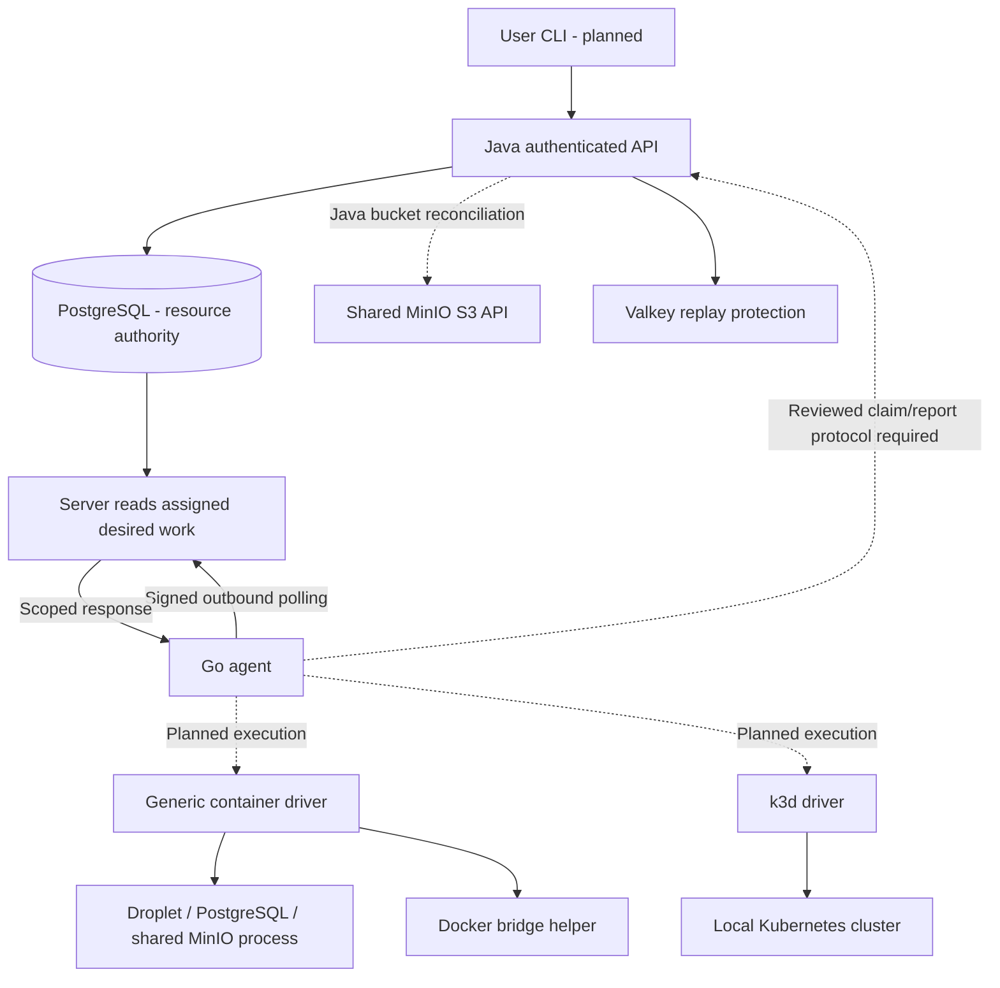

# Historical pre-VM entry-point snapshot

> Preserved original body below, not active installation, architecture or schedule guidance. Use [current platform docs](../../platform/README.md). Original relative links require the original checkout layout; no runtime result is revised.

<!-- Historical body preserved below. -->

# CoveStack — Project, Use Cases, Workflow and Infrastructure

| Document control  | Value                                                                                            |
| ----------------- | ------------------------------------------------------------------------------------------------ |
| Updated           | 4 November 2026                                                                                  |
| Purpose           | One readable overview of the existing project and its target design                              |
| Product           | CoveStack; compatibility directories remain kan-server and kan-agent                             |
| Evidence boundary | Source/document inspection only; no deployment or runtime acceptance performed for this overview |
| Service status    | CORE-5 remains Planned; no service promoted by this document                                     |

## 1. What CoveStack is

**A local cloud control plane with an account-scoped, crash-safe resource model. Docker and k3d are replaceable execution backends.**

In simple words: CoveStack aims to let a user request cloud-style resources on a local host. The server remembers what should exist; an agent inspects the local runtime and creates, repairs or removes the owned resources to match that request. Account ownership, credentials, operations and recovery belong to the platform, rather than being left to individual Docker commands.

Local does not mean pretend data. The target app, PostgreSQL database, MinIO storage and Kubernetes cluster run real software on the host. However, a Droplet is a container, not an independent VM, and local simulation does not reproduce all public-cloud networking, availability or API behavior.

This is an early implementation. The signed client and no-execution polling loop exist; the complete resource-provisioning workflow below is a target, not a current product capability.

## 2. What problem it addresses

A developer can manually create containers, networks, volumes and Kubernetes clusters. The proposed value of CoveStack is to expose a consistent account-owned workflow around those components: durable requests, authorized access, visible progress, safe retries, cleanup and verified recovery.

| User problem                       | CoveStack target                                                         | What must prove it                                                       |
| ---------------------------------- | ------------------------------------------------------------------------ | ------------------------------------------------------------------------ |
| Repeating environment setup        | One fixed app/database/storage stack                                     | App actually uses its DB and bucket; retry creates no duplicate children |
| Several users share one host       | Account-scoped resources, credentials and private networks               | API denial and actual network/credential tests                           |
| A process crashes during creation  | Persisted intent plus inspection before retry                            | Restart leads to exactly one owned resource                              |
| A request is submitted twice       | Atomic idempotency record and resource transaction                       | Same key gives same result; changed body is rejected                     |
| Infrastructure status is confusing | Desired/converged revision, observations, freshness and sanitized errors | User can distinguish pending, stale evidence and actual failure          |
| Recovery is unproven               | Persistent volumes, measured restore and operating instructions          | Known data returns; teammate reproduces the procedure                    |

These are useful engineering goals, not exclusive inventions or proof of market demand. Docker, Floci, LocalStack and other platforms overlap with parts of the design. Adoption would require a concrete user benefit demonstrated against alternatives.

## 3. Intended use cases

| Use case                         | User journey                                                                               | Boundary                                                                            |
| -------------------------------- | ------------------------------------------------------------------------------------------ | ----------------------------------------------------------------------------------- |
| Local application environment    | Provision app Droplet with PostgreSQL and scoped object storage                            | Fixed reviewed template first; no arbitrary template engine                         |
| Kubernetes learning/deployment   | Create a cluster, obtain scoped kubeconfig, deploy a bounded app                           | User deploys through kubectl/Helm; cluster creation is not automatic app deployment |
| Team infrastructure lab          | Two accounts create resources on one host                                                  | Logical/credential/network controls, not hostile-tenant VM isolation                |
| Infrastructure-security exercise | Test ownership denial, signing/replay protection, private reachability and secret handling | Show actual observed results; policies on paper do not prove enforcement            |
| Recovery exercise                | Interrupt provisioning or remove test data and perform recovery                            | Destructive tests use owned test resources and explicit data-retention policy       |
| Optional API automation          | Use CLI and later a thin Terraform provider                                                | Optional Terraform supports Droplet and Kubernetes resources only                   |

Instructor assignment, automated grading, student reports and a Floci-based fork were discussed as possible directions. They are not approved features or existing functionality, and this overview does not change CoveStack into those products.

## 4. CORE-5 service scope

| Service            | Target behavior                                                                                 | Execution and limits                                                                                 | Status  |
| ------------------ | ----------------------------------------------------------------------------------------------- | ---------------------------------------------------------------------------------------------------- | ------- |
| Compute / Droplets | Create, inspect, stop/start and delete an account-owned app workload under the agreed lifecycle | Docker container through generic container driver; one host; not a VM                                | Planned |
| Kubernetes         | Create/recover/delete clusters, reserve API port and export authorized kubeconfig               | k3d CLI; max 2 clusters/host; 1 server plus max 2 agent nodes each; one reviewed pinned k3d/k3s pair | Planned |
| Managed PostgreSQL | Usable SQL endpoint, private access, scoped credentials, persistence, backup and restore        | Generic container driver runs PostgreSQL; readiness requires actual DB connection                    | Planned |
| Object storage     | Scoped S3-compatible bucket/credential lifecycle and actual byte storage                        | Shared operator-owned MinIO process; Java reconciles tenant bucket/policy                            | Planned |
| VPC/IPAM           | One owned private network/account and collision-free address reservations                       | Server allocator and PostgreSQL reservations; Docker bridge helper; no custom CIDR                   | Planned |

Security, recovery, CLI, optional Terraform, one integration stack and Ansible Part 1 are cross-cutting commitments, not extra services. Capability admission must respect measured host capacity; the two-cluster cap is an upper limit, not a promise that every workload combination fits.

### 4.1 Extended track and optional future work

These are outside CORE-5 SRS deliverables. Entry depends on relevant core gates; Anuj's extended Go starts only after all CORE-5 gates pass.

| Extended item            | Target purpose                                                                      | Status         |
| ------------------------ | ----------------------------------------------------------------------------------- | -------------- |
| Auto scaling groups      | Maintain bounded desired membership and scaling rules                               | Extended track |
| HTTP load balancing      | Health-checked backend routing and rebuilt proxy configuration                      | Extended track |
| Application publication  | Explicitly approved hostname routes through shared gateway/tunnel and reverse proxy | Extended track |
| Metadata                 | Workload-bound self-metadata with no platform secrets                               | Extended track |
| Monitoring               | Freshness-aware health, metrics, events and alerts                                  | Extended track |
| Snapshots                | Owned instance filesystem capture and restore; DB backup remains separate           | Extended track |
| Domains                  | Verified custom hostname ownership and safe reassignment                            | Extended track |
| React UI                 | Read-only account-scoped resource list first, using the same API                    | Extended track |
| Ansible inventory Part 2 | Dynamic inventory from authenticated CLI JSON, never docker ps                      | Extended track |

Nested Docker, VM-backed Droplets, multi-host VPC, additional DB engines and full provider parity are optional future work. No tunnel provider, proxy choice, address pool or untested software version is selected here.

## 5. Architecture: who does what

| Component         | Technology / location                  | Responsibility                                                                                                       | Must not do                                                  |
| ----------------- | -------------------------------------- | -------------------------------------------------------------------------------------------------------------------- | ------------------------------------------------------------ |
| CLI               | Go/cobra; planned cmd/covestack        | Submit authorized requests, list/get JSON, wait for convergence                                                      | Call Docker/k3d or query platform DB directly                |
| Control plane     | Java 25 / Spring Boot; kan-server      | Identity, account policy, API/DTO validation, intent, operations, quotas, scheduling and server-owned reconciliation | Treat runtime objects as the authoritative resource registry |
| Platform database | PostgreSQL 17                          | Persist identity, owned resources, generations, claims, operations and reservations                                  | Be directly writable by agent or user CLI                    |
| Agent             | Go; kan-agent                          | Signed outbound communication; future owned inspection/reconciliation through drivers                                | Trust caller-selected accounts or execute unsupported kinds  |
| Container driver  | Planned agent implementation           | Generic image/volume/labels/health lifecycle; network helper                                                         | Become separate bespoke Postgres/MinIO/network drivers       |
| k3d driver        | Planned agent implementation           | Bounded cluster lifecycle through reviewed CLI flags                                                                 | Exceed quota or return kubeconfig in ordinary observations   |
| Shared MinIO      | Planned runtime dependency             | Persist object bytes; enforce tenant S3 credentials/policies                                                         | Expose administrator secrets to workloads                    |
| Valkey            | Infrastructure / nonce-store component | Replay protection through configured authenticated store                                                             | Replace PostgreSQL resource authority                        |
| Mailpit           | Local development dependency           | Capture development email                                                                                            | Represent production email delivery                          |



Solid communication arrows explain component roles, not a claim of end-to-end deployment. Dotted execution/claim paths still need implementation and coordinated protocol work. End-user DB/S3/app traffic follows the data paths below, not the polling endpoint.

## 6. Infrastructure and deployment boundaries

### 6.1 Planned host topology

Start with one dedicated AlmaLinux lab VM/host with an 8 GB RAM design constraint. Operator tools, platform dependencies, Java and the agent share that host. Actual CPU, RAM and disk admission require the host spike; the total includes databases and workloads, not only idle clusters.

```text
Dedicated lab host / VM
  Platform area
    kan-server Java API
    kan-agent Go process
    PostgreSQL control-plane database
    Valkey replay store
    Mailpit for development
  Runtime area - planned
    Shared operator-owned MinIO process + persistent volume
    Account A private network: app Droplet + PostgreSQL
    Account B private network: separate owned workloads
    Bounded k3d clusters, with protected API-port reservations
```

### 6.2 What the existing Compose file provides

The inspected deploy/docker-compose.yml defines dependencies only; it does not start a complete Java control plane, agent or CORE-5 runtime. Exact image values come from reviewed local configuration.

| Existing dependency | Defined host binding             | Defined persistence / purpose                                    |
| ------------------- | -------------------------------- | ---------------------------------------------------------------- |
| PostgreSQL          | 127.0.0.1:5432                   | pgdata volume; control-plane DB, not tenant PostgreSQL instances |
| Valkey              | 127.0.0.1:6390 to container 6379 | valkeydata volume and protected configuration                    |
| Mailpit SMTP        | 127.0.0.1:1025                   | Development email capture                                        |
| Mailpit web         | 127.0.0.1:8025                   | Development mailbox inspection                                   |

These are file definitions, not verified listeners or permission to launch infrastructure. The dependency backend network is not a tenant VPC. Existing environment restrictions may prevent Docker/Kubernetes execution; consult the environment notes before runtime work. Never use down -v or blanket pruning as repair instructions.

### 6.3 Control, data and administration paths

| Path                    | Target flow                                       | Security requirement                                         |
| ----------------------- | ------------------------------------------------- | ------------------------------------------------------------ |
| User management         | CLI → Java API → PostgreSQL                       | User token, account authorization and mutation idempotency   |
| Agent management        | Assigned agent context → signed Java internal API | Service credential, replay protection and trusted assignment |
| SQL application traffic | App → account PostgreSQL private endpoint         | Scoped DB credential and actual reachability restrictions    |
| Object traffic          | App/client → permitted shared MinIO S3 endpoint   | Bucket policy and per-account credentials                    |
| Kubernetes management   | Authorized user → scoped kubeconfig → cluster API | Protected export; never included in list/get/observations    |
| Operator administration | Installer/server → protected infrastructure       | Private management exposure, separate custody and rotation   |

The privileged Docker daemon/agent is a trusted host boundary. Tenant workloads must not receive the daemon socket or broad host mounts. Container isolation is not equivalent to separate tenant VMs. Shared MinIO admin and tenant traffic may use the same listener; permissions and key custody enforce separation, not an invented separate admin port.

## 7. End-to-end resource workflow — target

Consider a request to create an app Droplet.

| Step                | Component                       | Required behavior                                                                                 |
| ------------------- | ------------------------------- | ------------------------------------------------------------------------------------------------- |
| 1. Request          | CLI                             | Send authenticated API request with idempotency key                                               |
| 2. Authorize        | Java                            | Resolve account and permission; validate requested image/spec/quota                               |
| 3. Persist          | Java/PostgreSQL                 | Atomically store intent, generation, operation, event and idempotent result                       |
| 4. Return           | API                             | Return pending result/resource identity without waiting for runtime creation                      |
| 5. Discover         | Agent/Java                      | Signed read-only poll returns only assigned account work and installed kinds                      |
| 6. Claim            | Future coordinated exchange     | Acquire validated resource/generation/epoch ownership; no lease mutation on GET                   |
| 7. Prepare network  | Server allocator + agent helper | Ensure correct default VPC and address reservation before workload attachment                     |
| 8. Inspect          | Agent                           | Find deterministic owned runtime identity before creating anything                                |
| 9. Reconcile        | Driver                          | Create/repair only when allowed; serialize and settle uncertain prior actions                     |
| 10. Check readiness | Agent                           | Verify actual workload/service behavior, not just successful command exit                         |
| 11. Report          | Signed API/Java                 | Validate account, assignment, exact generation, epoch and live claim before accepting convergence |
| 12. Inspect status  | CLI/API                         | Display desired versus converged revision, observation freshness and sanitized errors             |
| 13. Repeat          | Scheduler/reconcile             | Reinspect nonterminal resources and repair drift under fresh authority                            |

The current 1.1.0 wire contract does not settle the full claim/renew/fencing/network protocol. B+D+A/C must review schemas, fixtures and generated outputs before steps requiring those messages. No new endpoint or wire field is defined by this explanation.

### 7.1 What generations, leases and fencing mean

| Term             | Simple meaning                                   | Important limit                                          |
| ---------------- | ------------------------------------------------ | -------------------------------------------------------- |
| Desired state    | What the user wants                              | Values depend on resource kind                           |
| Observed state   | What an inspection found                         | Can be stale and can represent failure                   |
| generation       | Revision of accepted desired intent              | Increments on relevant user changes                      |
| acked_generation | Revision accepted as successfully converged      | Progress/health must not advance it                      |
| Lease            | Temporary authorization for an execution attempt | Expiry/renewal use server-authoritative rules            |
| Epoch fence      | Number identifying the current claim             | Stale owner/epoch/generation reports must update nothing |
| Idempotency key  | Identity of one logical request                  | Same body alone is not a substitute for the caller key   |

Database fencing prevents stale database updates; it does not make Docker/k3d reject an old command. Host exclusion, per-resource serialization and settlement of uncertain backend work are separate requirements. On successful acknowledgment clear lease owner and expiry together; retain epoch. Never hold a DB transaction open throughout a container command.

### 7.2 Existing lifecycle examples

| Kind             | Desired values in contract 1.1.0 | Success interpretation                                             |
| ---------------- | -------------------------------- | ------------------------------------------------------------------ |
| compute.instance | active, off, archive             | Actual readiness/stop/owned teardown respectively                  |
| k8s.cluster      | active, deleted                  | Running usable cluster or verified owned cleanup                   |
| db.instance      | online, stopped, deleted         | Database readiness, intentional stop or reviewed deletion          |
| storage.bucket   | available, deleted               | Real bucket/policy readiness or reviewed empty/authorized deletion |

VPC has no current contract kind and remains server-owned with reviewed separate execution messaging pending. Operations use queued, running, completed, failed, cancelled. Do not substitute state strings from old guides or invent missing vocabulary.

## 8. One fixed-stack application workflow — target

The fixed integration is an app Droplet plus PostgreSQL and a scoped MinIO bucket. The shared MinIO process is operator-owned and must not be deleted with a tenant stack.

1. User authenticates and submits the reviewed fixed template with validated inputs.
2. Java records the stack and durable child references; no general DAG planner is introduced.
3. Ensure the account network before app/database runtime attachment.
4. Provision PostgreSQL with persistent volume, scoped credential and real readiness.
5. Wait for shared MinIO readiness; Java ensures the owned bucket and credential policy.
6. Start the reviewed app using documented endpoints and protected secret references.
7. Verify the app writes/reads a database row and uploads/downloads exact object bytes.
8. Interrupt provisioning and retry: resume existing child identities without duplicates.
9. Demonstrate another account cannot inspect or access the owned services.
10. Perform reviewed test-data restore and scoped cleanup/retention.

App image, input shape, actual endpoint delivery and secret-reference mechanism must be finalized with B/D/E+A/C. Do not fabricate commands, credentials or public URLs. This example does not imply users can upload arbitrary shell scripts to execute on the host.

## 9. Deploying an application and accessing it

| Target         | Intended user action                                                   | Access boundary                                                                                 |
| -------------- | ---------------------------------------------------------------------- | ----------------------------------------------------------------------------------------------- |
| Droplet        | Provide approved image/configuration and wait for readiness            | Documented private/local access with explicit route/port arrangement                            |
| Kubernetes     | Create cluster, export scoped kubeconfig, deploy app with kubectl/Helm | Cluster Service/Ingress/access configuration still required; cluster API is not an app endpoint |
| Fixed stack    | Select one approved integrated app/database/bucket template            | App/dependency configuration agreed and tested                                                  |
| Public website | Explicitly request publication after core dependencies pass            | Extended gateway/tunnel/reverse-proxy route and TLS/hostname validation                         |

A simulated public IP is display metadata and does not route internet traffic. A website becomes public only through an actual reachable ingress/gateway, appropriate DNS/TLS and a running workload. Platform subdomains and verified custom domains are extended targets, not existing capability.

## 10. Failure and recovery behavior — target

| Failure                           | Required platform response                                                  | Evidence                                             |
| --------------------------------- | --------------------------------------------------------------------------- | ---------------------------------------------------- |
| Duplicate API create              | Same logical key returns original result; changed body rejected             | Parallel idempotency test                            |
| Agent killed after runtime create | Restart inspects ownership and resumes without a duplicate                  | Container/cluster crash tests                        |
| Old worker reports                | Reject outdated generation/owner/epoch/expiry                               | Fencing/stale-report tests                           |
| Server unavailable                | No new unauthorized execution or cleanup inferred from failed polls         | Server-outage test                                   |
| Runtime drifts after convergence  | Fresh scheduled inspection detects and repairs under current authority      | Drift/health regression tests                        |
| PostgreSQL data removed in test   | Restore reviewed backup; known rows/checksum match                          | Measured restore, not just backup-file creation      |
| MinIO restarts                    | Java restores bucket/policy intent; persistent object bytes remain readable | Policy plus retained-object readback                 |
| Partial deletion                  | Retain reservations and retry owned cleanup until confirmed                 | No leaked cluster ports, quota or unrelated deletion |

Control-plane DB backup and protected-key recovery are separate operating procedures. A checksum of an archive alone does not prove usable restored application data.

## 11. ITISS contribution

ITISS work is the practical design, configuration, operation and verification of infrastructure/security controls. It is not established by adding security buzzwords or a page of service names.

| Area               | Work to demonstrate                                                          | Team responsibility                                    |
| ------------------ | ---------------------------------------------------------------------------- | ------------------------------------------------------ |
| Host/service setup | Reproducible install, protected services, least necessary exposure           | A installer/ITISS; B server; C review                  |
| Identity           | Active/revoked service keys, user-token separation and account assignment    | C security, B storage, A loading/signing               |
| Request security   | HMAC signing, nonce replay denial, TLS outside loopback                      | A client, C verifier/tests, B integration              |
| Network boundaries | Real app/DB paths, denied cross-account paths and protected management ports | C allocator/tests; A helper; B records                 |
| Secret handling    | Encrypted signing secrets, hash-only tokens and scoped service credentials   | C custody; B persistence; A protected execution inputs |
| Investigation      | Sanitized audit/events and outage timeline                                   | B/C storage/policy; A operating evidence               |
| Recovery           | Agent crash recovery and data restoration with observed results              | A execution; B persistence; C tests                    |

Signing is not encryption and not authorization by itself. Append-only privileges do not make audit records tamper-proof against administrators. Neither CDAC approval nor production security is established by documentation; mentor assessment criteria require confirmation.

## 12. Team ownership

| Person   | Main responsibility                                                                                             |
| -------- | --------------------------------------------------------------------------------------------------------------- |
| A — Anuj | Go agent/client/signing/reconciliation, container/k3d drivers, network helper, CI, installer and ITISS evidence |
| B        | Java core; all SQL/migrations, claim/lease/fencing/idempotency transactions, quotas and stack records           |
| C        | Authentication/security, all acceptance tests and Java IPAM allocator                                           |
| D        | Java API/DTO/schema alignment and Terraform fixtures; no Go                                                     |
| E        | Thin Go/cobra CLI, JSON and packaging; later optional thin Terraform provider; no agent ownership               |

Any Go needs A review; shared client/k3d needs A+B+C; schema B+C+A with D DTO review. AI-generated agent code is reference material that Anuj must understand and explain.

## 13. Current code versus remaining work

| Area                       | Inspected source evidence                                              | Still not established                                                     |
| -------------------------- | ---------------------------------------------------------------------- | ------------------------------------------------------------------------- |
| Configuration/signing      | Agent config, shared signing rules, request signer and tests           | Real deployed credential provisioning and verification                    |
| HTTP client                | Signed GET, timeout, redirect refusal, bounded response and tests      | Successful integration with B's real assigned-account server              |
| Agent startup/polling      | internal/agent/loop.go, loop_test.go and cmd/kan-agent/main.go exist   | Live Java outage/recovery and signal evidence in the target environment   |
| Safe no-execution behavior | Poll loop stops on nonempty work; no driver dispatch                   | Actual resource execution/reconciliation                                  |
| Java                       | Authentication filters/services/stores and contract validation sources | Complete bootable resource API, credential store and CORE-5 persistence   |
| Migrations                 | V5 publications and V6 domains files exist                             | Missing accounts/resources foundation and tested empty-DB migration chain |
| Infrastructure             | Compose dependency definitions exist                                   | Runtime readiness and actual hosted CORE-5 services                       |
| Design                     | V5 scope, schema, HLD/LLD and acceptance references                    | Service gates and deployment evidence                                     |

Historical checkpoint records include Go test/race/vet/lint results. They were not rerun for this overview and do not prove backend execution. No Nginx reconciler, full domain verifier, production CLI/provider or shared-client module is established by this inspection.

## 14. When a service can be called Supported

| Gate | Required result                                                                         |
| ---- | --------------------------------------------------------------------------------------- |
| G1   | Persisted desired state and generation are authoritative                                |
| G2   | Crash-safe reconciliation/rebuild from DB without duplicates                            |
| G3   | Other-account API access returns 404; applicable protocol/network denial is also proven |
| G4   | A meaningful service failure test runs in CI                                            |

Use only Planned, In progress, Gates passed or Extended track for service status. Supported requires Gates passed after all four gates. C owns CORE-5 tests 1–15 and extended E1–E8. A merged helper or passing mock test is not a service gate.

## 15. Next steps and schedule clarification

Immediate technical next step: coordinate with B+C to verify the existing signed client and polling loop against a real Java server using non-production credentials. Collect evidence for 200 [], temporary outage/recovery, invalid-auth stop and prompt Ctrl+C. Missing foundational migrations, credential provisioning and trusted assignment remain dependencies. No Docker/backend operation is implied by this no-execution milestone.

Then review claim/network messaging before resource mutation, implement one owned Droplet lifecycle, and progress under the core gates. Multi-account concurrency and extended services must not displace the first reliable workflow.

**Deadline discrepancy:** older V5 documents plan submission for 25 January 2027. The user's latest stated deadline is **15 December**. The year was not restated in that message; a revised delivery scope/schedule has not been agreed. Do not treat the older dates as current assurance or silently remove required SRS items. Mentor scope agreement is needed before reducing deliverables. This overview does not create a replacement schedule.

A Floci fork/companion and instructor-managed assessment were discussed, but no decision to replace CoveStack was authorized. This document describes the existing CoveStack project, not a renamed upstream emulator.

## 16. Repository map and further detail

| Location                 | Purpose                                                               |
| ------------------------ | --------------------------------------------------------------------- |
| kan-agent/               | Existing Go communication code; future drivers/reconcile              |
| kan-server/              | Java control-plane/auth code and migration location                   |
| contracts/               | Wire/schema/lifecycle source and generated fixtures; contract-first   |
| deploy/                  | Dependency Compose and configuration templates; protect local secrets |
| V5/                      | Detailed target scope, schema, design, setup, ownership and tests     |
| TEAM-FIRST-CHECKPOINT.md | First responsibilities and GitHub issue/board guidance                |
| checkpoint.md            | Canonical changing AI-agent handoff; read before continuing work      |

For more detail: [scope](V5/CoveStack-SRS-Scope.md), [technical design](V5/DocsV5-DO_Team.md), [schema](V5/CoveStack-Database-Schema.md), [acceptance](V5/CoveStack-AntiWrapper-Acceptance.md), [stack](V5/CoveStack-Stack-Templates.md), [setup](V5/CoveStack-Complete-Working-Setup.md) and [Anuj's work](V5/CoveStack-Anuj-Next-Steps.md).

This overview is explanatory. Contracts and reviewed implementation determine actual messages/behavior; gate evidence determines readiness. It introduces no code, migrations, configuration, service implementation or market-adoption guarantee.
