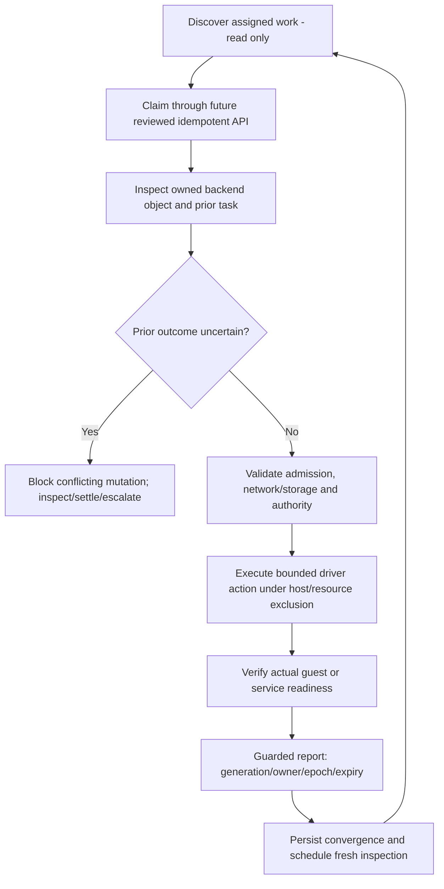

# Agent execution, reconciliation and recovery

Product identity and core/future scope: [canonical architecture and service catalogue](../product/CoveStack-Product-Architecture-and-Service-Catalogue.md).

Updated: 4 November 2026. Existing Go communication code is Partially implemented platform functionality; execution below is Planned.

## Existing behavior

kan-agent/cmd/kan-agent loads environment config, creates the signed client and uses signal cancellation around internal/agent.Run. The loop polls the read-only work endpoint, waits/backoffs, handles 429 guidance and stops on non-executable returned work. It does not claim, execute, acknowledge, delete or repair resources. Source tests exist; historical checks are in [status](implementation-status.md). Current client permits HTTPS off loopback and refuses redirects.

## Target authorized execution

One trusted process per physical host; immutable account-specific credential/client contexts share bounded coordination. Server derives account/host from stored assignment. Agent verifies assigned resource, supported spec/backend capability, current generation and claim before a mutation. A backend label or tenant-supplied account selector is not authorization.

Driver inspect/create/start/stop/delete/readiness must bind opaque provider task/instance IDs to account/resource/host. Backend async acceptance is not readiness. Persist task identity before retry can duplicate an accepted action; exactly where to persist and how to recover a lost response are B+A/C decisions. Native idempotency alone is insufficient unless ownership and full failure semantics are tested.

## Fences and runtime exclusion

DB claim includes current generation, owner, epoch and expiry using DB-authoritative time. Renew only a current unchanged claim under the reviewed validity policy; B+C+A must finalize expiry/renewal acceptance consistently. Progress/health cannot acknowledge; convergence requires actual kind readiness, exact current generation and claim, then releases owner+expiry together, retaining epoch. Stale owner/epoch/generation reports alter neither convergence nor fresh observations; exact expiry predicates follow that explicitly agreed policy. The current V5 query remains a non-executable design, not approved VM wire/schema.

DB epochs fence database writes; Incus/Docker/k3d do not automatically enforce CoveStack's epoch. Hold reviewed process/child-operation exclusion and serialize per-resource changes; after timeout, parent death or lost API response, inspect actual provider task before takeover. An expired SQL lease is not permission to issue conflicting backend commands. Block unknown outcomes rather than delete/create blindly.

## Failure policy

| Event | Required outcome |
| --- | --- |
| API/auth/replay store unavailable | Stop new mutations and renewals that cannot be authorized; inspect safely; no fallback credential |
| Empty/malformed/partial poll | Empty means no assigned work, not cleanup; malformed/error is explicit failure |
| Backend unavailable | Preserve reservations/intent; bounded retry only after outcome known |
| Agent restart | Reconstruct assigned attempts from DB plus owned backend inventory; no adoption of arbitrary objects |
| VM guest not ready | Report bounded observed failure, never successful create from backend process status |
| Deleting or retained data | Confirm owned teardown and policy before releasing capacity/address/disk identity |
| Drift after acknowledgment | Fresh claim and inspection; repair under same desired revision if spec unchanged |

Health has freshness/observation ordering, separate from desired generation equality. The privileged agent is part of the host trust boundary; do not load arbitrary tenant plugins or execute host scripts from API payloads. Per-resource field names, claim/renew/network routes and future credential reload protocol require coordinated contracts. See [API compatibility](api-and-cli.md) and [threat model](security.md).
