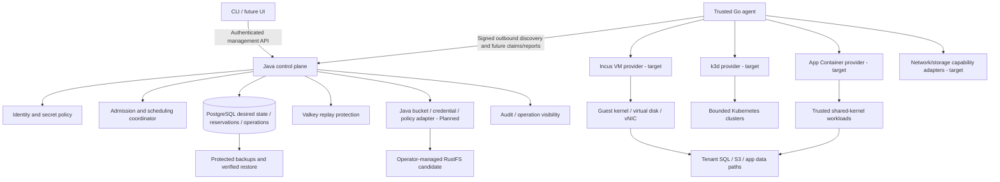

# Production-target architecture

Product identity and core/future scope: [canonical architecture and service catalogue](../product/CoveStack-Product-Architecture-and-Service-Catalogue.md).

Updated: 4 November 2026. **Target design; Experimental implementation.** No production profile has passed acceptance. The historical container-Droplet architecture is superseded by [VM Instance and App Container](resource-model.md).

## Planes and authority

| Plane | Responsibility | Boundary and current gap |
| --- | --- | --- |
| User management | CLI first; eventual UI; authenticated CRUD, operations and exports | No runtime sockets or direct DB; CLI not present |
| Control | Java/Spring Boot validation, account/membership policy, intent, quotas, operations and scheduling coordination | Current auth libraries are not a bootable resource service |
| Resource state | PostgreSQL 17 authoritative ownership, spec, generation, row version, reservations, attempts, lease/epoch and idempotent result | Foundational migrations missing; [current V5 schema](../../V5/CoveStack-Database-Schema.md) is an updated non-executable design; only the former full DDL is preserved as [historical reference](../archive/V5-before-full-product-alignment-2026-11-04.md) |
| Agent/worker | Go signed outbound client, assignment validation, capability/health reporting, claims and serialized execution | Read-only poll loop exists; full assignment/claim protocol and execution absent |
| Runtime execution | Incus VM provider (preferred evaluation); App Container, k3d, storage and network capabilities | Drivers have no accepted implementation; no fixed two-driver ceiling |
| Tenant data | Guest OS/disks/NICs, app traffic, SQL/S3 and Kubernetes workloads | Management connectivity denied; real isolation must be proven |
| Identity/secrets | Account RBAC; service identities; short-lived credentials where suitable; encrypted/hashed storage and rotation | Existing signer/filters; concrete provisioning/custody missing |
| Scheduling/capacity | Durable admission/reservations and fair bounded assignment | Minimal coordinator starts with Java; Go scheduler is later selective product work, not a second authority |
| Observability/audit | Redacted events, request/operation correlation, freshness, capacity and admin audit | Logging library/process success is not deployed monitoring |
| Recovery/backup | Control-plane and workload backups, verified restore, uncertain-action recovery | Off-host copies/key recovery and failure evidence pending |

Arrows specify target responsibilities, not a deployed topology. Tenants cannot access privileged execution APIs; Java does not invoke arbitrary host shell commands. Any guest bootstrap is an approved bounded data contract, not host command execution.

## Request-to-convergence transaction model

1. Authenticate identity, authorize membership/action and validate request before mutation.
2. Evaluate host backend capability, physical capacity and account quota; acquire ordered locks. Scheduling can admit a request only against durable reservations and sufficiently fresh host evidence.
3. Atomically record ownership, desired revision, operation, reservation, event and idempotent response. Return operation identity; no backend command inside the transaction.
4. Agent discovers assigned scoped work, then uses a future reviewed idempotent claim exchange. GET work stays read-only.
5. Driver inspects exact backend ownership; an existing uncertain action must settle before another creation. A host lock and serialized resource operations supplement DB fencing.
6. Apply VM/container/network/storage changes; verify actual readiness. Persist redacted attempt/observed evidence through authorized report APIs, never direct agent SQL.
7. Accept convergence only for the current account/assignment/resource/generation/owner/epoch and the explicitly reviewed claim-validity/expiry policy; release claim and retain ownership tombstones/reservations per cleanup policy.
8. Schedule future inspection; drift repair uses current intent without inventing a new desired revision. Failed polls/partial inventory never authorize deletion.

## Database design requirements, not schema changes

Retain UUID internal identity, separate CLI public ID and numeric compatibility-provider ID where applicable; B+D finalize mapping. Separate operation attempt identity from resource generation and optimistic row version. Preserve hash-only tokens, encrypted signing material/key references, composite ownership constraints, atomic idempotency fingerprints/responses, append-only app privileges and reviewed audit retention. RLS can add defense in depth after connection-pool/session isolation review; it does not replace predicates.

VM disk/NIC/image/backend identity, App Container distinction, host capability snapshots, durable capacity/port/IP/storage reservations, claim correlation, provider task IDs and restore verification require a future reviewed data model. Neither existing resources.spec JSON nor a container-shaped schema may hide ownership/business keys or silently become a VM schema. No DDL/migration is changed by this target.

## Backend contracts and extensibility

A provider advertises tested capabilities and accepted spec versions: inspect/create/start/stop/restart/delete, readiness, cancellation/timeout interpretation, observation and scoped inventory; resize/archive/restore only if verified. Opaque backend task/instance handles must be persisted and owner-bound. Network/storage adapters declare attachment, quota, snapshot and policy enforcement semantics independently. Same conformance cases apply across providers; backend-specific security/runtime tests remain necessary.

Incus API access is privileged. Prefer its management API for VM operations over composing raw QEMU shell arguments; QEMU/KVM is the underlying evaluation stack, not three redundant CoveStack drivers. Docker is a candidate trusted App Container backend; Incus containers may be a later adapter, not an automatic feature. k3d is a distinct Kubernetes lifecycle backend. Storage/network may initially be helpers but must expose explicit capabilities rather than a false fixed driver count.

No dynamic untrusted plugin execution in the agent. Versioned built-in adapters first; plugin trust, packaging and compatibility need a later ADR. Capabilities unsupported by the host fail before provisioning; no VM-to-container fallback. Reuse backend IPAM/storage facilities through reconciled ownership, avoiding competing authoritative allocators.

## Language and failure domains

Keep existing Java responsibilities; no migration now. Build new product-owned agents/CLI/drivers/adapters and a future scheduler in Go when the boundary/ownership is reviewed. A later control-plane extraction needs state/transaction ownership, compatibility, tests, rollout and rollback ADRs. Floci remains an external optional emulator; no Java-to-Go rewrite of its internals.

A hardened single host has one failure domain: host loss can take down API, DB, agents and guests. Future HA requires independent DB availability, leader/claim safety, agent failover, durable storage/networking, split-brain prevention and host-loss tests. Do not equate multiple processes or an Incus cluster with CoveStack HA.

References: [Incus API/security](https://linuxcontainers.org/incus/docs/main/explanation/security/), [QEMU management/accelerators](https://www.qemu.org/docs/master/system/introduction.html). See [readiness](readiness.md), [network/storage](network-and-storage.md), [capacity](capacity.md).

## Object-storage HLD and LLD — Planned RustFS integration

HLD: operator-managed RustFS is the preferred object-storage candidate. Account-owned buckets and policy/credential intent stay in authoritative PostgreSQL; Java reconciles them through a provider adapter over a private management path. The agent may manage process/volume lifecycle, but does not own bucket reconciliation. Tenant S3 traffic is separate from management access. [Compatibility and acceptance](provider-evaluation.md#rustfs-compatibility-and-acceptance).

LLD target: authenticate/authorize → persist bucket intent, generation, operation and idempotency atomically → Java inspect owned backend bucket/policy/credential binding → ensure only missing/current intent → verify observed state and record result. On timeout inspect before retry; on restart preserve stored bytes and reconcile configuration. Delete only authorized intent under retention policy. Credential issuance uses the reviewed backend admin interface; do not assume it is part of S3 or introduce unapproved wire fields. Backups must restore actual bytes and required configuration/ownership/keys, then recheck access denial.

RustFS integration is Planned. Its admin interface, artifact/version, custody and backup procedure remain subject to engineering review. SeaweedFS/other providers remain possible behind the same conformance boundary.
