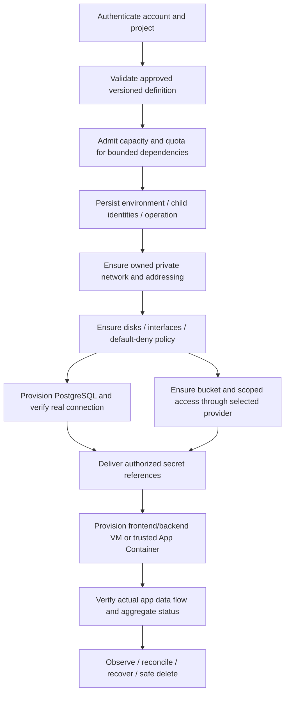

# Application environments and bounded orchestration

Updated: 4 November 2026. Status: **Planned**; catalogue core capability 13. Canonical identity/scope: [product catalogue](../product/CoveStack-Product-Architecture-and-Service-Catalogue.md). No environment engine or expanded SRS is implemented.

## User problem and outcome

A team needs a usable application environment, not a collection of unrelated create responses. An account/project member requests a reviewed definition and inspects the entire environment: child IDs, actual readiness, operation attempts, failures, retry/retention and shared dependencies. Environment-level progress must never imply a failed child is ready. Account ownership + orchestration + capacity + crash safety + security + verified recovery is the hypothesis, not a proven unique market feature.

A bounded app/PG/bucket definition is a useful initial example; the historical academic template count does not constrain the product. A future e-commerce definition can include frontend and backend VM/App Container, PostgreSQL, bucket, private network, subnets/interfaces/volumes, firewall and scoped secrets. That broader example is target product scope, not a working command.

This is a fixed typed resource dependency graph, not arbitrary user-defined executable DAG steps. No arbitrary shell, uploaded plugin or workflow-language interpreter executes on the host. Backend/API identifiers remain separate; no new wire states/fields are approved by human-readable stage names.

## Desired state and ownership

| Concern | Required durable semantics |
| --- | --- |
| Environment identity | Account-owned, project-scoped identity and immutable definition version; exact future schema B+D review |
| Children | Stable owner-bound role/child bindings written before creation; unique logical binding prevents duplicate retry |
| Dependencies | Declared type/readiness/attachment edges, cycle/incompatible host detection and protected external/shared references |
| Inputs | Validated nonsecret values and secret references; no plaintext credentials in definitions, logs or idempotency responses |
| Operation | Idempotent submission records intent and reservations atomically; child attempts/events remain queryable |
| Observation | Aggregate readiness/freshness from actual child evidence, not average progress or command exit |
| Sharing | Explicit owner grant and reference relationship; environment membership is not permission to delete a shared resource |
| Capacity | Reserve the safe executable subset/dependency footprint; avoid request deadlocks/starvation and retain pending allocations honestly |

## Retry, compensation and deletion

| Failure/action | Required behavior |
| --- | --- |
| Partial creation | Persist created/pending/failed child references and safe error; no fake environment-ready status |
| Retry same intent | Reuse logical child IDs and provider tasks; inspect uncertain backend outcome before create |
| New desired revision | Validate diff, ownership and capacity delta; stale worker cannot apply newer desired revision implicitly |
| Agent/server restart | Rebuild progress from DB and owner-inspected backend; event notification is a hint, not sole state |
| Dependency unhealthy | Do not start dependent app with fictional endpoints; keep diagnostics and policy-governed retry |
| Rollback/compensation | Remove only newly owned safe disposable resources; preserve persistent data and separately owned/shared objects; report incomplete compensation |
| Delete | Authenticate and snapshot owned dependency/reference inventory, disable publication when applicable, clean reverse dependency order and retain explicit data |
| Shared dependency | Detach only this environment reference; never delete operator object service, another environment's DB/network or policy-granted resource |
| Cleanup uncertain | Keep reservations/tombstones and retryable attempt; no release solely because a lease or client wait expires |

Cancellation, failure, compensation and data retention are distinct. Define reversible versus irreversible operations before exposing update/delete automation; no blanket transactional rollback of real infrastructure is promised. Full caller cancellation/operation protocol requires review.

## Acceptance and next implementation requirements

C owns automated cases with B coordinator/SQL, A providers and E CLI/D DTO: create usable app/DB/object flow; concurrent same-key one environment; partial create then restart/retry no duplicate child; wrong account/project denied; quota insufficiency leaves no orphan/reservation; shared dependency survives delete; retained data remains readable and restored known data matches. Test ambiguous provider response and interrupted compensation, not only happy-path mocks.

No current environment service exists. Old stack tables/JSON are reference designs; adding ownership/project/sharing/task/aggregate records needs a separately reviewed schema and contract. Historical test 15 remains recorded; product environment tests independently cover the selected definition and safe dependency behavior.
