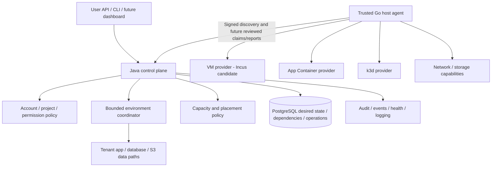

# CoveStack — Product Architecture and Service Catalogue

Updated: 4 November 2026. **Canonical active product identity, scope and catalogue.** This is a specification, not a list of available services. Source, [implementation evidence](../platform/implementation-status.md), [maturity gates](../platform/readiness.md) and unchanged [wire contract 1.1.0](../../contracts/README.md) determine actual behavior.

Active requirements: [product SRS](CoveStack-Product-SRS.md).

## 1. Product identity

**A local-first infrastructure control plane for small teams that want account-owned environments, intelligent resource scheduling, reliable provisioning, built-in security and recoverable infrastructure across their own machines.**

CoveStack-owned code and documentation are licensed under [Apache License 2.0](../../LICENSE) (SPDX `Apache-2.0`), approved by the maintainer. Third-party material and bundled artifacts retain their own licenses and redistribution obligations. Across machines is the eventual scope, not implemented multi-host support. Intelligent means explainable resource/capability/quota/constraint decisions, not an AI scheduler claim. No public cloud account is required by the target local capabilities; acquiring images/updates or optional external DNS may require separately disclosed network/provider access.

CoveStack orchestrates established technologies; it is not a hypervisor, Kubernetes distribution, cloud API clone or replacement for Floci, LocalStack, Coolify, Portainer, OpenStack or CloudStack. Potential users are developers, self-hosters, small teams and organizations; demand requires interviews and real pilot use. Education institutes may operate infrastructure, but no student/instructor/lab-management or assessment product is in scope.

## 2. Value to prove

| Product hypothesis | Required usable behavior | Evidence, not a slogan |
| --- | --- | --- |
| Account-Owned Infrastructure | Explicit user/account/project permissions and durable ownership | Foreign ID, disk/key/network access denied under concurrent operations |
| Environment-Level Orchestration | One owned app environment with visible child dependencies/readiness | Usable app/DB/object path; safe partial retry and shared-resource preservation |
| Crash-Safe Infrastructure Reconciliation | Inspect actual objects/tasks against DB intent; resume without duplicates | Lost-response/agent crash/stale worker tests and no unrelated deletion |
| Intelligent Resource Scheduling | Fresh capacity, quotas, compatibility and placement constraints | Concurrent admission cannot overspend; decisions/rejections explainable |
| Built-In Security and Verified Recovery | Identity/network/secrets/audit and actual restore integrated in lifecycle | Enforcement and restored known data on a declared profile |

These overlap existing products. A coherent demonstrably easier/reliable workflow, not feature count or unsupported exclusivity, must earn adoption. See [comparison](../platform/competitive-analysis.md).

## 3. Scope and status rules

Core here means the **proposed product architecture**, independent of academic deliverables and not an installed capability or commitment to finish every item immediately. The 22 core entries include supporting capabilities and interfaces, not 22 separate daemons/microservices. Future entries are dependency-bound candidates, not a release plan. Initial implementation must select a safe subset through review without concealing unmet product requirements.

Product scope is independent of historical academic CORE-5. The 22 core and 31 future classifications below define the product direction; academic service limits, dates and template counts are historical reference only and do not gate product functionality. Engineering schema/security/contract review remains required. Environment definitions are bounded and dependency-aware; no arbitrary DAG engine is promised.

Service maturity vocabulary: **Proposed → Planned → In Progress → Partially Implemented / Implemented → Runtime Verified → Acceptance Gates Passed → Supported**, with **Deferred** and **Blocked** as explicit alternatives. This is evidence tracking, not an automatic linear ladder: code can be implemented while runtime verification is blocked; record both fact and gate. Legacy V5 Gates passed/Extended track are historical labels, mapped in readiness.md. No service is Supported from an API/schema/source file or mock test. None is promoted by this task.

## 4. Core product catalogue

All entries inherit the ownership/lifecycle model in section 6 and security/acceptance in sections 8–9. Conditional backend features must be explicitly advertised or rejected; S3 versioning, disk resize, snapshot consistency and guest OS support are not assumed from a brand name.

| ID | Service/capability | Category | Requested capability scope | Dependencies | Acceptance focus | Current status |
| --- | --- | --- | --- | --- | --- | --- |
| 1 | Compute Instances (VMs) | Compute | Image, vCPU/RAM/disk/NIC, secure initialization; create/inspect/start/stop/restart/resize/snapshot/backup/restore/delete | IAM, images, admission, volumes, NIC/network/firewall, agent/provider | Actual guest kernel/readiness; interrupted create exactly one owned VM; denied foreign attach and safe restore/delete | Planned |
| 2 | App Containers | Compute | OCI image, ports, env/secret refs, CPU/RAM, volumes/network, health/logs, start/stop/restart/update/delete | IAM, image verification, capacity, network/storage/secrets, OCI driver | Shared-kernel type explicit; health succeeds; no daemon/root mount; image-update failure preserves data | Planned |
| 3 | Kubernetes Clusters | Compute | Create/delete/inspect/lifecycle, nodes/limits, reserved API endpoint, protected kubeconfig, health/network and standard-tool workload deployment | Tested k3d/k3s/Docker host, ports/capacity/network, secret export | Real cluster/workload, foreign kubeconfig denied, half-create recovered and owned cleanup | Planned |
| 4 | VM Images and Templates | Compute support | Approved OS images/custom-image intake, versioned VM templates, validated cloud-init or equivalent, provenance | Trusted image origin/signatures, image/disk capacity, supported guest/backend | Reject malicious/unsupported image/bootstrap; immutable version verified and actual guest boot | Planned |
| 5 | VPC / Private Networks | Networking | Owned network create/inspect/membership/attachment/dependency-safe delete | Account/project policy, coordinated IPAM, NIC/firewall and backend network capability | Allowed connectivity and cross-account denial survive reconciliation; attached network cannot be removed | Planned |
| 6 | Subnets | Networking | Operator-reviewed ranges, allocate subnet from permitted pool, reservations and no overlap | Private network, route/pool validation, one authoritative allocator | Parallel account allocations no overlap; reserved addresses/pool containment enforced | Planned |
| 7 | IPAM | Networking | Allocate/reserve/inspect/release private addresses; interrupted-allocation recovery | Owned subnet/host/NIC, transaction locks and backend allocator coordination | No duplicate live address; no release on timeout or before verified detach | Planned |
| 8 | Network Interfaces | Networking | Owned interface create/inspect and validated attach/detach; address tracking | VM/container capability, VPC/subnet/IPAM, host/owner binding | Foreign/double attachment denied; partial detach recovered without wrong-address reuse | Planned |
| 9 | Firewalls / Security Groups | Networking/security | Default deny, ingress/egress protocol/port/source/destination rules, associations and audit | NIC/network mapping, host policy backend, IAM, validated rule model | Stored rule actually allows/blocks packets; revoke/restart/cross-account/management paths tested | Planned |
| 10 | Block Storage / Volumes | Storage | Create/inspect/attach/detach, supported resize, ownership/usage and safe delete | Pool capability/capacity, VM/container bindings, secret/encryption policy | Persistence and foreign-attach denial; no destructive shrink or lost data after interrupted lifecycle | Planned |
| 11 | Object Storage | Storage | S3 bytes/buckets, scoped keys/policies, quota, persistent objects, backup/restore; capability-declared versioning/lifecycle | Maintained provider ADR, private service/admin path, capacity, key custody, backup adapter | Exact bytes, cross-account key denial, restart persistence, quota behavior and verified restore | Planned |
| 12 | Managed PostgreSQL | Database | Private database/user/credential lifecycle, real readiness, persistent storage, start/stop/health/backup/restore/delete/rotate | Compute placement, volume/network, secrets, backup consistency | Actual scoped SQL connection and rows persist/restore; foreign account denied; rotation proven | Planned |
| 13 | Application Environments | Application infrastructure | Owned resources and bounded dependencies, provision order/readiness/status/progress, safe retry/recovery/cleanup | Constituent service gates, project ownership, durable child/attempt records, capacity | Usable app/data path; partial creation retries same identities; shared resources survive deletion | Planned |
| 14 | IAM and RBAC | Identity/security | Users, organization/account membership, roles/permissions, default-deny resource/project authorization | Reviewed identity/membership schema and concrete auth stores | Missing/revoked/wrong-role/foreign account and membership races denied; filters alone insufficient | Partially Implemented |
| 15 | API Keys and Service Accounts | Identity/security | Scoped programmatic identity, issuance/revocation/rotation/expiration policy and trusted agent assignment | IAM, protected key provider, hash/encryption distinction, replay protection | Unknown/revoked credentials fail, assigned account/host bound; no default shared key; rotation tested | Partially Implemented |
| 16 | Secrets Management | Identity/security | Sensitive credential references, scoped retrieval/redaction/audit/rotation through evaluated mature backend | Secret provider/custody ADR, bootstrap/recovery, IAM and TLS | Foreign secret denied; no value in spec/logs/idempotency response; rotation/recovery verified | Planned |
| 17 | Audit Logs and Events | Operations/security | API/admin/agent/resource/security/credential events, correlation, append-only app access | Event schema, IAM, retention and protected logging storage | Denied/admin actions recorded with redaction; app cannot rewrite logs; freshness/correlation truthful | Planned |
| 18 | Resource Quotas | Operations/admission | CPU/RAM/disk/VM/container/cluster/storage/network per-account limits | Atomic reservations, canonical host identity, IAM and actual capacity | Concurrent requests cannot bypass quota or host headroom; deleting/uncertain work still reserved | Planned |
| 19 | Monitoring and Resource Health | Observability | Host/VM/container/Kubernetes/agent/scheduler CPU/RAM/disk/health and observation freshness | Authenticated collection, timestamp/sequence semantics, real runtime probes | Stale/offline is not healthy; desired/observed/recovery distinguishable; protected metrics do not leak tenants | Planned |
| 20 | Basic Logging | Observability | Platform/agent/provisioning and authorized workload logs, sanitized errors and retention | Collection scope, IAM, secret redaction, bounded storage | No foreign log access or secret leak; bounded storage/outage behavior; operation log correlation | Planned |
| 21 | Snapshots and Backup/Restore Foundations | Storage/recovery | Owned VM/volume recovery points and metadata, bounded schedules/retention, verify/restore/history | Backend consistency support, off-host storage/key recovery, capacity, IAM | Quiesce/consistency declared; restored VM/files/SQL/object checks match; corrupted/foreign backup rejected | Planned |
| 22 | CLI and API | User interface | Unified scoped lifecycle API and thin CLI, JSON, idempotency, wait/cancel/progress and explicit errors | Existing signed transport plus real server/user auth, reviewed contracts/module layout | API-only client; actual end-to-end request/readiness/retry/cleanup; no fake command success | Partially Implemented |

IAM/API rows are Partially Implemented because reusable filters/signing/client libraries exist; no complete user/service lifecycle is established. Initial provider acceptance can declare a narrower supported subset only with a capability matrix, exclusions and tests. Basic protection/restore cannot be postponed while claiming safely managed data services.

## 5. Later candidates, dependencies and deferral

Every row is Deferred as product expansion; no dates, numbered releases or implementation promises. Core backup/network/security foundations remain required even when richer policy/services are deferred.

| ID | Candidate | Category | Possible capability | Prerequisites | Why deferred / future acceptance | Status |
| --- | --- | --- | --- | --- | --- | --- |
| 23 | Load Balancers | Networking | TCP/HTTP pools, health and configuration reconcile | Owned targets/network/firewall and ingress/ports | Defer until target health is trustworthy; remove dead member and rebuild config; no management route exposure | Deferred |
| 24 | Private DNS | Networking | Owned internal records/zones and discovery | Network identity/IPAM, resolver control, IAM | Defer managed DNS lifecycle; prove scoped resolve/update/delete and deny cross-account disclosure | Deferred |
| 25 | DNS Management | Networking | Zones/records, verification and external-domain integration | Private/public DNS provider credentials, domain policy, audit | Defer external provider dependency; proof ownership and safe reassignment with no old-tenant serving | Deferred |
| 26 | NAT / Egress Gateway | Networking | Address translation, controlled outbound policy and egress observations | Routing/firewall, capacity and host network privilege | Defer beyond private-network subset; actual authorized egress and denied path tests, no invented internet reachability | Deferred |
| 27 | VPN Gateway | Networking | Secure private-network access, device/user auth, routes and key rotation | IAM/secrets, routing, firewall and supported VPN backend | Defer remote-access attack surface; lost/revoked key denied and routes removed | Deferred |
| 28 | Application Gateway / Ingress | Networking/application | Explicit HTTP/HTTPS publication, reverse proxy, TLS and health | Verified hostname, owned app endpoint, firewall, certificate provider | Defer public edge; unregistered host denied, deleted app route removed and control ports private | Deferred |
| 29 | Public IP / Port Exposure | Networking | Real reachable host/network path with explicit port/IP binding | Operator-authorized routable address, NAT/firewall and admission | Defer topology-specific publication; fake IP never routes; verify remote path and collision-free cleanup | Deferred |
| 30 | File Storage | Storage | NFS/SMB/shared filesystem, ACL and quotas | Secure per-account storage/export identity, network policy and supported backend | Defer shared-filesystem attack surface; foreign mount denied and retained data survives restart | Deferred |
| 31 | Advanced Snapshot Policies | Storage | Expanded consistency/retention and recovery-point automation | Foundation snapshots, backend hooks, capacity/retention | Defer policy complexity until restore proven; enforce ownership and retention under failure | Deferred |
| 32 | Advanced Backup Policies | Storage | Richer schedules, remote copies/retention and recovery policy | Verified foundation backup, protected keys/targets and scheduler | Defer beyond bounded foundation; test missed runs, corrupt copy, authorized retention and known-data recovery | Deferred |
| 33 | Managed Valkey | Database | Owned cache auth/persistence/quotas/health | Approved runtime/network/secrets and persistence profile | Separate from platform nonce store; defer demand; validate scoped auth and declared expiry/restart behavior | Deferred |
| 34 | Managed MySQL | Database | Instance/users/private endpoint/storage/backup/restore | DB provider, image/license, secrets/storage/network | Defer engine breadth; real SQL/data/restore and foreign access tests | Deferred |
| 35 | Managed MariaDB | Database | Instance/user/storage/recovery lifecycle | Reviewed engine artifact and DB provider conformance | Defer engine breadth; no automatic MySQL equivalence; actual SQL/persistence/restore | Deferred |
| 36 | MongoDB-compatible Service | Database | Document engine lifecycle and scoped durable access | User demand, exact engine license/support and provider review | Defer demand/rights/compatibility uncertainty; test chosen client/auth/data/recovery subset | Deferred |
| 37 | Private Container Registry | Application infrastructure | Repositories/credentials/tags/digests/pull permissions/retention | Harbor or lighter OCI registry evaluation, blob storage, IAM/TLS | Defer registry operation burden; authenticated push/pull by immutable digest and foreign denial | Deferred |
| 38 | Artifact Registry | Application infrastructure | Versioned artifacts/packages and scoped access | Owned blob storage/integrity/provider and IAM | Defer package-protocol breadth; exact artifact bytes/digest and retained-version access | Deferred |
| 39 | Advanced Application Deployment | Application infrastructure | Richer app update/rollout/readiness/rollback history | Environment state, immutable app versions and health | Defer beyond basic app image update; failed rollout restores prior declared healthy app without data loss | Deferred |
| 40 | Infrastructure Templates | Application infrastructure | Versioned reusable definitions, validated variables and previews | Environment resource/dependency schemas and ownership | Defer beyond one fixed initial definition; preview matches actual bounded mutations; no arbitrary DAG executor | Deferred |
| 41 | Deployment Automation | Application infrastructure | Integrate approved tools/jobs with deployment history/rollback | Existing CI/CD/tool identity, app API and artifact trust | Defer pipeline scope; do not build full CI/CD; test authorized integration and failure propagation | Deferred |
| 42 | TLS / Certificate Management | Application infrastructure/security | Issuance/import/renewal and gateway binding | Mature certificate backend, DNS/ownership/secrets, trusted network | Defer external issuance complexity; validate actual TLS, expiry/renewal and foreign key denial | Deferred |
| 43 | Advanced Key Management | Security | Managed key lifecycle/rotation/access through mature backend | Core secret references, custody/restore and KMS integration | Defer custom cryptography; revoked/rotated key and recovery policy tested | Deferred |
| 44 | Security Posture Checks | Security | Misconfiguration/weak-policy checks and recommendations | Reliable inventory, versioned rules and IAM/audit | Defer unvalidated compliance claims; findings evidence-based, exceptions explicit | Deferred |
| 45 | Image Vulnerability Scanning | Security | Expose trusted scanner findings for selected images | Image digest/provenance, scanner/version/feed and policy | Defer user-facing scanning service; baseline release scanning remains required; findings not proof absence | Deferred |
| 46 | Supply-Chain Security Integrations | Security | Richer provenance/signature/SBOM policy integrations | Core trusted artifact verification, approved signing/attestation backends | Defer integrations, not baseline release trust; reject tampered artifact and preserve provenance | Deferred |
| 47 | Kubernetes Node Pools | Infrastructure | Worker group sizing/constraints/node lifecycle and future scaling | Tested cluster lifecycle, capacity and node ownership | Defer topology expansion until node ownership, measured capacity and lifecycle conformance are established; historical academic node limits are not product limits | Deferred |
| 48 | Autoscaling Groups | Infrastructure | Bounded desired membership and scaling policy | Reliable compute/health/admission, cooldown and ownership model | Defer automated amplification; min/max/failure/outage tests without quota bypass | Deferred |
| 49 | Multi-host Scheduling | Infrastructure | Place account/environment resources across owned registered machines | Single-host admission plus network/storage locality, assignments and partition-safe task authority | Defer distributed failure domains; no implicit HA; reject stale hosts and prevent split ownership | Deferred |
| 50 | Advanced Load Balancing | Infrastructure | Richer protocols/algorithms/topologies and failover | Basic LB, measured health/capacity and gateway policy | Defer breadth; failover proven under partial failure with no cross-account target binding | Deferred |
| 51 | GPU Instances | Infrastructure | Approved device placement/isolation and quota | VM device/backend support, hardware profile and driver/license security | Defer scarce privileged hardware; no unsafe broad passthrough; isolation/reset/capacity tests | Deferred |
| 52 | Cross-host Resource Migration | Infrastructure | Reviewed move of owned compute/data/network attachment | Multi-host placement, backend migration, storage/network consistency and claims | Defer data-loss risk; interrupted move one authority, verified data and rollback/resume | Deferred |
| 53 | Disaster Recovery | Infrastructure/recovery | Coordinated recovery after major host/site/control-plane loss | Verified backups/keys/off-host targets, recovery mapping, consistency and operational ownership | Defer orchestrated multi-host/site guarantee; foundation restore remains core; rehearse stated recovery objectives | Deferred |

Optional Floci integration is an unnumbered external application-test integration, not a mandatory provider or a substitute for CoveStack VM/network/storage authority. It needs its own artifact/license/enforcement/persistence and cleanup verification. No Floci source rewrite.

## 6. Common resource and ownership model

The following are conceptual responsibilities, **not new API fields, SQL columns or kind/state strings**. A shared control-plane model does not force every service to use VM start/stop semantics.

| Concern | Common requirement | Domain-specific interpretation |
| --- | --- | --- |
| Identity | Stable internal identity and approved public/provider mapping; never reuse identity accidentally | A bucket name, backend VM/task handle and certificate identity need separate reviewed mappings |
| Account/project | One authoritative account owner; project/environment membership is a sub-scope, never extra authority | Organization/account/project role policy and cross-project sharing need B+C/D review; no current project schema implied |
| Creation and desired config | Authenticated validated request; idempotent logical key, versioned desired intent | Guest image/disk versus OCI image versus S3 policy have distinct schemas |
| Observed config and generation | Current inspected backend evidence, revision correlation and freshness | Process running is not guest/SQL/S3 readiness; policy records are not packet enforcement |
| Operation history | Durable attempts, outcomes and provider-task correlation; atomic request/reservations | Separate backend acceptance, readiness, progress and acknowledged convergence |
| Backend identifier | Opaque owner-bound task/object reference; inspect before create/adopt | Never accept arbitrary host path/device/provider ID as tenant authority |
| Health | Authenticated time/sequence/source; stale/unknown distinguished from ready | Host, guest, DB, network and backup checks differ |
| Permissions | Account membership, role/action and resource/project checks before side effects | Secret/kubeconfig/log retrieval separately authorized; foreign API IDs normally 404 |
| Quota | Durable requested and pending allocation; canonical host accounting | Physical RAM/disk/ports plus account VM/bucket/cluster limits; no double accounting |
| Dependencies | Persist owner-scoped child/attachment/sharing references and readiness requirements | A declared graph is not authorization to execute arbitrary scripts |
| Cleanup | Versioned intent and retention; remove only owned resources; protect shared dependencies | Release addresses/capacity after confirmed teardown; policy-retained data stays reserved/accounted |
| Recovery | DB authority plus actual backend inspection, fenced attempts and safe unknown-outcome handling | Restore verifies actual guest/data bytes and access boundaries, not a successful file write |

| Operation | Applicable target semantics |
| --- | --- |
| Create | Validate type/capability, identity, quotas/capacity and dependencies; persist before execution |
| Read/inspect | Redacted owned actual state and freshness; no credential or backend administration leak |
| Update | Reviewed desired generation plus validated delta; no hidden ownership reassignment |
| Start/stop/restart | Only meaningful runtime kinds; graceful/force policy and retained capacity explicit |
| Resize | Backend-supported changes with delta admission; reject unsafe shrink/unsupported online operation |
| Snapshot | Only declared backend consistency/capability; not automatically independent backup |
| Backup/restore | Owned protected recovery point; consistency/provenance/key and known-data verification |
| Delete | Remove dependent owned attachments under retention; no unrelated or shared-object deletion |
| Recover/reconcile | Resolve actual provider task/object before retry; no blind recreate after timeout |

## 7. Architecture and technology boundaries

| Plane/domain | Initial direction | Responsibility / unresolved boundary |
| --- | --- | --- |
| User interface | Go CLI/API; eventual dashboard | API-only user credentials, JSON, wait/cancel; no direct sockets/DB |
| Control plane | Existing Java/Spring Boot/JdbcClient | Identity/account/project policy, durable operations, environment coordination and authoritative transactions; no arbitrary host shell |
| State | PostgreSQL | Generations/versions, ownership/dependencies, provider tasks, capacity/claims and audit; future schema needs B review |
| Agent | Existing Go process | Signed outbound communication/assignment, future narrow providers, inspect/readiness/reconcile/capacity reporting |
| Replay protection | Valkey | Authenticated atomic nonce check with fail-closed outage policy, not resource-state authority |
| VM backend | Preferred Incus evaluation over QEMU/KVM | Real guest kernel and reviewed VM/storage/network lifecycle; no driver exists |
| App Container | Docker/approved OCI backend | Restricted shared-kernel workloads and internal services; distinct from VM |
| Kubernetes | k3d/k3s candidate | Actual local cluster; runtime/capacity limits, not a production Kubernetes SLA |
| Volume/network | Incus/Linux/host capabilities | Owner-bound disk/NIC/IP/ACL capability adapters; one allocator authority |
| Object storage | **RustFS preferred candidate; Planned** | RustFS preferred candidate, integration Planned; SeaweedFS/other adapters remain possible; see provider evaluation |
| Database | Managed PostgreSQL workload driver | Actual SQL/credential/private-volume/readiness and verified restore |
| Secrets | Mature provider integration under evaluation | Protected reference/issuance/rotation/audit, no homemade vault |
| Development mail | Existing Mailpit dependency | Local capture only, no production mail guarantee |

Targets shown, not deployed paths. Future backend/provider interfaces must be capability/spec-versioned and consumer-tested. Go may grow in product-owned scheduler/adapters/drivers; no Java-to-Go migration now. Incus placement/clustering is not duplicated as a second uncontrolled scheduler: CoveStack admits account/environment/policy allocations and coordinates with backend placement. [Scheduling](../platform/capacity.md), [providers](../platform/provider-evaluation.md), [HLD](../platform/architecture.md).

## 8. Security and recovery foundations

VM guest-kernel isolation is stronger than namespaces, not immunity to escape or privileged host/agent compromise. Tenants never receive Incus/Docker sockets, host root filesystem, arbitrary host commands or broad devices. Restrict and audit backend access, harden supported host/kernel/runtime and validate image provenance/bootstrap. Incus is a privileged control boundary, not a tenant-facing unrestricted API.

Authenticate all management, enforce account/project/membership/action default deny, separate user hashes and encrypted service/DB/S3 secrets, support reviewed rotation/revocation/expiry, protect transport and replay. Network ingress/egress is explicit; management routes denied; actual cross-account packet/disk/secret tests required. Control-plane rate/body limits, idempotency, fenced reports and host exclusion prevent unsafe retry; unknown provider outcomes remain reserved and blocked until settled.

Backup foundations include protected off-host copy/key recovery, per-resource consistency, retained metadata/history and actual restore proof. A snapshot or written dump is not verified recovery. Audit/metrics/logs require redaction/scoped reads/freshness/bounded storage. Baseline release artifact scanning/provenance/SBOM/signature verification is required; future user-facing security scanning integrations do not defer that baseline. [Threat model](../platform/security.md).

## 9. Service acceptance and current gaps

Supported requires declared subset/profile and four gates: persisted authoritative desired state; crash-safe no-duplicate reconciliation; ownership/access enforcement; meaningful automated acceptance including runtime on a capable authorized runner. Domain cases extend these:

| Domain | Actual acceptance |
| --- | --- |
| VM | Guest boots with own kernel/disk/NIC; readiness/start/stop/restart; interrupt recovery; delete only owned VM |
| Container | Explicit shared-kernel trust/limits, health/logs, no host exposure; data-safe update/restart/delete |
| PostgreSQL | Actual private SQL, scoped credentials, persisted known rows and verified restore; foreign access denied |
| Object | Exact bytes, scoped credential/policy and foreign denial, retained objects after restart, verified restore |
| Network/firewall | No allocation collision; allowed traffic works; denied traffic/management/cross-account paths actually fail |
| Environment | Correct dependency readiness, visible partial state, safe retries/no duplicate children and preserved shared resources |
| Scheduler | Fresh capability/admission, concurrent quota/physical budget enforcement, safe failure and explainable placement |

Current code supports signing/config/lifecycle helpers and a read-only no-execution loop/client, plus Java auth/replay components. It does not implement the listed infrastructure services. Basic IAM/API libraries are partial, not working user/service account administration. Foundational SQL, full server, concrete credentials/assignments, execution providers, future protocols and runtime evidence are missing. No service is Runtime Verified, Acceptance Gates Passed or Supported from this task.

## 10. Scope exclusions and review

No Labs product, assignments, instructor dashboard, learning catalogue/path/marketplace or validation engine; no CI/CD system, hypervisor implementation, Kubernetes distribution or new release-by-release roadmap. Education usage does not create an education product. The existing numbered product roadmap is superseded historical planning only; [future dependencies](../platform/future-services.md) carry no release numbers/dates.

Historical academic material is preserved in [historical reference](../platform/academic-transition.md) and does not constrain this product catalogue. No academic date becomes a product deadline. Project/organization model, sharing/retention, RustFS artifact/custody integration, VM/wire compatibility and scheduler/secret decisions need engineering review by B+C+A/D and E for CLI; no implementation approval is invented.

Research and evaluation: [provider evidence](../platform/provider-evaluation.md), [competitive analysis](../platform/competitive-analysis.md), [references](../platform/references.md). All new functionality requires separately authorized implementation and tests. No API field, resource kind, schema/migration or lifecycle value is changed by catalogue terminology or its reference IDs.

Object-storage implementation preference: **RustFS, integration Planned**, operator-managed process/volumes with Java-side bucket/policy/credential reconciliation. SeaweedFS/other adapters remain possible. See [verified upstream findings and unverified integration requirements](../platform/provider-evaluation.md#rustfs-compatibility-and-acceptance). Apache-2.0 is adopted with maintainer approval and the official root LICENSE: [licensing decision](../platform/licensing-decision.md).
